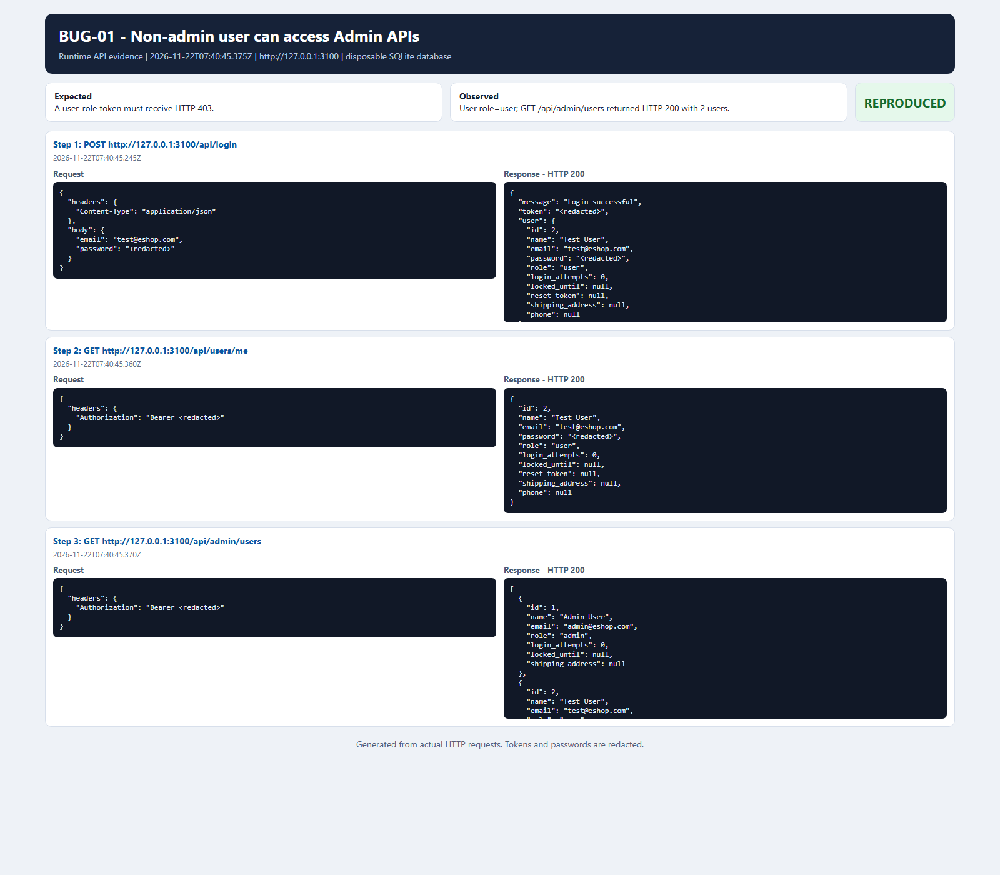
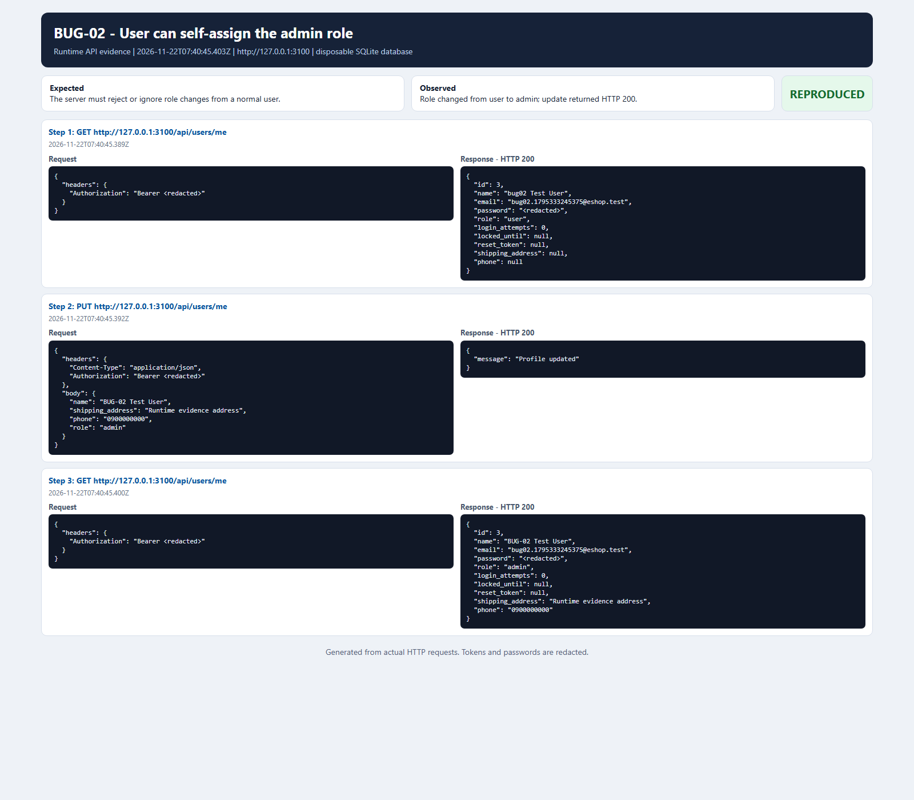
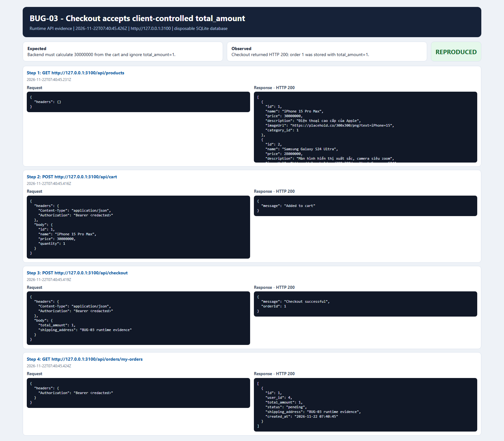
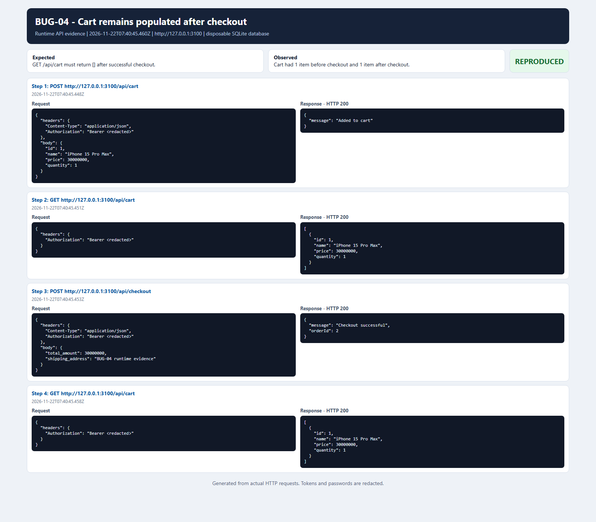
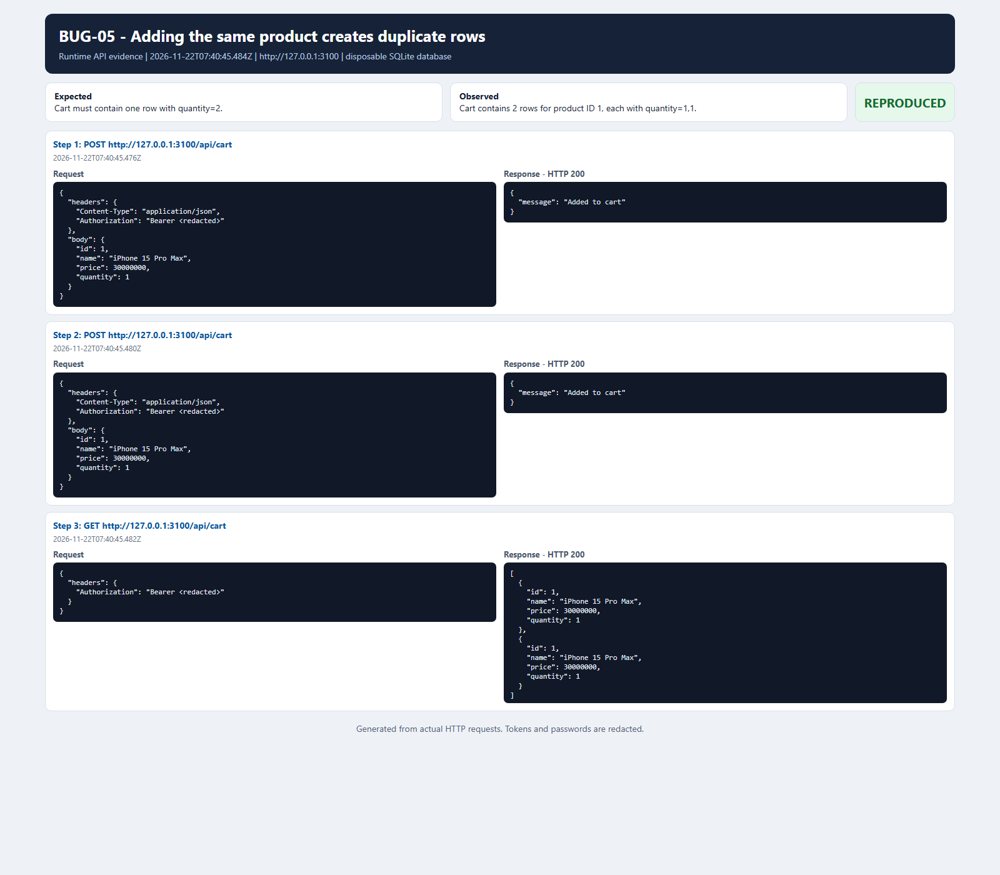
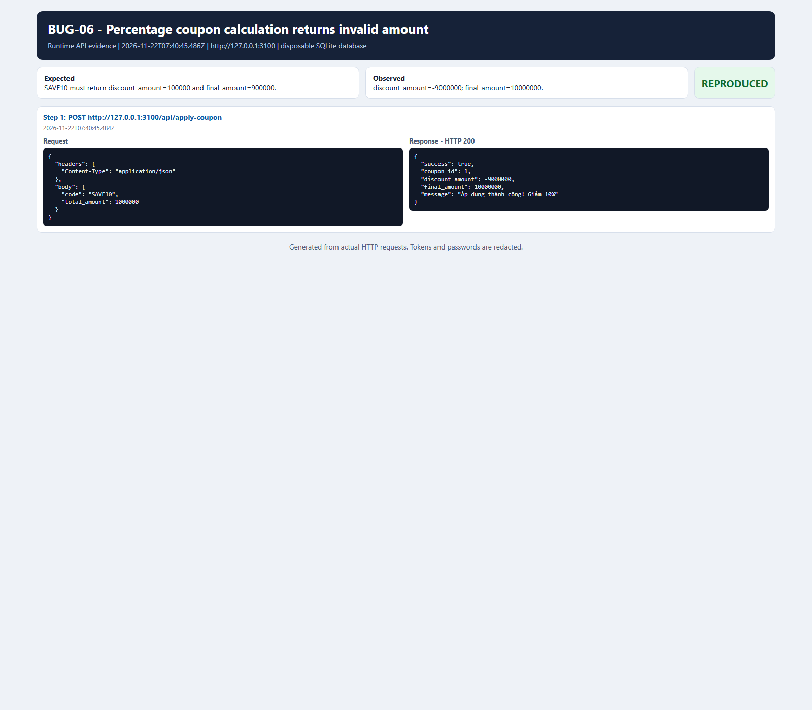
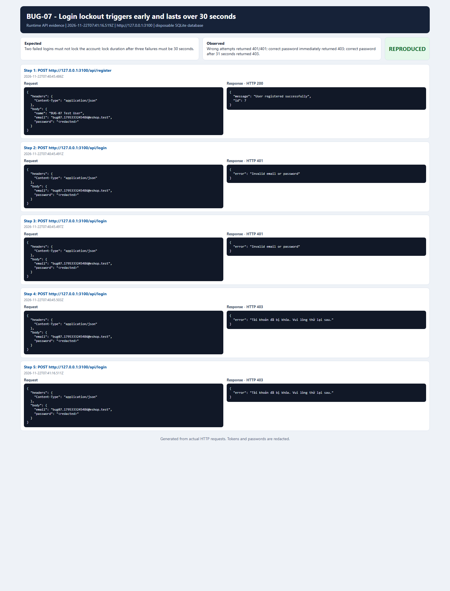

# Nội dung GitHub Issues cho 7 bug của EShop

## Cách sử dụng

Mỗi mục dưới đây tương ứng với một GitHub Issue riêng. Bảy lỗi đã được tái hiện bằng HTTP request thật trên backend Node.js tạm chạy tại cổng `3100`, dùng bản sao SQLite riêng để không thay đổi dữ liệu dự án. Request/response, thời điểm chạy và ảnh chụp runtime được lưu kèm từng mục; token và password đã được che.

Môi trường chung:

| Thuộc tính | Giá trị |
|---|---|
| Repository | `Taylor3691/eshop-sut` |
| Branch | `DANH/HW5` |
| Backend | Node.js + Express + SQLite |
| Base URL khi tái hiện | `http://127.0.0.1:3100` (backend tạm, SQLite tách biệt) |
| OS | Windows 11 Home Single Language 64-bit |
| Hostname | `DESKTOP-PMBJKB5` |
| Test user | `test@eshop.com` / `Test1234!` |

Không đưa password hoặc JWT đầy đủ vào ảnh. Chỉ để lại vài ký tự đầu/cuối nếu cần chứng minh hai request dùng cùng token.

---

## BUG-01 - User thường truy cập được API quản trị

**Issue title**

```text
[HW05][BUG-01] Authenticated non-admin user can access Admin APIs
```

**Labels đề xuất:** `bug`, `security`, `authorization`, `critical`

### Mô tả

Tài khoản có role `user` có thể gọi API `/api/admin/users` và nhận dữ liệu quản trị. Theo FR-12 và SEC-03, mọi API `/api/admin/*` phải kiểm tra cả JWT hợp lệ và `role = admin`.

### Điều kiện trước

- Backend đang chạy.
- Tài khoản `test@eshop.com` có role `user`.

### Các bước tái hiện

1. Gửi `POST /api/login` bằng tài khoản user thường và lấy JWT.
2. Gửi `GET /api/users/me` bằng JWT đó để xác nhận `role` là `user`.
3. Gửi `GET /api/admin/users` với cùng JWT.

### Kết quả mong đợi

Server trả `403 Forbidden` và không trả danh sách người dùng.

### Kết quả thực tế

 `GET /api/users/me` xác nhận role là `user`, nhưng `GET /api/admin/users` vẫn trả **HTTP 200** và trả danh sách **2 user**.
### Bằng chứng


### Ảnh hưởng

User thường có thể đọc dữ liệu chỉ dành cho quản trị viên; các API admin khác dùng cùng middleware có thể cũng bị truy cập trái phép.

---

## BUG-02 - User có thể tự nâng role thành admin

**Issue title**

```text
[HW05][BUG-02] User can self-assign admin role through profile update
```

**Labels đề xuất:** `bug`, `security`, `privilege-escalation`, `critical`

### Mô tả

API cập nhật hồ sơ chấp nhận trường `role` do client gửi lên. Điều này vi phạm FR-04 và SEC-06 vì user chỉ được sửa hồ sơ của chính mình, không được tự thay đổi quyền.

### Các bước tái hiện

1. Đăng nhập bằng user thường và lấy JWT.
2. Gửi `GET /api/users/me`; lưu lại `name`, `shipping_address`, `phone` và role hiện tại.
3. Gửi `PUT /api/users/me` với các giá trị hồ sơ hiện tại và thêm `"role": "admin"`.
4. Gửi lại `GET /api/users/me`.

Payload mẫu:

```json
{
  "name": "Test User",
  "shipping_address": "Test address",
  "phone": "0900000000",
  "role": "admin"
}
```

### Kết quả mong đợi

Server từ chối trường `role` bằng `400/403`, hoặc bỏ qua trường này; role vẫn là `user`.

### Kết quả thực tế

 `PUT /api/users/me` với `"role": "admin"` trả **HTTP 200** (`Profile updated`). Lần `GET /api/users/me` tiếp theo trả `"role": "admin"`.

### Bằng chứng


### Ảnh hưởng

Lỗ hổng privilege escalation cho phép user thường tự cấp quyền quản trị.

---

## BUG-03 - Checkout tin cậy total_amount do client gửi

**Issue title**

```text
[HW05][BUG-03] Checkout accepts client-controlled total_amount
```

**Labels đề xuất:** `bug`, `security`, `business-logic`, `high`

### Mô tả

Backend lưu trực tiếp `total_amount` từ request checkout thay vì tự tính lại từ cart. Hành vi này vi phạm FR-08 và cho phép người dùng tạo đơn với giá tùy ý.

### Các bước tái hiện

1. Đăng nhập và lấy JWT.
2. Gọi `GET /api/products`, chọn sản phẩm có giá lớn hơn 1.
3. Gửi `POST /api/cart` để thêm sản phẩm vào giỏ.
4. Gửi `POST /api/checkout` với `total_amount: 1`.
5. Gửi `GET /api/orders/my-orders` và tìm `orderId` vừa tạo.

Payload checkout mẫu:

```json
{
  "total_amount": 1,
  "shipping_address": "23120117 HW05 test address"
}
```

### Kết quả mong đợi

Backend bỏ qua giá client và tự tính tổng đúng từ sản phẩm trong cart.

### Kết quả thực tế

Sau khi thêm iPhone 15 Pro Max giá `30000000` vào cart, `POST /api/checkout` với `total_amount: 1` trả **HTTP 200** và `orderId: 1`. `GET /api/orders/my-orders` trả đơn này với `total_amount: 1`.

### Bằng chứng


### Ảnh hưởng

Người dùng có thể tạo đơn hàng với giá thấp tùy ý, gây thất thoát doanh thu.

---

## BUG-04 - Giỏ hàng không được xóa sau checkout

**Issue title**

```text
[HW05][BUG-04] Cart remains populated after successful checkout
```

**Labels đề xuất:** `bug`, `checkout`, `cart`, `high`

### Mô tả

Sau khi checkout thành công, các item cũ vẫn còn trong cart. FR-08 yêu cầu giỏ hàng phải được xóa sau thanh toán.

### Các bước tái hiện

1. Đăng nhập và thêm một sản phẩm vào cart.
2. Gửi `GET /api/cart` và ghi nhận item trước checkout.
3. Gửi `POST /api/checkout` với dữ liệu hợp lệ.
4. Sau khi nhận response thành công, gửi lại `GET /api/cart`.

### Kết quả mong đợi

Response cart sau checkout là mảng rỗng `[]`.

### Kết quả thực tế

Cart có **1 item** trước checkout; `POST /api/checkout` trả **HTTP 200**; lần `GET /api/cart` sau checkout vẫn trả **1 item**.

### Bằng chứng


### Ảnh hưởng

Người dùng có thể vô tình checkout lại sản phẩm cũ; cart tích lũy làm sai hành vi nghiệp vụ và workload hiệu năng.

---

## BUG-05 - Thêm cùng sản phẩm tạo dòng trùng

**Issue title**

```text
[HW05][BUG-05] Adding the same product creates duplicate cart rows
```

**Labels đề xuất:** `bug`, `cart`, `medium`

### Mô tả

Khi thêm cùng một product hai lần, backend tạo hai dòng riêng thay vì tăng quantity của dòng đã có. Hành vi này vi phạm FR-07.

### Các bước tái hiện

1. Đăng nhập và lấy JWT.
2. Chọn một product từ `GET /api/products`.
3. Gửi hai lần `POST /api/cart` với cùng product ID và quantity 1.
4. Gửi `GET /api/cart`.

### Kết quả mong đợi

Cart có một dòng cho product đó với `quantity = 2`.

### Kết quả thực tế

Hai request thêm cùng product ID `1` đều trả **HTTP 200**. `GET /api/cart` trả **2 dòng** cùng product ID `1`, mỗi dòng có `quantity: 1`.

### Bằng chứng


### Ảnh hưởng

Cart hiển thị sai cấu trúc, gây nhầm lẫn số lượng và có thể làm sai tổng tiền hoặc checkout.

---

## BUG-06 - Coupon phần trăm tính sai số tiền giảm

**Issue title**

```text
[HW05][BUG-06] Percentage coupon calculation returns an invalid final amount
```

**Labels đề xuất:** `bug`, `coupon`, `business-logic`, `high`

### Mô tả

Coupon `SAVE10` có giá trị giảm 10%, nhưng API áp dụng công thức sai, làm `discount_amount` âm và `final_amount` lớn hơn tổng ban đầu.

### Các bước tái hiện

1. Gửi `POST /api/apply-coupon` với payload bên dưới.
2. Kiểm tra `discount_amount` và `final_amount`.

```json
{
  "code": "SAVE10",
  "total_amount": 1000000
}
```

### Kết quả mong đợi

```json
{
  "discount_amount": 100000,
  "final_amount": 900000
}
```

### Kết quả thực tế

`POST /api/apply-coupon` với `SAVE10` và `total_amount: 1000000` trả **HTTP 200** với `discount_amount: -9000000` và `final_amount: 10000000`.

### Bằng chứng


### Ảnh hưởng

Mọi coupon loại percent có thể làm số tiền cuối sai nghiêm trọng, ảnh hưởng trực tiếp đến thanh toán.

---

## BUG-07 - Login lockout tăng sai bộ đếm và khóa quá lâu

**Issue title**

```text
[HW05][BUG-07] Login lockout counts two attempts per failure and locks for 180 seconds
```

**Labels đề xuất:** `bug`, `authentication`, `security`, `high`

### Mô tả

FR-02 yêu cầu tăng bộ đếm đúng một lần cho mỗi login sai, khóa sau ba lần sai và thời gian khóa là 30 giây. Backend hiện có dấu hiệu khóa sau lần sai thứ hai và giữ khóa khoảng 180 giây.

### Điều kiện trước

- Dùng một account test chưa bị khóa.
- Ghi lại thời gian hệ thống trong ảnh.

### Các bước tái hiện

1. Gửi login sai lần 1.
2. Gửi login sai lần 2.
3. Ngay sau đó gửi login bằng password đúng.
4. Sau 30-40 giây, thử lại password đúng.
5. Nếu vẫn bị khóa, ghi lại thời điểm mở khóa thực tế; không cần chờ đủ nếu đã có database evidence về `locked_until`.

### Kết quả mong đợi

- Sau hai lần sai, login đúng vẫn thành công.
- Chỉ lần sai thứ ba mới khóa account.
- Account được mở sau khoảng 30 giây.

### Kết quả thực tế

Hai lần login sai lần lượt trả **HTTP 401**. Login bằng password đúng ngay sau lần sai thứ hai trả **HTTP 403**. Sau khi chờ **31 giây**, login đúng vẫn trả **HTTP 403**. Như vậy account bị khóa sớm hơn lần sai thứ ba và thời gian khóa vượt 30 giây.

### Bằng chứng


### Ảnh hưởng

User hợp lệ bị khóa sớm và lâu hơn yêu cầu; các bài load test dùng credential sai cũng có thể bị nhiễu kết quả.

---
