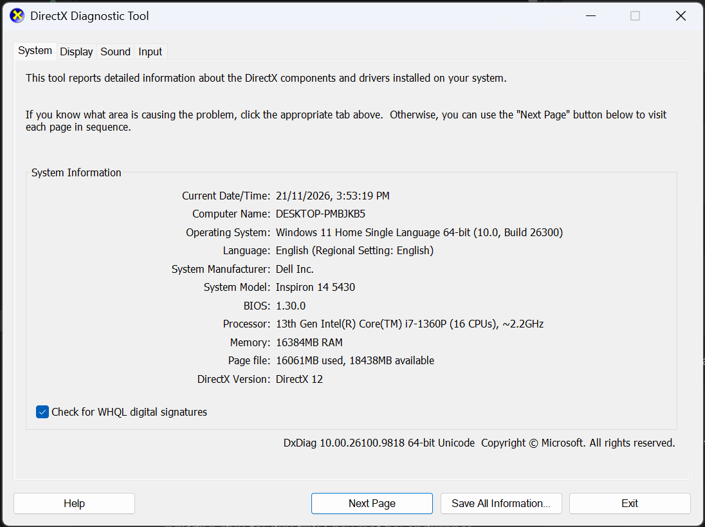
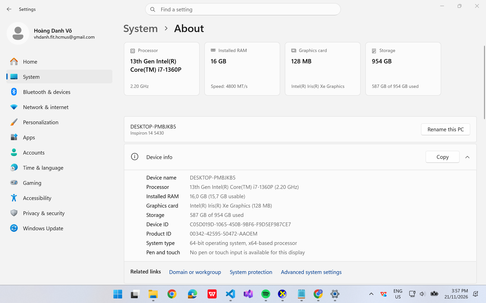
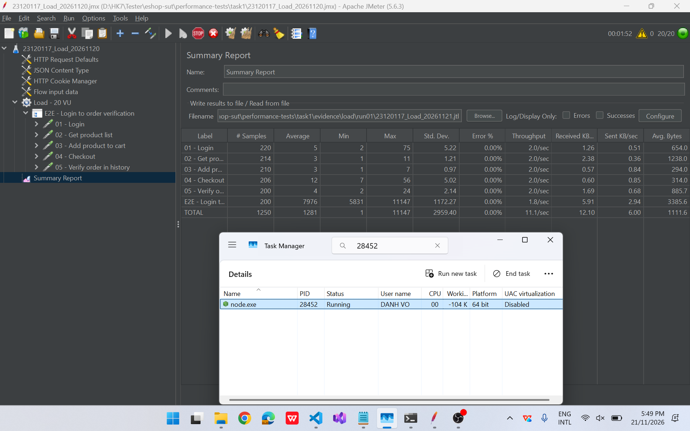
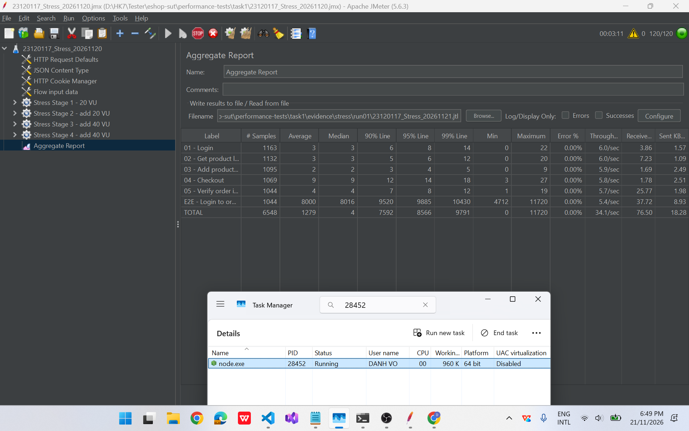
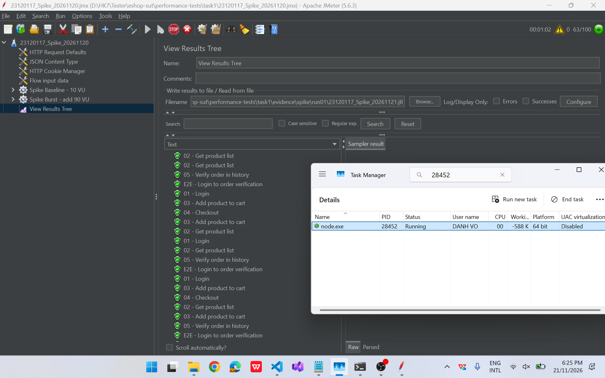
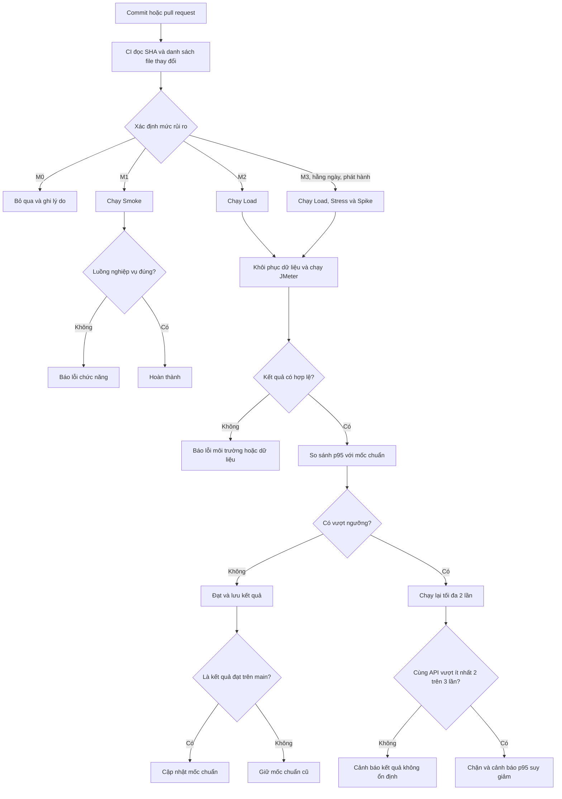

# Báo cáo kiểm thử hiệu năng EShop - HW05

## 1. Thông tin bài nộp

| Thuộc tính | Giá trị |
|---|---|
| Student ID | `23120117` |
| Bài tập | HW05 - AI Performance Testing |
| Điểm tự đánh giá | `100/100` |
| Công cụ tải | Apache JMeter 5.6.3 |
| SUT | EShop Backend API - Node.js, Express, SQLite |
| Public repository | <https://github.com/Taylor3691/eshop-sut> |
| Môi trường | Windows 11, backend và JMeter chạy trên localhost |

## 2. Tóm tắt điều hành

Báo cáo này hợp nhất toàn bộ kết quả của Task 1, Task 2 và Task 3. Task 1 thiết kế và thực thi ba kế hoạch Load, Stress, Spike trên cùng luồng end-to-end; thực hiện human review, thu raw JTL, HTML Dashboard, ảnh JMeter/Task Manager, bằng chứng phần cứng và bài Endurance. Task 2 phân tích trực tiếp raw JTL, tìm các diễn giải sai của AI và đánh giá tính khả thi của các đề xuất tối ưu. Task 3 đề xuất mô hình continuous performance testing dựa trên rủi ro commit và phát hiện p95 regression.

Ba kế hoạch chính đều chạy luồng:

```text
POST /api/login
-> GET /api/products
-> POST /api/cart
-> POST /api/checkout
-> GET /api/orders/my-orders
```

Luồng bao phủ auth-heavy, read-heavy và transactional. Toàn bộ HTTP sample của Load, Stress và Spike trả mã 200, không có assertion failure. Bài Endurance xác minh mức ổn định 120 VU trong 10 phút hold với 74,38 HTTP RPS, p95 11 ms và Working Set cao nhất 87,97 MB. Đây là mức cao nhất đã được xác minh trên máy thử nghiệm, không phải giới hạn tuyệt đối của SUT.

## 3. Mục lục nội dung

1. Task 1 - Thiết kế, thực thi, human review, Endurance và report issues.
2. Task 2 - Phân tích raw JTL, misinterpretation hunt và đánh giá optimization.
3. Task 3 - Continuous Performance Testing proposal.
4. AI Critique và kết luận chung.

## 4. Minh chứng ảnh chụp

Các ảnh thực tế nằm tại `performance-tests/task1/evidence/screenshots/` và được nhúng trực tiếp dưới đây.

### 4.1. Cấu hình phần cứng - DxDiag



Ảnh DxDiag ghi nhận hostname `DESKTOP-PMBJKB5`, Dell Inspiron 14 5430, Windows 11 Home Single Language 64-bit, Intel Core i7-1360P và RAM 16 GB.

### 4.2. Cấu hình phần cứng - Windows System About



Ảnh System About bổ sung CPU Intel Core i7-1360P 2,20 GHz, RAM 16 GB 4800 MT/s, Intel Iris Xe Graphics và storage 954 GB.

### 4.3. Load test - 20 VU



Ảnh cho thấy kế hoạch `23120117_Load_20261120`, Summary Report, trạng thái 20/20 threads và Task Manager lọc đúng tiến trình `node.exe` PID 28452 trong cùng khung hình.

### 4.4. Stress test - 120 VU



Ảnh cho thấy bốn stage của Stress plan, Aggregate Report, trạng thái 120/120 threads và tiến trình backend PID 28452.

### 4.5. Spike test - 100 VU



Ảnh cho thấy baseline 10 VU, burst thêm 90 VU, View Results Tree và Task Manager theo dõi backend PID 28452 trong giai đoạn burst.

### 4.6. Bảng tóm tắt kết quả thực thi

| Scenario | VU mục tiêu cao nhất | Thời lượng thực tế | HTTP samples | HTTP p95 | E2E p95 | Error rate |
|---|---:|---:|---:|---:|---:|---:|
| Load | 20 | 359,92 giây | 4.151 | 13 ms | 9.938 ms | 0,00% |
| Stress | 120 | 299,99 giây | 13.538 | 12 ms | 9.893 ms | 0,00% |
| Spike | 100 | 179,42 giây | 4.233 | 14 ms | 10.034 ms | 0,00% |
| Endurance stable hold | 120 | 600 giây hold | 44.623 | 11 ms | 10.003 ms | 0,00% |

Lưu ý: E2E elapsed bao gồm think-time 1-3 giây giữa các bước nên không được dùng như latency của một HTTP endpoint. Spike screenshot thể hiện View Results Tree trong lần quan sát GUI; listener này có thể tạo overhead và nên được tắt trong lần chạy non-GUI dùng để benchmark chính thức.

---

# TASK 1 - AI-ASSISTED TEST DESIGN AND EXECUTION

Phần Task 1 dưới đây tích hợp nguyên nội dung báo cáo thiết kế, human review, Endurance threshold, report issues và hướng dẫn thực thi Endurance. Các test plans, CSV, raw JTL và HTML Dashboard vẫn được đính kèm trong `performance-tests/task1/`.

### Task 1.1 – AI-assisted test design

#### Thông tin chung

- Student ID: `23120117`
- Ngày thiết kế: `2026-11-20`
- Công cụ: Apache JMeter, chỉ dùng component chuẩn
- Base URL mặc định: `http://localhost:3000`

#### Flow đầu vào

```text
Đăng nhập
→ Lấy danh sách sản phẩm
→ Thêm sản phẩm vào giỏ
→ Thanh toán
→ Kiểm tra đơn hàng
```

Cả ba test plan Load, Stress và Spike sử dụng đúng flow này. Chúng chỉ khác workload profile.

#### Endpoint và coverage

| Bước | Request | Authentication | Nhóm endpoint | Kiểm tra chính |
|---|---|---|---|---|
| Đăng nhập | `POST /api/login` | Không | auth-heavy | HTTP 200 và response có JWT `token` |
| Lấy danh sách sản phẩm | `GET /api/products` | Không | read-heavy | HTTP 200, JSON array và tìm thấy `product_id` từ CSV |
| Thêm sản phẩm vào giỏ | `POST /api/cart` | Bearer JWT | transactional | HTTP 200 và có thông báo `Added to cart` |
| Thanh toán | `POST /api/checkout` | Bearer JWT | transactional | HTTP 200 và response có `orderId` |
| Kiểm tra đơn hàng | `GET /api/orders/my-orders` | Bearer JWT | read-heavy | Tìm thấy `orderId` vừa tạo với trạng thái `pending` |

Flow đáp ứng đủ ba nhóm: đăng nhập bao phủ auth-heavy; đọc danh sách sản phẩm và lịch sử đơn bao phủ read-heavy; thêm giỏ và tạo đơn bao phủ transactional.

#### Correlation và dữ liệu

1. Login extract `$.token` thành `${token}`.
2. Các request được bảo vệ gửi `Authorization: Bearer ${token}`.
3. `GET /api/products` tìm sản phẩm có ID bằng `${product_id}`, sau đó lưu `product_name` và `product_price`.
4. Cart payload được tạo từ product vừa tìm cùng `${quantity}`.
5. Checkout payload tính `total_amount = product_price × quantity` và dùng `${shipping_address}`.
6. Checkout extract `$.orderId` thành `${order_id}`.
7. Lịch sử đơn phải chứa đúng `${order_id}` ở trạng thái `pending`.

File `flow-data.csv` cung cấp các cột:

```text
user_index,name,email,password,product_id,quantity,shipping_address
```

CSV có 240 dòng dữ liệu, gấp đôi peak 120 VU của Stress test. Các product ID luân phiên từ 1 đến 5, quantity từ 1 đến 3 và mỗi account có địa chỉ riêng. Tài khoản `perfuser001@eshop.test` đến `perfuser240@eshop.test` cần được đăng ký trước bằng `seed-test-users.ps1` khi backend đang chạy.

JMeter dùng `CSV Data Set Config` với:

- encoding `UTF-8`;
- header được khai báo tường minh;
- `quotedData=true` để đọc đúng địa chỉ có dấu phẩy;
- `shareMode.all` để các Thread Group Stress/Spike cùng dùng một data pool;
- `recycle=true` để bài kiểm thử theo duration không dừng khi đọc hết file.

Có thể thay file lúc chạy mà không sửa `.jmx`:

```powershell
jmeter -n -t <plan.jmx> -JdataFile=<path-to-csv> -l <result.jtl>
```

#### Workload profile

| Plan | VU/Thread | Ramp/shape | Tổng thời gian | Think-time |
|---|---:|---|---:|---:|
| Load | 20 | Ramp đều trong 60 giây, giữ mức 20 VU thêm 300 giây | 360 giây | Ngẫu nhiên 1–3 giây trước mỗi bước sau login |
| Stress | 20 → 40 → 80 → 120 | Bốn Thread Group chuẩn bắt đầu tại giây 0, 60, 120 và 180 | 300 giây | Ngẫu nhiên 1–3 giây |
| Spike | Baseline 10, spike thêm 90 | Baseline ramp 30 giây; burst bắt đầu ở giây 60 và ramp trong 5 giây | 180 giây | Ngẫu nhiên 1–3 giây |

Các con số trên là điểm bắt đầu thận trọng khi chưa có baseline hoặc giới hạn phần cứng. Chúng chưa phải ngưỡng hiệu năng đã được chứng minh.

#### Lý do lựa chọn

- Load mô phỏng tải bình thường đủ lâu để quan sát độ trễ ổn định.
- Stress tăng đến 120 VU theo các mốc để quan sát thời điểm latency/error rate suy giảm.
- Spike tạo bước nhảy từ khoảng 10 lên 100 VU, sau đó còn 60 giây baseline để quan sát phục hồi.
- Think-time 1–3 giây tránh tạo request liên tục phi thực tế nhưng vẫn đủ tải cho máy cá nhân.

#### Sai lệch và rủi ro cần con người rà soát

1. README yêu cầu login sai tăng bộ đếm 1 và khóa 30 giây; implementation hiện tăng 2 và khóa 180 giây. Plans dùng credential đúng nhưng vẫn cần kiểm tra tài khoản không bị khóa trước khi chạy.
2. README yêu cầu backend tự tính tổng tiền và xóa giỏ sau checkout. Implementation hiện nhận `total_amount` từ client và không xóa `userCarts`. Đây là sai lệch chức năng có thể ảnh hưởng kết quả khi lặp nhiều iteration.
3. Giỏ hàng được giữ trong bộ nhớ và được khóa theo `userId`. Nhiều VU dùng chung một account sẽ làm giỏ hàng giao thoa.
4. SQLite sẽ tích lũy một order cho mỗi iteration; kích thước bảng orders tăng dần có thể ảnh hưởng Stress/Spike.
5. Cần chạy `seed-test-users.ps1` một lần trước test để tạo các account trong CSV. Script không được chạy trong workload đo hiệu năng.
6. `recycle=true` cho phép tái sử dụng account sau khi hết 240 dòng. Nếu iteration quá nhanh, một account có thể được cấp lại khi request cũ chưa hoàn tất; cần quan sát khi smoke test.
7. Ba plan chưa có listener/report view vì đây là yêu cầu Task 1.3, nằm ngoài phạm vi skill này.
8. Chưa có số liệu đo thực tế. Cần smoke test 1–2 VU và human review trước lần chạy chính thức.

Chi tiết phản biện và các sửa đổi được ghi trong `task1-human-review.md`.

#### Các pha AI đã thực hiện

1. Kiểm chứng flow và xác nhận coverage ba nhóm endpoint.
2. Đối chiếu `backend/server.js`, `api_specification.md`, `README.md` và `HW5.md`.
3. Thiết kế correlation cho JWT, product và order ID.
4. Chọn workload khởi điểm cho Load, Stress và Spike.
5. Sinh ba JMeter plan và kiểm tra cấu trúc XML, sampler sequence, biến và endpoint.
6. Chuyển credential, product ID, quantity và shipping address sang CSV data pool dùng chung.

Phần này hỗ trợ ghi nhận quá trình thiết kế, nhưng không thay thế AI Audit Report bắt buộc của bài tập.

### Task 1.5 – Human review and fixes

#### Phạm vi rà soát

Các file được AI tạo đã được đối chiếu với flow, route thực tế trong `backend/server.js`, dữ liệu CSV và cấu hình JMeter. Phần này ghi nhận lỗi/thiếu sót của AI, nguyên nhân và cách sửa. Các mức tải vẫn cần hiệu chỉnh sau smoke test vì chưa có kết quả thực nghiệm trên phần cứng thật.

#### Kết quả rà soát

| STT | Điểm AI làm sai hoặc bỏ sót | Ảnh hưởng | Nguyên nhân có thể | Cách sửa | Trạng thái |
|---:|---|---|---|---|---|
| 1 | Thread Group dùng `on_sample_error=continue` | Nếu login không lấy được JWT, các request cart/checkout/order tiếp tục chạy và tạo nhiều lỗi 401/403 dây chuyền; error rate không còn phản ánh lỗi gốc | AI tập trung tạo đủ sampler nhưng chưa xem xét quan hệ phụ thuộc giữa các bước | Đổi thành `startnextloop` trong mọi Thread Group. Khi một bước thất bại, VU bỏ phần còn lại của iteration và bắt đầu flow mới | Đã sửa |
| 2 | Generator ban đầu không sinh Listener | Chạy lại `generate-task1-plans.ps1` sẽ ghi đè ba Listener được thêm thủ công | Listener thuộc yêu cầu Task 1.3, trong khi skill ban đầu chỉ giới hạn ở Task 1.1 | Generator hiện sinh `Summary Report`, `Aggregate Report`, `View Results Tree` đúng từng plan | Đã sửa |
| 3 | `View Results Tree` được bật trong Spike 100 VU | Listener lưu chi tiết sample/response trong RAM của load generator, có thể làm tăng memory và làm sai số liệu Spike | AI ưu tiên đáp ứng “ba report view” nhưng chưa tách chế độ debug khỏi lần chạy chính thức | Giữ Listener trong plan nhưng đặt `enabled=false`. Chỉ bật khi smoke test 1–2 VU hoặc nạp `.jtl` sau khi chạy | Đã sửa |
| 4 | Các mức 20/120/100 VU được chọn khi chưa có baseline phần cứng | Mức tải có thể quá thấp hoặc quá cao trên máy thực tế | Không có CPU, RAM, baseline RPS hoặc SLA trong prompt | Giữ đây là workload khởi điểm, không gọi là ngưỡng chính thức. Sau smoke/baseline test phải hiệu chỉnh VU và ramp-up | Chờ kết quả chạy |
| 5 | CSV ban đầu chỉ có một account | Nhiều VU dùng chung giỏ hàng; dữ liệu giao thoa và kết quả transactional thiếu tin cậy | AI tạo schema mẫu trước khi biết peak concurrency | CSV đã mở rộng thành 240 account, product ID 1–5, quantity 1–3; thêm script seed account | Đã sửa |
| 6 | CSV dùng `recycle=true` | Sau khi dùng hết 240 dòng, account được tái sử dụng; iteration quá nhanh vẫn có khả năng trùng account | Test chạy theo duration cần dữ liệu liên tục, trong khi CSV hữu hạn | Dùng pool gấp đôi peak VU và ghi rõ rủi ro. Cần kiểm tra collision trong smoke test; tăng pool nếu cần | Giảm thiểu, cần quan sát |
| 7 | Flow lặp thêm item nhưng implementation không xóa cart sau checkout | Cart trong bộ nhớ tăng dần, làm workload thay đổi theo thời gian và có thể giống memory leak | README và implementation không khớp; AI ban đầu thiết kế theo flow mong đợi | Ghi nhận đây là sai lệch SUT, không tự sửa backend vì ngoài phạm vi test plan. Báo cáo như bug nếu tái hiện khi chạy | Không thể sửa trong plan |
| 8 | Implementation nhận `total_amount` từ client | Flow không kiểm tra yêu cầu “backend tự tính lại tổng tiền” trong README | Performance happy-path không phải test chức năng tampering | Giữ payload theo API thực tế để performance plan chạy được; tạo test chức năng/báo bug riêng nếu cần | Ngoài phạm vi performance plan |
| 9 | Account lockout chưa có guard riêng | Credential sai lặp lại có thể kích hoạt khóa tài khoản, đặc biệt implementation tăng attempts sai | Prompt không cung cấp trạng thái account và AI giả định dữ liệu đăng nhập hợp lệ | Dùng account test riêng, seed trước khi chạy, smoke test 1–2 VU và dừng nếu login lỗi. Ghi lại/reset lockout nếu bị kích hoạt | Quy trình vận hành |

#### Đánh giá tham số sau rà soát

| Plan | Tham số hiện tại | Đánh giá của con người |
|---|---|---|
| Load | 20 VU, ramp 60 giây, tổng 360 giây | Hợp lý làm baseline đầu tiên; chưa được xem là tải sản xuất |
| Stress | 20 → 40 → 80 → 120 VU, tổng 300 giây | Có các bậc tải rõ và dùng component JMeter chuẩn; cần quan sát CPU/error rate để quyết định có tăng hoặc giảm stage |
| Spike | Baseline 10 VU, thêm 90 VU trong 5 giây, burst 60 giây, recovery 60 giây | Đúng hình dạng spike; View Results Tree phải tắt trong lần chạy chính thức |
| Think-time | Random 1–3 giây trước các bước sau login | Hợp lý cho hành vi duyệt/mua đơn giản và được giữ giống nhau giữa ba plan để so sánh |

#### Assertions và correlation

Các kiểm tra sau được giữ lại vì đủ mạnh cho flow:

1. Login phải trả HTTP 200 và có JWT.
2. Danh sách sản phẩm phải là JSON array và chứa `product_id` từ CSV.
3. Add-to-cart phải trả HTTP 200 và thông báo xác nhận.
4. Checkout phải trả HTTP 200 và có `orderId`.
5. Order history phải chứa đúng `orderId` vừa tạo với trạng thái `pending`.

JWT, product information và `orderId` được extract trước khi sử dụng. Sau thay đổi `startnextloop`, một assertion thất bại không còn tạo chuỗi request phụ thuộc sai.

#### Việc phải làm trước khi chạy chính thức

1. Seed 240 account bằng `seed-test-users.ps1`.
2. Chạy smoke test 1–2 VU và xác nhận toàn bộ assertion pass.
3. Kiểm tra không account nào bị lock.
4. Bật View Results Tree chỉ trong smoke test; tắt lại trước Spike chính thức.
5. Chạy non-GUI, xuất raw `.jtl` và HTML report.
6. Dựa trên CPU, RAM, p95 và error rate để hiệu chỉnh mức VU nếu workload hiện tại không phù hợp.

### Task 1.7 – Endurance Threshold Report

#### 1. Mục tiêu

Bài kiểm thử đánh giá khả năng duy trì tải của backend EShop trong 10 phút ở trạng thái ổn định. Mục tiêu là xác định mức tải và thông lượng cao nhất đã được xác minh trong lần chạy, đồng thời ghi nhận memory ceiling của tiến trình backend.

#### 2. Nguồn dữ liệu

Phân tích sử dụng hai nguồn dữ liệu thực thi:

1. `evidence/endurance/run01/23120117_Endurance_20261121.jtl`: raw HTTP samples và E2E Transaction Controller.
2. `evidence/endurance/run01/backend-resource.csv`: CPU, Working Set, Private Memory, thread và handle của backend PID 28452.

HTML Dashboard tại `evidence/endurance/run01/html/` được dùng để đối chiếu số sample và lỗi tổng thể.

#### 3. Cấu hình và phương pháp phân tích

| Thuộc tính | Giá trị |
|---|---:|
| Virtual users tối đa | 120 VU |
| Ramp-up | 120 giây |
| Stable hold | 600 giây |
| Tổng thời gian thực tế | 719,96 giây |
| Bắt đầu test | 21/11/2026 19:52:04,869 (UTC+7) |
| Kết thúc test | 21/11/2026 20:04:04,829 (UTC+7) |
| Stable window | 19:54:04,869–20:04:04,829 (UTC+7) |

Phương pháp xử lý:

- Ramp-up 0–120 giây không được dùng để kết luận stable RPS.
- Kết quả ổn định được tính trong khoảng 120–720 giây.
- Các dòng `E2E - Login to order verification` được tách khỏi HTTP RPS để tránh đếm thêm Transaction Controller như một HTTP request.
- Percentile trong phần phân tích stable window được tính trực tiếp từ `elapsed` trong JTL bằng nearest-rank.
- Resource CSV có 250 mẫu từ 19:51:56 đến 20:16:33. Chỉ 121 mẫu nằm trong thời gian test và 101 mẫu nằm trong stable window được sử dụng.
- Dấu phẩy thập phân trong resource CSV được chuẩn hóa trước khi tính toán.

#### 4. Kết quả tổng quan

##### 4.1. Toàn bộ lần chạy, gồm ramp-up

| Metric | HTTP requests | E2E workflows |
|---|---:|---:|
| Samples hoàn thành | 49.146 | 9.798 |
| Error count | 0 | 0 |
| Error rate | 0,00% | 0,00% |
| Throughput | 68,26 request/s | 13,61 workflow/s |
| Average | 4,18 ms | 8.056,42 ms |
| Median | 3 ms | 8.050 ms |
| p95 | 11 ms | 10.006 ms |
| p99 | 18 ms | 10.663 ms |
| Maximum | 184 ms | 11.584 ms |

##### 4.2. Stable hold 600 giây

| Metric | HTTP requests | E2E workflows |
|---|---:|---:|
| Samples hoàn thành | 44.623 | 8.832 |
| Error count | 0 | 0 |
| Error rate | 0,00% | 0,00% |
| Throughput | **74,38 request/s** | **14,72 workflow/s** |
| Average | 4,24 ms | 8.057,60 ms |
| Median | 3 ms | 8.051 ms |
| p90 | 8 ms | 9.564 ms |
| p95 | **11 ms** | 10.003 ms |
| p99 | 19 ms | 10.676 ms |
| Maximum | 184 ms | 11.584 ms |

E2E duration chứa think-time ngẫu nhiên 1–3 giây giữa các bước. Vì vậy p95 E2E khoảng 10 giây không phải p95 của một API riêng lẻ. HTTP latency phải được đọc từ HTTP requests hoặc từng endpoint.

#### 5. Kết quả từng endpoint trong stable hold

| Endpoint label | Samples | RPS | Average | p95 | p99 | Maximum | Error % |
|---|---:|---:|---:|---:|---:|---:|---:|
| 01 - Login | 8.922 | 14,87 | 2,77 ms | 7 ms | 13 ms | 67 ms | 0,00% |
| 02 - Get product list | 8.928 | 14,88 | 3,42 ms | 9 ms | 16 ms | 122 ms | 0,00% |
| 03 - Add product to cart | 8.928 | 14,88 | 1,93 ms | 4 ms | 5 ms | 30 ms | 0,00% |
| 04 - Checkout | 8.923 | 14,87 | 8,10 ms | 16 ms | 28 ms | 184 ms | 0,00% |
| 05 - Verify order in history | 8.922 | 14,87 | 5,00 ms | 11 ms | 19 ms | 107 ms | 0,00% |

Checkout là endpoint chậm nhất trong workflow nhưng p95 chỉ 16 ms và không có lỗi. Tất cả 44.623 HTTP responses trong stable window trả mã 200.

#### 6. Độ ổn định theo từng phút

| Stable window | HTTP RPS | p95 | Error % | CPU trung bình | CPU tối đa | Working Set tối đa |
|---|---:|---:|---:|---:|---:|---:|
| 120–180s | 74,42 | 10 ms | 0,00% | 0,98% | 3,00% | 84,48 MB |
| 180–240s | 74,37 | 11 ms | 0,00% | 0,96% | 2,31% | 85,46 MB |
| 240–300s | 74,45 | 9 ms | 0,00% | 1,06% | 2,69% | 85,73 MB |
| 300–360s | 74,05 | 10 ms | 0,00% | 0,75% | 2,62% | 85,82 MB |
| 360–420s | 73,77 | 9 ms | 0,00% | 0,40% | 1,44% | 86,94 MB |
| 420–480s | 75,28 | 9 ms | 0,00% | 1,44% | 3,94% | 87,97 MB |
| 480–540s | 74,50 | 9 ms | 0,00% | 0,59% | 1,94% | 86,27 MB |
| 540–600s | 74,55 | 9 ms | 0,00% | 0,51% | 3,38% | 86,77 MB |
| 600–660s | 74,33 | 16 ms | 0,00% | 0,93% | 2,25% | 87,32 MB |
| 660–720s | 74,05 | 14 ms | 0,00% | 1,14% | 2,94% | 86,60 MB |

Thông lượng dao động trong khoảng 73,77–75,28 RPS và không có xu hướng giảm liên tục. Nửa đầu stable hold đạt 74,21 RPS; nửa sau đạt 74,54 RPS, tăng 0,45%.

p95 tăng từ 10 ms ở nửa đầu lên 12 ms ở nửa sau, tương đương 20%. Hai phút cuối có p95 cao hơn, nhưng p95 giảm từ 16 ms xuống 14 ms ở phút cuối và throughput vẫn ổn định. Đây là điểm cần theo dõi trong lần chạy lặp lại, chưa phải bằng chứng suy giảm liên tục.

#### 7. Tài nguyên backend

| Metric trong stable hold | Giá trị |
|---|---:|
| Backend PID | 28452 |
| Resource samples | 101 |
| CPU trung bình | 0,87% |
| CPU p95 | 2,69% |
| CPU tối đa | 3,94% |
| Tỷ lệ mẫu CPU trên 90% | 0,00% |
| Working Set đầu hold | 83,32 MB |
| Working Set cuối hold | 86,60 MB |
| Working Set trung bình | 81,52 MB |
| **Working Set cao nhất** | **87,97 MB** |
| Working Set thay đổi đầu–cuối | +3,28 MB (+3,94%) |
| Xu hướng Working Set | +0,824 MB/phút |
| Private Memory đầu hold | 103,58 MB |
| Private Memory cuối hold | 105,98 MB |
| Private Memory cao nhất | 107,09 MB |
| Thread tối đa | 12 |
| Handle tối đa | 331 |

Working Set dao động theo từng phút thay vì tăng đơn điệu. Peak 87,97 MB xuất hiện ở phút 420–480; cuối bài còn 86,60 MB. Mức tăng đầu–cuối 3,94% trong 10 phút chưa cho thấy memory growth mất kiểm soát, nhưng một soak test dài hơn vẫn cần thiết để loại trừ memory leak chậm.

#### 8. Đánh giá theo tiêu chí ổn định

| Tiêu chí | Kết quả | Đánh giá |
|---|---:|---|
| Backend hoàn tất toàn bộ 720 giây | Có | Đạt |
| Error rate dưới 1% | 0,00% | Đạt |
| Không có chuỗi lỗi 5xx/timeout | 0 lỗi, tất cả HTTP 200 | Đạt |
| Throughput không giảm liên tục | Nửa sau +0,45% | Đạt |
| CPU không duy trì trên 90% | Peak 3,94% | Đạt |
| Memory không tăng không giới hạn | +3,94%, có dao động/giải phóng | Đạt trong phạm vi 10 phút |
| p95 không tăng trên 20% | Tăng đúng 20% giữa hai nửa | Đạt sát ngưỡng, cần theo dõi |

#### 9. Endurance threshold

Lần chạy 120 VU thỏa các tiêu chí ổn định đã đặt ra. Kết quả xác minh:

```text
Maximum verified stable load: 120 VU
Maximum verified stable RPS: 74,38 HTTP requests/second
Verified workflow throughput: 14,72 completed workflows/second
Backend memory ceiling: 87,97 MB Working Set
Peak private memory: 107,09 MB
Average / peak backend CPU: 0,87% / 3,94%
HTTP p95 during stable hold: 11 ms
Error rate during stable hold: 0,00%
Evidence run: performance-tests/task1/evidence/endurance/run01/
```

**Kết luận:** trên phần cứng và dữ liệu của lần chạy này, backend duy trì ổn định 120 VU trong 10 phút hold với khoảng 74,38 HTTP RPS. Vì chưa thực hiện soak test ở mức cao hơn, 74,38 RPS phải được mô tả là **maximum verified stable RPS**, không phải giới hạn tuyệt đối của hệ thống.

#### 10. Hạn chế và việc cần bổ sung

1. Thời gian hold 10 phút đáp ứng phạm vi bài tập nhưng chưa đủ dài để loại trừ memory leak chậm.
2. p95 của nửa sau cao hơn 20% so với nửa đầu. Throughput và error rate vẫn ổn định, nhưng nên chạy lặp lại để kiểm tra khả năng tái lập.
3. Resource collection dùng WMI/CIM nên chu kỳ thực tế gần 6 giây thay vì đúng 5 giây; vẫn bao phủ toàn bộ stable window.
4. Load generator và backend cùng chạy trên localhost. Kết quả phản ánh phần cứng hiện tại, không đại diện cho môi trường mạng/production.
5. Flow dùng CSV recycle và backend có hành vi tích lũy cart đã được ghi nhận trong human review; điều này có thể ảnh hưởng memory khi chạy lâu hơn.
6. Task 1.7 không yêu cầu riêng một ảnh Endurance có JMeter và Task Manager trong cùng khung hình. Có thể bổ sung ảnh này như bằng chứng hỗ trợ; số liệu tài nguyên của lần chạy hiện được lưu trong `backend-resource.csv`.

### Task 1.9 – Report Issues

#### 1. Phạm vi kiểm tra

Các nguồn đã được đối chiếu:

- Raw JTL của Load, Spike, Stress và Endurance.
- `README.md` và các yêu cầu FR/SEC của SUT.
- `backend/server.js` và `backend/database.js`.
- `task1-human-review.md`.

Bảy phát hiện từ source code đã được tái hiện bằng HTTP request thật trên backend Node.js tạm tại cổng `3100`, dùng bản sao SQLite tách biệt để không thay đổi dữ liệu dự án. Ảnh request/response, timestamp và trạng thái thực tế đã được lưu; JWT và password được che. Việc tạo GitHub Issue trên repository vẫn chờ người nộp thực hiện.

#### 2. Kiểm tra performance issues từ raw JTL

| Scenario | Max VU | Duration | HTTP samples | Error % | HTTP p95 | HTTP p99 | HTTP max |
|---|---:|---:|---:|---:|---:|---:|---:|
| Load | 20 | 359,92 giây | 4.151 | 0,00% | 13 ms | 17 ms | 75 ms |
| Spike | 100 | 179,42 giây | 4.233 | 0,00% | 14 ms | 21 ms | 44 ms |
| Stress | 120 | 299,99 giây | 13.538 | 0,00% | 12 ms | 19 ms | 58 ms |
| Endurance | 120 | 719,96 giây | 49.146 | 0,00% | 11 ms | 18 ms | 184 ms |

##### Kết luận performance

Không có bằng chứng đủ mạnh để mở performance issue từ bốn raw logs:

- Không có HTTP error hoặc assertion failure.
- Không xuất hiện response code khác 200.
- HTTP p95 vẫn thấp ở tất cả scenario.
- Endurance giữ stable throughput khoảng 74,38 HTTP RPS trong 10 phút hold.
- CPU và Working Set trong Endurance không cho thấy saturation hoặc tăng không kiểm soát.

E2E Transaction Controller có p95 khoảng 10 giây vì chứa think-time 1–3 giây giữa các bước. Không được báo p95 E2E này như một lỗi API latency.

#### 3. Runtime-confirmed issues

| ID | Tiêu đề | Loại | Mức độ | Trạng thái |
|---|---|---|---|---|
| ISSUE-01 | API Admin không kiểm tra role admin | Security/Authorization | Critical | Runtime-confirmed; screenshot attached |
| ISSUE-02 | User có thể tự đổi role thành admin | Security/Privilege escalation | Critical | Runtime-confirmed; screenshot attached |
| ISSUE-03 | Checkout tin cậy total_amount từ client | Functional/Security | High | Runtime-confirmed; screenshot attached |
| ISSUE-04 | Giỏ hàng không được xóa sau checkout | Functional | High | Runtime-confirmed; screenshot attached |
| ISSUE-05 | Thêm cùng sản phẩm tạo dòng trùng thay vì tăng quantity | Functional | Medium | Runtime-confirmed; screenshot attached |
| ISSUE-06 | Công thức coupon phần trăm tạo số tiền sai | Functional | High | Runtime-confirmed; screenshot attached |
| ISSUE-07 | Login lockout tăng sai bộ đếm và khóa sai thời gian | Functional/Security | High | Runtime-confirmed; screenshot attached |

#### 4. GitHub Issue drafts

##### ISSUE-01 – Authenticated non-admin user can access Admin APIs

**Severity:** Critical  
**Requirement:** FR-12, SEC-03.

**Source evidence:**

- README yêu cầu mọi `/api/admin/*` phải kiểm tra JWT và `role = 'admin'`.
- Các route `/api/admin/users`, `/api/admin/orders`, xóa user, cập nhật order và CRUD coupon chỉ gọi `authenticateToken`.
- `authenticateToken` chỉ verify JWT và không kiểm tra `req.user.role`.

**Steps to reproduce:**

1. Đăng nhập bằng tài khoản user thường và lấy JWT.
2. Gửi `GET /api/admin/users` với `Authorization: Bearer <user-token>`.
3. Gửi `GET /api/admin/orders` bằng cùng token.

**Expected:** Server trả 403 cho tài khoản không có role admin.  
**Kết quả thực tế:** `GET /api/users/me` xác nhận role `user`, nhưng `GET /api/admin/users` trả HTTP 200 và danh sách 2 user.

**Impact:** User thường có thể đọc dữ liệu người dùng/đơn hàng và gọi các API thay đổi dữ liệu admin.

**Evidence:**


**Screenshot Github Issue:**

---

##### ISSUE-02 – User can self-assign the admin role through profile update

**Severity:** Critical  
**Requirement:** SEC-06.

**Source evidence:**

`PUT /api/users/me` đọc trường `role` từ request body và thêm `role = ?` vào câu UPDATE nếu client gửi trường này.

**Steps to reproduce:**

1. Đăng nhập bằng user thường.
2. Gửi `PUT /api/users/me` với body chứa `"role": "admin"`.
3. Gọi lại `GET /api/users/me`.

**Expected:** Server bỏ qua hoặc từ chối trường `role`; role vẫn là `user`.  
**Kết quả thực tế:** `PUT /api/users/me` chứa `"role": "admin"` trả HTTP 200; `GET /api/users/me` sau đó trả role `admin`.

**Impact:** Privilege escalation từ user thường thành admin.

**Evidence:**


**Screenshot Github Issue:**

---

##### ISSUE-03 – Checkout accepts client-controlled total_amount

**Severity:** High  
**Requirement:** FR-08.

**Source evidence:**

README yêu cầu backend tự tính tổng từ cart và không chấp nhận `total_amount` từ client. Route `/api/checkout` lại lấy trực tiếp `total_amount` từ `req.body` và ghi vào bảng orders.

**Steps to reproduce:**

1. Đăng nhập và thêm sản phẩm có giá lớn hơn 1 vào cart.
2. Gửi `POST /api/checkout` với `"total_amount": 1`.
3. Gọi order history hoặc Admin Orders để kiểm tra đơn vừa tạo.

**Expected:** Backend tính lại tổng đúng từ cart và bỏ qua giá client.  
**Kết quả thực tế:** iPhone giá 30000000 được thêm vào cart; checkout với `total_amount: 1` trả HTTP 200, `orderId: 1`; order history lưu `total_amount: 1`.

**Impact:** Người dùng có thể tạo đơn với giá tùy ý.

**Evidence:**


**Screenshot Github Issue:**

---

##### ISSUE-04 – Cart remains populated after successful checkout

**Severity:** High  
**Requirement:** FR-08.

**Source evidence:**

README yêu cầu xóa cart sau checkout. Route `/api/checkout` tạo order nhưng không gán `userCarts[userId] = []` hoặc xóa các item.

**Steps to reproduce:**

1. Đăng nhập và thêm một item vào cart.
2. Gọi `GET /api/cart` và chụp cart trước checkout.
3. Checkout thành công.
4. Gọi lại `GET /api/cart`.

**Expected:** Cart rỗng.  
**Kết quả thực tế:** Cart có 1 item trước checkout; checkout trả HTTP 200; `GET /api/cart` sau checkout vẫn trả 1 item.

**Impact:** Người dùng có thể checkout lặp lại item cũ; performance workflow tích lũy cart theo thời gian và làm workload thay đổi.

**Evidence**


**Screenshot Github Issue:**

---

##### ISSUE-05 – Adding the same product creates duplicate cart rows

**Severity:** Medium  
**Requirement:** FR-07.

**Source evidence:**

README yêu cầu thêm cùng sản phẩm phải tăng quantity. `POST /api/cart` luôn gọi `userCarts[userId].push(req.body)` và không tìm item có cùng product ID.

**Steps to reproduce:**

1. Đăng nhập.
2. Gửi hai lần `POST /api/cart` với cùng product ID và quantity 1.
3. Gọi `GET /api/cart`.

**Expected:** Một dòng sản phẩm với quantity 2.  
**Kết quả thực tế:** Hai lần thêm product ID 1 đều trả HTTP 200; cart trả 2 dòng cùng product ID 1, mỗi dòng `quantity: 1`.

**Impact:** Cart hiển thị sai và tổng tiền/tương tác checkout có thể không nhất quán.

**Evidence**


**Screenshot Github Issue:**

---

##### ISSUE-06 – Percentage coupon calculation returns an invalid final amount

**Severity:** High  
**Requirement:** FR-09.

**Source evidence:**

Coupon `SAVE10` được seed với `discount_value = 10`. Backend tính:

```text
discount_amount = total_amount * (1 - discount_value)
final_amount = total_amount - discount_amount
```

Với total 1.000.000, công thức tạo discount -9.000.000 và final 10.000.000 thay vì discount 100.000 và final 900.000.

**Steps to reproduce:**

1. Gửi `POST /api/apply-coupon` với code `SAVE10` và total_amount 1.000.000.
2. Kiểm tra `discount_amount` và `final_amount`.

**Expected:** discount 100.000; final 900.000.  
**Kết quả thực tế:** `SAVE10` với `total_amount: 1000000` trả HTTP 200, `discount_amount: -9000000` và `final_amount: 10000000`.

**Impact:** Tính tiền sai cho mọi coupon loại percent.


**Evidence**


**Screenshot Github Issue:**

---

##### ISSUE-07 – Login lockout counts two attempts per failure and locks for 180 seconds

**Severity:** High  
**Requirement:** FR-02 và yêu cầu 3-fail login lockout của HW5.

**Source evidence:**

- README yêu cầu mỗi lần sai tăng đúng 1, khóa sau ba lần và khóa 30 giây.
- Backend dùng `newAttempts = user.login_attempts + 2`.
- Backend đặt `locked_until` thêm 180.000 ms, tương đương 180 giây.

**Steps to reproduce:**

1. Dùng một account chưa bị khóa.
2. Đăng nhập sai lần thứ nhất.
3. Đăng nhập sai lần thứ hai.
4. Thử đăng nhập đúng ngay sau đó.

**Expected:** Sau hai lần sai, tài khoản chưa bị khóa; lần thứ ba mới khóa trong 30 giây.  
**Kết quả thực tế:** Hai lần login sai trả 401/401; login đúng ngay sau đó trả 403; sau 31 giây login đúng vẫn trả 403. Account bị khóa từ lần sai thứ hai và vượt thời gian khóa 30 giây.

**Impact:** Người dùng hợp lệ bị khóa sớm và lâu hơn yêu cầu; Stress/Spike có credential sai sẽ làm sai kết quả kiểm thử.

**Evidence**


**Screenshot Github Issue:**

---

# TASK 2 - AI ANALYSIS AND MISINTERPRETATION HUNT

## Phân tích raw JMeter JTL — Load, Stress và Spike

### 1. Phạm vi và phương pháp

Nguồn dữ liệu:

| Scenario | Raw log |
|---|---|
| Load | `performance-tests/task1/evidence/load/run01/23120117_Load_20261121.jtl` |
| Stress | `performance-tests/task1/evidence/stress/run01/23120117_Stress_20261121.jtl` |
| Spike | `performance-tests/task1/evidence/spike/run01/23120117_Spike_20261121.jtl` |

Quy ước tính:

- Response time dùng cột `elapsed`, đơn vị ms.
- Median, p90, p95 và p99 dùng **nearest-rank** trên các giá trị raw `elapsed`: phần tử thứ `ceil(p × N)` sau khi sắp tăng dần.
- Throughput của một tập sample = `sample count / (max(timeStamp + elapsed) - min(timeStamp))`, đơn vị sample/s. Vì vậy throughput của từng label có cửa sổ thời gian riêng.
- Error rate = số dòng có `success=false` / sample count. Cả ba file chỉ có `responseCode=200` và `success=true`.
- Dòng **Scenario total** gồm cả năm HTTP sampler và parent sample `E2E - Login to order verification`. Do parent E2E bao quanh các child sample, đây là số sample JMeter ghi nhận chứ không phải số HTTP request độc lập; percentile total vì thế không nên dùng thay percentile từng endpoint.
- Các mốc `+Xs` tính từ `timeStamp` nhỏ nhất trong từng file.

### 2. Thống kê theo scenario và label

#### 2.1 Load

| Label | Samples | Avg (ms) | Median | p90 | p95 | p99 | Min / Max (ms) | Throughput (sample/s) | Errors | Error rate |
|---|---:|---:|---:|---:|---:|---:|---:|---:|---:|---:|
| **Scenario total** | **4,978** | **1,328.15** | **4** | **7,562** | **8,627** | **9,833** | **1 / 11,476** | **13.831** | **0** | **0.000%** |
| 01 - Login | 840 | 4.23 | 4 | 6 | 7 | 11 | 2 / 75 | 2.336 | 0 | 0.000% |
| 02 - Get product list | 836 | 3.47 | 3 | 5 | 6 | 9 | 1 / 19 | 2.346 | 0 | 0.000% |
| 03 - Add product to cart | 828 | 3.12 | 3 | 4 | 5 | 7 | 1 / 9 | 2.340 | 0 | 0.000% |
| 04 - Checkout | 827 | 11.92 | 11 | 15 | 17 | 24 | 6 / 56 | 2.346 | 0 | 0.000% |
| 05 - Verify order in history | 820 | 4.36 | 4 | 6 | 7 | 12 | 2 / 24 | 2.342 | 0 | 0.000% |
| E2E - Login to order verification | 827 | 7,967.41 | 7,930 | 9,427 | 9,938 | 10,682 | 4,904 / 11,476 | 2.298 | 0 | 0.000% |

#### 2.2 Stress

| Label | Samples | Avg (ms) | Median | p90 | p95 | p99 | Min / Max (ms) | Throughput (sample/s) | Errors | Error rate |
|---|---:|---:|---:|---:|---:|---:|---:|---:|---:|---:|
| **Scenario total** | **16,214** | **1,325.06** | **4** | **7,677** | **8,652** | **9,799** | **0 / 11,720** | **54.048** | **0** | **0.000%** |
| 01 - Login | 2,766 | 3.52 | 3 | 6 | 9 | 15 | 0 / 42 | 9.220 | 0 | 0.000% |
| 02 - Get product list | 2,742 | 3.69 | 3 | 7 | 10 | 16 | 0 / 47 | 9.231 | 0 | 0.000% |
| 03 - Add product to cart | 2,708 | 2.32 | 2 | 4 | 4 | 6 | 0 / 21 | 9.208 | 0 | 0.000% |
| 04 - Checkout | 2,676 | 9.48 | 9 | 14 | 17 | 25 | 2 / 58 | 9.160 | 0 | 0.000% |
| 05 - Verify order in history | 2,646 | 4.98 | 4 | 8 | 11 | 17 | 1 / 55 | 9.118 | 0 | 0.000% |
| E2E - Login to order verification | 2,676 | 8,004.43 | 8,044 | 9,549 | 9,893 | 10,592 | 4,178 / 11,720 | 8.920 | 0 | 0.000% |

#### 2.3 Spike

| Label | Samples | Avg (ms) | Median | p90 | p95 | p99 | Min / Max (ms) | Throughput (sample/s) | Errors | Error rate |
|---|---:|---:|---:|---:|---:|---:|---:|---:|---:|---:|
| **Scenario total** | **5,054** | **1,305.27** | **5** | **7,672** | **8,677** | **9,978** | **1 / 11,234** | **28.169** | **0** | **0.000%** |
| 01 - Login | 897 | 5.36 | 4 | 9 | 12 | 18 | 1 / 40 | 5.085 | 0 | 0.000% |
| 02 - Get product list | 873 | 4.05 | 3 | 7 | 9 | 15 | 1 / 34 | 4.959 | 0 | 0.000% |
| 03 - Add product to cart | 844 | 2.87 | 3 | 4 | 5 | 8 | 1 / 13 | 4.875 | 0 | 0.000% |
| 04 - Checkout | 821 | 12.04 | 11 | 16 | 19 | 27 | 5 / 44 | 4.791 | 0 | 0.000% |
| 05 - Verify order in history | 798 | 5.28 | 4 | 8 | 11 | 20 | 1 / 31 | 4.788 | 0 | 0.000% |
| E2E - Login to order verification | 821 | 8,004.84 | 8,024 | 9,754 | 10,034 | 10,668 | 3,853 / 11,234 | 4.576 | 0 | 0.000% |

### 3. So sánh và thời điểm suy giảm

#### 3.1 So sánh toàn run

| Scenario | Max VU ghi nhận | Samples | Throughput total (sample/s) | E2E throughput (transaction/s) | E2E p95 / p99 (ms) | HTTP endpoint có p95 cao nhất | Errors |
|---|---:|---:|---:|---:|---:|---|---:|
| Load | 20 | 4,978 | 13.831 | 2.298 | 9,938 / 10,682 | 04 - Checkout: 17 ms | 0 / 4,978 |
| Stress | 120 | 16,214 | 54.048 | 8.920 | 9,893 / 10,592 | 04 - Checkout: 17 ms | 0 / 16,214 |
| Spike | 100 | 5,054 | 28.169 | 4.576 | 10,034 / 10,668 | 04 - Checkout: 19 ms | 0 / 5,054 |

Stress đạt throughput total `54.048 sample/s` và E2E `8.920 transaction/s`, cao hơn Load `13.831 sample/s` và `2.298 transaction/s`, trong khi E2E p95 Stress `9,893 ms` thấp hơn nhẹ Load `9,938 ms`; vì vậy raw log **không cho thấy throughput sụp giảm hoặc latency E2E tăng theo toàn run**. Spike có E2E p95 cao nhất `10,034 ms`, chỉ cao hơn Load `96 ms` và Stress `141 ms`; không có error ở cả ba scenario.

#### 3.2 Diễn biến Stress theo các mốc tăng tải

`threadName` cho thấy các nhóm được thêm tại `+60.006s` (thêm 20 VU), `+120.010s` (thêm 40 VU) và `+180.024s` (thêm 40 VU). Bảng dưới dùng các cửa sổ 0–60s, 60–120s, 120–180s và 180–300s; các sample E2E bắt đầu trong cửa sổ có thể kết thúc sau biên cửa sổ.

| Stress phase | Max VU | Total throughput (sample/s) | Login p95 | Product list p95 | Add cart p95 | Checkout p95 | Verify history p95 | E2E p95 / p99 | Error rate |
|---|---:|---:|---:|---:|---:|---:|---:|---:|---:|
| Stage 1, 0–60s | 20 | 7.026 | 7 ms | 4 ms | 4 ms | 13 ms | 6 ms | 9,603 / 10,371 ms | 0.000% |
| Stage 2, 60–120s | 40 | 25.651 | 7 ms | 6 ms | 4 ms | 14 ms | 7 ms | 9,957 / 10,327 ms | 0.000% |
| Stage 3, 120–180s | 80 | 50.103 | 8 ms | 7 ms | 4 ms | 14 ms | 8 ms | 9,893 / 10,488 ms | 0.000% |
| Stage 4, 180–300s | 120 | 87.856 | 9 ms | 10 ms | 4 ms | 19 ms | 12 ms | 9,890 / 10,645 ms | 0.000% |

- Dấu hiệu tăng response time đầu tiên xuất hiện từ **Stage 2 tại +60.006s**: `02 - Get product list` p95 tăng `4 → 6 ms`, `04 - Checkout` `13 → 14 ms`, `05 - Verify order in history` `6 → 7 ms`; `01 - Login` giữ `7 ms` và `03 - Add product to cart` giữ `4 ms`.
- Mức tăng rõ nhất nằm ở **Stage 4 tại +180.024s**: so với Stage 3, `02 - Get product list` p95 `7 → 10 ms`, `04 - Checkout` `14 → 19 ms`, `05 - Verify order in history` `8 → 12 ms`, và `01 - Login` `8 → 9 ms`. Tuy vậy throughput total vẫn tăng `50.103 → 87.856 sample/s`, E2E p95 giảm nhẹ `9,893 → 9,890 ms`, và error rate vẫn `0.000%`.
- Vì throughput tiếp tục tăng đến `87.856 sample/s` ở Stage 4, không có error và không có bước nhảy lớn ở E2E p95, **không quan sát được saturation/breakpoint trong Stress log**. Ngưỡng tải gây sụp giảm: **không đủ dữ liệu**.

#### 3.3 Diễn biến Spike

`threadName` cho thấy nhóm `Spike Burst - add 90 VU` bắt đầu tại `+60.002s` và sample cuối của nhóm này bắt đầu tại `+120.010s`.

| Spike phase | VU mục tiêu | Total throughput (sample/s) | Login p95 | Product list p95 | Add cart p95 | Checkout p95 | Verify history p95 | E2E p95 / p99 | Error rate |
|---|---:|---:|---:|---:|---:|---:|---:|---:|---:|
| Baseline, 0–60s | 10 | 5.410 | 8 ms | 5 ms | 4 ms | 15 ms | 8 ms | 9,920 / 10,641 ms | 0.000% |
| Burst, 60–120s | 100 | 64.171 | 12 ms | 10 ms | 5 ms | 19 ms | 12 ms | 10,049 / 10,691 ms | 0.000% |
| Recovery, 120–180s | 10 | 7.591 | 6 ms | 5 ms | 4 ms | 16 ms | 6 ms | 9,885 / 10,564 ms | 0.000% |

- Suy giảm bắt đầu cùng burst tại **+60.002s**: `01 - Login` p95 `8 → 12 ms`, `02 - Get product list` `5 → 10 ms`, `03 - Add product to cart` `4 → 5 ms`, `04 - Checkout` `15 → 19 ms`, `05 - Verify order in history` `8 → 12 ms`, và E2E p95 `9,920 → 10,049 ms`.
- Sau khi burst ngừng ở khoảng `+120.010s`, p95 phục hồi: Login `12 → 6 ms`, Product list `10 → 5 ms`, Add cart `5 → 4 ms`, Checkout `19 → 16 ms`, Verify history `12 → 6 ms`, E2E `10,049 → 9,885 ms`. Đây là suy giảm nhỏ, tạm thời, gắn trực tiếp với giai đoạn burst; error rate vẫn `0.000%` trong cả ba phase.
- Throughput total tăng `5.410 → 64.171 sample/s` trong burst thay vì giảm. Vì không có error và throughput không sụp, raw Spike log chưa chứng minh hệ thống chạm giới hạn công suất.

#### 3.4 Load

Load ramp lên 20 VU trong khoảng đầu run. So sánh ramp 0–60s với phần ổn định 60–350s: các p95 HTTP không tăng có hệ thống — Login `11 → 7 ms`, Product list `6 → 5 ms`, Add cart `5 → 5 ms`, Checkout `20 → 17 ms`, Verify history `7 → 7 ms`. E2E p95 tăng nhẹ `9,831 → 9,974 ms` (`+143 ms`, khoảng `1.45%`), throughput total tăng `7.183 → 14.636 sample/s`, error rate giữ `0.000%`. Do đó **không xác định được thời điểm suy giảm bền vững trong Load log**.

### 4. Lỗi nổi bật và nút thắt quan sát trực tiếp

| Quan sát | Bằng chứng raw log | Kết luận giới hạn trong dữ liệu |
|---|---|---|
| Không có lỗi ứng dụng/giao thức được JMeter ghi nhận | Load `0/4,978`, Stress `0/16,214`, Spike `0/5,054`; mọi dòng có `responseCode=200`, `success=true` | Không có loại lỗi nổi bật để phân tích. Lỗi có thể tồn tại ngoài điều JMeter/assertion kiểm tra: **không đủ dữ liệu**. |
| Checkout là HTTP endpoint chậm nhất theo p95 | `04 - Checkout`: Load `17 ms`, Stress `17 ms`, Spike `19 ms`; các endpoint HTTP còn lại có p95 tối đa lần lượt Login `12 ms`, Product list `10 ms`, Add cart `5 ms`, Verify history `11 ms` | Checkout là nút thắt **tương đối** trong năm HTTP endpoint. Mức tuyệt đối vẫn dưới `20 ms` ở p95 trong cả ba run. Nguyên nhân bên trong endpoint: **không đủ dữ liệu**. |
| E2E elapsed khoảng 8 giây nhưng tổng thời gian HTTP chỉ vài chục ms | Load E2E avg `7,967.41 ms`, trong khi tổng avg năm HTTP label là `27.10 ms`; Stress `8,004.43 ms` so với `23.99 ms`; Spike `8,004.84 ms` so với `29.60 ms` | Phần lớn E2E elapsed không nằm trong thời gian phản hồi của năm HTTP sampler. Raw JTL không chứa timer definition, script logic hay trace nên nguồn của phần thời gian còn lại: **không đủ dữ liệu**. |
| Connect time không phải dấu hiệu nghẽn quan sát được | Connect avg Scenario total: Load `0.13 ms`, Stress `0.08 ms`, Spike `0.11 ms`; endpoint Login cao nhất lần lượt `0.14`, `0.06`, `0.25 ms` | Không có bằng chứng nghẽn thiết lập kết nối từ ba log. |
| Chưa thấy capacity breakpoint | Stress Stage 4 đạt `87.856 sample/s`, E2E p95 `9,890 ms`, error `0.000%`; Spike burst đạt `64.171 sample/s`, E2E p95 `10,049 ms`, error `0.000%` | Không thể xác định tải cực đại hay nguyên nhân hạ tầng từ các JTL này: **không đủ dữ liệu**. |

### 5. Performance thresholds đề xuất

Các ngưỡng dưới đây là **regression thresholds theo baseline của đúng ba run này**, không phải production SLO. Không có business SLO, traffic forecast, server metrics hoặc nhiều lần chạy để chứng minh độ lặp lại, nên production capacity/SLA: **không đủ dữ liệu**.

#### 5.1 Response time và error rate theo label

| Label | p95 đề xuất | p99 đề xuất | Error rate đề xuất | Cơ sở từ ba JTL |
|---|---:|---:|---:|---|
| 01 - Login | ≤ 15 ms | ≤ 25 ms | 0.000% | Max quan sát: p95 `12 ms` (Spike), p99 `18 ms` (Spike); cả ba run `0` lỗi. |
| 02 - Get product list | ≤ 12 ms | ≤ 20 ms | 0.000% | Max quan sát: p95 `10 ms` (Stress), p99 `16 ms` (Stress); cả ba run `0` lỗi. |
| 03 - Add product to cart | ≤ 7 ms | ≤ 10 ms | 0.000% | Max quan sát: p95 `5 ms` (Load/Spike), p99 `8 ms` (Spike); cả ba run `0` lỗi. |
| 04 - Checkout | ≤ 25 ms | ≤ 35 ms | 0.000% | Max quan sát: p95 `19 ms` (Spike), p99 `27 ms` (Spike); cả ba run `0` lỗi. |
| 05 - Verify order in history | ≤ 15 ms | ≤ 25 ms | 0.000% | Max quan sát: p95 `11 ms` (Stress/Spike), p99 `20 ms` (Spike); cả ba run `0` lỗi. |
| E2E - Login to order verification | ≤ 10,500 ms | ≤ 11,000 ms | 0.000% | Max quan sát: p95 `10,034 ms` (Spike), p99 `10,682 ms` (Load); cả ba run `0` lỗi. |

Các giá trị p95/p99 được làm tròn lên từ worst observed để tạo khoảng đệm nhỏ nhưng vẫn bắt được regression rõ ràng. Với error rate, dữ liệu hiện tại chỉ chứng minh mức `0.000%`; lựa chọn một mức khác 0% cần chính sách SLO ngoài JTL và hiện **không đủ dữ liệu**.

#### 5.2 Throughput theo phase tải ổn định/cao nhất

| Scenario / phase dùng để gate | Total throughput tối thiểu | Throughput mỗi HTTP label tối thiểu | E2E throughput tối thiểu | Cơ sở raw log |
|---|---:|---:|---:|---|
| Load, steady 60–350s | ≥ 14.0 sample/s | ≥ 2.4 sample/s | ≥ 2.3 transaction/s | Quan sát `14.636`; năm HTTP label đạt `2.499–2.513`; E2E `2.434`. |
| Stress, Stage 4 180–300s | ≥ 85.0 sample/s | ≥ 14.0 sample/s | ≥ 14.0 transaction/s | Quan sát `87.856`; năm HTTP label đạt `14.563–14.896`; E2E `14.146`. |
| Spike, burst 60–120s | ≥ 60.0 sample/s | ≥ 11.0 sample/s | ≥ 10.0 transaction/s | Quan sát `64.171`; năm HTTP label đạt `11.391–12.692`; E2E `10.421`. |

Throughput threshold phải được áp dụng đúng phase/VU và cùng pacing; không nên lấy throughput toàn run để gate vì Load có ramp-up, Stress có bốn stage, còn Spike có baseline–burst–recovery.

### 6. Phân biệt elapsed time, latency và connect time

| Trường JMeter | Ý nghĩa chính xác trong HTTP sample | Quan hệ |
|---|---|---|
| `elapsed` | Thời gian từ lúc JMeter bắt đầu sample đến khi nhận xong response; đây là response time dùng trong các bảng percentile. Với parent Transaction Controller, `elapsed` bao trùm toàn transaction chứ không phải một HTTP response riêng. | Thường `elapsed ≥ latency ≥ Connect`. |
| `Latency` | Thời gian từ lúc bắt đầu sample đến khi nhận byte phản hồi đầu tiên (time to first byte theo góc nhìn JMeter). Phần nhận nốt response nằm trong `elapsed` nhưng không nằm trong `Latency`. | Bao gồm thời gian chờ trước byte đầu; có thể gồm `Connect` khi phải mở kết nối mới. |
| `Connect` | Thời gian JMeter dùng để thiết lập kết nối tới server; có thể bằng 0 khi kết nối được tái sử dụng hoặc độ phân giải đo ghi nhận 0 ms. | Là một phần của latency khi có kết nối mới; không phải toàn bộ latency. |

Ví dụ trực tiếp: Load, `01 - Login`, timestamp `1795258093500` có `elapsed=19 ms`, `Latency=18 ms`, `Connect=7 ms`, response `200`. Như vậy 7 ms thiết lập kết nối nằm trong 18 ms chờ byte đầu, và thêm 1 ms từ byte đầu đến khi hoàn tất sample. Stress, `03 - Add product to cart`, timestamp `1795261635316` có `elapsed=4 ms`, `Latency=3 ms`, `Connect=0 ms`; Spike cùng label tại timestamp `1795260269142` có `elapsed=5 ms`, `Latency=4 ms`, `Connect=0 ms`.

### 7. Kết luận ngắn

Ba raw JTL không ghi nhận lỗi (`0.000%` ở Load, Stress và Spike). Spike bắt đầu suy giảm nhỏ tại `+60.002s` khi tăng từ 10 lên 100 VU, rõ nhất ở `02 - Get product list` p95 `5 → 10 ms`, rồi trở lại `5 ms` trong recovery. Stress bắt đầu có tăng p95 từ `+60.006s`, nhưng ngay cả Stage 4/120 VU vẫn đạt `87.856 sample/s`, E2E p95 `9,890 ms` và `0.000%` lỗi; chưa có capacity breakpoint. Trong năm HTTP endpoint, `04 - Checkout` là chậm nhất theo p95 (`17/17/19 ms` cho Load/Stress/Spike). Khoảng chênh rất lớn giữa E2E avg khoảng `8,000 ms` và tổng HTTP avg `23.99–29.60 ms` là quan sát quan trọng nhất, nhưng raw JTL không đủ để quy nguyên nhân.

### 8. Review and correct — human review

Phần này đối chiếu phân tích của AI với ba tệp JTL gốc. Các số liệu đúng được giữ nguyên; chỉ các điểm sai hoặc chưa đủ căn cứ mới được sửa.

#### 8.1 Throughput theo giai đoạn

AI chọn các dòng theo `timeStamp` của từng giai đoạn nhưng lại tính đến lúc mẫu cuối kết thúc. Vì mẫu tổng E2E có thể kết thúc sau giai đoạn, thời gian dùng để chia bị dài hơn. Nếu báo throughput trong một khoảng thời gian cố định, công thức phải là:

`Số dòng JTL trong cửa sổ / thời lượng cửa sổ`.

| Giai đoạn | AI tính (sample/s) | Giá trị đúng (sample/s) |
|---|---:|---:|
| Load 0–60s | 7.183 | `489 / 60 = 8.150` |
| Load 60–350s | 14.636 | `4,354 / 290 = 15.014` |
| Stress 0–60s | 7.026 | `483 / 60 = 8.050` |
| Stress 60–120s | 25.651 | `1,746 / 60 = 29.100` |
| Stress 120–180s | 50.103 | `3,443 / 60 = 57.383` |
| Stress 180–300s | 87.856 | `10,542 / 120 = 87.850` |
| Spike 0–60s | 5.410 | `354 / 60 = 5.900` |
| Spike 60–120s | 64.171 | `4,249 / 60 = 70.817` |
| Spike 120–180s | 7.591 | `451 / 60 = 7.517` |

**Sửa:** dùng các giá trị ở cột cuối khi báo throughput của từng khoảng thời gian. Mục 5.2 cũng phải dùng cùng cách tính.

#### 8.2 Các điểm cần sửa khác

| Điểm AI phân tích chưa đúng | Bằng chứng từ raw JTL | Giải thích và cách sửa |
|---|---|---|
| Stress có “Max VU” là `20/40/80/120`. | Giá trị `allThreads` lớn nhất trong bốn tập dữ liệu là `38/73/115/120`. Dòng E2E tại `timeStamp=1795261636347` bắt đầu ở `+59.815s` nhưng có `allThreads=38`. | `timeStamp` là lúc E2E bắt đầu, còn `allThreads` được ghi khi E2E kết thúc. Các số `20/40/80/120` là tải đặt trước, không phải giá trị lớn nhất trong JTL. Đổi tên cột thành **VU mục tiêu**. |
| Toàn bộ 120–180s của Spike được xem là giai đoạn phục hồi 10 VU. | Trong 451 dòng có 450 dòng của nhóm tải nền và một dòng của nhóm tải tăng đột biến tại `+120.010s`: `05 - Verify order in history`, `elapsed=4 ms`. | Một mẫu của nhóm tăng tải đã nằm trong giai đoạn phục hồi. Cần loại dòng này hoặc ghi rõ ngoại lệ. Khi chỉ tính 450 dòng tải nền, throughput là `450 / 60 = 7.500 mẫu/giây`. |
| Connect trung bình của toàn kịch bản là Load `0.13 ms`, Stress `0.08 ms`, Spike `0.11 ms`. | Khi chỉ tính yêu cầu HTTP, kết quả đúng là Load `0.081 ms` (`4,151` mẫu), Stress `0.046 ms` (`13,538` mẫu), Spike `0.064 ms` (`4,233` mẫu). | AI đã trộn mẫu tổng E2E với các yêu cầu HTTP, làm dữ liệu bị tính lặp. Chỉ dùng các yêu cầu HTTP để đánh giá Connect. Kết luận vẫn là chưa thấy vấn đề kết nối. |
| Checkout được gọi là điểm nghẽn. | Checkout có p95 cao nhất: Load `17 ms`, Stress `17 ms`, Spike `19 ms`. Tuy nhiên Stress không có lỗi (`0/16,214`) và throughput không giảm. | Dữ liệu chỉ chứng minh Checkout là API chậm nhất trong năm API, chưa chứng minh nó giới hạn hệ thống. Sửa thành **API có p95 cao nhất**. |
| Ngưỡng tỷ lệ lỗi được đặt là `0.000%`. | Kết quả đo là Load `0/4,978`, Stress `0/16,214`, Spike `0/5,054`, đều bằng `0.000%`. | `0.000%` là kết quả của ba lần chạy, không phải ngưỡng yêu cầu. Ghi **tỷ lệ lỗi quan sát = 0.000%**; chỉ đặt ngưỡng chấp nhận khi có mục tiêu dịch vụ hoặc quy định của dự án. |

#### 8.3 Các số liệu đã kiểm tra và đúng

- Tổng số sample: Load `4,978`, Stress `16,214`, Spike `5,054`.
- E2E p95/p99: Load `9,938/10,682 ms`, Stress `9,893/10,592 ms`, Spike `10,034/10,668 ms`.
- Mọi dòng đều có `responseCode=200`, `success=true`; tỷ lệ lỗi quan sát là `0.000%`.
- Các phân vị theo từng nhãn trong mục 2 khớp với cột `elapsed`.
- JTL gốc không đủ dữ liệu để xác định nguyên nhân E2E khoảng 8 giây hoặc giới hạn tải của hệ thống.

### 9. Judge the AI's recommendations — đề xuất và đánh giá tối ưu SUT

#### 9.1 Nguyên tắc đánh giá

Theo yêu cầu số 3 của Task 2 trong `HW5.md`, mỗi đề xuất dưới đây được xếp vào một trong hai nhóm:

- **Feasible:** phù hợp với công nghệ và truy vấn thực tế của SUT, có thể triển khai/thử nghiệm được. Nhãn này không có nghĩa JTL đã chứng minh chắc chắn biện pháp sẽ cải thiện hiệu năng.
- **Hallucinated / không có căn cứ:** không phù hợp kiến trúc hiện tại hoặc không có bằng chứng từ raw JTL và source code để xem đó là cách xử lý vấn đề đã quan sát.

Việc kiểm tra source/database hiện tại cho thấy backend dùng `sqlite3`, mở một `new sqlite3.Database(...)` trong `backend/database.js`; database đang ở `journal_mode=delete`. Snapshot hiện tại có `242` users, `5` products và `18,530` orders. Query plan hiện tại của Login là `SCAN users`, còn Verify order history là `SCAN orders`.

#### 9.2 Bảng phân loại đề xuất

| ID | Đề xuất AI | Phân loại | Bằng chứng và lý do | Ưu tiên / điều kiện |
|---|---|---|---|---|
| OPT-01 | Thêm composite index `orders(user_id, id DESC)` | **Feasible** | `05 - Verify order in history` gọi `SELECT * FROM orders WHERE user_id = ? ORDER BY id DESC` (`backend/server.js:311-318`). Database có `18,530` orders và `EXPLAIN QUERY PLAN` hiện trả `SCAN orders`. Stress p95 của label này tăng từ `6 ms` ở Stage 1 lên `12 ms` ở Stage 4; Spike tăng `8 → 12 ms` trong burst. Trên bản sao in-memory, sau khi thêm index, plan đổi thành `SEARCH orders USING INDEX idx_orders_user_id_id (user_id=?)`. Đây là căn cứ trực tiếp, dù JTL chưa chứng minh full scan là nguyên nhân duy nhất. | **Cao nhất.** Benchmark trước/sau; theo dõi cả `05 - Verify order in history` và write path `04 - Checkout` vì index làm mỗi lần insert tốn thêm chi phí cập nhật index. |
| OPT-02 | Phân trang lịch sử đơn hàng và chỉ trả số cột cần thiết | **Feasible** | `/api/orders/my-orders` hiện trả toàn bộ orders của user, không có `LIMIT`; snapshot có tối đa `81` orders cho một user. Response của label `05 - Verify order in history` có p95 Load/Stress/Spike lần lượt `7/11/11 ms`, và Stress Stage 4 là `12 ms`. Phân trang bằng `LIMIT`/cursor kết hợp index OPT-01 giới hạn số row đọc và kích thước response khi bảng tiếp tục tăng. | **Cao**, nhưng là thay đổi API contract; phải cập nhật frontend và assertion JMeter để vẫn tìm được order vừa tạo. Không tuyên bố đây là bottleneck hiện tại vì p95 tuyệt đối vẫn thấp và không có error. |
| OPT-03 | Bật SQLite WAL và cấu hình `busy_timeout`, sau đó đo lại mixed read/write workload | **Feasible, cần thử nghiệm** | SUT thực sự dùng SQLite và file hiện có `journal_mode=delete`. Flow vừa ghi `orders` qua `04 - Checkout` vừa đọc `orders` qua `05 - Verify order in history`; Spike burst làm p95 hai label lần lượt `15 → 19 ms` và `8 → 12 ms`, nhưng vẫn có `0.000%` lỗi. WAL có thể giảm việc reader và writer cản nhau trong workload phù hợp, nhưng raw JTL không có `SQLITE_BUSY`/lock error để chứng minh WAL đang cần thiết. | **Trung bình.** Thử WAL như một A/B experiment, theo dõi checkpoint và kích thước `-wal`; SQLite vẫn chỉ có một writer. Không mặc định đổi `synchronous` nếu chưa chấp nhận trade-off durability. |
| OPT-04 | Thêm index cho `users(email)` | **Feasible nhưng ưu tiên thấp** | Login thực hiện `SELECT * FROM users WHERE email = ?` (`backend/server.js:32-35`); database có `242` users, chưa có index cho email và plan là `SCAN users`. Login p95 tăng từ `7 → 9 ms` qua Stress Stage 1→4 và `8 → 12 ms` trong Spike burst. Sau khi thêm index trên bản sao in-memory, plan đổi thành `SEARCH users USING INDEX idx_users_email (email=?)`. Tuy nhiên Login toàn run vẫn chỉ p95 `7/9/12 ms` ở Load/Stress/Spike. | **Thấp ở quy mô hiện tại**, hữu ích khi users tăng. Chỉ dùng `UNIQUE INDEX` nếu yêu cầu nghiệp vụ xác nhận email phải duy nhất; snapshot hiện không có email trùng nhưng đó chưa phải đặc tả nghiệp vụ. |
| OPT-05 | Thêm database connection pool để xử lý connect time | **Hallucinated / không phù hợp SUT hiện tại** | Backend dùng một SQLite file và một `sqlite3.Database`, không dùng PostgreSQL/MySQL client. `Connect` trong JTL là thời gian thiết lập kết nối HTTP, không phải DB connection time. Human review đã tính HTTP-only Connect avg chỉ `0.081 ms` Load, `0.046 ms` Stress và `0.064 ms` Spike. Pool nhiều SQLite connections còn có thể tăng cạnh tranh khóa mà không loại bỏ giới hạn single-writer. | **Không triển khai.** Chỉ đánh giá connection pool nếu sau này SUT chuyển sang client/server DB và có DB connection-wait metrics. |
| OPT-06 | Cache `/api/products` hoặc thêm index cho product list để sửa Spike degradation | **Hallucinated / chưa có căn cứ** | Measured request là `SELECT * FROM products`; database chỉ có `5` products. `02 - Get product list` p95 tuy tăng `5 → 10 ms` trong Spike burst nhưng phục hồi về `5 ms`, không lỗi và không có DB profile chứng minh table scan gây ra tăng này. Index thông thường cũng không giúp truy vấn trả toàn bộ bảng; với nhánh search, predicate hiện là leading wildcard `LIKE '%keyword%'`, nên B-tree index trên `name` không tự động giải quyết truy vấn đó. | **Không ưu tiên.** Chỉ xem xét cache/search index sau khi tạo dataset gần production và đo query/response-size; nếu cache phải có invalidation cho API tạo/sửa/xóa product. |
| OPT-07 | Tối ưu backend để giảm E2E từ khoảng 8 giây xuống vài chục ms | **Hallucinated nếu xem 8 giây là server latency** | JMX đặt `TransactionController.includeTimers=true` và có bốn `UniformRandomTimer` 1–3 giây trong flow. Vì vậy E2E avg Load/Stress/Spike `7,967.41/8,004.43/8,004.84 ms` chủ yếu bao gồm think time, trong khi tổng avg năm HTTP label chỉ `27.10/23.99/29.60 ms`. Đây không phải bằng chứng backend xử lý một request trong 8 giây. | **Không sửa SUT theo số E2E này.** Khi báo server latency, dùng từng HTTP label hoặc một parent metric loại timers; vẫn giữ timers trong workload để mô phỏng pacing người dùng. |
| OPT-08 | Tăng số Node workers/instances hoặc đặt load balancer ngay | **Hallucinated / chưa đủ căn cứ và chưa an toàn với thiết kế hiện tại** | Stress Stage 4 vẫn đạt sample-start rate đúng theo cửa sổ `87.850 sample/s`, có `0/10,542` lỗi trong phase; toàn Stress có `0/16,214` lỗi. Không có CPU, event-loop lag hay memory metrics trong JTL để chứng minh Node process bão hòa. Ngoài ra cart đang lưu trong biến process-local `userCarts` (`backend/server.js:14,284-294`), nên nhiều worker/instance sẽ làm trạng thái giỏ không đồng nhất; SQLite file cũng không trở thành multi-writer chỉ nhờ thêm worker. | **Không triển khai ở giai đoạn này.** Chỉ scale out sau khi chuyển cart sang shared store, xác minh chiến lược database và chứng minh CPU/event-loop là giới hạn bằng telemetry. |

#### 9.3 Thay đổi đề xuất cụ thể

Ưu tiên triển khai nhỏ nhất có thể kiểm chứng:

```sql
CREATE INDEX IF NOT EXISTS idx_orders_user_id_id
ON orders(user_id, id DESC);

CREATE INDEX IF NOT EXISTS idx_users_email
ON users(email);
```

Sau OPT-01, sửa API lịch sử đơn theo hướng cursor/limit, ví dụ lấy trang đầu theo `id DESC` và chỉ trả các trường frontend cần. Không nên thêm index cho mọi cột: mỗi index làm `04 - Checkout` phải cập nhật thêm cấu trúc dữ liệu khi insert order.

Với WAL, thay đổi phải được áp dụng trên connection thật của ứng dụng và kiểm tra kết quả khởi tạo, không chỉ chạy PRAGMA thủ công ngoài process:

```sql
PRAGMA journal_mode = WAL;
PRAGMA busy_timeout = 5000;
```

`busy_timeout=5000` là cấu hình chờ khi database bận, không làm truy vấn nhanh hơn. WAL cũng không cho phép nhiều writer đồng thời; vì ba JTL hiện có observed error rate `0.000%`, lợi ích của WAL phải được chứng minh bằng A/B test thay vì trình bày như một fix đã chắc chắn hiệu quả.

#### 9.4 Kế hoạch xác minh trước/sau

1. Giữ cố định JMX, CSV, phần cứng, database seed và thứ tự chạy. Chụp một database snapshot giống nhau trước mỗi biến thể để tránh số orders tích lũy làm sai so sánh.
2. Chạy baseline ít nhất ba lần, sau đó áp dụng **một** thay đổi mỗi lần: OPT-01 → OPT-02 → OPT-03 → OPT-04. Không gộp nhiều tối ưu trong một lần vì sẽ không biết thay đổi nào tạo hiệu quả.
3. Với OPT-01/OPT-02, so sánh `05 - Verify order in history` p95/p99 ở Stress Stage 4 với baseline p95 `12 ms`, đồng thời bảo đảm `04 - Checkout` không xấu hơn baseline Stage 4 p95 `19 ms` và không phát sinh error.
4. Với OPT-03, so sánh Spike burst với baseline: Checkout p95 `19 ms`, Verify history p95 `12 ms`, E2E p95 `10,049 ms`, và observed error rate `0.000%`. E2E chỉ dùng để kiểm tra flow tổng thể; không dùng nó để kết luận thời gian xử lý backend vì metric bao gồm timers.
5. Dùng rate đã hiệu chỉnh trong human review: Stress Stage 4 `10,542 / 120 = 87.850 sample-start/s`; Spike burst `4,249 / 60 = 70.817 sample-start/s`. Không so sánh với các throughput phase cũ có mẫu số bị kéo dài bởi parent E2E.
6. Thu thập thêm CPU, memory, event-loop lag, SQLite query duration, lock/busy count và WAL checkpoint metrics. Nếu index/WAL không tạo cải thiện lặp lại hoặc làm Checkout chậm hơn, rollback; khi đó nguyên nhân hiệu năng vẫn là **không đủ dữ liệu**.

#### 9.5 Kết luận đánh giá optimization

Đề xuất mạnh nhất là index `orders(user_id, id DESC)` kết hợp phân trang lịch sử đơn vì khớp trực tiếp query measured, database đã có `18,530` orders và query plan hiện là full scan. WAL và index `users(email)` đều khả thi về kỹ thuật nhưng chỉ nên xem là thí nghiệm có kiểm soát: ba JTL không có lock error, không có throughput collapse và Login vẫn dưới `12 ms` ở p95. Connection pool, cache product list, tối ưu backend dựa trên E2E 8 giây và scale-out Node ngay đều là các đề xuất không có căn cứ cho SUT hiện tại. Chưa có dữ liệu để khẳng định bất kỳ thay đổi nào sẽ cải thiện production; kết luận cuối cùng phải dựa trên benchmark trước/sau.

---

# TASK 3 - CONTINUOUS PERFORMANCE TESTING PROPOSAL

## Task 3 — Đề xuất kiểm thử hiệu năng liên tục cho EShop

### 1. Mục tiêu

Mô hình này giúp EShop:

- theo dõi mọi commit;
- quyết định commit nào cần chạy kiểm thử hiệu năng;
- so sánh kết quả mới với mốc chuẩn;
- phát hiện và cảnh báo khi p95 tăng bất thường.

**p95** là thời gian mà 95% yêu cầu hoàn thành nhanh hơn hoặc bằng giá trị đó. Ví dụ, p95 bằng 20 ms nghĩa là 95% yêu cầu hoàn thành trong tối đa 20 ms.

Phạm vi đo là luồng API:

```text
Đăng nhập
→ Lấy danh sách sản phẩm
→ Thêm sản phẩm vào giỏ
→ Thanh toán
→ Kiểm tra đơn hàng
```

EShop hiện dùng Node.js, Express và SQLite. Các kế hoạch JMeter có sẵn gồm:

- Load: 20 người dùng ảo, 360 giây;
- Stress: tăng từ 20 lên 120 người dùng ảo, 300 giây;
- Spike: tăng nhanh từ 10 lên 100 người dùng ảo, 180 giây.

Báo cáo này tập trung vào hiệu năng API. Hiệu năng giao diện React như kích thước JavaScript, tốc độ hiển thị và Core Web Vitals cần được kiểm tra riêng bằng Lighthouse CI.

### 2. Mô hình đề xuất

Không cần chạy toàn bộ bài kiểm thử cho mọi commit. Pipeline đọc danh sách file thay đổi bằng `git diff`, sau đó chọn mức kiểm thử phù hợp.

| Mức | Loại thay đổi | Bài kiểm thử | Có chặn merge không? |
|---|---|---|---|
| M0 | Chỉ sửa tài liệu, ảnh hoặc chú thích | Không chạy | Không |
| M1 | Chỉ sửa giao diện, không đổi cách gọi API | Smoke: 5 người dùng ảo, 60 giây | Không; chỉ báo lỗi luồng |
| M2 | Sửa API, truy vấn, SQLite, auth, cart, checkout, order, dependency backend, JMeter hoặc dữ liệu test | Load | Có |
| M3 | Sửa index, WAL, cache, xử lý đồng thời; thay đổi trên 300 dòng thực thi; hoặc PR có nhãn `performance-critical` | Load, Stress và Spike | Có với Load; Stress/Spike chặn PR quan trọng và bản phát hành |

Các trường hợp chạy bổ sung:

| Thời điểm | Bài kiểm thử | Mục đích |
|---|---|---|
| Sau khi merge vào `main` | Load | Theo dõi xu hướng và cập nhật mốc chuẩn |
| 02:00 mỗi ngày, giờ Asia/Bangkok | Stress và Spike | Phát hiện lỗi ở tải cao |
| Hằng tuần hoặc trước khi phát hành | Load, Stress, Spike và Endurance 10–15 phút | Kiểm tra toàn diện |
| Chạy thủ công | Bài được chọn | Điều tra hoặc xác nhận thay đổi |

Nếu một commit khớp nhiều mức, chọn mức cao nhất. Chỉ được dùng `[perf skip]` cho M0 hoặc M1 và phải ghi rõ lý do.

### 3. Quy trình



Các bước thực hiện:

1. Khởi động SUT trên máy chạy cố định, khóa phiên bản Node và JMeter.
2. Khôi phục cùng một bản SQLite trước mỗi lần chạy; restart backend để xóa trạng thái giỏ hàng trong bộ nhớ.
3. Chạy làm nóng 1–2 phút; không dùng dữ liệu làm nóng để đánh giá.
4. Chạy JMeter ở chế độ dòng lệnh và tạo file JTL.
5. Kiểm tra số mẫu, assertion, lỗi HTTP và thông tin môi trường.
6. Tính p95 riêng cho từng API và đúng giai đoạn tải.
7. So sánh với mốc chuẩn, chạy xác nhận nếu phát hiện dấu hiệu suy giảm.
8. Đăng kết quả lên pull request và lưu JTL, báo cáo, commit SHA.

Một lần chạy bị xem là không hợp lệ khi:

- CPU nền trung bình trong 30 giây từ 20% trở lên;
- bộ nhớ trống dưới 20%;
- có bài kiểm thử hiệu năng khác cùng chạy trên máy;
- tiến trình JMeter dùng trên 80% CPU liên tục 30 giây;
- có dưới 200 mẫu thành công cho một API trong giai đoạn đánh giá;
- assertion sai, backend chưa sẵn sàng hoặc thông tin môi trường không khớp.

### 4. Mốc chuẩn

Mốc chuẩn phải thuộc cùng:

- loại bài kiểm thử và giai đoạn tải;
- file JMeter;
- dữ liệu SQLite;
- phiên bản Node và JMeter;
- loại máy chạy.

Với mỗi API:

- lấy 5 lần chạy đạt gần nhất trên nhánh `main`;
- `B` là trung vị p95 của 5 lần đó;
- `MAD` là trung vị độ lệch tuyệt đối so với `B`;
- cần ít nhất 3 lần chạy hợp lệ;
- mốc chuẩn hết hạn sau 30 ngày;
- khi đổi JMeter, dữ liệu hoặc máy chạy, phải tạo mốc chuẩn mới.

Kết quả bị lỗi, chạy thủ công hoặc bị đánh dấu không ổn định không được đưa vào mốc chuẩn. Một thay đổi cố ý làm p95 tăng vẫn phải được review trước khi chấp nhận mốc mới.

### 5. Quy tắc phát hiện p95 suy giảm

Với:

- `C`: p95 của commit đang kiểm tra;
- `B`: p95 của mốc chuẩn.

```text
độ tăng = C - B
biên cho phép = max(20% × B, 5 ms, 3 × MAD)

Vượt ngưỡng tương đối khi: C - B > biên cho phép
Vượt ngưỡng tuyệt đối khi: C > giới hạn cứng của API
```

Biên tối thiểu 5 ms giúp tránh cảnh báo vì chênh lệch rất nhỏ. Điều này phù hợp với EShop vì p95 hiện chỉ khoảng 4–19 ms.

#### Mốc ban đầu

| API | Load p95 | Stress p95 | Spike p95 | Giới hạn cứng ban đầu |
|---|---:|---:|---:|---:|
| Login | 7 ms | 9 ms | 12 ms | 15 ms |
| Get product list | 6 ms | 10 ms | 9 ms | 12 ms |
| Add product to cart | 5 ms | 4 ms | 5 ms | 7 ms |
| Checkout | 17 ms | 17 ms | 19 ms | 25 ms |
| Verify order history | 7 ms | 11 ms | 11 ms | 15 ms |

Các số trên lấy từ kết quả Task 2 và chỉ dùng để khởi tạo. Chúng chưa phải cam kết hiệu năng thực tế. Trước khi chặn pull request, cần chạy ít nhất 5 lần độc lập cho mỗi loại bài kiểm thử.

Không dùng p95 của giao dịch E2E để đánh giá tốc độ backend vì giá trị này chứa thời gian chờ mô phỏng người dùng. Chỉ dùng p95 của từng HTTP request.

#### Quyết định

| Trạng thái | Điều kiện | Xử lý |
|---|---|---|
| Không hợp lệ | Sai môi trường, thiếu mẫu hoặc assertion sai | Không kết luận về hiệu năng; sửa nguyên nhân rồi chạy lại |
| Đạt | Không API nào vượt ngưỡng | Cho phép tiếp tục |
| Nghi ngờ | Lần đầu có API vượt ngưỡng | Chạy thêm tối đa 2 lần |
| Suy giảm | Cùng API vượt ngưỡng ít nhất 2/3 lần và trung vị vẫn vượt | Chặn merge hoặc phát hành |
| Không ổn định | Chỉ 1/3 lần vượt hoặc độ dao động quá cao | Không chặn; điều tra máy chạy và bài test |
| Lỗi an toàn | Tỷ lệ lỗi trên 0,5%, assertion quan trọng sai hoặc throughput giảm trên 10% | Chặn, dù p95 không tăng |

Ngưỡng lỗi 0,5% là quy tắc đề xuất ban đầu, không phải yêu cầu nghiệp vụ đã được xác nhận. Checkout có thể áp dụng không chấp nhận lỗi nếu nhóm dự án quyết định đây là giao dịch quan trọng.

### 6. Công cụ

| Công cụ | Vai trò |
|---|---|
| GitHub Actions | Theo dõi commit, chạy theo lịch và chặn merge |
| Apache JMeter | Tạo tải và xuất JTL |
| Python | Phân tích JTL, tính p95, MAD và kết luận |
| SQLite seed | Khôi phục cùng dữ liệu trước mỗi lần chạy |
| GitHub Artifacts | Lưu JTL, báo cáo và thông tin môi trường |
| Performance Monitor hoặc Prometheus/Grafana | Theo dõi CPU, bộ nhớ và tải máy |
| GitHub Check, Slack, Teams hoặc email | Gửi cảnh báo |
| Lighthouse CI | Kiểm tra hiệu năng giao diện React riêng |

Cảnh báo cần ghi rõ:

- commit đang kiểm tra và commit của mốc chuẩn;
- loại bài kiểm thử, giai đoạn tải và API bị ảnh hưởng;
- p95 cũ, p95 mới, mức tăng và giới hạn;
- số mẫu, tỷ lệ lỗi và throughput;
- liên kết đến JTL và báo cáo.

### 7. Giảm cảnh báo sai

| Nguyên nhân | Cách xử lý |
|---|---|
| Máy chạy bị tranh CPU hoặc I/O | Dùng máy riêng, mỗi lần chỉ chạy một bài |
| Database lớn dần sau mỗi lần checkout | Khôi phục cùng SQLite seed trước mỗi lần |
| Khởi động lạnh | Chạy làm nóng trước khi đo |
| Số mẫu quá ít | Yêu cầu ít nhất 200 mẫu thành công cho mỗi API |
| So sánh sai loại tải | Tách mốc Load, Stress, Spike và từng giai đoạn |
| Thay JMeter hoặc máy chạy | Tạo nhóm mốc chuẩn mới |
| Một giá trị bất thường | Dùng trung vị, MAD và quy tắc 2/3 |
| Mốc chuẩn xấu dần | Giữ giới hạn cứng và xem xu hướng 7/30 ngày |
| Chạy lại nhiều lần đến khi đạt | Chỉ cho tối đa 3 lần và lưu tất cả kết quả |

Cũng cần tránh bỏ sót lỗi. p95 có thể thấp giả tạo khi nhiều request lỗi sớm hoặc throughput giảm. Vì vậy phải kiểm tra đồng thời p95, tỷ lệ lỗi, assertion và throughput.

### 8. Chi phí và đánh đổi

Ba bài Load, Stress và Spike cần khoảng 14 phút tải cho một lượt, chưa gồm khởi động, khôi phục dữ liệu và tạo báo cáo.

```text
Chi phí mỗi tuần ≈
  6 phút × số PR mức M2
  + 14 phút × số PR mức M3 hoặc bản phát hành
  + 8 phút × 7 lần chạy hằng ngày
  + 15 phút Endurance hằng tuần
  + thời gian chạy lại các kết quả nghi ngờ
```

Ví dụ, 20 PR mức M2, 2 PR mức M3, 7 lần chạy hằng ngày và 1 Endurance cần khoảng 219 phút/tuần trước khi tính chạy lại.

| Lựa chọn | Lợi ích | Hạn chế |
|---|---|---|
| Chạy toàn bộ cho mọi commit | Phát hiện sớm | Tốn thời gian, hàng đợi dài, nhiều cảnh báo sai |
| Chọn bài theo rủi ro | Giảm chi phí | Có thể phân loại thiếu; bài chạy hằng ngày giúp bù rủi ro |
| Máy chạy riêng | Kết quả ổn định | Tốn chi phí máy và bảo trì |
| Máy chạy dùng chung | Dễ triển khai | Kết quả dễ bị ảnh hưởng bởi tác vụ khác |
| Chạy 3 lần cho mọi PR | Tin cậy hơn | Gần gấp ba chi phí |
| Chỉ chạy lại khi nghi ngờ | Cân bằng chi phí và độ tin cậy | Phản hồi chậm hơn khi có dấu hiệu lỗi |
| Mốc chuẩn cập nhật dần | Phù hợp với hệ thống mới | Có thể che sự suy giảm nhỏ; cần giới hạn cứng |
| Dữ liệu cố định | So sánh công bằng | Không thể hiện dữ liệu tăng trưởng; cần thêm bộ dữ liệu lớn khi phát hành |

### 9. Lộ trình áp dụng

#### Giai đoạn 1 — Theo dõi

- Chạy Load cho M2/M3 nhưng chưa chặn merge.
- Thu ít nhất 5 kết quả sạch cho mỗi loại bài.
- Kiểm tra việc khôi phục SQLite và lưu thông tin môi trường.

#### Giai đoạn 2 — Cảnh báo

- Đăng cảnh báo p95 lên pull request.
- Chạy Stress và Spike hằng ngày.
- Theo dõi tỷ lệ cảnh báo sai và điều chỉnh biên cho phép bằng dữ liệu thực.

#### Giai đoạn 3 — Bắt buộc

- Chặn M2, M3 và bản phát hành theo quy tắc 2/3.
- Chỉ cập nhật mốc chuẩn từ kết quả đạt trên `main`.
- Xem lại giới hạn và mốc chuẩn mỗi tháng hoặc khi yêu cầu thay đổi.

Mô hình được xem là hoạt động đúng khi mọi commit đều có mức xử lý, mọi so sánh truy được dữ liệu gốc, thay đổi cố ý làm chậm API bị phát hiện ít nhất 2/3 lần, và cảnh báo nêu rõ API cùng mức tăng p95.

### 10. Kết luận

EShop nên dùng mô hình kiểm thử hiệu năng theo mức rủi ro:

- theo dõi mọi commit;
- chạy Load khi thay đổi API hoặc database;
- chạy Stress và Spike cho thay đổi quan trọng, hằng ngày và trước phát hành;
- so sánh p95 của từng API với mốc chuẩn cùng môi trường;
- chỉ chặn khi cùng lỗi xuất hiện ít nhất 2/3 lần.

Quy tắc `max(20% × mốc chuẩn, 5 ms, 3 × MAD)` kết hợp giới hạn cứng giúp cân bằng giữa khả năng phát hiện suy giảm, chi phí thực thi và nguy cơ cảnh báo sai.

---

# AI CRITIQUE 

AI hỗ trợ tốt việc dựng ba kế hoạch JMeter, liên kết JWT, product ID và order ID, nhưng vẫn tạo ra nhiều điểm cần con người sửa. Ban đầu AI để Thread Group tiếp tục sau lỗi, khiến đăng nhập thất bại có thể tạo chuỗi lỗi 401/403 và làm sai tỷ lệ lỗi gốc. AI cũng chọn mức tải khi chưa có baseline phần cứng, tạo CSV chỉ có một tài khoản, và gọi Checkout là “nút thắt” chỉ vì API này có p95 cao nhất. Trong Task 2, AI tính throughput theo thời điểm sample cuối hoàn tất thay vì đúng độ dài cửa sổ, làm các giá trị Load, Stress và Spike thấp hơn thực tế. AI còn có nguy cơ hiểu E2E khoảng tám giây là thời gian xử lý backend, trong khi JMX có bốn think-time 1-3 giây. Những thiếu sót này xuất hiện vì prompt ban đầu chưa cung cấp đủ đặc điểm SUT, trạng thái tài khoản, giới hạn phần cứng và quy ước tính metric; mô hình cũng ưu tiên hoàn thành cấu trúc hơn kiểm tra quan hệ giữa sampler, timer và dữ liệu thô. Qua rà soát, tôi rút ra rằng không được dùng kết luận AI nếu chưa đối chiếu JMX, raw JTL, source code và điều kiện chạy. Mọi nhận định phải gắn với label, cửa sổ tải và số liệu cụ thể. Đề xuất tối ưu phải phân biệt giữa khả thi về kỹ thuật và đã được chứng minh bằng benchmark. AI hữu ích nhất khi tạo khung phân tích và liệt kê giả thuyết; quyết định cuối cùng vẫn cần phép tính tái lập, bằng chứng thực thi và đánh giá của người kiểm thử.

---

# KẾT LUẬN CHUNG

Ba scenario Load, Stress và Spike hoàn thành không có lỗi trong phạm vi đo. Stress chưa tìm thấy capacity breakpoint ở 120 VU; Spike chỉ xuất hiện suy giảm nhỏ trong burst và phục hồi sau đó. Endurance xác minh 120 VU, 74,38 HTTP RPS, p95 11 ms và Working Set peak 87,97 MB trong 10 phút hold.

Human review đã phát hiện các vấn đề quan trọng trong phân tích AI: throughput phase từng bị tính với mẫu số sai, `allThreads` từng bị hiểu như tải mục tiêu, Checkout từng bị gọi là bottleneck khi dữ liệu chỉ chứng minh đây là API có p95 cao nhất, và E2E khoảng tám giây từng có nguy cơ bị hiểu sai thành server latency. Các correction hiện đã được ghi đầy đủ trong Task 2.

Đề xuất tối ưu có căn cứ nhất là index `orders(user_id, id DESC)` kết hợp phân trang lịch sử đơn. WAL, `busy_timeout` và index `users(email)` cần A/B test. Connection pool cho SQLite, cache product list hoặc scale-out Node ngay chưa có căn cứ từ dữ liệu hiện tại.

Mô hình continuous performance testing đề xuất theo dõi mọi commit, chọn bài test theo mức rủi ro, dùng baseline cùng môi trường và chỉ chặn khi cùng API vượt ngưỡng ít nhất hai trong ba lần. Công thức `max(20% x baseline, 5 ms, 3 x MAD)` kết hợp hard limit giúp cân bằng khả năng phát hiện regression, chi phí thực thi và false alarms.

Giới hạn của kết quả gồm: backend và load generator cùng chạy trên localhost; mỗi scenario mới có một lần chạy chính; Endurance hold 10 phút chưa đủ loại trừ memory leak chậm; dữ liệu CSV được recycle; và View Results Tree có thể tạo overhead trong lần quan sát Spike bằng GUI.

