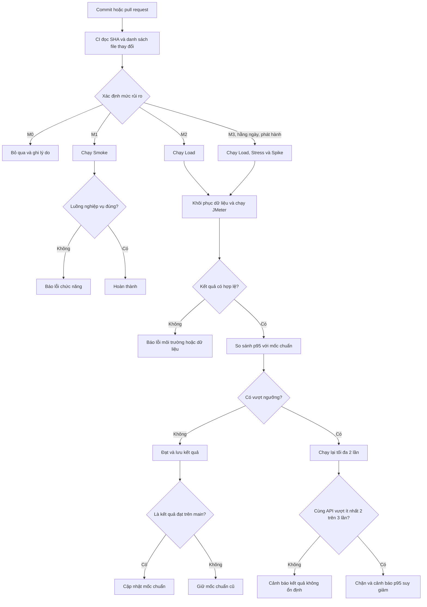

# Task 3 — Đề xuất kiểm thử hiệu năng liên tục cho EShop

## 1. Mục tiêu

Mô hình này giúp EShop:

- theo dõi mọi commit;
- quyết định commit nào cần chạy kiểm thử hiệu năng;
- so sánh kết quả mới với mốc chuẩn;
- phát hiện và cảnh báo khi p95 tăng bất thường.

**p95** là thời gian mà 95% yêu cầu hoàn thành nhanh hơn hoặc bằng giá trị đó. Ví dụ, p95 bằng 20 ms nghĩa là 95% yêu cầu hoàn thành trong tối đa 20 ms.

Phạm vi đo là luồng API:

```text
Đăng nhập
→ Lấy danh sách sản phẩm
→ Thêm sản phẩm vào giỏ
→ Thanh toán
→ Kiểm tra đơn hàng
```

EShop hiện dùng Node.js, Express và SQLite. Các kế hoạch JMeter có sẵn gồm:

- Load: 20 người dùng ảo, 360 giây;
- Stress: tăng từ 20 lên 120 người dùng ảo, 300 giây;
- Spike: tăng nhanh từ 10 lên 100 người dùng ảo, 180 giây.

Báo cáo này tập trung vào hiệu năng API. Hiệu năng giao diện React như kích thước JavaScript, tốc độ hiển thị và Core Web Vitals cần được kiểm tra riêng bằng Lighthouse CI.

## 2. Mô hình đề xuất

Không cần chạy toàn bộ bài kiểm thử cho mọi commit. Pipeline đọc danh sách file thay đổi bằng `git diff`, sau đó chọn mức kiểm thử phù hợp.

| Mức | Loại thay đổi | Bài kiểm thử | Có chặn merge không? |
|---|---|---|---|
| M0 | Chỉ sửa tài liệu, ảnh hoặc chú thích | Không chạy | Không |
| M1 | Chỉ sửa giao diện, không đổi cách gọi API | Smoke: 5 người dùng ảo, 60 giây | Không; chỉ báo lỗi luồng |
| M2 | Sửa API, truy vấn, SQLite, auth, cart, checkout, order, dependency backend, JMeter hoặc dữ liệu test | Load | Có |
| M3 | Sửa index, WAL, cache, xử lý đồng thời; thay đổi trên 300 dòng thực thi; hoặc PR có nhãn `performance-critical` | Load, Stress và Spike | Có với Load; Stress/Spike chặn PR quan trọng và bản phát hành |

Các trường hợp chạy bổ sung:

| Thời điểm | Bài kiểm thử | Mục đích |
|---|---|---|
| Sau khi merge vào `main` | Load | Theo dõi xu hướng và cập nhật mốc chuẩn |
| 02:00 mỗi ngày, giờ Asia/Bangkok | Stress và Spike | Phát hiện lỗi ở tải cao |
| Hằng tuần hoặc trước khi phát hành | Load, Stress, Spike và Endurance 10–15 phút | Kiểm tra toàn diện |
| Chạy thủ công | Bài được chọn | Điều tra hoặc xác nhận thay đổi |

Nếu một commit khớp nhiều mức, chọn mức cao nhất. Chỉ được dùng `[perf skip]` cho M0 hoặc M1 và phải ghi rõ lý do.

## 3. Quy trình



Các bước thực hiện:

1. Khởi động SUT trên máy chạy cố định, khóa phiên bản Node và JMeter.
2. Khôi phục cùng một bản SQLite trước mỗi lần chạy; restart backend để xóa trạng thái giỏ hàng trong bộ nhớ.
3. Chạy làm nóng 1–2 phút; không dùng dữ liệu làm nóng để đánh giá.
4. Chạy JMeter ở chế độ dòng lệnh và tạo file JTL.
5. Kiểm tra số mẫu, assertion, lỗi HTTP và thông tin môi trường.
6. Tính p95 riêng cho từng API và đúng giai đoạn tải.
7. So sánh với mốc chuẩn, chạy xác nhận nếu phát hiện dấu hiệu suy giảm.
8. Đăng kết quả lên pull request và lưu JTL, báo cáo, commit SHA.

Một lần chạy bị xem là không hợp lệ khi:

- CPU nền trung bình trong 30 giây từ 20% trở lên;
- bộ nhớ trống dưới 20%;
- có bài kiểm thử hiệu năng khác cùng chạy trên máy;
- tiến trình JMeter dùng trên 80% CPU liên tục 30 giây;
- có dưới 200 mẫu thành công cho một API trong giai đoạn đánh giá;
- assertion sai, backend chưa sẵn sàng hoặc thông tin môi trường không khớp.

## 4. Mốc chuẩn

Mốc chuẩn phải thuộc cùng:

- loại bài kiểm thử và giai đoạn tải;
- file JMeter;
- dữ liệu SQLite;
- phiên bản Node và JMeter;
- loại máy chạy.

Với mỗi API:

- lấy 5 lần chạy đạt gần nhất trên nhánh `main`;
- `B` là trung vị p95 của 5 lần đó;
- `MAD` là trung vị độ lệch tuyệt đối so với `B`;
- cần ít nhất 3 lần chạy hợp lệ;
- mốc chuẩn hết hạn sau 30 ngày;
- khi đổi JMeter, dữ liệu hoặc máy chạy, phải tạo mốc chuẩn mới.

Kết quả bị lỗi, chạy thủ công hoặc bị đánh dấu không ổn định không được đưa vào mốc chuẩn. Một thay đổi cố ý làm p95 tăng vẫn phải được review trước khi chấp nhận mốc mới.

## 5. Quy tắc phát hiện p95 suy giảm

Với:

- `C`: p95 của commit đang kiểm tra;
- `B`: p95 của mốc chuẩn.

```text
độ tăng = C - B
biên cho phép = max(20% × B, 5 ms, 3 × MAD)

Vượt ngưỡng tương đối khi: C - B > biên cho phép
Vượt ngưỡng tuyệt đối khi: C > giới hạn cứng của API
```

Biên tối thiểu 5 ms giúp tránh cảnh báo vì chênh lệch rất nhỏ. Điều này phù hợp với EShop vì p95 hiện chỉ khoảng 4–19 ms.

### Mốc ban đầu

| API | Load p95 | Stress p95 | Spike p95 | Giới hạn cứng ban đầu |
|---|---:|---:|---:|---:|
| Login | 7 ms | 9 ms | 12 ms | 15 ms |
| Get product list | 6 ms | 10 ms | 9 ms | 12 ms |
| Add product to cart | 5 ms | 4 ms | 5 ms | 7 ms |
| Checkout | 17 ms | 17 ms | 19 ms | 25 ms |
| Verify order history | 7 ms | 11 ms | 11 ms | 15 ms |

Các số trên lấy từ kết quả Task 2 và chỉ dùng để khởi tạo. Chúng chưa phải cam kết hiệu năng thực tế. Trước khi chặn pull request, cần chạy ít nhất 5 lần độc lập cho mỗi loại bài kiểm thử.

Không dùng p95 của giao dịch E2E để đánh giá tốc độ backend vì giá trị này chứa thời gian chờ mô phỏng người dùng. Chỉ dùng p95 của từng HTTP request.

### Quyết định

| Trạng thái | Điều kiện | Xử lý |
|---|---|---|
| Không hợp lệ | Sai môi trường, thiếu mẫu hoặc assertion sai | Không kết luận về hiệu năng; sửa nguyên nhân rồi chạy lại |
| Đạt | Không API nào vượt ngưỡng | Cho phép tiếp tục |
| Nghi ngờ | Lần đầu có API vượt ngưỡng | Chạy thêm tối đa 2 lần |
| Suy giảm | Cùng API vượt ngưỡng ít nhất 2/3 lần và trung vị vẫn vượt | Chặn merge hoặc phát hành |
| Không ổn định | Chỉ 1/3 lần vượt hoặc độ dao động quá cao | Không chặn; điều tra máy chạy và bài test |
| Lỗi an toàn | Tỷ lệ lỗi trên 0,5%, assertion quan trọng sai hoặc throughput giảm trên 10% | Chặn, dù p95 không tăng |

Ngưỡng lỗi 0,5% là quy tắc đề xuất ban đầu, không phải yêu cầu nghiệp vụ đã được xác nhận. Checkout có thể áp dụng không chấp nhận lỗi nếu nhóm dự án quyết định đây là giao dịch quan trọng.

## 6. Công cụ

| Công cụ | Vai trò |
|---|---|
| GitHub Actions | Theo dõi commit, chạy theo lịch và chặn merge |
| Apache JMeter | Tạo tải và xuất JTL |
| Python | Phân tích JTL, tính p95, MAD và kết luận |
| SQLite seed | Khôi phục cùng dữ liệu trước mỗi lần chạy |
| GitHub Artifacts | Lưu JTL, báo cáo và thông tin môi trường |
| Performance Monitor hoặc Prometheus/Grafana | Theo dõi CPU, bộ nhớ và tải máy |
| GitHub Check, Slack, Teams hoặc email | Gửi cảnh báo |
| Lighthouse CI | Kiểm tra hiệu năng giao diện React riêng |

Cảnh báo cần ghi rõ:

- commit đang kiểm tra và commit của mốc chuẩn;
- loại bài kiểm thử, giai đoạn tải và API bị ảnh hưởng;
- p95 cũ, p95 mới, mức tăng và giới hạn;
- số mẫu, tỷ lệ lỗi và throughput;
- liên kết đến JTL và báo cáo.

## 7. Giảm cảnh báo sai

| Nguyên nhân | Cách xử lý |
|---|---|
| Máy chạy bị tranh CPU hoặc I/O | Dùng máy riêng, mỗi lần chỉ chạy một bài |
| Database lớn dần sau mỗi lần checkout | Khôi phục cùng SQLite seed trước mỗi lần |
| Khởi động lạnh | Chạy làm nóng trước khi đo |
| Số mẫu quá ít | Yêu cầu ít nhất 200 mẫu thành công cho mỗi API |
| So sánh sai loại tải | Tách mốc Load, Stress, Spike và từng giai đoạn |
| Thay JMeter hoặc máy chạy | Tạo nhóm mốc chuẩn mới |
| Một giá trị bất thường | Dùng trung vị, MAD và quy tắc 2/3 |
| Mốc chuẩn xấu dần | Giữ giới hạn cứng và xem xu hướng 7/30 ngày |
| Chạy lại nhiều lần đến khi đạt | Chỉ cho tối đa 3 lần và lưu tất cả kết quả |

Cũng cần tránh bỏ sót lỗi. p95 có thể thấp giả tạo khi nhiều request lỗi sớm hoặc throughput giảm. Vì vậy phải kiểm tra đồng thời p95, tỷ lệ lỗi, assertion và throughput.

## 8. Chi phí và đánh đổi

Ba bài Load, Stress và Spike cần khoảng 14 phút tải cho một lượt, chưa gồm khởi động, khôi phục dữ liệu và tạo báo cáo.

```text
Chi phí mỗi tuần ≈
  6 phút × số PR mức M2
  + 14 phút × số PR mức M3 hoặc bản phát hành
  + 8 phút × 7 lần chạy hằng ngày
  + 15 phút Endurance hằng tuần
  + thời gian chạy lại các kết quả nghi ngờ
```

Ví dụ, 20 PR mức M2, 2 PR mức M3, 7 lần chạy hằng ngày và 1 Endurance cần khoảng 219 phút/tuần trước khi tính chạy lại.

| Lựa chọn | Lợi ích | Hạn chế |
|---|---|---|
| Chạy toàn bộ cho mọi commit | Phát hiện sớm | Tốn thời gian, hàng đợi dài, nhiều cảnh báo sai |
| Chọn bài theo rủi ro | Giảm chi phí | Có thể phân loại thiếu; bài chạy hằng ngày giúp bù rủi ro |
| Máy chạy riêng | Kết quả ổn định | Tốn chi phí máy và bảo trì |
| Máy chạy dùng chung | Dễ triển khai | Kết quả dễ bị ảnh hưởng bởi tác vụ khác |
| Chạy 3 lần cho mọi PR | Tin cậy hơn | Gần gấp ba chi phí |
| Chỉ chạy lại khi nghi ngờ | Cân bằng chi phí và độ tin cậy | Phản hồi chậm hơn khi có dấu hiệu lỗi |
| Mốc chuẩn cập nhật dần | Phù hợp với hệ thống mới | Có thể che sự suy giảm nhỏ; cần giới hạn cứng |
| Dữ liệu cố định | So sánh công bằng | Không thể hiện dữ liệu tăng trưởng; cần thêm bộ dữ liệu lớn khi phát hành |

## 9. Lộ trình áp dụng

### Giai đoạn 1 — Theo dõi

- Chạy Load cho M2/M3 nhưng chưa chặn merge.
- Thu ít nhất 5 kết quả sạch cho mỗi loại bài.
- Kiểm tra việc khôi phục SQLite và lưu thông tin môi trường.

### Giai đoạn 2 — Cảnh báo

- Đăng cảnh báo p95 lên pull request.
- Chạy Stress và Spike hằng ngày.
- Theo dõi tỷ lệ cảnh báo sai và điều chỉnh biên cho phép bằng dữ liệu thực.

### Giai đoạn 3 — Bắt buộc

- Chặn M2, M3 và bản phát hành theo quy tắc 2/3.
- Chỉ cập nhật mốc chuẩn từ kết quả đạt trên `main`.
- Xem lại giới hạn và mốc chuẩn mỗi tháng hoặc khi yêu cầu thay đổi.

Mô hình được xem là hoạt động đúng khi mọi commit đều có mức xử lý, mọi so sánh truy được dữ liệu gốc, thay đổi cố ý làm chậm API bị phát hiện ít nhất 2/3 lần, và cảnh báo nêu rõ API cùng mức tăng p95.

## 10. Kết luận

EShop nên dùng mô hình kiểm thử hiệu năng theo mức rủi ro:

- theo dõi mọi commit;
- chạy Load khi thay đổi API hoặc database;
- chạy Stress và Spike cho thay đổi quan trọng, hằng ngày và trước phát hành;
- so sánh p95 của từng API với mốc chuẩn cùng môi trường;
- chỉ chặn khi cùng lỗi xuất hiện ít nhất 2/3 lần.

Quy tắc `max(20% × mốc chuẩn, 5 ms, 3 × MAD)` kết hợp giới hạn cứng giúp cân bằng giữa khả năng phát hiện suy giảm, chi phí thực thi và nguy cơ cảnh báo sai.
