# Task 1 — Báo cáo Lỗi Chi tiết (Bug Report — EShop Web)

- **MSSV:** `23120146`
- **Phạm vi:** Màn hình chính `/profile`; Màn hình phụ `/register`, `/forgot-password`; thành phần dùng chung (`Header`, `AuthContext`, `index.html`)
- **Tài liệu đối chiếu:** [`task1-gui-checklist.md`](./task1-gui-checklist.md) (`52` mục kiểm tra: `12 Passed`, `40 Failed`)
- **Mẫu chuẩn tham chiếu:** [GitHub Issue #106 (`Taylor3691/eshop-sut`)](https://github.com/Taylor3691/eshop-sut/issues/106)
- **Phương pháp tổng hợp:** Gom nhóm theo **nguyên nhân gốc (root cause)** từ 40 mục `Failed` thành **31 Bugs duy nhất**, bảo toàn ánh xạ 100% (`40/40`) mã checklist `GUI-XX` và đầy đủ `40/40` ảnh chụp minh họa trong [`screenshots/`](./screenshots).

---

## 1. Thống kê Tổng hợp & Danh mục Bugs

- **Tổng số Bugs:** **31** (phủ **40/40** mục `Failed`)
- **Phân bổ Severity:** Critical: **8** | Major: **11** | Minor: **11** | Trivial: **1**

| Bug ID | Tiêu đề (GitHub Issue Title) | Checklist Ref | Severity | Priority | Screenshot | GitHub Issue |
| :--- | :--- | :--- | :---: | :---: | :--- | :--- |
| `23120146-BUG-01` | [BUG][Shared] Các trang /profile, /register, /forgot-password thiếu thẻ tiêu đề <h1> | GUI-01, GUI-02, GUI-03 | `minor` | `P2` | [`GUI-01.png`](./screenshots/GUI-01.png), [`GUI-02.png`](./screenshots/GUI-02.png), [`GUI-03.png`](./screenshots/GUI-03.png) | [#191](https://github.com/Taylor3691/eshop-sut/issues/191) |
| `23120146-BUG-02` | [BUG][Navbar][XSS] Tên người dùng trên Header dùng dangerouslySetInnerHTML gây lỗi XSS | GUI-44 | `critical` | `P0` | [`GUI-44.png`](./screenshots/GUI-44.png) | [#192](https://github.com/Taylor3691/eshop-sut/issues/192) |
| `23120146-BUG-03` | [BUG][Navbar] Link điều hướng thiếu highlight trang hiện tại và link hồ sơ luôn sáng vàng | GUI-25 | `minor` | `P2` | [`GUI-25.png`](./screenshots/GUI-25.png) | [#193](https://github.com/Taylor3691/eshop-sut/issues/193) |
| `23120146-BUG-04` | [BUG][Navbar] Link Giỏ hàng không hiển thị badge số lượng sản phẩm | GUI-26 | `major` | `P1` | [`GUI-26.png`](./screenshots/GUI-26.png) | [#194](https://github.com/Taylor3691/eshop-sut/issues/194) |
| `23120146-BUG-05` | [BUG][Navbar] Nút đăng xuất hiển thị nhãn "Thoát" thay vì "Đăng xuất" | GUI-27 | `minor` | `P2` | [`GUI-27.png`](./screenshots/GUI-27.png) | [#195](https://github.com/Taylor3691/eshop-sut/issues/195) |
| `23120146-BUG-06` | [BUG][Shared][A11y] Nhãn form thiếu htmlFor/id và input thiếu thuộc tính autocomplete, name | GUI-45, GUI-51 | `major` | `P2` | [`GUI-45.png`](./screenshots/GUI-45.png), [`GUI-51.png`](./screenshots/GUI-51.png) | [#196](https://github.com/Taylor3691/eshop-sut/issues/196) |
| `23120146-BUG-07` | [BUG][Shared][A11y] Độ tương phản màu chữ trên Navbar và form không đạt WCAG AA (>= 4.5:1) | GUI-46 | `minor` | `P3` | [`GUI-46.png`](./screenshots/GUI-46.png) | [#197](https://github.com/Taylor3691/eshop-sut/issues/197) |
| `23120146-BUG-08` | [BUG][Shared] index.html đặt cố định <html lang="en"> và <title>frontend-web</title> cho mọi route | GUI-50 | `trivial` | `P3` | [`GUI-50.png`](./screenshots/GUI-50.png) | [#198](https://github.com/Taylor3691/eshop-sut/issues/198) |
| `23120146-BUG-09` | [BUG][Shared] Các màn hình /profile, /register, /forgot-password thiếu breadcrumb và link về trang chủ | GUI-34 | `minor` | `P3` | [`GUI-34.png`](./screenshots/GUI-34.png) | [#199](https://github.com/Taylor3691/eshop-sut/issues/199) |
| `23120146-BUG-10` | [BUG][Profile] Validation số điện thoại từ chối số hợp lệ 0912345678 nhưng chấp nhận số 9 chữ số 912345678 | GUI-14, GUI-15 | `critical` | `P0` | [`GUI-14.png`](./screenshots/GUI-14.png), [`GUI-15.png`](./screenshots/GUI-15.png) | [#200](https://github.com/Taylor3691/eshop-sut/issues/200) |
| `23120146-BUG-11` | [BUG][Profile] Đơn hàng ở trạng thái "Đang giao" (shipping) vẫn hiển thị và cho phép bấm nút "Hủy đơn" | GUI-38 | `critical` | `P0` | [`GUI-38.png`](./screenshots/GUI-38.png) | [#201](https://github.com/Taylor3691/eshop-sut/issues/201) |
| `23120146-BUG-12` | [BUG][Profile] Bấm nút "Hủy đơn" gọi API hủy đơn ngay lập tức không có dialog xác nhận | GUI-39 | `major` | `P1` | [`GUI-39.png`](./screenshots/GUI-39.png) | [#202](https://github.com/Taylor3691/eshop-sut/issues/202) |
| `23120146-BUG-13` | [BUG][Profile][Responsive] Bảng Lịch sử đơn hàng thiếu overflow-x-auto gây tràn ngang trên mobile 375px | GUI-11, GUI-47 | `major` | `P1` | [`GUI-11.png`](./screenshots/GUI-11.png), [`GUI-47.png`](./screenshots/GUI-47.png) | [#203](https://github.com/Taylor3691/eshop-sut/issues/203) |
| `23120146-BUG-14` | [BUG][Profile] Truy cập /profile khi chưa đăng nhập không chuyển hướng hoặc có link tới /login | GUI-29 | `major` | `P1` | [`GUI-29.png`](./screenshots/GUI-29.png) | [#204](https://github.com/Taylor3691/eshop-sut/issues/204) |
| `23120146-BUG-15` | [BUG][Profile] Thiếu trạng thái loading nên khi F5 tải lại trang bị nháy màn hình "Vui lòng đăng nhập" | GUI-35 | `major` | `P2` | [`GUI-35.png`](./screenshots/GUI-35.png) | [#205](https://github.com/Taylor3691/eshop-sut/issues/205) |
| `23120146-BUG-16` | [BUG][Profile] Cập nhật hồ sơ không đồng bộ tên mới lên Navbar và dùng window.alert() chặn UI | GUI-36, GUI-49 | `major` | `P1` | [`GUI-36.png`](./screenshots/GUI-36.png), [`GUI-49.png`](./screenshots/GUI-49.png) | [#206](https://github.com/Taylor3691/eshop-sut/issues/206) |
| `23120146-BUG-17` | [BUG][Profile] Đăng xuất ở tab khác không đồng bộ khiến tab /profile vẫn gửi JWT cũ cập nhật DB | GUI-52 | `critical` | `P1` | [`GUI-52.png`](./screenshots/GUI-52.png) | [#207](https://github.com/Taylor3691/eshop-sut/issues/207) |
| `23120146-BUG-18` | [BUG][Profile] Empty State Lịch sử đơn hàng chỉ là text thô thiếu hình minh họa/icon và CTA | GUI-37 | `minor` | `P3` | [`GUI-37.png`](./screenshots/GUI-37.png) | [#208](https://github.com/Taylor3691/eshop-sut/issues/208) |
| `23120146-BUG-19` | [BUG][Profile] Cột Ngày đặt hiển thị định dạng Mỹ MM/DD/YYYY trên trình duyệt locale en-US | GUI-48 | `minor` | `P3` | [`GUI-48.png`](./screenshots/GUI-48.png) | [#209](https://github.com/Taylor3691/eshop-sut/issues/209) |
| `23120146-BUG-20` | [BUG][Profile] Nhãn trường bắt buộc Họ Tên thiếu ký hiệu dấu sao (*) | GUI-12 | `minor` | `P2` | [`GUI-12.png`](./screenshots/GUI-12.png) | [#210](https://github.com/Taylor3691/eshop-sut/issues/210) |
| `23120146-BUG-21` | [BUG][Register] Đăng ký trùng email vẫn trả về 200 OK và thiếu trạng thái loading khi submit | GUI-41 | `critical` | `P0` | [`GUI-41.png`](./screenshots/GUI-41.png) | [#211](https://github.com/Taylor3691/eshop-sut/issues/211) |
| `23120146-BUG-22` | [BUG][Register] Regex mật khẩu từ chối mật khẩu hợp lệ Test1234! nhưng chấp nhận "Test 1234" | GUI-20 | `critical` | `P0` | [`GUI-20.png`](./screenshots/GUI-20.png) | [#212](https://github.com/Taylor3691/eshop-sut/issues/212) |
| `23120146-BUG-23` | [BUG][Register] Form thiếu trường Xác nhận mật khẩu và thiếu dấu sao (*) ở các nhãn bắt buộc | GUI-17, GUI-19 | `major` | `P1` | [`GUI-17.png`](./screenshots/GUI-17.png), [`GUI-19.png`](./screenshots/GUI-19.png) | [#213](https://github.com/Taylor3691/eshop-sut/issues/213) |
| `23120146-BUG-24` | [BUG][Register] Trường Email dùng type="text" thay vì type="email" nên bỏ qua validate HTML5 | GUI-18 | `major` | `P1` | [`GUI-18.png`](./screenshots/GUI-18.png) | [#214](https://github.com/Taylor3691/eshop-sut/issues/214) |
| `23120146-BUG-25` | [BUG][Register] Nút submit "Đăng Ký" dùng màu đỏ (bg-red-500) thay vì màu xanh dương | GUI-06 | `minor` | `P2` | [`GUI-06.png`](./screenshots/GUI-06.png) | [#215](https://github.com/Taylor3691/eshop-sut/issues/215) |
| `23120146-BUG-26` | [BUG][Register] Hộp thông báo lỗi hiển thị ở đầu form thay vì phía trên nút submit "Đăng Ký" | GUI-21 | `minor` | `P2` | [`GUI-21.png`](./screenshots/GUI-21.png) | [#216](https://github.com/Taylor3691/eshop-sut/issues/216) |
| `23120146-BUG-27` | [BUG][Forgot Password] Hệ thống sinh OTP 4 chữ số thay vì 6 chữ số và báo lỗi email qua alert() ở Bước 1 | GUI-42 | `critical` | `P0` | [`GUI-42.png`](./screenshots/GUI-42.png) | [#217](https://github.com/Taylor3691/eshop-sut/issues/217) |
| `23120146-BUG-28` | [BUG][Forgot Password] Bước 2 từ chối mật khẩu hợp lệ NewPass1!, thiếu loading và báo lỗi qua alert() | GUI-24, GUI-43 | `critical` | `P0` | [`GUI-24.png`](./screenshots/GUI-24.png), [`GUI-43.png`](./screenshots/GUI-43.png) | [#218](https://github.com/Taylor3691/eshop-sut/issues/218) |
| `23120146-BUG-29` | [BUG][Forgot Password] Thiếu Step Indicator, Email dùng type="text", thiếu (*) và thiếu Xác nhận mật khẩu mới | GUI-22, GUI-23 | `major` | `P1` | [`GUI-22.png`](./screenshots/GUI-22.png), [`GUI-23.png`](./screenshots/GUI-23.png) | [#219](https://github.com/Taylor3691/eshop-sut/issues/219) |
| `23120146-BUG-30` | [BUG][Forgot Password] Bước 1 thiếu nút/liên kết "Quay lại đăng nhập" | GUI-32 | `major` | `P1` | [`GUI-32.png`](./screenshots/GUI-32.png) | [#220](https://github.com/Taylor3691/eshop-sut/issues/220) |
| `23120146-BUG-31` | [BUG][Forgot Password] Bước 2 gán cùng màu xanh lá (bg-green-600) cho cả nút submit chính và nút "← Quay lại" | GUI-07 | `minor` | `P2` | [`GUI-07.png`](./screenshots/GUI-07.png) | [#221](https://github.com/Taylor3691/eshop-sut/issues/221) |

---

## 2. Chi tiết Từng Bug (Theo mẫu Issue #106)

### 23120146-BUG-01: [BUG][Shared] Các trang /profile, /register, /forgot-password thiếu thẻ tiêu đề <h1>

- **GitHub Issue:** [#191](https://github.com/Taylor3691/eshop-sut/issues/191)

#### Mô tả lỗi

Cả 3 trang thuộc phạm vi kiểm thử (`/profile`, `/register`, `/forgot-password`) đều không có thẻ `<h1>` mô tả tiêu đề chính của trang.

- Mã bug: 23120146-BUG-01
- Yêu cầu / IA / Checklist: FR-21, FR-05 / IA-01 / GUI-01, GUI-02, GUI-03
- Module: ui
- Severity: minor — Lỗi giao diện, nhãn, định dạng hoặc điều hướng phụ; người dùng vẫn có thể hoàn thành luồng chính.
- Priority: P2 — Xử lý ở vòng cải thiện tiếp theo để đồng bộ đặc tả UI/UX.
- Trạng thái phát hiện: new

#### Môi trường

- **Nền tảng 1 (Local Desktop — Blink):** Google Chrome 136 trên Windows 11 Pro (x64); viewport `1440 × 900` (và responsive `375 × 812`); URL `http://localhost:5173`.
- **Nền tảng 2 (Cloud Desktop — Gecko):** Mozilla Firefox 160 trên macOS Tahoe 26 (Sauce Labs Live `eu-central-1`, Tunnel `oauth-hoangngoc3691-78411_tunnel_name`, Session `f2c7a95f3b92415db6162ba99af3212a`); viewport `1440 × 900`; URL `http://localhost.lvh.me:5173`.
- **Nền tảng 3 (Cloud Desktop — WebKit):** Apple Safari 26 trên macOS Tahoe 26 (Sauce Labs Live `eu-central-1`, Tunnel `oauth-hoangngoc3691-78411_tunnel_name`, Session `adc08edd334e4ed88d3bd654d2d9e8d8`); viewport `1440 × 900`; URL `https://localhost.lvh.me:5173`.
- **Backend API:** `http://localhost:3000` (SQLite).
- **Version/commit nguồn SUT:** `13e4a5c` (không sửa mã ứng dụng); commit bằng chứng Task 1: `8c68bec`; commit bằng chứng Task 3: `b88bc8d`.
- **Account & Định danh kiểm thử (`§6` & `§11`):** `test@eshop.com` / `Test1234!`, MSSV & Họ tên: `23120146 - Hoàng Ngọc`, Email sinh viên: `23120146@student.hcmus.edu.vn`.

#### Steps to reproduce

1. **Điều kiện:** Ứng dụng EShop Web chạy ở `http://localhost:5173`.
2. Lần lượt truy cập `http://localhost:5173/profile` (đã đăng nhập), `http://localhost:5173/register` và `http://localhost:5173/forgot-password` (cả Bước 1 và Bước 2).
3. Kiểm tra cấu trúc DOM (`document.querySelectorAll('h1').length`) trên từng màn hình.

#### Actual result

- **GUI-01 (`/profile`):** Có `0` thẻ `<h1>`; hai tiêu đề khối `"Hồ sơ của bạn"` và `"Lịch sử đơn hàng"` dùng thẻ `<h2>` (`24px`, `Profile.jsx`).
- **GUI-02 (`/register`):** Có `0` thẻ `<h1>`; tiêu đề `"Đăng Ký Tài Khoản"` dùng thẻ `<h2>` (`24px`, `Register.jsx`).
- **GUI-03 (`/forgot-password`):** Có `0` thẻ `<h1>` ở cả Bước 1 và Bước 2; tiêu đề `"Quên Mật Khẩu"` dùng thẻ `<h2>` (`24px`, `ForgotPassword.jsx`).

#### Expected result

- **GUI-01, GUI-02, GUI-03 / FR-21:** Mỗi trang phải có **đúng 1 thẻ `<h1>`** mô tả nội dung chính của màn hình đang mở.
- Nguồn oracle: `README.md` của SUT; `IA-01..IA-04` dùng để tổ chức checklist HW03.

#### Evidence

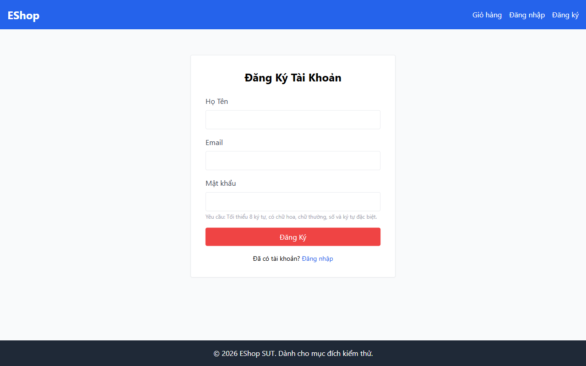

#### Kết quả Kiểm thử Đa Nền tảng (Task 3 — Cross-Browser / Cross-Platform)

| Nền tảng | Trình duyệt & Hệ điều hành | Engine | Độ phân giải | Kết quả | Minh chứng Đa nền tảng |
| :--- | :--- | :---: | :---: | :---: | :--- |
| **Platform 1** | **Google Chrome 136** — Windows 11 Pro | Blink | `1440 × 900` | **Reproduced (Failed)** | [`chrome-profile.png`](screenshots/task3/chrome-profile.png) |
| **Platform 2** | **Mozilla Firefox 160** — macOS Tahoe 26 (Sauce Labs) | Gecko | `1440 × 900` | **Reproduced (Failed)** | [`firefox-profile.png`](screenshots/task3/firefox-profile.png) |
| **Platform 3** | **Apple Safari 26** — macOS Tahoe 26 (Sauce Labs) | WebKit | `1440 × 900` | **Reproduced (Failed)** | [`safari-profile.png`](screenshots/task3/safari-profile.png) |

- **Ghi chú đối chiếu đa trình duyệt:** Cả 3 trình duyệt (Chrome 136 / Blink, Firefox 160 / Gecko, Safari 26 / WebKit) đều ghi nhận `document.querySelectorAll("h1").length === 0` và chỉ render thẻ `<h2>` (24px).

##### Minh chứng Đa Nền tảng (Chrome 136 · Firefox 160 · Safari 26)

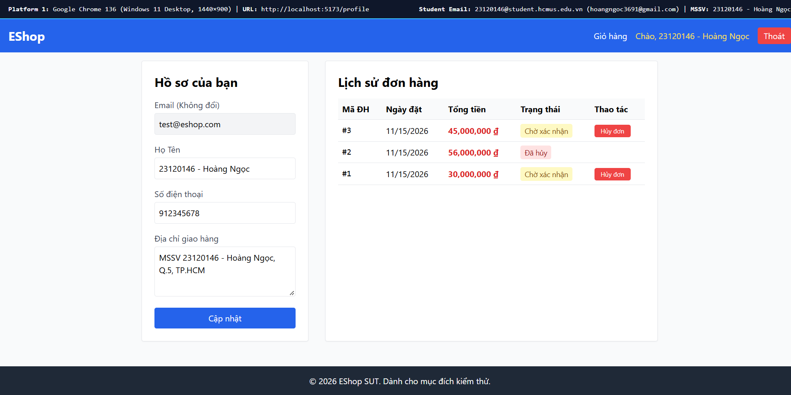

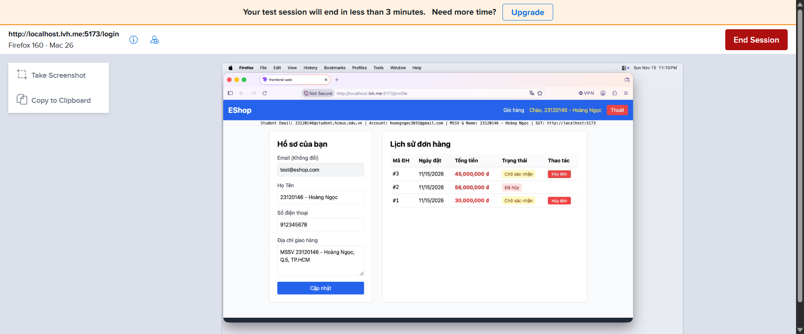

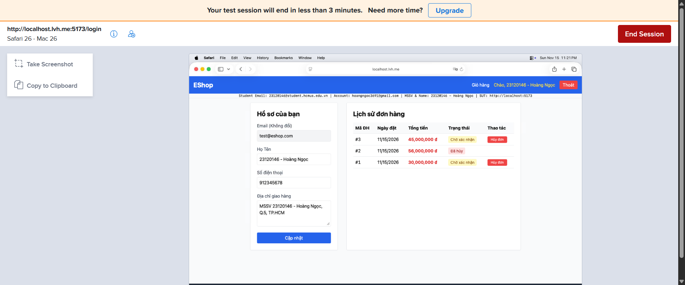

##### Ảnh chụp GitHub Issue [#191](https://github.com/Taylor3691/eshop-sut/issues/191)

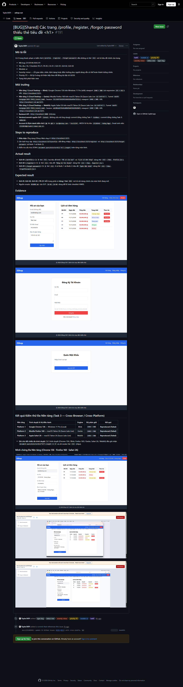

---

### 23120146-BUG-02: [BUG][Navbar][XSS] Tên người dùng trên Header dùng dangerouslySetInnerHTML gây lỗi XSS

- **GitHub Issue:** [#192](https://github.com/Taylor3691/eshop-sut/issues/192)

#### Mô tả lỗi

Thanh Header render trực tiếp chuỗi tên tài khoản bằng `dangerouslySetInnerHTML`, khiến các thẻ HTML/script trong `user.name` được phân tích thành DOM thật.

- Mã bug: 23120146-BUG-02
- Yêu cầu / IA / Checklist: SEC-04, FR-04 / IA-04 / GUI-44
- Module: navigation
- Severity: critical — Ảnh hưởng nghiêm trọng đến bảo mật, toàn vẹn dữ liệu, luồng nghiệp vụ chính hoặc khả năng hoàn thành tác vụ.
- Priority: P0 — Cần ưu tiên xử lý ngay do chặn luồng chính hoặc gây rủi ro bảo mật/dữ liệu.
- Trạng thái phát hiện: new

#### Môi trường

- **Nền tảng 1 (Local Desktop — Blink):** Google Chrome 136 trên Windows 11 Pro (x64); viewport `1440 × 900` (và responsive `375 × 812`); URL `http://localhost:5173`.
- **Nền tảng 2 (Cloud Desktop — Gecko):** Mozilla Firefox 160 trên macOS Tahoe 26 (Sauce Labs Live `eu-central-1`, Tunnel `oauth-hoangngoc3691-78411_tunnel_name`, Session `f2c7a95f3b92415db6162ba99af3212a`); viewport `1440 × 900`; URL `http://localhost.lvh.me:5173`.
- **Nền tảng 3 (Cloud Desktop — WebKit):** Apple Safari 26 trên macOS Tahoe 26 (Sauce Labs Live `eu-central-1`, Tunnel `oauth-hoangngoc3691-78411_tunnel_name`, Session `adc08edd334e4ed88d3bd654d2d9e8d8`); viewport `1440 × 900`; URL `https://localhost.lvh.me:5173`.
- **Backend API:** `http://localhost:3000` (SQLite).
- **Version/commit nguồn SUT:** `13e4a5c` (không sửa mã ứng dụng); commit bằng chứng Task 1: `8c68bec`; commit bằng chứng Task 3: `b88bc8d`.
- **Account & Định danh kiểm thử (`§6` & `§11`):** `test@eshop.com` / `Test1234!`, MSSV & Họ tên: `23120146 - Hoàng Ngọc`, Email sinh viên: `23120146@student.hcmus.edu.vn`.

#### Steps to reproduce

1. Đăng ký hoặc cập nhật hồ sơ tại `http://localhost:5173/profile` với trường `Họ Tên` chứa mã HTML, ví dụ `<b>XSS23120146</b>`.
2. Quan sát phần hiển thị `Chào, ...` trên thanh Header (`App.jsx`) sau khi đăng nhập / tải lại trang.
3. Kiểm tra đồng thời ô `Địa chỉ giao hàng` trên `/profile` với chuỗi chứa thẻ HTML.

#### Actual result

- **Header (`App.jsx:27`):** Sử dụng ``, làm trình duyệt render trực tiếp thẻ `<b>XSS23120146</b>` thành phần tử DOM thật (`<b>`).
- **Textarea Địa chỉ (`/profile`):** Vẫn escape dạng text thuần.

#### Expected result

- **GUI-44 / SEC-04:** Mọi dữ liệu người dùng nhập vào khi hiển thị trên UI phải được escape an toàn dưới dạng văn bản thuần, tuyệt đối không dùng `dangerouslySetInnerHTML` / `innerHTML` trực tiếp.
- Nguồn oracle: `README.md` của SUT; `IA-01..IA-04` dùng để tổ chức checklist HW03.

#### Evidence

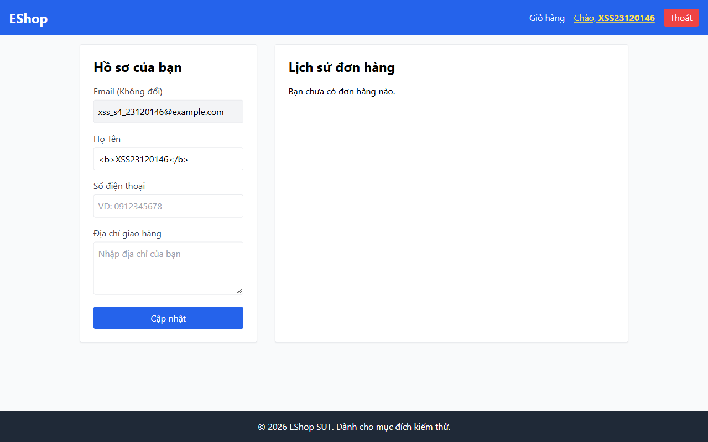

#### Kết quả Kiểm thử Đa Nền tảng (Task 3 — Cross-Browser / Cross-Platform)

| Nền tảng | Trình duyệt & Hệ điều hành | Engine | Độ phân giải | Kết quả | Minh chứng Đa nền tảng |
| :--- | :--- | :---: | :---: | :---: | :--- |
| **Platform 1** | **Google Chrome 136** — Windows 11 Pro | Blink | `1440 × 900` | **Reproduced (Failed)** | [`chrome-profile.png`](screenshots/task3/chrome-profile.png) |
| **Platform 2** | **Mozilla Firefox 160** — macOS Tahoe 26 (Sauce Labs) | Gecko | `1440 × 900` | **Reproduced (Failed)** | [`firefox-profile.png`](screenshots/task3/firefox-profile.png) |
| **Platform 3** | **Apple Safari 26** — macOS Tahoe 26 (Sauce Labs) | WebKit | `1440 × 900` | **Reproduced (Failed)** | [`safari-profile.png`](screenshots/task3/safari-profile.png) |

- **Ghi chú đối chiếu đa trình duyệt:** Lỗi bắt nguồn từ mã nguồn JSX/CSS/API của ứng dụng nên tái hiện đồng nhất 100% trên cả 3 nền tảng: **Google Chrome 136 (Windows 11 — Blink)**, **Mozilla Firefox 160 (macOS Tahoe 26 — Gecko)** và **Apple Safari 26 (macOS Tahoe 26 — WebKit)**.

##### Minh chứng Đa Nền tảng (Chrome 136 · Firefox 160 · Safari 26)

##### Ảnh chụp GitHub Issue [#192](https://github.com/Taylor3691/eshop-sut/issues/192)

---

### 23120146-BUG-03: [BUG][Navbar] Link điều hướng thiếu highlight trang hiện tại và link hồ sơ luôn sáng vàng

- **GitHub Issue:** [#193](https://github.com/Taylor3691/eshop-sut/issues/193)

#### Mô tả lỗi

Navbar không làm nổi bật đúng route đang mở (`Đăng ký`, `Đăng nhập`, `Giỏ hàng`) trong khi link `Chào, <Tên>` luôn cố định màu vàng ở mọi trang.

- Mã bug: 23120146-BUG-03
- Yêu cầu / IA / Checklist: FR-23 / IA-03 / GUI-25
- Module: navigation
- Severity: minor — Lỗi giao diện, nhãn, định dạng hoặc điều hướng phụ; người dùng vẫn có thể hoàn thành luồng chính.
- Priority: P2 — Xử lý ở vòng cải thiện tiếp theo để đồng bộ đặc tả UI/UX.
- Trạng thái phát hiện: new

#### Môi trường

- **Nền tảng 1 (Local Desktop — Blink):** Google Chrome 136 trên Windows 11 Pro (x64); viewport `1440 × 900` (và responsive `375 × 812`); URL `http://localhost:5173`.
- **Nền tảng 2 (Cloud Desktop — Gecko):** Mozilla Firefox 160 trên macOS Tahoe 26 (Sauce Labs Live `eu-central-1`, Tunnel `oauth-hoangngoc3691-78411_tunnel_name`, Session `f2c7a95f3b92415db6162ba99af3212a`); viewport `1440 × 900`; URL `http://localhost.lvh.me:5173`.
- **Nền tảng 3 (Cloud Desktop — WebKit):** Apple Safari 26 trên macOS Tahoe 26 (Sauce Labs Live `eu-central-1`, Tunnel `oauth-hoangngoc3691-78411_tunnel_name`, Session `adc08edd334e4ed88d3bd654d2d9e8d8`); viewport `1440 × 900`; URL `https://localhost.lvh.me:5173`.
- **Backend API:** `http://localhost:3000` (SQLite).
- **Version/commit nguồn SUT:** `13e4a5c` (không sửa mã ứng dụng); commit bằng chứng Task 1: `8c68bec`; commit bằng chứng Task 3: `b88bc8d`.
- **Account & Định danh kiểm thử (`§6` & `§11`):** `test@eshop.com` / `Test1234!`, MSSV & Họ tên: `23120146 - Hoàng Ngọc`, Email sinh viên: `23120146@student.hcmus.edu.vn`.

#### Steps to reproduce

1. Ở trạng thái chưa đăng nhập, truy cập `http://localhost:5173/register` và quan sát hai link `"Đăng nhập"`, `"Đăng ký"` trên Navbar.
2. Ở trạng thái đã đăng nhập, truy cập `http://localhost:5173/` rồi chuyển sang `http://localhost:5173/profile` và quan sát link `Chào, ...`.

#### Actual result

- Tại `/register`, link `"Đăng ký"` không có class active hay `aria-current="page"` khác biệt với `"Đăng nhập"` (`App.jsx:33-34`).
- Khi đã đăng nhập, link `/profile` (`Chào, ...`) luôn gắn tĩnh `text-yellow-300` (`App.jsx:26`) ngay cả khi đang ở trang chủ `/`.

#### Expected result

- **GUI-25 / FR-23:** Thanh điều hướng phải highlight đúng trang đang chọn và không làm sáng sai link khi người dùng đang ở trang khác.
- Nguồn oracle: `README.md` của SUT; `IA-01..IA-04` dùng để tổ chức checklist HW03.

#### Evidence

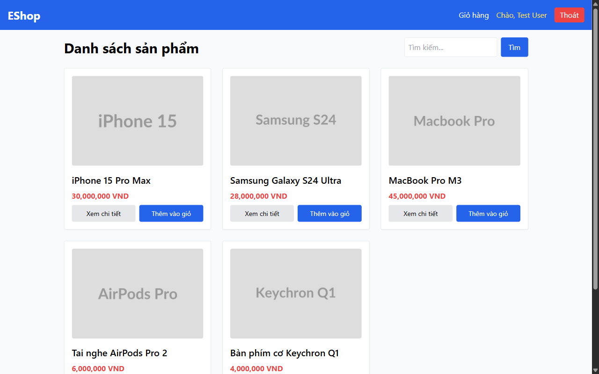

#### Kết quả Kiểm thử Đa Nền tảng (Task 3 — Cross-Browser / Cross-Platform)

| Nền tảng | Trình duyệt & Hệ điều hành | Engine | Độ phân giải | Kết quả | Minh chứng Đa nền tảng |
| :--- | :--- | :---: | :---: | :---: | :--- |
| **Platform 1** | **Google Chrome 136** — Windows 11 Pro | Blink | `1440 × 900` | **Reproduced (Failed)** | [`chrome-profile.png`](screenshots/task3/chrome-profile.png) |
| **Platform 2** | **Mozilla Firefox 160** — macOS Tahoe 26 (Sauce Labs) | Gecko | `1440 × 900` | **Reproduced (Failed)** | [`firefox-profile.png`](screenshots/task3/firefox-profile.png) |
| **Platform 3** | **Apple Safari 26** — macOS Tahoe 26 (Sauce Labs) | WebKit | `1440 × 900` | **Reproduced (Failed)** | [`safari-profile.png`](screenshots/task3/safari-profile.png) |

- **Ghi chú đối chiếu đa trình duyệt:** Tái hiện trên cả 3 trình duyệt. Đặc biệt trên **Safari 26 (macOS 26)**, thanh địa chỉ mặc định ẩn đường dẫn route (`/profile`, `/register`), khiến việc thiếu highlight trên Navbar càng làm người dùng khó nhận biết trang đang mở.

##### Minh chứng Đa Nền tảng (Chrome 136 · Firefox 160 · Safari 26)

##### Ảnh chụp GitHub Issue [#193](https://github.com/Taylor3691/eshop-sut/issues/193)

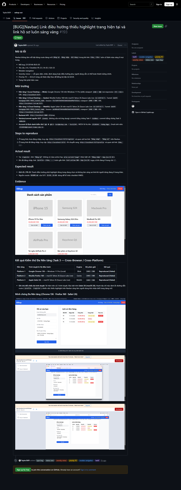

---

### 23120146-BUG-04: [BUG][Navbar] Link Giỏ hàng không hiển thị badge số lượng sản phẩm

- **GitHub Issue:** [#194](https://github.com/Taylor3691/eshop-sut/issues/194)

#### Mô tả lỗi

Link `"Giỏ hàng"` trên Navbar không hiển thị badge đếm số lượng sản phẩm dù `Header` đã gọi `useCart()`.

- Mã bug: 23120146-BUG-04
- Yêu cầu / IA / Checklist: FR-23 / IA-03 / GUI-26
- Module: navigation
- Severity: major — Ảnh hưởng hành vi nghiệp vụ, validation, phản hồi trạng thái hoặc khả năng sử dụng của chức năng chính.
- Priority: P1 — Ưu tiên kiểm tra/sửa sớm vì ảnh hưởng trực tiếp trải nghiệm và tính đúng đắn nghiệp vụ.
- Trạng thái phát hiện: new

#### Môi trường

- **Nền tảng 1 (Local Desktop — Blink):** Google Chrome 136 trên Windows 11 Pro (x64); viewport `1440 × 900` (và responsive `375 × 812`); URL `http://localhost:5173`.
- **Nền tảng 2 (Cloud Desktop — Gecko):** Mozilla Firefox 160 trên macOS Tahoe 26 (Sauce Labs Live `eu-central-1`, Tunnel `oauth-hoangngoc3691-78411_tunnel_name`, Session `f2c7a95f3b92415db6162ba99af3212a`); viewport `1440 × 900`; URL `http://localhost.lvh.me:5173`.
- **Nền tảng 3 (Cloud Desktop — WebKit):** Apple Safari 26 trên macOS Tahoe 26 (Sauce Labs Live `eu-central-1`, Tunnel `oauth-hoangngoc3691-78411_tunnel_name`, Session `adc08edd334e4ed88d3bd654d2d9e8d8`); viewport `1440 × 900`; URL `https://localhost.lvh.me:5173`.
- **Backend API:** `http://localhost:3000` (SQLite).
- **Version/commit nguồn SUT:** `13e4a5c` (không sửa mã ứng dụng); commit bằng chứng Task 1: `8c68bec`; commit bằng chứng Task 3: `b88bc8d`.
- **Account & Định danh kiểm thử (`§6` & `§11`):** `test@eshop.com` / `Test1234!`, MSSV & Họ tên: `23120146 - Hoàng Ngọc`, Email sinh viên: `23120146@student.hcmus.edu.vn`.

#### Steps to reproduce

1. Mở `http://localhost:5173/` ở trạng thái giỏ hàng trống và quan sát link `"Giỏ hàng"` trên Header.
2. Thêm sản phẩm (vd `iPhone 15 Pro Max`) vào giỏ hàng rồi quan sát lại link `"Giỏ hàng"` trên Navbar tại `/` và `/profile`.

#### Actual result

- Link `"Giỏ hàng"` (`App.jsx:23`) chỉ hiển thị văn bản tĩnh `"Giỏ hàng"`, không có badge số lượng cả khi giỏ trống lẫn khi đã thêm `1` sản phẩm vào giỏ.

#### Expected result

- **GUI-26 / FR-23:** Link `"Giỏ hàng"` trên Navbar phải hiển thị badge đếm chính xác tổng số lượng sản phẩm đang có trong giỏ.
- Nguồn oracle: `README.md` của SUT; `IA-01..IA-04` dùng để tổ chức checklist HW03.

#### Evidence

#### Kết quả Kiểm thử Đa Nền tảng (Task 3 — Cross-Browser / Cross-Platform)

| Nền tảng | Trình duyệt & Hệ điều hành | Engine | Độ phân giải | Kết quả | Minh chứng Đa nền tảng |
| :--- | :--- | :---: | :---: | :---: | :--- |
| **Platform 1** | **Google Chrome 136** — Windows 11 Pro | Blink | `1440 × 900` | **Reproduced (Failed)** | [`chrome-profile.png`](screenshots/task3/chrome-profile.png) |
| **Platform 2** | **Mozilla Firefox 160** — macOS Tahoe 26 (Sauce Labs) | Gecko | `1440 × 900` | **Reproduced (Failed)** | [`firefox-profile.png`](screenshots/task3/firefox-profile.png) |
| **Platform 3** | **Apple Safari 26** — macOS Tahoe 26 (Sauce Labs) | WebKit | `1440 × 900` | **Reproduced (Failed)** | [`safari-profile.png`](screenshots/task3/safari-profile.png) |

- **Ghi chú đối chiếu đa trình duyệt:** Lỗi bắt nguồn từ mã nguồn JSX/CSS/API của ứng dụng nên tái hiện đồng nhất 100% trên cả 3 nền tảng: **Google Chrome 136 (Windows 11 — Blink)**, **Mozilla Firefox 160 (macOS Tahoe 26 — Gecko)** và **Apple Safari 26 (macOS Tahoe 26 — WebKit)**.

##### Minh chứng Đa Nền tảng (Chrome 136 · Firefox 160 · Safari 26)

##### Ảnh chụp GitHub Issue [#194](https://github.com/Taylor3691/eshop-sut/issues/194)

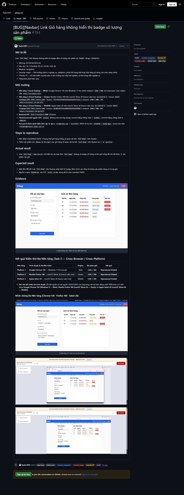

---

### 23120146-BUG-05: [BUG][Navbar] Nút đăng xuất hiển thị nhãn "Thoát" thay vì "Đăng xuất"

- **GitHub Issue:** [#195](https://github.com/Taylor3691/eshop-sut/issues/195)

#### Mô tả lỗi

Nút thoát tài khoản trên Header dùng nhãn `"Thoát"` thay vì nhãn chuẩn `"Đăng xuất"` theo đặc tả.

- Mã bug: 23120146-BUG-05
- Yêu cầu / IA / Checklist: FR-23 / IA-03 / GUI-27
- Module: navigation
- Severity: minor — Lỗi giao diện, nhãn, định dạng hoặc điều hướng phụ; người dùng vẫn có thể hoàn thành luồng chính.
- Priority: P2 — Xử lý ở vòng cải thiện tiếp theo để đồng bộ đặc tả UI/UX.
- Trạng thái phát hiện: new

#### Môi trường

- **Nền tảng 1 (Local Desktop — Blink):** Google Chrome 136 trên Windows 11 Pro (x64); viewport `1440 × 900` (và responsive `375 × 812`); URL `http://localhost:5173`.
- **Nền tảng 2 (Cloud Desktop — Gecko):** Mozilla Firefox 160 trên macOS Tahoe 26 (Sauce Labs Live `eu-central-1`, Tunnel `oauth-hoangngoc3691-78411_tunnel_name`, Session `f2c7a95f3b92415db6162ba99af3212a`); viewport `1440 × 900`; URL `http://localhost.lvh.me:5173`.
- **Nền tảng 3 (Cloud Desktop — WebKit):** Apple Safari 26 trên macOS Tahoe 26 (Sauce Labs Live `eu-central-1`, Tunnel `oauth-hoangngoc3691-78411_tunnel_name`, Session `adc08edd334e4ed88d3bd654d2d9e8d8`); viewport `1440 × 900`; URL `https://localhost.lvh.me:5173`.
- **Backend API:** `http://localhost:3000` (SQLite).
- **Version/commit nguồn SUT:** `13e4a5c` (không sửa mã ứng dụng); commit bằng chứng Task 1: `8c68bec`; commit bằng chứng Task 3: `b88bc8d`.
- **Account & Định danh kiểm thử (`§6` & `§11`):** `test@eshop.com` / `Test1234!`, MSSV & Họ tên: `23120146 - Hoàng Ngọc`, Email sinh viên: `23120146@student.hcmus.edu.vn`.

#### Steps to reproduce

1. Đăng nhập bằng tài khoản hợp lệ (`test@eshop.com` / `Test1234!`).
2. Quan sát nút màu đỏ bên cạnh tên người dùng trên Navbar ở góc phải phía trên.

#### Actual result

- Nút đăng xuất trên Navbar (`App.jsx:29`) hiển thị nhãn `"Thoát"` thay vì `"Đăng xuất"`.

#### Expected result

- **GUI-27 / FR-23:** Nút đăng xuất trên Navbar phải có nhãn chính xác là `"Đăng xuất"` (không dùng `"Thoát"`).
- Nguồn oracle: `README.md` của SUT; `IA-01..IA-04` dùng để tổ chức checklist HW03.

#### Evidence

#### Kết quả Kiểm thử Đa Nền tảng (Task 3 — Cross-Browser / Cross-Platform)

| Nền tảng | Trình duyệt & Hệ điều hành | Engine | Độ phân giải | Kết quả | Minh chứng Đa nền tảng |
| :--- | :--- | :---: | :---: | :---: | :--- |
| **Platform 1** | **Google Chrome 136** — Windows 11 Pro | Blink | `1440 × 900` | **Reproduced (Failed)** | [`chrome-profile.png`](screenshots/task3/chrome-profile.png) |
| **Platform 2** | **Mozilla Firefox 160** — macOS Tahoe 26 (Sauce Labs) | Gecko | `1440 × 900` | **Reproduced (Failed)** | [`firefox-profile.png`](screenshots/task3/firefox-profile.png) |
| **Platform 3** | **Apple Safari 26** — macOS Tahoe 26 (Sauce Labs) | WebKit | `1440 × 900` | **Reproduced (Failed)** | [`safari-profile.png`](screenshots/task3/safari-profile.png) |

- **Ghi chú đối chiếu đa trình duyệt:** Lỗi bắt nguồn từ mã nguồn JSX/CSS/API của ứng dụng nên tái hiện đồng nhất 100% trên cả 3 nền tảng: **Google Chrome 136 (Windows 11 — Blink)**, **Mozilla Firefox 160 (macOS Tahoe 26 — Gecko)** và **Apple Safari 26 (macOS Tahoe 26 — WebKit)**.

##### Minh chứng Đa Nền tảng (Chrome 136 · Firefox 160 · Safari 26)

##### Ảnh chụp GitHub Issue [#195](https://github.com/Taylor3691/eshop-sut/issues/195)

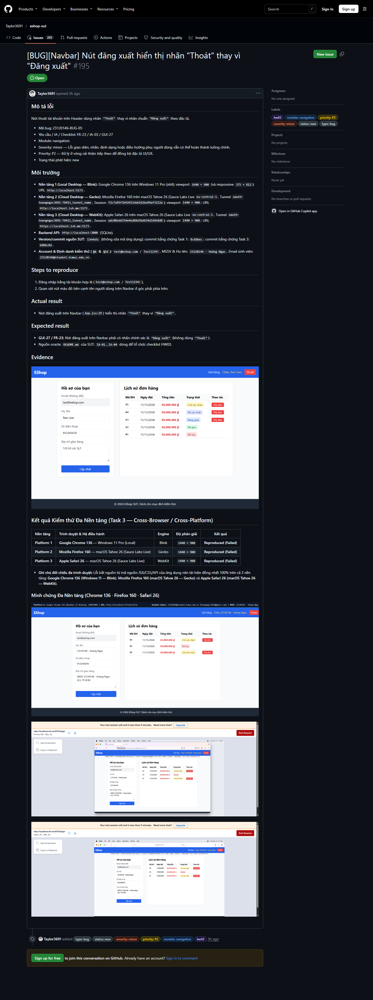

---

### 23120146-BUG-06: [BUG][Shared][A11y] Nhãn form thiếu htmlFor/id và input thiếu thuộc tính autocomplete, name

- **GitHub Issue:** [#196](https://github.com/Taylor3691/eshop-sut/issues/196)

#### Mô tả lỗi

Tất cả form trên `/profile`, `/register`, `/forgot-password` không liên kết `<label>` với `<input>`/`<textarea>` qua `htmlFor`/`id` và thiếu thuộc tính `autocomplete`, `name`.

- Mã bug: 23120146-BUG-06
- Yêu cầu / IA / Checklist: WCAG 1.3.1, WCAG 4.1.2, FR-22 / IA-02 / GUI-45, GUI-51
- Module: ui
- Severity: major — Ảnh hưởng hành vi nghiệp vụ, validation, phản hồi trạng thái hoặc khả năng sử dụng của chức năng chính.
- Priority: P2 — Xử lý ở vòng cải thiện tiếp theo để đồng bộ đặc tả UI/UX.
- Trạng thái phát hiện: new

#### Môi trường

- **Nền tảng 1 (Local Desktop — Blink):** Google Chrome 136 trên Windows 11 Pro (x64); viewport `1440 × 900` (và responsive `375 × 812`); URL `http://localhost:5173`.
- **Nền tảng 2 (Cloud Desktop — Gecko):** Mozilla Firefox 160 trên macOS Tahoe 26 (Sauce Labs Live `eu-central-1`, Tunnel `oauth-hoangngoc3691-78411_tunnel_name`, Session `f2c7a95f3b92415db6162ba99af3212a`); viewport `1440 × 900`; URL `http://localhost.lvh.me:5173`.
- **Nền tảng 3 (Cloud Desktop — WebKit):** Apple Safari 26 trên macOS Tahoe 26 (Sauce Labs Live `eu-central-1`, Tunnel `oauth-hoangngoc3691-78411_tunnel_name`, Session `adc08edd334e4ed88d3bd654d2d9e8d8`); viewport `1440 × 900`; URL `https://localhost.lvh.me:5173`.
- **Backend API:** `http://localhost:3000` (SQLite).
- **Version/commit nguồn SUT:** `13e4a5c` (không sửa mã ứng dụng); commit bằng chứng Task 1: `8c68bec`; commit bằng chứng Task 3: `b88bc8d`.
- **Account & Định danh kiểm thử (`§6` & `§11`):** `test@eshop.com` / `Test1234!`, MSSV & Họ tên: `23120146 - Hoàng Ngọc`, Email sinh viên: `23120146@student.hcmus.edu.vn`.

#### Steps to reproduce

1. Mở lần lượt `/register`, `/forgot-password` và `/profile` trên Chrome DevTools.
2. Click chuột trực tiếp vào văn bản các nhãn `<label>` (như `Họ Tên`, `Email`, `Mật khẩu`, `Số điện thoại`).
3. Kiểm tra tab DevTools Issues / Accessibility tree về `for`/`htmlFor`, `id`, `name`, `autocomplete`.

#### Actual result

- **GUI-45:** Toàn bộ `<label>` trên cả 3 trang thiếu `for`/`htmlFor` và các `<input>`/`<textarea>` thiếu `id`; click vào chữ nhãn không focus ô nhập tương ứng; DevTools báo `No label associated with a form field`.
- **GUI-51:** Toàn bộ input trên cả 3 trang thiếu thuộc tính `autocomplete`, `id`, `name` (và Email trên `/register`, `/forgot-password` dùng `type="text"`, gây bất lợi cho trình tự điền/bàn phím ảo mobile). Gõ tiếng Việt có dấu hoạt động bình thường.

#### Expected result

- **GUI-45, GUI-51 / WCAG 1.3.1, 4.1.2, FR-22:** Mỗi `<label>` phải gắn đúng `htmlFor` trùng `id` của input/textarea; các trường cần có `name` và `autoComplete` phù hợp (`name`, `email`, `new-password`, `tel`, `street-address`).
- Nguồn oracle: `README.md` của SUT; `IA-01..IA-04` dùng để tổ chức checklist HW03.

#### Evidence

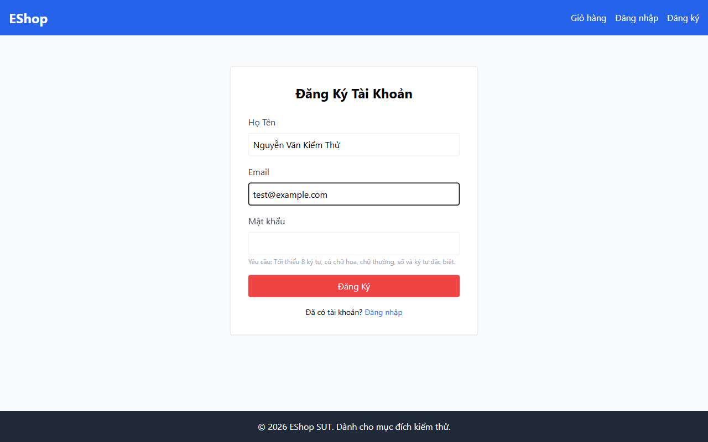

#### Kết quả Kiểm thử Đa Nền tảng (Task 3 — Cross-Browser / Cross-Platform)

| Nền tảng | Trình duyệt & Hệ điều hành | Engine | Độ phân giải | Kết quả | Minh chứng Đa nền tảng |
| :--- | :--- | :---: | :---: | :---: | :--- |
| **Platform 1** | **Google Chrome 136** — Windows 11 Pro | Blink | `1440 × 900` | **Reproduced (Failed)** | [`chrome-profile.png`](screenshots/task3/chrome-profile.png) |
| **Platform 2** | **Mozilla Firefox 160** — macOS Tahoe 26 (Sauce Labs) | Gecko | `1440 × 900` | **Reproduced (Failed)** | [`firefox-profile.png`](screenshots/task3/firefox-profile.png) |
| **Platform 3** | **Apple Safari 26** — macOS Tahoe 26 (Sauce Labs) | WebKit | `1440 × 900` | **Reproduced (Failed)** | [`safari-profile.png`](screenshots/task3/safari-profile.png) |

- **Ghi chú đối chiếu đa trình duyệt:** Tái hiện trên cả 3 trình duyệt: click vào `<label>` không focus ô nhập. Trên **Safari 26 (macOS 26)**, phím `Tab` mặc định còn bỏ qua các liên kết/nút nếu không nhấn `Option + Tab`.

##### Minh chứng Đa Nền tảng (Chrome 136 · Firefox 160 · Safari 26)

##### Ảnh chụp GitHub Issue [#196](https://github.com/Taylor3691/eshop-sut/issues/196)

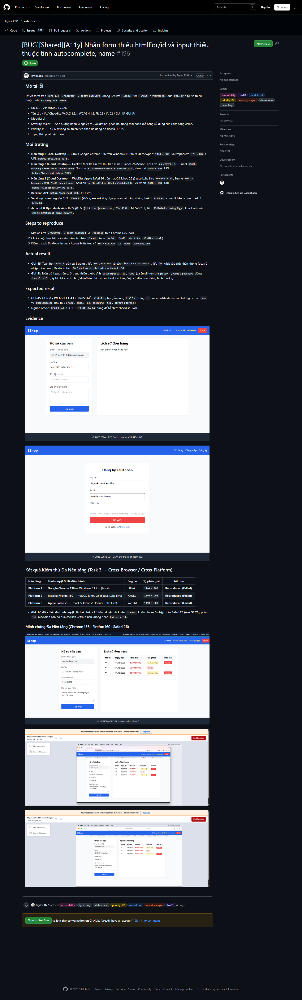

---

### 23120146-BUG-07: [BUG][Shared][A11y] Độ tương phản màu chữ trên Navbar và form không đạt WCAG AA (>= 4.5:1)

- **GitHub Issue:** [#197](https://github.com/Taylor3691/eshop-sut/issues/197)

#### Mô tả lỗi

Một số cặp màu chữ/nền dùng lớp Tailwind mặc định trên Header, `/register` và `/forgot-password` có độ tương phản dưới ngưỡng `4.5:1` cho văn bản thường.

- Mã bug: 23120146-BUG-07
- Yêu cầu / IA / Checklist: WCAG 1.4.3, FR-21 / IA-01 / GUI-46
- Module: ui
- Severity: minor — Lỗi giao diện, nhãn, định dạng hoặc điều hướng phụ; người dùng vẫn có thể hoàn thành luồng chính.
- Priority: P3 — Mức ưu tiên thấp, sửa khi tối ưu giao diện tổng thể.
- Trạng thái phát hiện: new

#### Môi trường

- **Nền tảng 1 (Local Desktop — Blink):** Google Chrome 136 trên Windows 11 Pro (x64); viewport `1440 × 900` (và responsive `375 × 812`); URL `http://localhost:5173`.
- **Nền tảng 2 (Cloud Desktop — Gecko):** Mozilla Firefox 160 trên macOS Tahoe 26 (Sauce Labs Live `eu-central-1`, Tunnel `oauth-hoangngoc3691-78411_tunnel_name`, Session `f2c7a95f3b92415db6162ba99af3212a`); viewport `1440 × 900`; URL `http://localhost.lvh.me:5173`.
- **Nền tảng 3 (Cloud Desktop — WebKit):** Apple Safari 26 trên macOS Tahoe 26 (Sauce Labs Live `eu-central-1`, Tunnel `oauth-hoangngoc3691-78411_tunnel_name`, Session `adc08edd334e4ed88d3bd654d2d9e8d8`); viewport `1440 × 900`; URL `https://localhost.lvh.me:5173`.
- **Backend API:** `http://localhost:3000` (SQLite).
- **Version/commit nguồn SUT:** `13e4a5c` (không sửa mã ứng dụng); commit bằng chứng Task 1: `8c68bec`; commit bằng chứng Task 3: `b88bc8d`.
- **Account & Định danh kiểm thử (`§6` & `§11`):** `test@eshop.com` / `Test1234!`, MSSV & Họ tên: `23120146 - Hoàng Ngọc`, Email sinh viên: `23120146@student.hcmus.edu.vn`.

#### Steps to reproduce

1. Mở `/register` ở trạng thái chưa đăng nhập và `/profile` khi đã đăng nhập.
2. Đo tỷ lệ tương phản màu (contrast ratio) bằng Chrome DevTools trên gợi ý mật khẩu (`text-gray-400`), link Navbar (`text-yellow-300` trên `bg-blue-600`) và chữ trắng trên nút `bg-red-500` / `bg-green-600`.

#### Actual result

- Chữ gợi ý mật khẩu `text-gray-400` trên nền trắng (`/register`): ~`2.54:1` (dưới ngưỡng `4.5:1`).
- Link Navbar `text-yellow-300` trên nền `bg-blue-600`: ~`3.92:1`.
- Chữ trắng trên nút `bg-red-500` (~`3.76:1`) và nút `bg-green-600` (~`3.30:1`) cũng thấp hơn `4.5:1`.

#### Expected result

- **GUI-46 / WCAG 1.4.3:** Tỷ lệ tương phản cho văn bản thường trên giao diện đạt tối thiểu `4.5:1` để đọc rõ ở điều kiện ánh sáng yếu hoặc High Contrast.
- Nguồn oracle: `README.md` của SUT; `IA-01..IA-04` dùng để tổ chức checklist HW03.

#### Evidence

#### Kết quả Kiểm thử Đa Nền tảng (Task 3 — Cross-Browser / Cross-Platform)

| Nền tảng | Trình duyệt & Hệ điều hành | Engine | Độ phân giải | Kết quả | Minh chứng Đa nền tảng |
| :--- | :--- | :---: | :---: | :---: | :--- |
| **Platform 1** | **Google Chrome 136** — Windows 11 Pro | Blink | `1440 × 900` | **Reproduced (Failed)** | [`chrome-profile.png`](screenshots/task3/chrome-profile.png) |
| **Platform 2** | **Mozilla Firefox 160** — macOS Tahoe 26 (Sauce Labs) | Gecko | `1440 × 900` | **Reproduced (Failed)** | [`firefox-profile.png`](screenshots/task3/firefox-profile.png) |
| **Platform 3** | **Apple Safari 26** — macOS Tahoe 26 (Sauce Labs) | WebKit | `1440 × 900` | **Reproduced (Failed)** | [`safari-profile.png`](screenshots/task3/safari-profile.png) |

- **Ghi chú đối chiếu đa trình duyệt:** Độ tương phản màu không đạt chuẩn WCAG AA (`< 4.5:1`) trên cả Windows 11 (DirectWrite ClearType / Segoe UI) lẫn macOS Tahoe 26 (CoreText / SF Pro trên Firefox 160 & Safari 26).

##### Minh chứng Đa Nền tảng (Chrome 136 · Firefox 160 · Safari 26)

##### Ảnh chụp GitHub Issue [#197](https://github.com/Taylor3691/eshop-sut/issues/197)

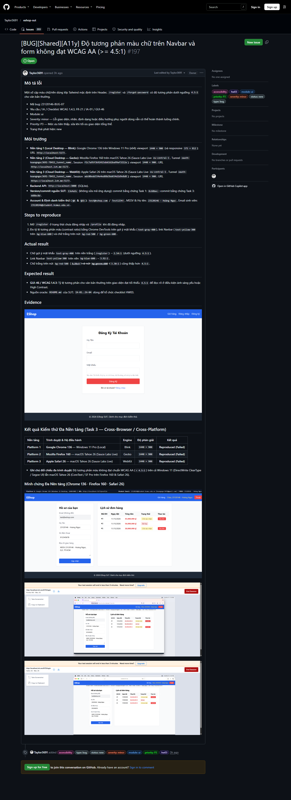

---

### 23120146-BUG-08: [BUG][Shared] index.html đặt cố định <html lang="en"> và <title>frontend-web</title> cho mọi route

- **GitHub Issue:** [#198](https://github.com/Taylor3691/eshop-sut/issues/198)

#### Mô tả lỗi

File gốc `frontend-web/index.html` khai báo ngôn ngữ tiếng Anh và tiêu đề mặc định của Vite ở tất cả màn hình tiếng Việt.

- Mã bug: 23120146-BUG-08
- Yêu cầu / IA / Checklist: FR-21, WCAG 2.4.2, WCAG 3.1.1 / IA-01 / GUI-50
- Module: ui
- Severity: trivial — Lỗi nhỏ về siêu dữ liệu HTML / hiển thị không cản trở thao tác nghiệp vụ.
- Priority: P3 — Mức ưu tiên thấp, sửa khi tối ưu giao diện tổng thể.
- Trạng thái phát hiện: new

#### Môi trường

- **Nền tảng 1 (Local Desktop — Blink):** Google Chrome 136 trên Windows 11 Pro (x64); viewport `1440 × 900` (và responsive `375 × 812`); URL `http://localhost:5173`.
- **Nền tảng 2 (Cloud Desktop — Gecko):** Mozilla Firefox 160 trên macOS Tahoe 26 (Sauce Labs Live `eu-central-1`, Tunnel `oauth-hoangngoc3691-78411_tunnel_name`, Session `f2c7a95f3b92415db6162ba99af3212a`); viewport `1440 × 900`; URL `http://localhost.lvh.me:5173`.
- **Nền tảng 3 (Cloud Desktop — WebKit):** Apple Safari 26 trên macOS Tahoe 26 (Sauce Labs Live `eu-central-1`, Tunnel `oauth-hoangngoc3691-78411_tunnel_name`, Session `adc08edd334e4ed88d3bd654d2d9e8d8`); viewport `1440 × 900`; URL `https://localhost.lvh.me:5173`.
- **Backend API:** `http://localhost:3000` (SQLite).
- **Version/commit nguồn SUT:** `13e4a5c` (không sửa mã ứng dụng); commit bằng chứng Task 1: `8c68bec`; commit bằng chứng Task 3: `b88bc8d`.
- **Account & Định danh kiểm thử (`§6` & `§11`):** `test@eshop.com` / `Test1234!`, MSSV & Họ tên: `23120146 - Hoàng Ngọc`, Email sinh viên: `23120146@student.hcmus.edu.vn`.

#### Steps to reproduce

1. Truy cập lần lượt `/register`, `/forgot-password`, `/profile` trên `http://localhost:5173`.
2. Quan sát tab trình duyệt (`document.title`) và kiểm tra thuộc tính `document.documentElement.lang`.

#### Actual result

- Cả 3 màn hình đều giữ nguyên `<html lang="en">` và `<title>frontend-web</title>` cố định từ `frontend-web/index.html`.

#### Expected result

- **GUI-50 / FR-21, WCAG 2.4.2, 3.1.1:** Đặt `lang="vi"` khớp ngôn ngữ trang và cập nhật `document.title` phản ánh đúng từng màn hình.
- Nguồn oracle: `README.md` của SUT; `IA-01..IA-04` dùng để tổ chức checklist HW03.

#### Evidence

#### Kết quả Kiểm thử Đa Nền tảng (Task 3 — Cross-Browser / Cross-Platform)

| Nền tảng | Trình duyệt & Hệ điều hành | Engine | Độ phân giải | Kết quả | Minh chứng Đa nền tảng |
| :--- | :--- | :---: | :---: | :---: | :--- |
| **Platform 1** | **Google Chrome 136** — Windows 11 Pro | Blink | `1440 × 900` | **Reproduced (Failed)** | [`chrome-profile.png`](screenshots/task3/chrome-profile.png) |
| **Platform 2** | **Mozilla Firefox 160** — macOS Tahoe 26 (Sauce Labs) | Gecko | `1440 × 900` | **Reproduced (Failed)** | [`firefox-profile.png`](screenshots/task3/firefox-profile.png) |
| **Platform 3** | **Apple Safari 26** — macOS Tahoe 26 (Sauce Labs) | WebKit | `1440 × 900` | **Reproduced (Failed)** | [`safari-profile.png`](screenshots/task3/safari-profile.png) |

- **Ghi chú đối chiếu đa trình duyệt:** Cả 3 trình duyệt (Chrome 136, Firefox 160, Safari 26) đều hiển thị tiêu đề tab cố định là `frontend-web` và `document.documentElement.lang === "en"`.

##### Minh chứng Đa Nền tảng (Chrome 136 · Firefox 160 · Safari 26)

##### Ảnh chụp GitHub Issue [#198](https://github.com/Taylor3691/eshop-sut/issues/198)

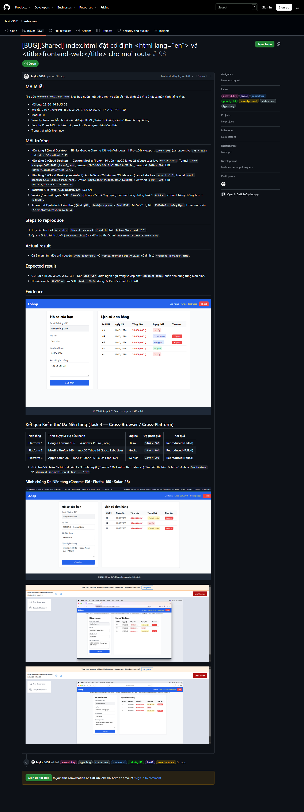

---

### 23120146-BUG-09: [BUG][Shared] Các màn hình /profile, /register, /forgot-password thiếu breadcrumb và link về trang chủ

- **GitHub Issue:** [#199](https://github.com/Taylor3691/eshop-sut/issues/199)

#### Mô tả lỗi

Các trang con `/profile`, `/register`, `/forgot-password` không có breadcrumb điều hướng và `/profile` không có link quay lại trang chủ trong nội dung chính.

- Mã bug: 23120146-BUG-09
- Yêu cầu / IA / Checklist: FR-23 / IA-03 / GUI-34
- Module: navigation
- Severity: minor — Lỗi giao diện, nhãn, định dạng hoặc điều hướng phụ; người dùng vẫn có thể hoàn thành luồng chính.
- Priority: P3 — Mức ưu tiên thấp, sửa khi tối ưu giao diện tổng thể.
- Trạng thái phát hiện: new

#### Môi trường

- **Nền tảng 1 (Local Desktop — Blink):** Google Chrome 136 trên Windows 11 Pro (x64); viewport `1440 × 900` (và responsive `375 × 812`); URL `http://localhost:5173`.
- **Nền tảng 2 (Cloud Desktop — Gecko):** Mozilla Firefox 160 trên macOS Tahoe 26 (Sauce Labs Live `eu-central-1`, Tunnel `oauth-hoangngoc3691-78411_tunnel_name`, Session `f2c7a95f3b92415db6162ba99af3212a`); viewport `1440 × 900`; URL `http://localhost.lvh.me:5173`.
- **Nền tảng 3 (Cloud Desktop — WebKit):** Apple Safari 26 trên macOS Tahoe 26 (Sauce Labs Live `eu-central-1`, Tunnel `oauth-hoangngoc3691-78411_tunnel_name`, Session `adc08edd334e4ed88d3bd654d2d9e8d8`); viewport `1440 × 900`; URL `https://localhost.lvh.me:5173`.
- **Backend API:** `http://localhost:3000` (SQLite).
- **Version/commit nguồn SUT:** `13e4a5c` (không sửa mã ứng dụng); commit bằng chứng Task 1: `8c68bec`; commit bằng chứng Task 3: `b88bc8d`.
- **Account & Định danh kiểm thử (`§6` & `§11`):** `test@eshop.com` / `Test1234!`, MSSV & Họ tên: `23120146 - Hoàng Ngọc`, Email sinh viên: `23120146@student.hcmus.edu.vn`.

#### Steps to reproduce

1. Truy cập `/profile`, `/register` và `/forgot-password`.
2. Tìm thanh breadcrumb hoặc liên kết điều hướng quay lại trang trước / trang chủ bên trong vùng `<main>`.

#### Actual result

- Cả `/profile`, `/register`, `/forgot-password` đều có `0` breadcrumb; trong `<main>` của `/profile` cũng không có liên kết quay lại trang chủ.

#### Expected result

- **GUI-34 / FR-23:** Hiển thị breadcrumb hoặc chỉ dẫn ngữ cảnh trang con/quay lại trang chủ rõ ràng (lưu ý `FR-23` ghi bắt buộc ở Giỏ hàng, Thanh toán, Chi tiết sản phẩm).
- Nguồn oracle: `README.md` của SUT; `IA-01..IA-04` dùng để tổ chức checklist HW03.

#### Evidence

#### Kết quả Kiểm thử Đa Nền tảng (Task 3 — Cross-Browser / Cross-Platform)

| Nền tảng | Trình duyệt & Hệ điều hành | Engine | Độ phân giải | Kết quả | Minh chứng Đa nền tảng |
| :--- | :--- | :---: | :---: | :---: | :--- |
| **Platform 1** | **Google Chrome 136** — Windows 11 Pro | Blink | `1440 × 900` | **Reproduced (Failed)** | [`chrome-profile.png`](screenshots/task3/chrome-profile.png) |
| **Platform 2** | **Mozilla Firefox 160** — macOS Tahoe 26 (Sauce Labs) | Gecko | `1440 × 900` | **Reproduced (Failed)** | [`firefox-profile.png`](screenshots/task3/firefox-profile.png) |
| **Platform 3** | **Apple Safari 26** — macOS Tahoe 26 (Sauce Labs) | WebKit | `1440 × 900` | **Reproduced (Failed)** | [`safari-profile.png`](screenshots/task3/safari-profile.png) |

- **Ghi chú đối chiếu đa trình duyệt:** Thiếu Breadcrumb trên cả 3 trình duyệt. Trên **Safari 26 (macOS 26)**, thanh địa chỉ thu gọn chỉ hiện tên miền `localhost.lvh.me` (ẩn đường dẫn con), làm tăng tác động của việc thiếu Breadcrumb.

##### Minh chứng Đa Nền tảng (Chrome 136 · Firefox 160 · Safari 26)

##### Ảnh chụp GitHub Issue [#199](https://github.com/Taylor3691/eshop-sut/issues/199)

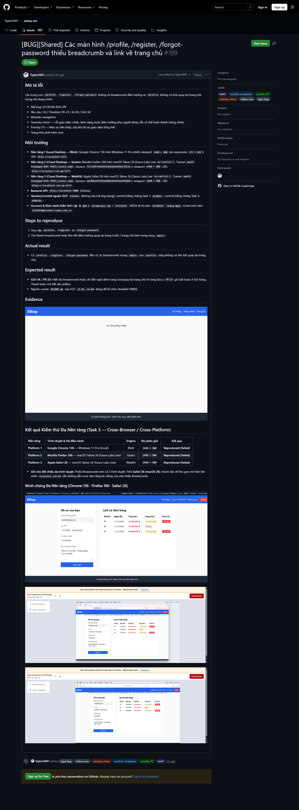

---

### 23120146-BUG-10: [BUG][Profile] Validation số điện thoại từ chối số hợp lệ 0912345678 nhưng chấp nhận số 9 chữ số 912345678

- **GitHub Issue:** [#200](https://github.com/Taylor3691/eshop-sut/issues/200)

#### Mô tả lỗi

Regex kiểm tra số điện thoại trong `Profile.jsx` bị viết sai (`/^[1-9][0-9]{8,9}$/`), chặn toàn bộ SĐT Việt Nam bắt đầu bằng `0` nhưng lại cho lưu SĐT sai đặc tả và báo lỗi bằng `window.alert()`.

- Mã bug: 23120146-BUG-10
- Yêu cầu / IA / Checklist: FR-04, FR-22 / IA-02 / GUI-14, GUI-15
- Module: ui
- Severity: critical — Ảnh hưởng nghiêm trọng đến bảo mật, toàn vẹn dữ liệu, luồng nghiệp vụ chính hoặc khả năng hoàn thành tác vụ.
- Priority: P0 — Cần ưu tiên xử lý ngay do chặn luồng chính hoặc gây rủi ro bảo mật/dữ liệu.
- Trạng thái phát hiện: new

#### Môi trường

- **Nền tảng 1 (Local Desktop — Blink):** Google Chrome 136 trên Windows 11 Pro (x64); viewport `1440 × 900` (và responsive `375 × 812`); URL `http://localhost:5173`.
- **Nền tảng 2 (Cloud Desktop — Gecko):** Mozilla Firefox 160 trên macOS Tahoe 26 (Sauce Labs Live `eu-central-1`, Tunnel `oauth-hoangngoc3691-78411_tunnel_name`, Session `f2c7a95f3b92415db6162ba99af3212a`); viewport `1440 × 900`; URL `http://localhost.lvh.me:5173`.
- **Nền tảng 3 (Cloud Desktop — WebKit):** Apple Safari 26 trên macOS Tahoe 26 (Sauce Labs Live `eu-central-1`, Tunnel `oauth-hoangngoc3691-78411_tunnel_name`, Session `adc08edd334e4ed88d3bd654d2d9e8d8`); viewport `1440 × 900`; URL `https://localhost.lvh.me:5173`.
- **Backend API:** `http://localhost:3000` (SQLite).
- **Version/commit nguồn SUT:** `13e4a5c` (không sửa mã ứng dụng); commit bằng chứng Task 1: `8c68bec`; commit bằng chứng Task 3: `b88bc8d`.
- **Account & Định danh kiểm thử (`§6` & `§11`):** `test@eshop.com` / `Test1234!`, MSSV & Họ tên: `23120146 - Hoàng Ngọc`, Email sinh viên: `23120146@student.hcmus.edu.vn`.

#### Steps to reproduce

1. Đăng nhập và mở `http://localhost:5173/profile`.
2. **Trường hợp 1 (`GUI-14`):** Nhập SĐT hợp lệ chuẩn Việt Nam `0912345678` (trùng chính placeholder `VD: 0912345678`) rồi bấm `"Cập nhật"`.
3. **Trường hợp 2 (`GUI-15`):** Nhập SĐT 9 chữ số không bắt đầu bằng `0` là `912345678` rồi bấm `"Cập nhật"`; thử thêm chuỗi ngắn `12345`.

#### Actual result

- **GUI-14:** SĐT hợp lệ `0912345678` bị client chặn với `alert("Số điện thoại không hợp lệ. Vui lòng nhập đúng 9-10 chữ số.")` (`Profile.jsx:43-46`) và không gửi `PUT /api/users/me`.
- **GUI-15:** SĐT sai đặc tả `912345678` lại được chấp nhận và gửi `PUT /api/users/me` thành công (`200 OK`); chuỗi ngắn `12345` hiển thị lỗi qua `window.alert()` thay vì hiển thị phía trên nút `"Cập nhật"`.

#### Expected result

- **GUI-14, GUI-15 / FR-04, FR-22:** Chấp nhận đúng SĐT bắt đầu bằng `0` dài `10–11` chữ số (`/^0[0-9]{9,10}$/`), từ chối số sai định dạng và hiển thị thông báo lỗi inline ngay phía trên nút `"Cập nhật"`.
- Nguồn oracle: `README.md` của SUT; `IA-01..IA-04` dùng để tổ chức checklist HW03.

#### Evidence

#### Kết quả Kiểm thử Đa Nền tảng (Task 3 — Cross-Browser / Cross-Platform)

| Nền tảng | Trình duyệt & Hệ điều hành | Engine | Độ phân giải | Kết quả | Minh chứng Đa nền tảng |
| :--- | :--- | :---: | :---: | :---: | :--- |
| **Platform 1** | **Google Chrome 136** — Windows 11 Pro | Blink | `1440 × 900` | **Reproduced (Failed)** | [`chrome-profile.png`](screenshots/task3/chrome-profile.png) |
| **Platform 2** | **Mozilla Firefox 160** — macOS Tahoe 26 (Sauce Labs) | Gecko | `1440 × 900` | **Reproduced (Failed)** | [`firefox-profile.png`](screenshots/task3/firefox-profile.png) |
| **Platform 3** | **Apple Safari 26** — macOS Tahoe 26 (Sauce Labs) | WebKit | `1440 × 900` | **Reproduced (Failed)** | [`safari-profile.png`](screenshots/task3/safari-profile.png) |

- **Ghi chú đối chiếu đa trình duyệt:** Regex `/^[1-9][0-9]{8,9}$/` chạy ở tầng JavaScript client nên chặn SĐT hợp lệ `0912345678` và chấp nhận SĐT 9 số `912345678` giống hệt nhau trên V8 (Chrome), SpiderMonkey (Firefox) và JavaScriptCore (Safari).

##### Minh chứng Đa Nền tảng (Chrome 136 · Firefox 160 · Safari 26)

##### Ảnh chụp GitHub Issue [#200](https://github.com/Taylor3691/eshop-sut/issues/200)

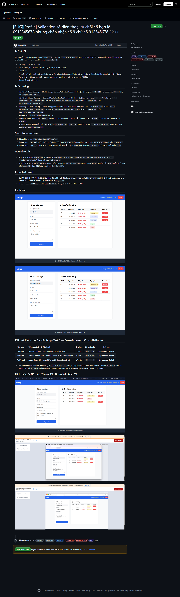

---

### 23120146-BUG-11: [BUG][Profile] Đơn hàng ở trạng thái "Đang giao" (shipping) vẫn hiển thị và cho phép bấm nút "Hủy đơn"

- **GitHub Issue:** [#201](https://github.com/Taylor3691/eshop-sut/issues/201)

#### Mô tả lỗi

Giao diện Lịch sử đơn hàng hiển thị nút `"Hủy đơn"` hoạt động cho cả đơn hàng đã chuyển sang trạng thái `shipping` (`Đang giao`).

- Mã bug: 23120146-BUG-11
- Yêu cầu / IA / Checklist: FR-10 / IA-04 / GUI-38
- Module: ui
- Severity: critical — Ảnh hưởng nghiêm trọng đến bảo mật, toàn vẹn dữ liệu, luồng nghiệp vụ chính hoặc khả năng hoàn thành tác vụ.
- Priority: P0 — Cần ưu tiên xử lý ngay do chặn luồng chính hoặc gây rủi ro bảo mật/dữ liệu.
- Trạng thái phát hiện: new

#### Môi trường

- **Nền tảng 1 (Local Desktop — Blink):** Google Chrome 136 trên Windows 11 Pro (x64); viewport `1440 × 900` (và responsive `375 × 812`); URL `http://localhost:5173`.
- **Nền tảng 2 (Cloud Desktop — Gecko):** Mozilla Firefox 160 trên macOS Tahoe 26 (Sauce Labs Live `eu-central-1`, Tunnel `oauth-hoangngoc3691-78411_tunnel_name`, Session `f2c7a95f3b92415db6162ba99af3212a`); viewport `1440 × 900`; URL `http://localhost.lvh.me:5173`.
- **Nền tảng 3 (Cloud Desktop — WebKit):** Apple Safari 26 trên macOS Tahoe 26 (Sauce Labs Live `eu-central-1`, Tunnel `oauth-hoangngoc3691-78411_tunnel_name`, Session `adc08edd334e4ed88d3bd654d2d9e8d8`); viewport `1440 × 900`; URL `https://localhost.lvh.me:5173`.
- **Backend API:** `http://localhost:3000` (SQLite).
- **Version/commit nguồn SUT:** `13e4a5c` (không sửa mã ứng dụng); commit bằng chứng Task 1: `8c68bec`; commit bằng chứng Task 3: `b88bc8d`.
- **Account & Định danh kiểm thử (`§6` & `§11`):** `test@eshop.com` / `Test1234!`, MSSV & Họ tên: `23120146 - Hoàng Ngọc`, Email sinh viên: `23120146@student.hcmus.edu.vn`.

#### Steps to reproduce

1. Chuẩn bị tài khoản `test@eshop.com` có đơn hàng ở trạng thái `shipping` (đã cập nhật qua Web Admin `http://localhost:5174`, đơn `#3`).
2. Mở `http://localhost:5173/profile` và quan sát cột `Thao tác` của đơn hàng `#3` (`Đang giao`).

#### Actual result

- Điều kiện render tại `Profile.jsx:200` (`o.status !== "delivered" && o.status !== "canceled"`) làm đơn `#3` ở trạng thái `"Đang giao"` (`shipping`) vẫn hiển thị nút `"Hủy đơn"` đang bật (`disabled=false`).

#### Expected result

- **GUI-38 / FR-10:** Nút `"Hủy đơn"` chỉ được hiển thị với đơn ở trạng thái `pending` (`Chờ xác nhận`) và `confirmed` (`Đã xác nhận`); không hiển thị/cho phép user tự hủy khi đơn đã sang `shipping`, `delivered`, `canceled`.
- Nguồn oracle: `README.md` của SUT; `IA-01..IA-04` dùng để tổ chức checklist HW03.

#### Evidence

#### Kết quả Kiểm thử Đa Nền tảng (Task 3 — Cross-Browser / Cross-Platform)

| Nền tảng | Trình duyệt & Hệ điều hành | Engine | Độ phân giải | Kết quả | Minh chứng Đa nền tảng |
| :--- | :--- | :---: | :---: | :---: | :--- |
| **Platform 1** | **Google Chrome 136** — Windows 11 Pro | Blink | `1440 × 900` | **Reproduced (Failed)** | [`chrome-profile.png`](screenshots/task3/chrome-profile.png) |
| **Platform 2** | **Mozilla Firefox 160** — macOS Tahoe 26 (Sauce Labs) | Gecko | `1440 × 900` | **Reproduced (Failed)** | [`firefox-profile.png`](screenshots/task3/firefox-profile.png) |
| **Platform 3** | **Apple Safari 26** — macOS Tahoe 26 (Sauce Labs) | WebKit | `1440 × 900` | **Reproduced (Failed)** | [`safari-profile.png`](screenshots/task3/safari-profile.png) |

- **Ghi chú đối chiếu đa trình duyệt:** Lỗi bắt nguồn từ mã nguồn JSX/CSS/API của ứng dụng nên tái hiện đồng nhất 100% trên cả 3 nền tảng: **Google Chrome 136 (Windows 11 — Blink)**, **Mozilla Firefox 160 (macOS Tahoe 26 — Gecko)** và **Apple Safari 26 (macOS Tahoe 26 — WebKit)**.

##### Minh chứng Đa Nền tảng (Chrome 136 · Firefox 160 · Safari 26)

##### Ảnh chụp GitHub Issue [#201](https://github.com/Taylor3691/eshop-sut/issues/201)

---

### 23120146-BUG-12: [BUG][Profile] Bấm nút "Hủy đơn" gọi API hủy đơn ngay lập tức không có dialog xác nhận

- **GitHub Issue:** [#202](https://github.com/Taylor3691/eshop-sut/issues/202)

#### Mô tả lỗi

Thao tác nguy hiểm `"Hủy đơn"` gửi thẳng request `PUT /api/orders/:id/cancel` ngay sau một lần click mà không hỏi xác nhận người dùng.

- Mã bug: 23120146-BUG-12
- Yêu cầu / IA / Checklist: FR-24, FR-21 / IA-04 / GUI-39
- Module: ui
- Severity: major — Ảnh hưởng hành vi nghiệp vụ, validation, phản hồi trạng thái hoặc khả năng sử dụng của chức năng chính.
- Priority: P1 — Ưu tiên kiểm tra/sửa sớm vì ảnh hưởng trực tiếp trải nghiệm và tính đúng đắn nghiệp vụ.
- Trạng thái phát hiện: new

#### Môi trường

- **Nền tảng 1 (Local Desktop — Blink):** Google Chrome 136 trên Windows 11 Pro (x64); viewport `1440 × 900` (và responsive `375 × 812`); URL `http://localhost:5173`.
- **Nền tảng 2 (Cloud Desktop — Gecko):** Mozilla Firefox 160 trên macOS Tahoe 26 (Sauce Labs Live `eu-central-1`, Tunnel `oauth-hoangngoc3691-78411_tunnel_name`, Session `f2c7a95f3b92415db6162ba99af3212a`); viewport `1440 × 900`; URL `http://localhost.lvh.me:5173`.
- **Nền tảng 3 (Cloud Desktop — WebKit):** Apple Safari 26 trên macOS Tahoe 26 (Sauce Labs Live `eu-central-1`, Tunnel `oauth-hoangngoc3691-78411_tunnel_name`, Session `adc08edd334e4ed88d3bd654d2d9e8d8`); viewport `1440 × 900`; URL `https://localhost.lvh.me:5173`.
- **Backend API:** `http://localhost:3000` (SQLite).
- **Version/commit nguồn SUT:** `13e4a5c` (không sửa mã ứng dụng); commit bằng chứng Task 1: `8c68bec`; commit bằng chứng Task 3: `b88bc8d`.
- **Account & Định danh kiểm thử (`§6` & `§11`):** `test@eshop.com` / `Test1234!`, MSSV & Họ tên: `23120146 - Hoàng Ngọc`, Email sinh viên: `23120146@student.hcmus.edu.vn`.

#### Steps to reproduce

1. Đăng nhập bằng tài khoản có đơn hàng trạng thái `Chờ xác nhận` (vd đơn `#1`) tại `http://localhost:5173/profile`.
2. Click nút `"Hủy đơn"` trong bảng Lịch sử đơn hàng.

#### Actual result

- Bấm `"Hủy đơn"` kích hoạt trực tiếp `cancelOrder(o.id)` (`Profile.jsx:66-80, 202`) gọi ngay `PUT /api/orders/1/cancel` mà không mở dialog xác nhận trước khi hủy.

#### Expected result

- **GUI-39 / FR-24, FR-21:** Khi bấm `"Hủy đơn"`, hệ thống phải mở hộp thoại xác nhận; chỉ gửi API hủy đơn khi người dùng xác nhận đồng ý.
- Nguồn oracle: `README.md` của SUT; `IA-01..IA-04` dùng để tổ chức checklist HW03.

#### Evidence

#### Kết quả Kiểm thử Đa Nền tảng (Task 3 — Cross-Browser / Cross-Platform)

| Nền tảng | Trình duyệt & Hệ điều hành | Engine | Độ phân giải | Kết quả | Minh chứng Đa nền tảng |
| :--- | :--- | :---: | :---: | :---: | :--- |
| **Platform 1** | **Google Chrome 136** — Windows 11 Pro | Blink | `1440 × 900` | **Reproduced (Failed)** | [`chrome-profile.png`](screenshots/task3/chrome-profile.png) |
| **Platform 2** | **Mozilla Firefox 160** — macOS Tahoe 26 (Sauce Labs) | Gecko | `1440 × 900` | **Reproduced (Failed)** | [`firefox-profile.png`](screenshots/task3/firefox-profile.png) |
| **Platform 3** | **Apple Safari 26** — macOS Tahoe 26 (Sauce Labs) | WebKit | `1440 × 900` | **Reproduced (Failed)** | [`safari-profile.png`](screenshots/task3/safari-profile.png) |

- **Ghi chú đối chiếu đa trình duyệt:** Lỗi bắt nguồn từ mã nguồn JSX/CSS/API của ứng dụng nên tái hiện đồng nhất 100% trên cả 3 nền tảng: **Google Chrome 136 (Windows 11 — Blink)**, **Mozilla Firefox 160 (macOS Tahoe 26 — Gecko)** và **Apple Safari 26 (macOS Tahoe 26 — WebKit)**.

##### Minh chứng Đa Nền tảng (Chrome 136 · Firefox 160 · Safari 26)

##### Ảnh chụp GitHub Issue [#202](https://github.com/Taylor3691/eshop-sut/issues/202)

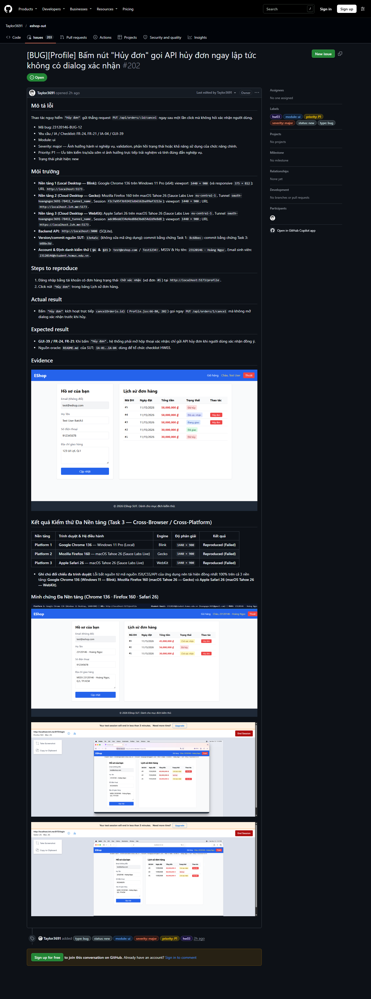

---

### 23120146-BUG-13: [BUG][Profile][Responsive] Bảng Lịch sử đơn hàng thiếu overflow-x-auto gây tràn ngang trên mobile 375px

- **GitHub Issue:** [#203](https://github.com/Taylor3691/eshop-sut/issues/203)

#### Mô tả lỗi

Bảng 5 cột `Lịch sử đơn hàng` trên `/profile` không được bọc container cuộn ngang, gây tràn card và tạo thanh cuộn ngang toàn trang ở màn hình nhỏ.

- Mã bug: 23120146-BUG-13
- Yêu cầu / IA / Checklist: FR-21, WCAG 1.4.4, WCAG 1.4.10 / IA-01 / GUI-11, GUI-47
- Module: ui
- Severity: major — Ảnh hưởng hành vi nghiệp vụ, validation, phản hồi trạng thái hoặc khả năng sử dụng của chức năng chính.
- Priority: P1 — Ưu tiên kiểm tra/sửa sớm vì ảnh hưởng trực tiếp trải nghiệm và tính đúng đắn nghiệp vụ.
- Trạng thái phát hiện: new

#### Môi trường

- **Nền tảng 1 (Local Desktop — Blink):** Google Chrome 136 trên Windows 11 Pro (x64); viewport `1440 × 900` (và responsive `375 × 812`); URL `http://localhost:5173`.
- **Nền tảng 2 (Cloud Desktop — Gecko):** Mozilla Firefox 160 trên macOS Tahoe 26 (Sauce Labs Live `eu-central-1`, Tunnel `oauth-hoangngoc3691-78411_tunnel_name`, Session `f2c7a95f3b92415db6162ba99af3212a`); viewport `1440 × 900`; URL `http://localhost.lvh.me:5173`.
- **Nền tảng 3 (Cloud Desktop — WebKit):** Apple Safari 26 trên macOS Tahoe 26 (Sauce Labs Live `eu-central-1`, Tunnel `oauth-hoangngoc3691-78411_tunnel_name`, Session `adc08edd334e4ed88d3bd654d2d9e8d8`); viewport `1440 × 900`; URL `https://localhost.lvh.me:5173`.
- **Backend API:** `http://localhost:3000` (SQLite).
- **Version/commit nguồn SUT:** `13e4a5c` (không sửa mã ứng dụng); commit bằng chứng Task 1: `8c68bec`; commit bằng chứng Task 3: `b88bc8d`.
- **Account & Định danh kiểm thử (`§6` & `§11`):** `test@eshop.com` / `Test1234!`, MSSV & Họ tên: `23120146 - Hoàng Ngọc`, Email sinh viên: `23120146@student.hcmus.edu.vn`.

#### Steps to reproduce

1. Đăng nhập bằng tài khoản có ít nhất 1 đơn hàng và mở `http://localhost:5173/profile`.
2. Đặt kích thước viewport về `375 × 812` trên Chrome DevTools (kiểm tra song song `/register` và `/forgot-password`).
3. Đo chiều rộng card, bảng `<table>` và `document.documentElement.scrollWidth`.

#### Actual result

- Card Lịch sử đơn hàng rộng `343.2px` (`overflowX: visible`, không có `overflow-x-auto` quanh `<table>` ở `Profile.jsx:171`), nên bảng 5 cột (`355.7px`) tràn ra ngoài card `37.3px` và làm toàn trang bị tràn ngang (`docScrollWidth: 397 > docClientWidth: 375`).
- Hai màn hình `/register` và `/forgot-password` không bị tràn ngang ở `375 × 812`.

#### Expected result

- **GUI-11, GUI-47 / FR-21, WCAG 1.4.10:** Bảng Lịch sử đơn hàng phải được bọc `overflow-x-auto` (hoặc chuyển card trên mobile), giữ `scrollWidth <= clientWidth` của toàn trang.
- Nguồn oracle: `README.md` của SUT; `IA-01..IA-04` dùng để tổ chức checklist HW03.

#### Evidence

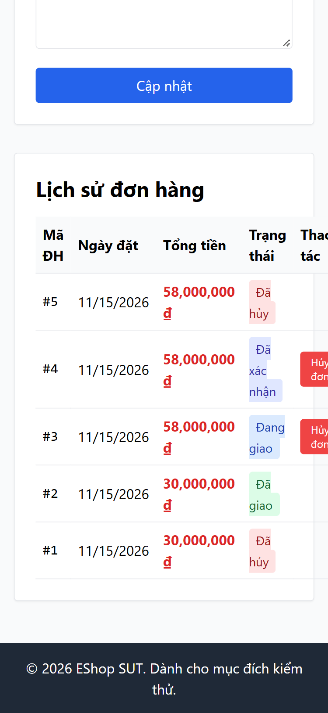

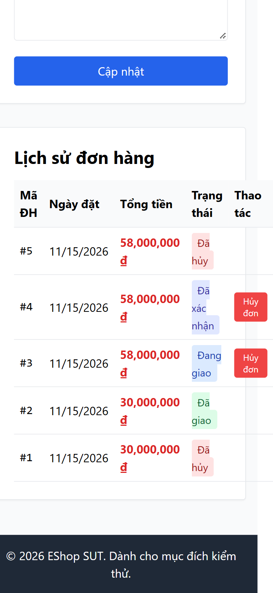

#### Kết quả Kiểm thử Đa Nền tảng (Task 3 — Cross-Browser / Cross-Platform)

| Nền tảng | Trình duyệt & Hệ điều hành | Engine | Độ phân giải | Kết quả | Minh chứng Đa nền tảng |
| :--- | :--- | :---: | :---: | :---: | :--- |
| **Platform 1** | **Google Chrome 136** — Windows 11 Pro | Blink | `1440 × 900` | **Reproduced (Failed)** | [`chrome-profile.png`](screenshots/task3/chrome-profile.png) |
| **Platform 2** | **Mozilla Firefox 160** — macOS Tahoe 26 (Sauce Labs) | Gecko | `1440 × 900` | **Reproduced (Failed)** | [`firefox-profile.png`](screenshots/task3/firefox-profile.png) |
| **Platform 3** | **Apple Safari 26** — macOS Tahoe 26 (Sauce Labs) | WebKit | `1440 × 900` | **Reproduced (Failed)** | [`safari-profile.png`](screenshots/task3/safari-profile.png) |

- **Ghi chú đối chiếu đa trình duyệt:** Khi thu hẹp viewport về `375 × 812`, bảng 5 cột `Lịch sử đơn hàng` thiếu `overflow-x-auto` gây tràn ngang trên cả Blink, Gecko và WebKit; ở desktop `1440 × 900` hiển thị đầy đủ 5 cột.

##### Minh chứng Đa Nền tảng (Chrome 136 · Firefox 160 · Safari 26)

##### Ảnh chụp GitHub Issue [#203](https://github.com/Taylor3691/eshop-sut/issues/203)

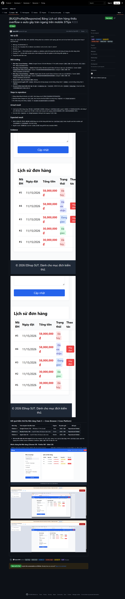

---

### 23120146-BUG-14: [BUG][Profile] Truy cập /profile khi chưa đăng nhập không chuyển hướng hoặc có link tới /login

- **GitHub Issue:** [#204](https://github.com/Taylor3691/eshop-sut/issues/204)

#### Mô tả lỗi

Khi người dùng chưa đăng nhập mở thẳng `/profile`, trang chỉ hiện dòng chữ tĩnh `"Vui lòng đăng nhập"` mà không tự điều hướng hoặc cung cấp nút/link sang `/login`.

- Mã bug: 23120146-BUG-14
- Yêu cầu / IA / Checklist: FR-04, FR-11 / IA-03 / GUI-29
- Module: navigation
- Severity: major — Ảnh hưởng hành vi nghiệp vụ, validation, phản hồi trạng thái hoặc khả năng sử dụng của chức năng chính.
- Priority: P1 — Ưu tiên kiểm tra/sửa sớm vì ảnh hưởng trực tiếp trải nghiệm và tính đúng đắn nghiệp vụ.
- Trạng thái phát hiện: new

#### Môi trường

- **Nền tảng 1 (Local Desktop — Blink):** Google Chrome 136 trên Windows 11 Pro (x64); viewport `1440 × 900` (và responsive `375 × 812`); URL `http://localhost:5173`.
- **Nền tảng 2 (Cloud Desktop — Gecko):** Mozilla Firefox 160 trên macOS Tahoe 26 (Sauce Labs Live `eu-central-1`, Tunnel `oauth-hoangngoc3691-78411_tunnel_name`, Session `f2c7a95f3b92415db6162ba99af3212a`); viewport `1440 × 900`; URL `http://localhost.lvh.me:5173`.
- **Nền tảng 3 (Cloud Desktop — WebKit):** Apple Safari 26 trên macOS Tahoe 26 (Sauce Labs Live `eu-central-1`, Tunnel `oauth-hoangngoc3691-78411_tunnel_name`, Session `adc08edd334e4ed88d3bd654d2d9e8d8`); viewport `1440 × 900`; URL `https://localhost.lvh.me:5173`.
- **Backend API:** `http://localhost:3000` (SQLite).
- **Version/commit nguồn SUT:** `13e4a5c` (không sửa mã ứng dụng); commit bằng chứng Task 1: `8c68bec`; commit bằng chứng Task 3: `b88bc8d`.
- **Account & Định danh kiểm thử (`§6` & `§11`):** `test@eshop.com` / `Test1234!`, MSSV & Họ tên: `23120146 - Hoàng Ngọc`, Email sinh viên: `23120146@student.hcmus.edu.vn`.

#### Steps to reproduce

1. Đảm bảo trình duyệt ở trạng thái chưa đăng nhập (không có `token` trong `localStorage`).
2. Mở trực tiếp URL `http://localhost:5173/profile`.

#### Actual result

- Trang không redirect về `/login` và chỉ hiển thị dòng text tĩnh `
Vui lòng đăng nhập
` (`Profile.jsx:108`) với `0` liên kết hoặc nút bấm tới `/login`.

#### Expected result

- **GUI-29 / FR-04, FR-11:** Khi chưa đăng nhập, truy cập `/profile` phải chuyển hướng về `/login` hoặc hiển thị thông báo kèm nút/link điều hướng rõ ràng tới trang đăng nhập.
- Nguồn oracle: `README.md` của SUT; `IA-01..IA-04` dùng để tổ chức checklist HW03.

#### Evidence

#### Kết quả Kiểm thử Đa Nền tảng (Task 3 — Cross-Browser / Cross-Platform)

| Nền tảng | Trình duyệt & Hệ điều hành | Engine | Độ phân giải | Kết quả | Minh chứng Đa nền tảng |
| :--- | :--- | :---: | :---: | :---: | :--- |
| **Platform 1** | **Google Chrome 136** — Windows 11 Pro | Blink | `1440 × 900` | **Reproduced (Failed)** | [`chrome-profile.png`](screenshots/task3/chrome-profile.png) |
| **Platform 2** | **Mozilla Firefox 160** — macOS Tahoe 26 (Sauce Labs) | Gecko | `1440 × 900` | **Reproduced (Failed)** | [`firefox-profile.png`](screenshots/task3/firefox-profile.png) |
| **Platform 3** | **Apple Safari 26** — macOS Tahoe 26 (Sauce Labs) | WebKit | `1440 × 900` | **Reproduced (Failed)** | [`safari-profile.png`](screenshots/task3/safari-profile.png) |

- **Ghi chú đối chiếu đa trình duyệt:** Lỗi bắt nguồn từ mã nguồn JSX/CSS/API của ứng dụng nên tái hiện đồng nhất 100% trên cả 3 nền tảng: **Google Chrome 136 (Windows 11 — Blink)**, **Mozilla Firefox 160 (macOS Tahoe 26 — Gecko)** và **Apple Safari 26 (macOS Tahoe 26 — WebKit)**.

##### Minh chứng Đa Nền tảng (Chrome 136 · Firefox 160 · Safari 26)

##### Ảnh chụp GitHub Issue [#204](https://github.com/Taylor3691/eshop-sut/issues/204)

---

### 23120146-BUG-15: [BUG][Profile] Thiếu trạng thái loading nên khi F5 tải lại trang bị nháy màn hình "Vui lòng đăng nhập"

- **GitHub Issue:** [#205](https://github.com/Taylor3691/eshop-sut/issues/205)

#### Mô tả lỗi

`AuthContext` không quản lý biến trạng thái đang xác thực token, khiến khi F5 tải lại `/profile` lúc mạng chậm giao diện bị nháy trạng thái chưa đăng nhập.

- Mã bug: 23120146-BUG-15
- Yêu cầu / IA / Checklist: FR-24, FR-05 / IA-04 / GUI-35
- Module: ui
- Severity: major — Ảnh hưởng hành vi nghiệp vụ, validation, phản hồi trạng thái hoặc khả năng sử dụng của chức năng chính.
- Priority: P2 — Xử lý ở vòng cải thiện tiếp theo để đồng bộ đặc tả UI/UX.
- Trạng thái phát hiện: new

#### Môi trường

- **Nền tảng 1 (Local Desktop — Blink):** Google Chrome 136 trên Windows 11 Pro (x64); viewport `1440 × 900` (và responsive `375 × 812`); URL `http://localhost:5173`.
- **Nền tảng 2 (Cloud Desktop — Gecko):** Mozilla Firefox 160 trên macOS Tahoe 26 (Sauce Labs Live `eu-central-1`, Tunnel `oauth-hoangngoc3691-78411_tunnel_name`, Session `f2c7a95f3b92415db6162ba99af3212a`); viewport `1440 × 900`; URL `http://localhost.lvh.me:5173`.
- **Nền tảng 3 (Cloud Desktop — WebKit):** Apple Safari 26 trên macOS Tahoe 26 (Sauce Labs Live `eu-central-1`, Tunnel `oauth-hoangngoc3691-78411_tunnel_name`, Session `adc08edd334e4ed88d3bd654d2d9e8d8`); viewport `1440 × 900`; URL `https://localhost.lvh.me:5173`.
- **Backend API:** `http://localhost:3000` (SQLite).
- **Version/commit nguồn SUT:** `13e4a5c` (không sửa mã ứng dụng); commit bằng chứng Task 1: `8c68bec`; commit bằng chứng Task 3: `b88bc8d`.
- **Account & Định danh kiểm thử (`§6` & `§11`):** `test@eshop.com` / `Test1234!`, MSSV & Họ tên: `23120146 - Hoàng Ngọc`, Email sinh viên: `23120146@student.hcmus.edu.vn`.

#### Steps to reproduce

1. Đăng nhập và đứng tại trang `http://localhost:5173/profile`.
2. Bật giả lập mạng `Slow 3G` trong Chrome DevTools và nhấn F5 tải lại trang.
3. Quan sát giao diện Header và nội dung `/profile` trong lúc chờ `GET /api/users/me` phản hồi.

#### Actual result

- `AuthContext.jsx:7-24` khởi tạo `user = null` và không có `loading` flag; trong lúc chờ API trả về, Header hiển thị tạm `"Đăng nhập" / "Đăng ký"` còn vùng nội dung nháy chữ `"Vui lòng đăng nhập"` không có spinner/skeleton.

#### Expected result

- **GUI-35 / FR-24:** Khi đang kiểm tra phiên và tải dữ liệu hồ sơ/đơn hàng, hệ thống phải hiển thị trạng thái loading/skeleton, tránh nháy màn hình chưa đăng nhập giả.
- Nguồn oracle: `README.md` của SUT; `IA-01..IA-04` dùng để tổ chức checklist HW03.

#### Evidence

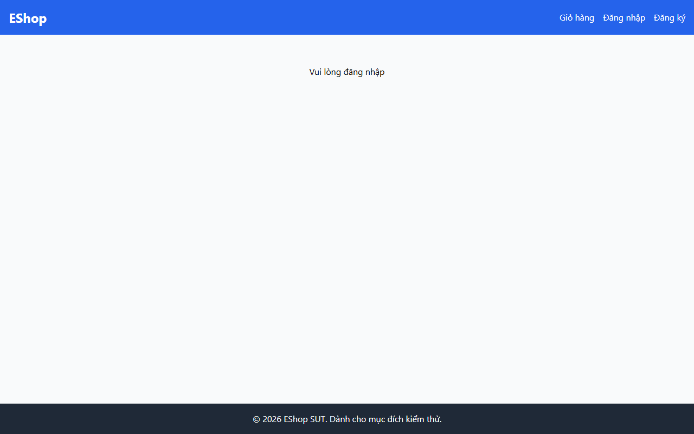

#### Kết quả Kiểm thử Đa Nền tảng (Task 3 — Cross-Browser / Cross-Platform)

| Nền tảng | Trình duyệt & Hệ điều hành | Engine | Độ phân giải | Kết quả | Minh chứng Đa nền tảng |
| :--- | :--- | :---: | :---: | :---: | :--- |
| **Platform 1** | **Google Chrome 136** — Windows 11 Pro | Blink | `1440 × 900` | **Reproduced (Failed)** | [`chrome-profile.png`](screenshots/task3/chrome-profile.png) |
| **Platform 2** | **Mozilla Firefox 160** — macOS Tahoe 26 (Sauce Labs) | Gecko | `1440 × 900` | **Reproduced (Failed)** | [`firefox-profile.png`](screenshots/task3/firefox-profile.png) |
| **Platform 3** | **Apple Safari 26** — macOS Tahoe 26 (Sauce Labs) | WebKit | `1440 × 900` | **Reproduced (Failed)** | [`safari-profile.png`](screenshots/task3/safari-profile.png) |

- **Ghi chú đối chiếu đa trình duyệt:** Lỗi bắt nguồn từ mã nguồn JSX/CSS/API của ứng dụng nên tái hiện đồng nhất 100% trên cả 3 nền tảng: **Google Chrome 136 (Windows 11 — Blink)**, **Mozilla Firefox 160 (macOS Tahoe 26 — Gecko)** và **Apple Safari 26 (macOS Tahoe 26 — WebKit)**.

##### Minh chứng Đa Nền tảng (Chrome 136 · Firefox 160 · Safari 26)

##### Ảnh chụp GitHub Issue [#205](https://github.com/Taylor3691/eshop-sut/issues/205)

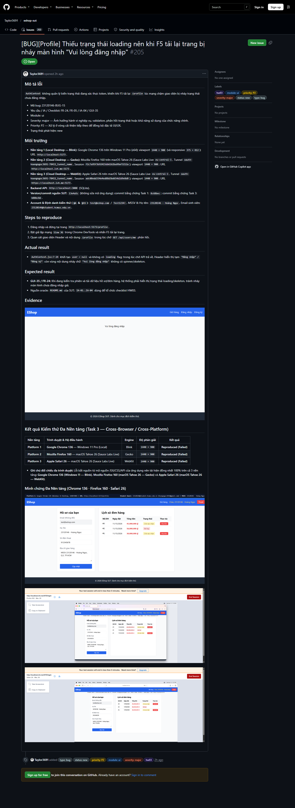

---

### 23120146-BUG-16: [BUG][Profile] Cập nhật hồ sơ không đồng bộ tên mới lên Navbar và dùng window.alert() chặn UI

- **GitHub Issue:** [#206](https://github.com/Taylor3691/eshop-sut/issues/206)

#### Mô tả lỗi

Cập nhật hồ sơ dùng hộp thoại chặn `window.alert()` thay vì phản hồi trực quan không chặn luồng, đồng thời không đồng bộ tên mới lên Header (`Chào, ...`) ngay lập tức.

- Mã bug: 23120146-BUG-16
- Yêu cầu / IA / Checklist: FR-24, FR-04, WCAG 4.1.3 / IA-04 / GUI-36, GUI-49
- Module: ui
- Severity: major — Ảnh hưởng hành vi nghiệp vụ, validation, phản hồi trạng thái hoặc khả năng sử dụng của chức năng chính.
- Priority: P1 — Ưu tiên kiểm tra/sửa sớm vì ảnh hưởng trực tiếp trải nghiệm và tính đúng đắn nghiệp vụ.
- Trạng thái phát hiện: new

#### Môi trường

- **Nền tảng 1 (Local Desktop — Blink):** Google Chrome 136 trên Windows 11 Pro (x64); viewport `1440 × 900` (và responsive `375 × 812`); URL `http://localhost:5173`.
- **Nền tảng 2 (Cloud Desktop — Gecko):** Mozilla Firefox 160 trên macOS Tahoe 26 (Sauce Labs Live `eu-central-1`, Tunnel `oauth-hoangngoc3691-78411_tunnel_name`, Session `f2c7a95f3b92415db6162ba99af3212a`); viewport `1440 × 900`; URL `http://localhost.lvh.me:5173`.
- **Nền tảng 3 (Cloud Desktop — WebKit):** Apple Safari 26 trên macOS Tahoe 26 (Sauce Labs Live `eu-central-1`, Tunnel `oauth-hoangngoc3691-78411_tunnel_name`, Session `adc08edd334e4ed88d3bd654d2d9e8d8`); viewport `1440 × 900`; URL `https://localhost.lvh.me:5173`.
- **Backend API:** `http://localhost:3000` (SQLite).
- **Version/commit nguồn SUT:** `13e4a5c` (không sửa mã ứng dụng); commit bằng chứng Task 1: `8c68bec`; commit bằng chứng Task 3: `b88bc8d`.
- **Account & Định danh kiểm thử (`§6` & `§11`):** `test@eshop.com` / `Test1234!`, MSSV & Họ tên: `23120146 - Hoàng Ngọc`, Email sinh viên: `23120146@student.hcmus.edu.vn`.

#### Steps to reproduce

1. Đăng nhập và mở `http://localhost:5173/profile`.
2. Sửa `Họ Tên` sang giá trị mới và nhập SĐT thỏa điều kiện regex hiện tại (vd `912345678`), sau đó bấm `"Cập nhật"`.
3. Quan sát loại thông báo xuất hiện, phản hồi bàn phím/focus và tên hiển thị ở Navbar (`Chào, ...`); kiểm tra thêm hộp thoại `alert()` khi hủy đơn hoặc thao tác trên `/forgot-password`.

#### Actual result

- **GUI-36:** `Profile.jsx:60` gọi `window.alert("Cập nhật thành công!")` chặn trình duyệt thay vì toast/banner trực quan, và `AuthContext` không cập nhật lại `user.name` nên tên trên Navbar giữ nguyên giá trị cũ cho tới khi F5.
- **GUI-49:** Nhiều thông báo thành công/lỗi trên `/profile` và `/forgot-password` đều dùng `window.alert()`, làm khóa luồng tương tác bàn phím/screen reader và phát sinh hiển thị dấu câu kép trong log cảnh báo (`".."` / `"!."`).

#### Expected result

- **GUI-36, GUI-49 / FR-24, FR-04, WCAG 4.1.3:** Thay `window.alert()` bằng toast/banner inline dùng `role="alert"` hoặc `aria-live`, đồng thời cập nhật ngay `user.name` trên Navbar sau khi lưu hồ sơ thành công.
- Nguồn oracle: `README.md` của SUT; `IA-01..IA-04` dùng để tổ chức checklist HW03.

#### Evidence

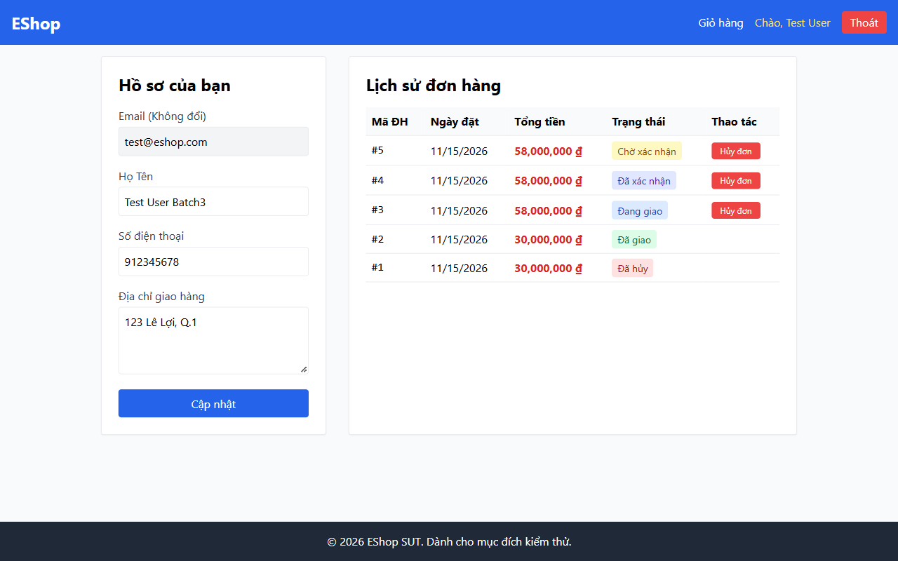

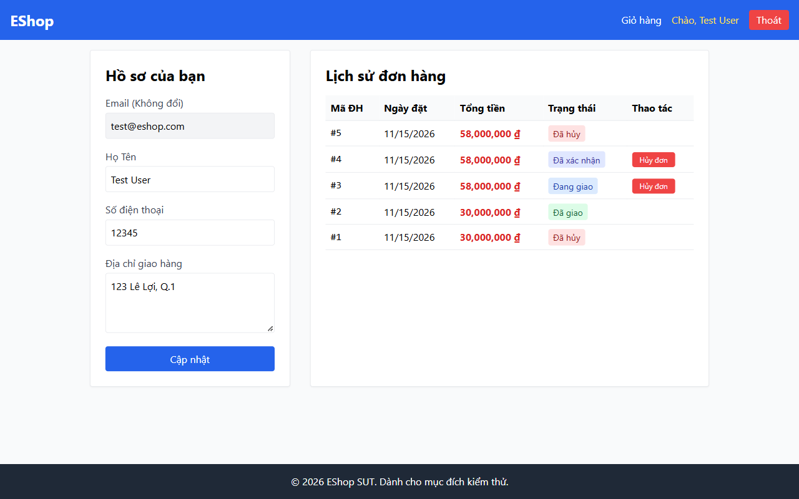

#### Kết quả Kiểm thử Đa Nền tảng (Task 3 — Cross-Browser / Cross-Platform)

| Nền tảng | Trình duyệt & Hệ điều hành | Engine | Độ phân giải | Kết quả | Minh chứng Đa nền tảng |
| :--- | :--- | :---: | :---: | :---: | :--- |
| **Platform 1** | **Google Chrome 136** — Windows 11 Pro | Blink | `1440 × 900` | **Reproduced (Failed)** | [`chrome-profile.png`](screenshots/task3/chrome-profile.png) |
| **Platform 2** | **Mozilla Firefox 160** — macOS Tahoe 26 (Sauce Labs) | Gecko | `1440 × 900` | **Reproduced (Failed)** | [`firefox-profile.png`](screenshots/task3/firefox-profile.png) |
| **Platform 3** | **Apple Safari 26** — macOS Tahoe 26 (Sauce Labs) | WebKit | `1440 × 900` | **Reproduced (Failed)** | [`safari-profile.png`](screenshots/task3/safari-profile.png) |

- **Ghi chú đối chiếu đa trình duyệt:** Hộp thoại native `window.alert()` khóa luồng UI trên cả 3 trình duyệt (Chrome hiện popup đầu tab, Firefox hiện modal giữa trang, Safari macOS hiện sheet trượt từ thanh tiêu đề), và tên trên Header đều không tự cập nhật nếu chưa tải lại trang.

##### Minh chứng Đa Nền tảng (Chrome 136 · Firefox 160 · Safari 26)

##### Ảnh chụp GitHub Issue [#206](https://github.com/Taylor3691/eshop-sut/issues/206)

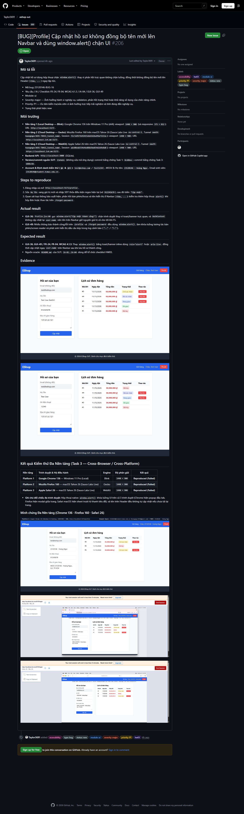

---

### 23120146-BUG-17: [BUG][Profile] Đăng xuất ở tab khác không đồng bộ khiến tab /profile vẫn gửi JWT cũ cập nhật DB

- **GitHub Issue:** [#207](https://github.com/Taylor3691/eshop-sut/issues/207)

#### Mô tả lỗi

Khi người dùng đã bấm đăng xuất ở tab thứ 2, tab `/profile` đang mở không lắng nghe sự kiện `storage` nên vẫn giữ JWT trong state và cập nhật CSDL thành công.

- Mã bug: 23120146-BUG-17
- Yêu cầu / IA / Checklist: FR-02, FR-04 / IA-04 / GUI-52
- Module: ui
- Severity: critical — Ảnh hưởng nghiêm trọng đến bảo mật, toàn vẹn dữ liệu, luồng nghiệp vụ chính hoặc khả năng hoàn thành tác vụ.
- Priority: P1 — Ưu tiên kiểm tra/sửa sớm vì ảnh hưởng trực tiếp trải nghiệm và tính đúng đắn nghiệp vụ.
- Trạng thái phát hiện: new

#### Môi trường

- **Nền tảng 1 (Local Desktop — Blink):** Google Chrome 136 trên Windows 11 Pro (x64); viewport `1440 × 900` (và responsive `375 × 812`); URL `http://localhost:5173`.
- **Nền tảng 2 (Cloud Desktop — Gecko):** Mozilla Firefox 160 trên macOS Tahoe 26 (Sauce Labs Live `eu-central-1`, Tunnel `oauth-hoangngoc3691-78411_tunnel_name`, Session `f2c7a95f3b92415db6162ba99af3212a`); viewport `1440 × 900`; URL `http://localhost.lvh.me:5173`.
- **Nền tảng 3 (Cloud Desktop — WebKit):** Apple Safari 26 trên macOS Tahoe 26 (Sauce Labs Live `eu-central-1`, Tunnel `oauth-hoangngoc3691-78411_tunnel_name`, Session `adc08edd334e4ed88d3bd654d2d9e8d8`); viewport `1440 × 900`; URL `https://localhost.lvh.me:5173`.
- **Backend API:** `http://localhost:3000` (SQLite).
- **Version/commit nguồn SUT:** `13e4a5c` (không sửa mã ứng dụng); commit bằng chứng Task 1: `8c68bec`; commit bằng chứng Task 3: `b88bc8d`.
- **Account & Định danh kiểm thử (`§6` & `§11`):** `test@eshop.com` / `Test1234!`, MSSV & Họ tên: `23120146 - Hoàng Ngọc`, Email sinh viên: `23120146@student.hcmus.edu.vn`.

#### Steps to reproduce

1. Đăng nhập cùng một tài khoản và mở `http://localhost:5173/profile` ở Tab 1 và `http://localhost:5173/` ở Tab 2.
2. Tại Tab 2, bấm nút đăng xuất (`"Thoát"`) để xóa `localStorage.token`.
3. Quay lại Tab 1 (`/profile`), chỉnh sửa thông tin hồ sơ rồi bấm `"Cập nhật"`.

#### Actual result

- Tab 1 không đồng bộ trạng thái đăng xuất (`AuthContext.jsx` chỉ đọc `localStorage` lúc mount và JWT không bị thu hồi phía server), nên bấm `"Cập nhật"` ở Tab 1 vẫn gửi token cũ trong bộ nhớ khiến `PUT /api/users/me` trả về `200 OK` và ghi đè DB.

#### Expected result

- **GUI-52 / FR-02, FR-04:** Khi token bị xóa ở tab khác hoặc hết hạn (`401`/`403`), hệ thống phải đồng bộ đăng xuất, chặn thao tác lưu và thông báo/điều hướng an toàn về `/login`.
- Nguồn oracle: `README.md` của SUT; `IA-01..IA-04` dùng để tổ chức checklist HW03.

#### Evidence

#### Kết quả Kiểm thử Đa Nền tảng (Task 3 — Cross-Browser / Cross-Platform)

| Nền tảng | Trình duyệt & Hệ điều hành | Engine | Độ phân giải | Kết quả | Minh chứng Đa nền tảng |
| :--- | :--- | :---: | :---: | :---: | :--- |
| **Platform 1** | **Google Chrome 136** — Windows 11 Pro | Blink | `1440 × 900` | **Reproduced (Failed)** | [`chrome-profile.png`](screenshots/task3/chrome-profile.png) |
| **Platform 2** | **Mozilla Firefox 160** — macOS Tahoe 26 (Sauce Labs) | Gecko | `1440 × 900` | **Reproduced (Failed)** | [`firefox-profile.png`](screenshots/task3/firefox-profile.png) |
| **Platform 3** | **Apple Safari 26** — macOS Tahoe 26 (Sauce Labs) | WebKit | `1440 × 900` | **Reproduced (Failed)** | [`safari-profile.png`](screenshots/task3/safari-profile.png) |

- **Ghi chú đối chiếu đa trình duyệt:** Lỗi bắt nguồn từ mã nguồn JSX/CSS/API của ứng dụng nên tái hiện đồng nhất 100% trên cả 3 nền tảng: **Google Chrome 136 (Windows 11 — Blink)**, **Mozilla Firefox 160 (macOS Tahoe 26 — Gecko)** và **Apple Safari 26 (macOS Tahoe 26 — WebKit)**.

##### Minh chứng Đa Nền tảng (Chrome 136 · Firefox 160 · Safari 26)

##### Ảnh chụp GitHub Issue [#207](https://github.com/Taylor3691/eshop-sut/issues/207)

---

### 23120146-BUG-18: [BUG][Profile] Empty State Lịch sử đơn hàng chỉ là text thô thiếu hình minh họa/icon và CTA

- **GitHub Issue:** [#208](https://github.com/Taylor3691/eshop-sut/issues/208)

#### Mô tả lỗi

Khi tài khoản chưa có đơn hàng nào, vùng Lịch sử đơn hàng chỉ render một thẻ `
` đơn độc không có icon minh họa hay lời dẫn thân thiện.

- Mã bug: 23120146-BUG-18
- Yêu cầu / IA / Checklist: FR-24 / IA-04 / GUI-37
- Module: ui
- Severity: minor — Lỗi giao diện, nhãn, định dạng hoặc điều hướng phụ; người dùng vẫn có thể hoàn thành luồng chính.
- Priority: P3 — Mức ưu tiên thấp, sửa khi tối ưu giao diện tổng thể.
- Trạng thái phát hiện: new

#### Môi trường

- **Nền tảng 1 (Local Desktop — Blink):** Google Chrome 136 trên Windows 11 Pro (x64); viewport `1440 × 900` (và responsive `375 × 812`); URL `http://localhost:5173`.
- **Nền tảng 2 (Cloud Desktop — Gecko):** Mozilla Firefox 160 trên macOS Tahoe 26 (Sauce Labs Live `eu-central-1`, Tunnel `oauth-hoangngoc3691-78411_tunnel_name`, Session `f2c7a95f3b92415db6162ba99af3212a`); viewport `1440 × 900`; URL `http://localhost.lvh.me:5173`.
- **Nền tảng 3 (Cloud Desktop — WebKit):** Apple Safari 26 trên macOS Tahoe 26 (Sauce Labs Live `eu-central-1`, Tunnel `oauth-hoangngoc3691-78411_tunnel_name`, Session `adc08edd334e4ed88d3bd654d2d9e8d8`); viewport `1440 × 900`; URL `https://localhost.lvh.me:5173`.
- **Backend API:** `http://localhost:3000` (SQLite).
- **Version/commit nguồn SUT:** `13e4a5c` (không sửa mã ứng dụng); commit bằng chứng Task 1: `8c68bec`; commit bằng chứng Task 3: `b88bc8d`.
- **Account & Định danh kiểm thử (`§6` & `§11`):** `test@eshop.com` / `Test1234!`, MSSV & Họ tên: `23120146 - Hoàng Ngọc`, Email sinh viên: `23120146@student.hcmus.edu.vn`.

#### Steps to reproduce

1. Đăng ký tài khoản mới chưa có đơn hàng nào và đăng nhập vào `http://localhost:5173/profile`.
2. Quan sát khối `"Lịch sử đơn hàng"` ở cột bên phải.

#### Actual result

- `Profile.jsx:169` chỉ hiển thị thẻ `
Bạn chưa có đơn hàng nào.
`, thiếu icon/hình minh họa (kèm `alt` nếu dùng ``) và nút điều hướng mua sắm theo `FR-24`.

#### Expected result

- **GUI-37 / FR-24:** Empty State phải có icon hoặc hình minh họa kèm thông báo thân thiện và gợi ý/CTA quay lại mua hàng.
- Nguồn oracle: `README.md` của SUT; `IA-01..IA-04` dùng để tổ chức checklist HW03.

#### Evidence

#### Kết quả Kiểm thử Đa Nền tảng (Task 3 — Cross-Browser / Cross-Platform)

| Nền tảng | Trình duyệt & Hệ điều hành | Engine | Độ phân giải | Kết quả | Minh chứng Đa nền tảng |
| :--- | :--- | :---: | :---: | :---: | :--- |
| **Platform 1** | **Google Chrome 136** — Windows 11 Pro | Blink | `1440 × 900` | **Reproduced (Failed)** | [`chrome-profile.png`](screenshots/task3/chrome-profile.png) |
| **Platform 2** | **Mozilla Firefox 160** — macOS Tahoe 26 (Sauce Labs) | Gecko | `1440 × 900` | **Reproduced (Failed)** | [`firefox-profile.png`](screenshots/task3/firefox-profile.png) |
| **Platform 3** | **Apple Safari 26** — macOS Tahoe 26 (Sauce Labs) | WebKit | `1440 × 900` | **Reproduced (Failed)** | [`safari-profile.png`](screenshots/task3/safari-profile.png) |

- **Ghi chú đối chiếu đa trình duyệt:** Lỗi bắt nguồn từ mã nguồn JSX/CSS/API của ứng dụng nên tái hiện đồng nhất 100% trên cả 3 nền tảng: **Google Chrome 136 (Windows 11 — Blink)**, **Mozilla Firefox 160 (macOS Tahoe 26 — Gecko)** và **Apple Safari 26 (macOS Tahoe 26 — WebKit)**.

##### Minh chứng Đa Nền tảng (Chrome 136 · Firefox 160 · Safari 26)

##### Ảnh chụp GitHub Issue [#208](https://github.com/Taylor3691/eshop-sut/issues/208)

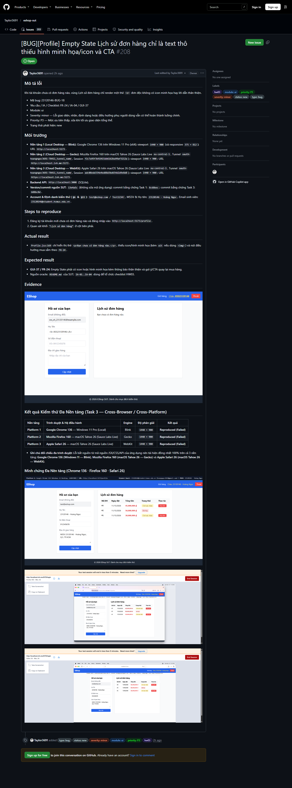

---

### 23120146-BUG-19: [BUG][Profile] Cột Ngày đặt hiển thị định dạng Mỹ MM/DD/YYYY trên trình duyệt locale en-US

- **GitHub Issue:** [#209](https://github.com/Taylor3691/eshop-sut/issues/209)

#### Mô tả lỗi

Hàm `toLocaleDateString()` không truyền tham số `'vi-VN'`, làm ngày đặt hàng hiển thị đảo tháng/ngày theo ngôn ngữ trình duyệt.

- Mã bug: 23120146-BUG-19
- Yêu cầu / IA / Checklist: FR-11, FR-21 / IA-01 / GUI-48
- Module: ui
- Severity: minor — Lỗi giao diện, nhãn, định dạng hoặc điều hướng phụ; người dùng vẫn có thể hoàn thành luồng chính.
- Priority: P3 — Mức ưu tiên thấp, sửa khi tối ưu giao diện tổng thể.
- Trạng thái phát hiện: new

#### Môi trường

- **Nền tảng 1 (Local Desktop — Blink):** Google Chrome 136 trên Windows 11 Pro (x64); viewport `1440 × 900` (và responsive `375 × 812`); URL `http://localhost:5173`.
- **Nền tảng 2 (Cloud Desktop — Gecko):** Mozilla Firefox 160 trên macOS Tahoe 26 (Sauce Labs Live `eu-central-1`, Tunnel `oauth-hoangngoc3691-78411_tunnel_name`, Session `f2c7a95f3b92415db6162ba99af3212a`); viewport `1440 × 900`; URL `http://localhost.lvh.me:5173`.
- **Nền tảng 3 (Cloud Desktop — WebKit):** Apple Safari 26 trên macOS Tahoe 26 (Sauce Labs Live `eu-central-1`, Tunnel `oauth-hoangngoc3691-78411_tunnel_name`, Session `adc08edd334e4ed88d3bd654d2d9e8d8`); viewport `1440 × 900`; URL `https://localhost.lvh.me:5173`.
- **Backend API:** `http://localhost:3000` (SQLite).
- **Version/commit nguồn SUT:** `13e4a5c` (không sửa mã ứng dụng); commit bằng chứng Task 1: `8c68bec`; commit bằng chứng Task 3: `b88bc8d`.
- **Account & Định danh kiểm thử (`§6` & `§11`):** `test@eshop.com` / `Test1234!`, MSSV & Họ tên: `23120146 - Hoàng Ngọc`, Email sinh viên: `23120146@student.hcmus.edu.vn`.

#### Steps to reproduce

1. Mở trình duyệt có locale `en-US` và truy cập `http://localhost:5173/profile` bằng tài khoản đã có đơn hàng.
2. Quan sát cột `"Ngày đặt"` trong bảng Lịch sử đơn hàng (`Profile.jsx:186`).

#### Actual result

- Cột `"Ngày đặt"` hiển thị dạng `11/15/2026` (`MM/DD/YYYY`) do `new Date(o.created_at).toLocaleDateString()` phụ thuộc locale của trình duyệt.

#### Expected result

- **GUI-48 / FR-11, FR-21:** Cố định định dạng ngày theo chuẩn Việt Nam `DD/MM/YYYY` (`toLocaleDateString('vi-VN')`), nhất quán trên mọi cấu hình trình duyệt.
- Nguồn oracle: `README.md` của SUT; `IA-01..IA-04` dùng để tổ chức checklist HW03.

#### Evidence

#### Kết quả Kiểm thử Đa Nền tảng (Task 3 — Cross-Browser / Cross-Platform)

| Nền tảng | Trình duyệt & Hệ điều hành | Engine | Độ phân giải | Kết quả | Minh chứng Đa nền tảng |
| :--- | :--- | :---: | :---: | :---: | :--- |
| **Platform 1** | **Google Chrome 136** — Windows 11 Pro | Blink | `1440 × 900` | **Reproduced (Failed)** | [`chrome-profile.png`](screenshots/task3/chrome-profile.png) |
| **Platform 2** | **Mozilla Firefox 160** — macOS Tahoe 26 (Sauce Labs) | Gecko | `1440 × 900` | **Reproduced (Failed)** | [`firefox-profile.png`](screenshots/task3/firefox-profile.png) |
| **Platform 3** | **Apple Safari 26** — macOS Tahoe 26 (Sauce Labs) | WebKit | `1440 × 900` | **Reproduced (Failed)** | [`safari-profile.png`](screenshots/task3/safari-profile.png) |

- **Ghi chú đối chiếu đa trình duyệt:** Cả 3 nền tảng (**Chrome 136 trên Windows 11**, **Firefox 160 trên macOS 26**, **Safari 26 trên macOS 26**) khi chạy locale `en-US` đều hiển thị cột `Ngày đặt` là `11/15/2026` (`MM/DD/YYYY`) thay vì chuẩn Việt Nam `15/11/2026` (`DD/MM/YYYY`).

##### Minh chứng Đa Nền tảng (Chrome 136 · Firefox 160 · Safari 26)

##### Ảnh chụp GitHub Issue [#209](https://github.com/Taylor3691/eshop-sut/issues/209)

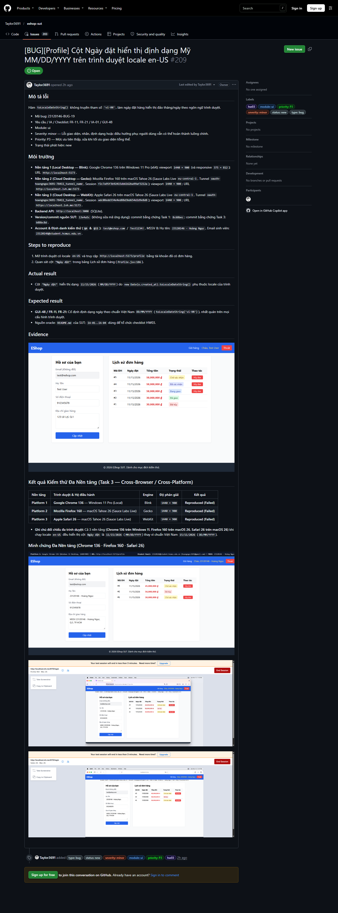

---

### 23120146-BUG-20: [BUG][Profile] Nhãn trường bắt buộc Họ Tên thiếu ký hiệu dấu sao (*)

- **GitHub Issue:** [#210](https://github.com/Taylor3691/eshop-sut/issues/210)

#### Mô tả lỗi

Trường `Họ Tên` trên `/profile` có thuộc tính `required` nhưng nhãn hiển thị không có dấu `*` bên cạnh.

- Mã bug: 23120146-BUG-20
- Yêu cầu / IA / Checklist: FR-22, FR-04 / IA-02 / GUI-12
- Module: ui
- Severity: minor — Lỗi giao diện, nhãn, định dạng hoặc điều hướng phụ; người dùng vẫn có thể hoàn thành luồng chính.
- Priority: P2 — Xử lý ở vòng cải thiện tiếp theo để đồng bộ đặc tả UI/UX.
- Trạng thái phát hiện: new

#### Môi trường

- **Nền tảng 1 (Local Desktop — Blink):** Google Chrome 136 trên Windows 11 Pro (x64); viewport `1440 × 900` (và responsive `375 × 812`); URL `http://localhost:5173`.
- **Nền tảng 2 (Cloud Desktop — Gecko):** Mozilla Firefox 160 trên macOS Tahoe 26 (Sauce Labs Live `eu-central-1`, Tunnel `oauth-hoangngoc3691-78411_tunnel_name`, Session `f2c7a95f3b92415db6162ba99af3212a`); viewport `1440 × 900`; URL `http://localhost.lvh.me:5173`.
- **Nền tảng 3 (Cloud Desktop — WebKit):** Apple Safari 26 trên macOS Tahoe 26 (Sauce Labs Live `eu-central-1`, Tunnel `oauth-hoangngoc3691-78411_tunnel_name`, Session `adc08edd334e4ed88d3bd654d2d9e8d8`); viewport `1440 × 900`; URL `https://localhost.lvh.me:5173`.
- **Backend API:** `http://localhost:3000` (SQLite).
- **Version/commit nguồn SUT:** `13e4a5c` (không sửa mã ứng dụng); commit bằng chứng Task 1: `8c68bec`; commit bằng chứng Task 3: `b88bc8d`.
- **Account & Định danh kiểm thử (`§6` & `§11`):** `test@eshop.com` / `Test1234!`, MSSV & Họ tên: `23120146 - Hoàng Ngọc`, Email sinh viên: `23120146@student.hcmus.edu.vn`.

#### Steps to reproduce

1. Đăng nhập và truy cập `http://localhost:5173/profile`.
2. Quan sát nhãn các trường trong form `"Hồ sơ của bạn"` (`Profile.jsx:127`).

#### Actual result

- Nhãn `"Họ Tên"` không có ký hiệu `*` dù `<input>` ở dòng 133 có gắn `required`.

#### Expected result

- **GUI-12 / FR-22:** Tất cả trường bắt buộc phải hiển thị dấu `*` rõ ràng bên cạnh nhãn.
- Nguồn oracle: `README.md` của SUT; `IA-01..IA-04` dùng để tổ chức checklist HW03.

#### Evidence

#### Kết quả Kiểm thử Đa Nền tảng (Task 3 — Cross-Browser / Cross-Platform)

| Nền tảng | Trình duyệt & Hệ điều hành | Engine | Độ phân giải | Kết quả | Minh chứng Đa nền tảng |
| :--- | :--- | :---: | :---: | :---: | :--- |
| **Platform 1** | **Google Chrome 136** — Windows 11 Pro | Blink | `1440 × 900` | **Reproduced (Failed)** | [`chrome-profile.png`](screenshots/task3/chrome-profile.png) |
| **Platform 2** | **Mozilla Firefox 160** — macOS Tahoe 26 (Sauce Labs) | Gecko | `1440 × 900` | **Reproduced (Failed)** | [`firefox-profile.png`](screenshots/task3/firefox-profile.png) |
| **Platform 3** | **Apple Safari 26** — macOS Tahoe 26 (Sauce Labs) | WebKit | `1440 × 900` | **Reproduced (Failed)** | [`safari-profile.png`](screenshots/task3/safari-profile.png) |

- **Ghi chú đối chiếu đa trình duyệt:** Lỗi bắt nguồn từ mã nguồn JSX/CSS/API của ứng dụng nên tái hiện đồng nhất 100% trên cả 3 nền tảng: **Google Chrome 136 (Windows 11 — Blink)**, **Mozilla Firefox 160 (macOS Tahoe 26 — Gecko)** và **Apple Safari 26 (macOS Tahoe 26 — WebKit)**.

##### Minh chứng Đa Nền tảng (Chrome 136 · Firefox 160 · Safari 26)

##### Ảnh chụp GitHub Issue [#210](https://github.com/Taylor3691/eshop-sut/issues/210)

---

### 23120146-BUG-21: [BUG][Register] Đăng ký trùng email vẫn trả về 200 OK và thiếu trạng thái loading khi submit

- **GitHub Issue:** [#211](https://github.com/Taylor3691/eshop-sut/issues/211)

#### Mô tả lỗi

Đăng ký bằng email đã tồn tại (`test@eshop.com`) không bị chặn trùng email mà trả về `200 OK` (`id: 3`); đồng thời nút `"Đăng Ký"` không khóa/loading khi đang gửi request và chuyển `/login` không có thông báo thành công.

- Mã bug: 23120146-BUG-21
- Yêu cầu / IA / Checklist: FR-01, FR-24 / IA-04 / GUI-41
- Module: register
- Severity: critical — Ảnh hưởng nghiêm trọng đến bảo mật, toàn vẹn dữ liệu, luồng nghiệp vụ chính hoặc khả năng hoàn thành tác vụ.
- Priority: P0 — Cần ưu tiên xử lý ngay do chặn luồng chính hoặc gây rủi ro bảo mật/dữ liệu.
- Trạng thái phát hiện: new

#### Môi trường

- **Nền tảng 1 (Local Desktop — Blink):** Google Chrome 136 trên Windows 11 Pro (x64); viewport `1440 × 900` (và responsive `375 × 812`); URL `http://localhost:5173`.
- **Nền tảng 2 (Cloud Desktop — Gecko):** Mozilla Firefox 160 trên macOS Tahoe 26 (Sauce Labs Live `eu-central-1`, Tunnel `oauth-hoangngoc3691-78411_tunnel_name`, Session `f2c7a95f3b92415db6162ba99af3212a`); viewport `1440 × 900`; URL `http://localhost.lvh.me:5173`.
- **Nền tảng 3 (Cloud Desktop — WebKit):** Apple Safari 26 trên macOS Tahoe 26 (Sauce Labs Live `eu-central-1`, Tunnel `oauth-hoangngoc3691-78411_tunnel_name`, Session `adc08edd334e4ed88d3bd654d2d9e8d8`); viewport `1440 × 900`; URL `https://localhost.lvh.me:5173`.
- **Backend API:** `http://localhost:3000` (SQLite).
- **Version/commit nguồn SUT:** `13e4a5c` (không sửa mã ứng dụng); commit bằng chứng Task 1: `8c68bec`; commit bằng chứng Task 3: `b88bc8d`.
- **Account & Định danh kiểm thử (`§6` & `§11`):** `test@eshop.com` / `Test1234!`, MSSV & Họ tên: `23120146 - Hoàng Ngọc`, Email sinh viên: `23120146@student.hcmus.edu.vn`.

#### Steps to reproduce

1. Mở `http://localhost:5173/register`.
2. Nhập `Họ Tên`: bất kỳ, `Email`: `test@eshop.com` (đã tồn tại sẵn trong seed DB), `Mật khẩu`: mật khẩu vượt qua regex hiện tại (vd `Test 1234`), rồi bấm `"Đăng Ký"`.
3. Quan sát phản hồi API `POST /api/register`, trạng thái nút `"Đăng Ký"` trong lúc gửi và màn hình sau điều hướng.

#### Actual result

- `POST /api/register` trả về `200 OK` (`id: 3`) và tạo bản ghi trùng email thay vì báo lỗi email đã tồn tại.
- Nút `"Đăng Ký"` không có trạng thái loading/`disabled` chống bấm đúp khi đang gọi API (`0` DOM mutations phản hồi đang tải), và khi chuyển sang `/login` không có thông báo đăng ký thành công.

#### Expected result

- **GUI-41 / FR-01, FR-24:** Email là duy nhất — từ chối đăng ký trùng email và báo lỗi rõ trên UI; nút `"Đăng Ký"` phải khóa/hiển thị đang xử lý khi submit và có phản hồi thành công rõ ràng.
- Nguồn oracle: `README.md` của SUT; `IA-01..IA-04` dùng để tổ chức checklist HW03.

#### Evidence

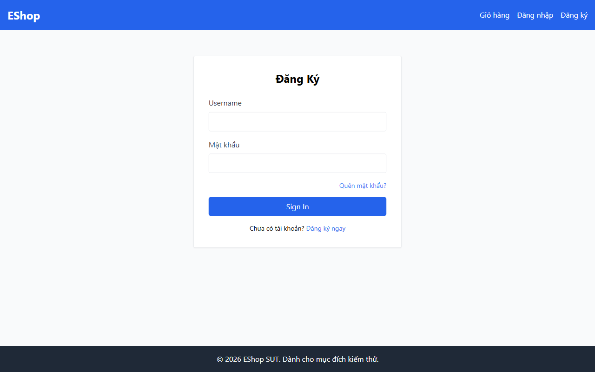

#### Kết quả Kiểm thử Đa Nền tảng (Task 3 — Cross-Browser / Cross-Platform)

| Nền tảng | Trình duyệt & Hệ điều hành | Engine | Độ phân giải | Kết quả | Minh chứng Đa nền tảng |
| :--- | :--- | :---: | :---: | :---: | :--- |
| **Platform 1** | **Google Chrome 136** — Windows 11 Pro | Blink | `1440 × 900` | **Reproduced (Failed)** | [`chrome-register.png`](screenshots/task3/chrome-register.png) |
| **Platform 2** | **Mozilla Firefox 160** — macOS Tahoe 26 (Sauce Labs) | Gecko | `1440 × 900` | **Reproduced (Failed)** | [`firefox-register.png`](screenshots/task3/firefox-register.png) |
| **Platform 3** | **Apple Safari 26** — macOS Tahoe 26 (Sauce Labs) | WebKit | `1440 × 900` | **Reproduced (Failed)** | [`safari-register.png`](screenshots/task3/safari-register.png) |

- **Ghi chú đối chiếu đa trình duyệt:** Lỗi bắt nguồn từ mã nguồn JSX/CSS/API của ứng dụng nên tái hiện đồng nhất 100% trên cả 3 nền tảng: **Google Chrome 136 (Windows 11 — Blink)**, **Mozilla Firefox 160 (macOS Tahoe 26 — Gecko)** và **Apple Safari 26 (macOS Tahoe 26 — WebKit)**.

##### Minh chứng Đa Nền tảng (Chrome 136 · Firefox 160 · Safari 26)

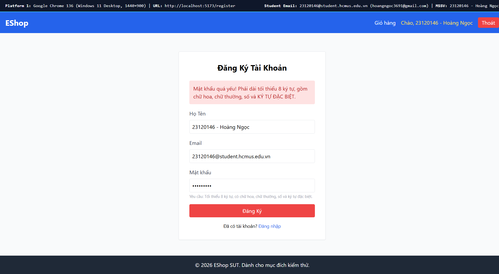

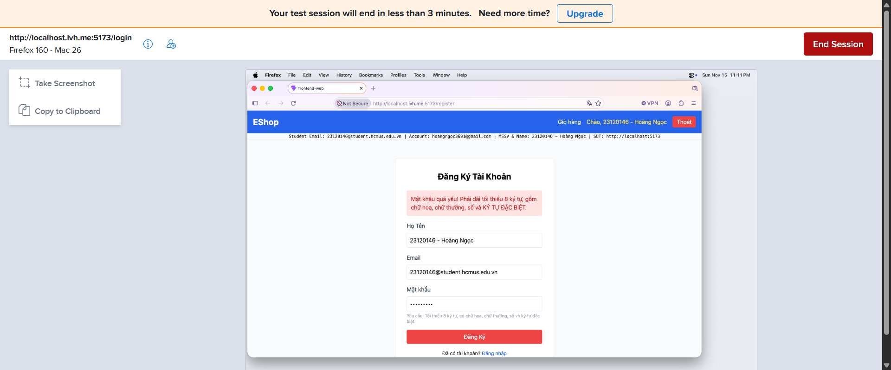

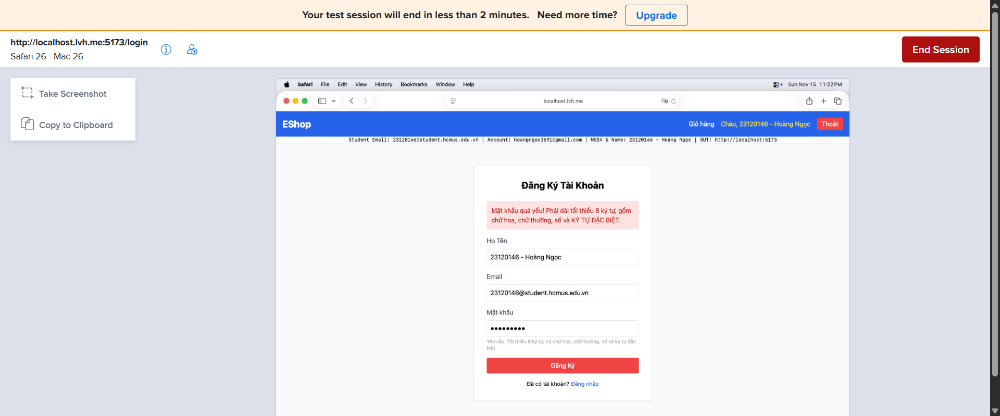

##### Ảnh chụp GitHub Issue [#211](https://github.com/Taylor3691/eshop-sut/issues/211)

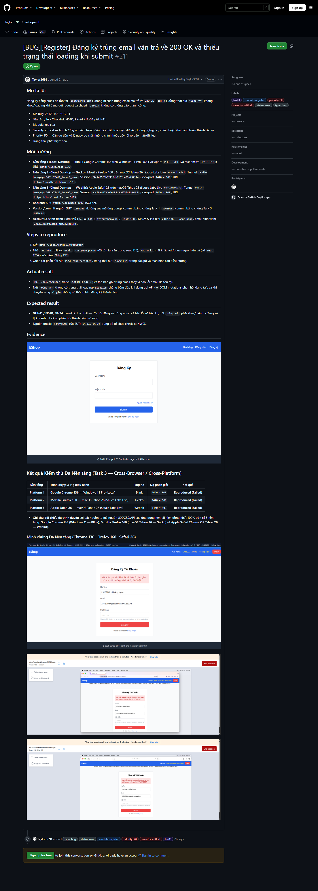

---

### 23120146-BUG-22: [BUG][Register] Regex mật khẩu từ chối mật khẩu hợp lệ Test1234! nhưng chấp nhận "Test 1234"

- **GitHub Issue:** [#212](https://github.com/Taylor3691/eshop-sut/issues/212)

#### Mô tả lỗi

Regex kiểm tra mật khẩu mạnh trong `Register.jsx` yêu cầu khoảng trắng `(?=.*\s)` và cấm ký tự đặc biệt (`[A-Za-z\d\s]{8,}`), đi ngược hoàn toàn với đặc tả `FR-01` và chính dòng gợi ý trên UI.

- Mã bug: 23120146-BUG-22
- Yêu cầu / IA / Checklist: FR-01 / IA-02 / GUI-20
- Module: register
- Severity: critical — Ảnh hưởng nghiêm trọng đến bảo mật, toàn vẹn dữ liệu, luồng nghiệp vụ chính hoặc khả năng hoàn thành tác vụ.
- Priority: P0 — Cần ưu tiên xử lý ngay do chặn luồng chính hoặc gây rủi ro bảo mật/dữ liệu.
- Trạng thái phát hiện: new

#### Môi trường

- **Nền tảng 1 (Local Desktop — Blink):** Google Chrome 136 trên Windows 11 Pro (x64); viewport `1440 × 900` (và responsive `375 × 812`); URL `http://localhost:5173`.
- **Nền tảng 2 (Cloud Desktop — Gecko):** Mozilla Firefox 160 trên macOS Tahoe 26 (Sauce Labs Live `eu-central-1`, Tunnel `oauth-hoangngoc3691-78411_tunnel_name`, Session `f2c7a95f3b92415db6162ba99af3212a`); viewport `1440 × 900`; URL `http://localhost.lvh.me:5173`.
- **Nền tảng 3 (Cloud Desktop — WebKit):** Apple Safari 26 trên macOS Tahoe 26 (Sauce Labs Live `eu-central-1`, Tunnel `oauth-hoangngoc3691-78411_tunnel_name`, Session `adc08edd334e4ed88d3bd654d2d9e8d8`); viewport `1440 × 900`; URL `https://localhost.lvh.me:5173`.
- **Backend API:** `http://localhost:3000` (SQLite).
- **Version/commit nguồn SUT:** `13e4a5c` (không sửa mã ứng dụng); commit bằng chứng Task 1: `8c68bec`; commit bằng chứng Task 3: `b88bc8d`.
- **Account & Định danh kiểm thử (`§6` & `§11`):** `test@eshop.com` / `Test1234!`, MSSV & Họ tên: `23120146 - Hoàng Ngọc`, Email sinh viên: `23120146@student.hcmus.edu.vn`.

#### Steps to reproduce

1. Mở `http://localhost:5173/register`.
2. Nhập mật khẩu mạnh đúng theo `FR-01` và dòng gợi ý dưới ô nhập là `Test1234!` rồi bấm `"Đăng Ký"`.
3. Thử lại với mật khẩu không có ký tự đặc biệt nhưng có dấu cách là `Test 1234`.

#### Actual result

- `Register.jsx:15` dùng `/^(?=.*[a-z])(?=.*[A-Z])(?=.*\d)(?=.*\s)[A-Za-z\d\s]{8,}$/`: mật khẩu chuẩn `Test1234!` bị từ chối với lỗi `"Mật khẩu quá yếu! ... và KÝ TỰ ĐẶC BIỆT."`, trong khi `Test 1234` (không có ký tự đặc biệt) lại được chấp nhận.

#### Expected result

- **GUI-20 / FR-01:** Chấp nhận mật khẩu `>= 8` ký tự gồm chữ hoa, chữ thường, số và ký tự đặc biệt (`@$!%*?&`); từ chối mật khẩu thiếu ký tự đặc biệt.
- Nguồn oracle: `README.md` của SUT; `IA-01..IA-04` dùng để tổ chức checklist HW03.

#### Evidence

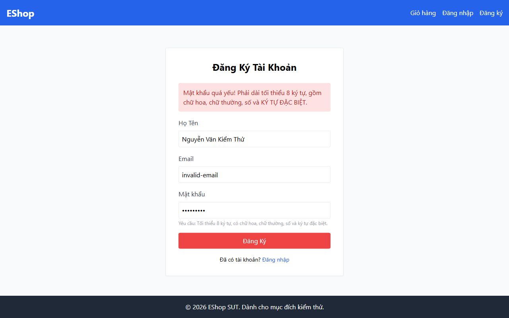

#### Kết quả Kiểm thử Đa Nền tảng (Task 3 — Cross-Browser / Cross-Platform)

| Nền tảng | Trình duyệt & Hệ điều hành | Engine | Độ phân giải | Kết quả | Minh chứng Đa nền tảng |
| :--- | :--- | :---: | :---: | :---: | :--- |
| **Platform 1** | **Google Chrome 136** — Windows 11 Pro | Blink | `1440 × 900` | **Reproduced (Failed)** | [`chrome-register.png`](screenshots/task3/chrome-register.png) |
| **Platform 2** | **Mozilla Firefox 160** — macOS Tahoe 26 (Sauce Labs) | Gecko | `1440 × 900` | **Reproduced (Failed)** | [`firefox-register.png`](screenshots/task3/firefox-register.png) |
| **Platform 3** | **Apple Safari 26** — macOS Tahoe 26 (Sauce Labs) | WebKit | `1440 × 900` | **Reproduced (Failed)** | [`safari-register.png`](screenshots/task3/safari-register.png) |

- **Ghi chú đối chiếu đa trình duyệt:** Regex mật khẩu lỗi `(?=.*\s)` từ chối `Test1234!` trên cả 3 trình duyệt. Trên **Safari 26 (WebKit)**, các dấu chấm tròn che mật khẩu (`•`) được vẽ to và sát hơn Chrome/Firefox, nhưng cả 3 đều thiếu nút ẩn/hiện mật khẩu để người dùng kiểm tra.

##### Minh chứng Đa Nền tảng (Chrome 136 · Firefox 160 · Safari 26)

##### Ảnh chụp GitHub Issue [#212](https://github.com/Taylor3691/eshop-sut/issues/212)

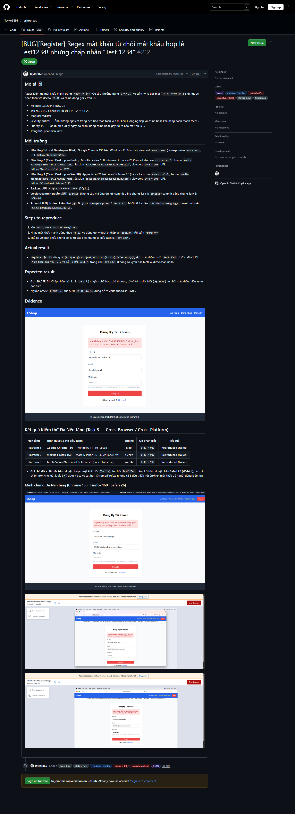

---

### 23120146-BUG-23: [BUG][Register] Form thiếu trường Xác nhận mật khẩu và thiếu dấu sao (*) ở các nhãn bắt buộc

- **GitHub Issue:** [#213](https://github.com/Taylor3691/eshop-sut/issues/213)

#### Mô tả lỗi

Form đăng ký chỉ có 3 trường (`Họ Tên`, `Email`, `Mật khẩu`), thiếu hoàn toàn ô `Xác nhận mật khẩu` và thiếu dấu `*` ở tất cả nhãn.

- Mã bug: 23120146-BUG-23
- Yêu cầu / IA / Checklist: FR-01, FR-22 / IA-02 / GUI-17, GUI-19
- Module: register
- Severity: major — Ảnh hưởng hành vi nghiệp vụ, validation, phản hồi trạng thái hoặc khả năng sử dụng của chức năng chính.
- Priority: P1 — Ưu tiên kiểm tra/sửa sớm vì ảnh hưởng trực tiếp trải nghiệm và tính đúng đắn nghiệp vụ.
- Trạng thái phát hiện: new

#### Môi trường

- **Nền tảng 1 (Local Desktop — Blink):** Google Chrome 136 trên Windows 11 Pro (x64); viewport `1440 × 900` (và responsive `375 × 812`); URL `http://localhost:5173`.
- **Nền tảng 2 (Cloud Desktop — Gecko):** Mozilla Firefox 160 trên macOS Tahoe 26 (Sauce Labs Live `eu-central-1`, Tunnel `oauth-hoangngoc3691-78411_tunnel_name`, Session `f2c7a95f3b92415db6162ba99af3212a`); viewport `1440 × 900`; URL `http://localhost.lvh.me:5173`.
- **Nền tảng 3 (Cloud Desktop — WebKit):** Apple Safari 26 trên macOS Tahoe 26 (Sauce Labs Live `eu-central-1`, Tunnel `oauth-hoangngoc3691-78411_tunnel_name`, Session `adc08edd334e4ed88d3bd654d2d9e8d8`); viewport `1440 × 900`; URL `https://localhost.lvh.me:5173`.
- **Backend API:** `http://localhost:3000` (SQLite).
- **Version/commit nguồn SUT:** `13e4a5c` (không sửa mã ứng dụng); commit bằng chứng Task 1: `8c68bec`; commit bằng chứng Task 3: `b88bc8d`.
- **Account & Định danh kiểm thử (`§6` & `§11`):** `test@eshop.com` / `Test1234!`, MSSV & Họ tên: `23120146 - Hoàng Ngọc`, Email sinh viên: `23120146@student.hcmus.edu.vn`.

#### Steps to reproduce

1. Mở `http://localhost:5173/register`.
2. Kiểm tra danh sách các trường nhập liệu và nhãn `<label>` trên form (`Register.jsx:34-67`).

#### Actual result

- **GUI-17:** Cả 3 nhãn `"Họ Tên"`, `"Email"`, `"Mật khẩu"` đều thiếu ký hiệu `*` dù các input đều gắn `required`.
- **GUI-19:** Form chỉ có 3 ô nhập liệu, thiếu hoàn toàn trường `"Xác nhận mật khẩu"` và logic kiểm tra khớp hai mật khẩu.

#### Expected result

- **GUI-17, GUI-19 / FR-01, FR-22:** Có trường `"Xác nhận mật khẩu"` (`type="password"`, kiểm tra khớp với `Mật khẩu`) và hiển thị `*` cạnh toàn bộ trường bắt buộc.
- Nguồn oracle: `README.md` của SUT; `IA-01..IA-04` dùng để tổ chức checklist HW03.

#### Evidence

#### Kết quả Kiểm thử Đa Nền tảng (Task 3 — Cross-Browser / Cross-Platform)

| Nền tảng | Trình duyệt & Hệ điều hành | Engine | Độ phân giải | Kết quả | Minh chứng Đa nền tảng |
| :--- | :--- | :---: | :---: | :---: | :--- |
| **Platform 1** | **Google Chrome 136** — Windows 11 Pro | Blink | `1440 × 900` | **Reproduced (Failed)** | [`chrome-register.png`](screenshots/task3/chrome-register.png) |
| **Platform 2** | **Mozilla Firefox 160** — macOS Tahoe 26 (Sauce Labs) | Gecko | `1440 × 900` | **Reproduced (Failed)** | [`firefox-register.png`](screenshots/task3/firefox-register.png) |
| **Platform 3** | **Apple Safari 26** — macOS Tahoe 26 (Sauce Labs) | WebKit | `1440 × 900` | **Reproduced (Failed)** | [`safari-register.png`](screenshots/task3/safari-register.png) |

- **Ghi chú đối chiếu đa trình duyệt:** Lỗi bắt nguồn từ mã nguồn JSX/CSS/API của ứng dụng nên tái hiện đồng nhất 100% trên cả 3 nền tảng: **Google Chrome 136 (Windows 11 — Blink)**, **Mozilla Firefox 160 (macOS Tahoe 26 — Gecko)** và **Apple Safari 26 (macOS Tahoe 26 — WebKit)**.

##### Minh chứng Đa Nền tảng (Chrome 136 · Firefox 160 · Safari 26)

##### Ảnh chụp GitHub Issue [#213](https://github.com/Taylor3691/eshop-sut/issues/213)

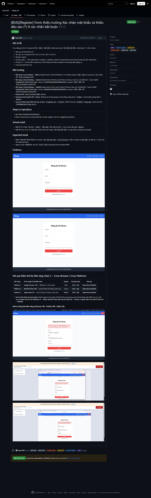

---

### 23120146-BUG-24: [BUG][Register] Trường Email dùng type="text" thay vì type="email" nên bỏ qua validate HTML5

- **GitHub Issue:** [#214](https://github.com/Taylor3691/eshop-sut/issues/214)

#### Mô tả lỗi

Ô nhập `Email` trên trang `/register` khai báo `type="text"`, cho phép submit chuỗi sai định dạng email mà trình duyệt không chặn ở bước HTML5 validation.

- Mã bug: 23120146-BUG-24
- Yêu cầu / IA / Checklist: FR-22, FR-01 / IA-02 / GUI-18
- Module: register
- Severity: major — Ảnh hưởng hành vi nghiệp vụ, validation, phản hồi trạng thái hoặc khả năng sử dụng của chức năng chính.
- Priority: P1 — Ưu tiên kiểm tra/sửa sớm vì ảnh hưởng trực tiếp trải nghiệm và tính đúng đắn nghiệp vụ.
- Trạng thái phát hiện: new

#### Môi trường

- **Nền tảng 1 (Local Desktop — Blink):** Google Chrome 136 trên Windows 11 Pro (x64); viewport `1440 × 900` (và responsive `375 × 812`); URL `http://localhost:5173`.
- **Nền tảng 2 (Cloud Desktop — Gecko):** Mozilla Firefox 160 trên macOS Tahoe 26 (Sauce Labs Live `eu-central-1`, Tunnel `oauth-hoangngoc3691-78411_tunnel_name`, Session `f2c7a95f3b92415db6162ba99af3212a`); viewport `1440 × 900`; URL `http://localhost.lvh.me:5173`.
- **Nền tảng 3 (Cloud Desktop — WebKit):** Apple Safari 26 trên macOS Tahoe 26 (Sauce Labs Live `eu-central-1`, Tunnel `oauth-hoangngoc3691-78411_tunnel_name`, Session `adc08edd334e4ed88d3bd654d2d9e8d8`); viewport `1440 × 900`; URL `https://localhost.lvh.me:5173`.
- **Backend API:** `http://localhost:3000` (SQLite).
- **Version/commit nguồn SUT:** `13e4a5c` (không sửa mã ứng dụng); commit bằng chứng Task 1: `8c68bec`; commit bằng chứng Task 3: `b88bc8d`.
- **Account & Định danh kiểm thử (`§6` & `§11`):** `test@eshop.com` / `Test1234!`, MSSV & Họ tên: `23120146 - Hoàng Ngọc`, Email sinh viên: `23120146@student.hcmus.edu.vn`.

#### Steps to reproduce

1. Mở `http://localhost:5173/register`.
2. Nhập `Họ Tên` hợp lệ, nhập `Email` sai định dạng `"invalid-email"`, nhập `Mật khẩu` thỏa regex và bấm `"Đăng Ký"`.

#### Actual result

- `Register.jsx:48` đặt `<input type="text" ... required />`, nên trình duyệt không bật kiểm tra định dạng HTML5 khi nhập `"invalid-email"`.

#### Expected result

- **GUI-18 / FR-22, FR-01:** Ô `Email` phải dùng `type="email"` và từ chối chuỗi không đúng định dạng `user@domain.com`.
- Nguồn oracle: `README.md` của SUT; `IA-01..IA-04` dùng để tổ chức checklist HW03.

#### Evidence

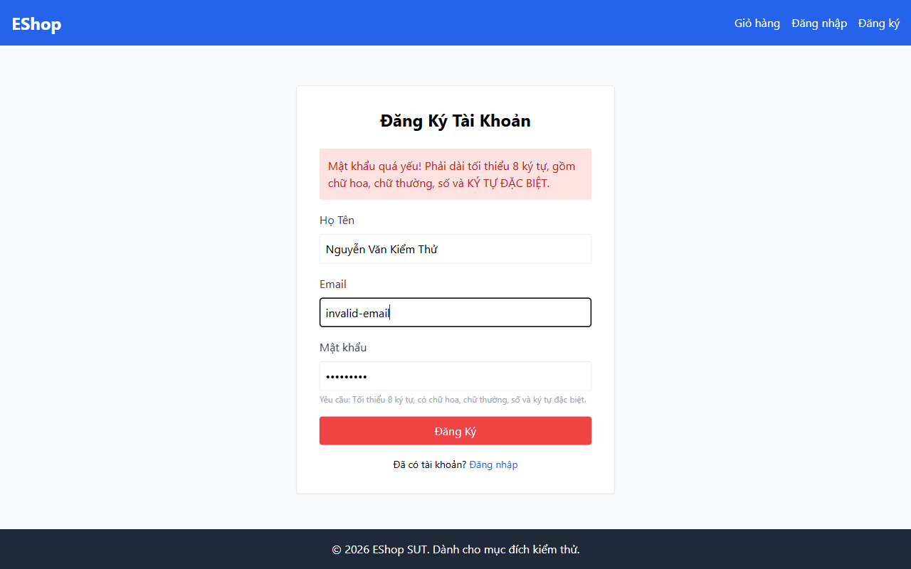

#### Kết quả Kiểm thử Đa Nền tảng (Task 3 — Cross-Browser / Cross-Platform)

| Nền tảng | Trình duyệt & Hệ điều hành | Engine | Độ phân giải | Kết quả | Minh chứng Đa nền tảng |
| :--- | :--- | :---: | :---: | :---: | :--- |
| **Platform 1** | **Google Chrome 136** — Windows 11 Pro | Blink | `1440 × 900` | **Reproduced (Failed)** | [`chrome-register.png`](screenshots/task3/chrome-register.png) |
| **Platform 2** | **Mozilla Firefox 160** — macOS Tahoe 26 (Sauce Labs) | Gecko | `1440 × 900` | **Reproduced (Failed)** | [`firefox-register.png`](screenshots/task3/firefox-register.png) |
| **Platform 3** | **Apple Safari 26** — macOS Tahoe 26 (Sauce Labs) | WebKit | `1440 × 900` | **Reproduced (Failed)** | [`safari-register.png`](screenshots/task3/safari-register.png) |

- **Ghi chú đối chiếu đa trình duyệt:** Lỗi bắt nguồn từ mã nguồn JSX/CSS/API của ứng dụng nên tái hiện đồng nhất 100% trên cả 3 nền tảng: **Google Chrome 136 (Windows 11 — Blink)**, **Mozilla Firefox 160 (macOS Tahoe 26 — Gecko)** và **Apple Safari 26 (macOS Tahoe 26 — WebKit)**.

##### Minh chứng Đa Nền tảng (Chrome 136 · Firefox 160 · Safari 26)

##### Ảnh chụp GitHub Issue [#214](https://github.com/Taylor3691/eshop-sut/issues/214)

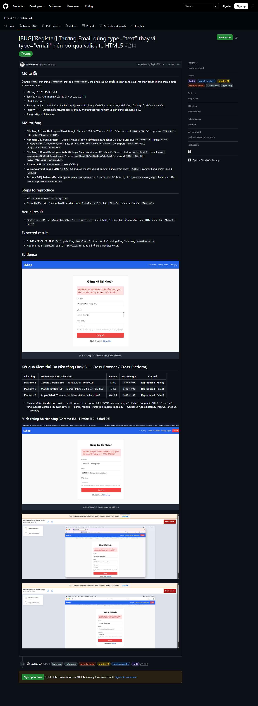

---

### 23120146-BUG-25: [BUG][Register] Nút submit "Đăng Ký" dùng màu đỏ (bg-red-500) thay vì màu xanh dương

- **GitHub Issue:** [#215](https://github.com/Taylor3691/eshop-sut/issues/215)

#### Mô tả lỗi

Nút hành động chính `"Đăng Ký"` trên `/register` sử dụng màu đỏ vốn dành cho hành động nguy hiểm/hủy bỏ.

- Mã bug: 23120146-BUG-25
- Yêu cầu / IA / Checklist: FR-21 / IA-01 / GUI-06
- Module: register
- Severity: minor — Lỗi giao diện, nhãn, định dạng hoặc điều hướng phụ; người dùng vẫn có thể hoàn thành luồng chính.
- Priority: P2 — Xử lý ở vòng cải thiện tiếp theo để đồng bộ đặc tả UI/UX.
- Trạng thái phát hiện: new

#### Môi trường

- **Nền tảng 1 (Local Desktop — Blink):** Google Chrome 136 trên Windows 11 Pro (x64); viewport `1440 × 900` (và responsive `375 × 812`); URL `http://localhost:5173`.
- **Nền tảng 2 (Cloud Desktop — Gecko):** Mozilla Firefox 160 trên macOS Tahoe 26 (Sauce Labs Live `eu-central-1`, Tunnel `oauth-hoangngoc3691-78411_tunnel_name`, Session `f2c7a95f3b92415db6162ba99af3212a`); viewport `1440 × 900`; URL `http://localhost.lvh.me:5173`.
- **Nền tảng 3 (Cloud Desktop — WebKit):** Apple Safari 26 trên macOS Tahoe 26 (Sauce Labs Live `eu-central-1`, Tunnel `oauth-hoangngoc3691-78411_tunnel_name`, Session `adc08edd334e4ed88d3bd654d2d9e8d8`); viewport `1440 × 900`; URL `https://localhost.lvh.me:5173`.
- **Backend API:** `http://localhost:3000` (SQLite).
- **Version/commit nguồn SUT:** `13e4a5c` (không sửa mã ứng dụng); commit bằng chứng Task 1: `8c68bec`; commit bằng chứng Task 3: `b88bc8d`.
- **Account & Định danh kiểm thử (`§6` & `§11`):** `test@eshop.com` / `Test1234!`, MSSV & Họ tên: `23120146 - Hoàng Ngọc`, Email sinh viên: `23120146@student.hcmus.edu.vn`.

#### Steps to reproduce

1. Mở `http://localhost:5173/register`.
2. Quan sát màu nền của nút submit `"Đăng Ký"`.

#### Actual result

- `Register.jsx:72` dùng `bg-red-500 ... hover:bg-red-600` (`rgb(239, 68, 68)`) thay vì màu xanh dương theo quy chuẩn hành động tích cực.

#### Expected result

- **GUI-06 / FR-21:** Nút hành động tích cực `"Đăng Ký"` phải dùng màu xanh dương.
- Nguồn oracle: `README.md` của SUT; `IA-01..IA-04` dùng để tổ chức checklist HW03.

#### Evidence

#### Kết quả Kiểm thử Đa Nền tảng (Task 3 — Cross-Browser / Cross-Platform)

| Nền tảng | Trình duyệt & Hệ điều hành | Engine | Độ phân giải | Kết quả | Minh chứng Đa nền tảng |
| :--- | :--- | :---: | :---: | :---: | :--- |
| **Platform 1** | **Google Chrome 136** — Windows 11 Pro | Blink | `1440 × 900` | **Reproduced (Failed)** | [`chrome-register.png`](screenshots/task3/chrome-register.png) |
| **Platform 2** | **Mozilla Firefox 160** — macOS Tahoe 26 (Sauce Labs) | Gecko | `1440 × 900` | **Reproduced (Failed)** | [`firefox-register.png`](screenshots/task3/firefox-register.png) |
| **Platform 3** | **Apple Safari 26** — macOS Tahoe 26 (Sauce Labs) | WebKit | `1440 × 900` | **Reproduced (Failed)** | [`safari-register.png`](screenshots/task3/safari-register.png) |

- **Ghi chú đối chiếu đa trình duyệt:** Lỗi bắt nguồn từ mã nguồn JSX/CSS/API của ứng dụng nên tái hiện đồng nhất 100% trên cả 3 nền tảng: **Google Chrome 136 (Windows 11 — Blink)**, **Mozilla Firefox 160 (macOS Tahoe 26 — Gecko)** và **Apple Safari 26 (macOS Tahoe 26 — WebKit)**.

##### Minh chứng Đa Nền tảng (Chrome 136 · Firefox 160 · Safari 26)

##### Ảnh chụp GitHub Issue [#215](https://github.com/Taylor3691/eshop-sut/issues/215)

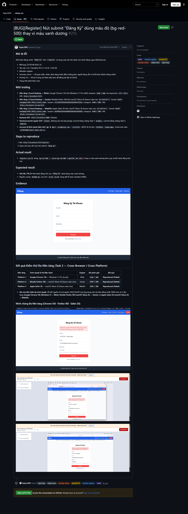

---

### 23120146-BUG-26: [BUG][Register] Hộp thông báo lỗi hiển thị ở đầu form thay vì phía trên nút submit "Đăng Ký"

- **GitHub Issue:** [#216](https://github.com/Taylor3691/eshop-sut/issues/216)

#### Mô tả lỗi

Khi phát sinh lỗi validation/submit trên `/register`, khung thông báo lỗi được đặt phía trên toàn bộ ô nhập liệu thay vì ngay phía trên nút submit.

- Mã bug: 23120146-BUG-26
- Yêu cầu / IA / Checklist: FR-22 / IA-02 / GUI-21
- Module: register
- Severity: minor — Lỗi giao diện, nhãn, định dạng hoặc điều hướng phụ; người dùng vẫn có thể hoàn thành luồng chính.
- Priority: P2 — Xử lý ở vòng cải thiện tiếp theo để đồng bộ đặc tả UI/UX.
- Trạng thái phát hiện: new

#### Môi trường

- **Nền tảng 1 (Local Desktop — Blink):** Google Chrome 136 trên Windows 11 Pro (x64); viewport `1440 × 900` (và responsive `375 × 812`); URL `http://localhost:5173`.
- **Nền tảng 2 (Cloud Desktop — Gecko):** Mozilla Firefox 160 trên macOS Tahoe 26 (Sauce Labs Live `eu-central-1`, Tunnel `oauth-hoangngoc3691-78411_tunnel_name`, Session `f2c7a95f3b92415db6162ba99af3212a`); viewport `1440 × 900`; URL `http://localhost.lvh.me:5173`.
- **Nền tảng 3 (Cloud Desktop — WebKit):** Apple Safari 26 trên macOS Tahoe 26 (Sauce Labs Live `eu-central-1`, Tunnel `oauth-hoangngoc3691-78411_tunnel_name`, Session `adc08edd334e4ed88d3bd654d2d9e8d8`); viewport `1440 × 900`; URL `https://localhost.lvh.me:5173`.
- **Backend API:** `http://localhost:3000` (SQLite).
- **Version/commit nguồn SUT:** `13e4a5c` (không sửa mã ứng dụng); commit bằng chứng Task 1: `8c68bec`; commit bằng chứng Task 3: `b88bc8d`.
- **Account & Định danh kiểm thử (`§6` & `§11`):** `test@eshop.com` / `Test1234!`, MSSV & Họ tên: `23120146 - Hoàng Ngọc`, Email sinh viên: `23120146@student.hcmus.edu.vn`.

#### Steps to reproduce

1. Mở `http://localhost:5173/register`.
2. Nhập mật khẩu không đạt điều kiện để kích hoạt thông báo lỗi và quan sát vị trí khung lỗi `div.bg-red-100`.

#### Actual result

- `Register.jsx:33` render `{error && 
}` nằm ở đầu card ngay dưới `<h2>` và phía trên các ô input, không nằm ngay phía trên nút submit `"Đăng Ký"`.

#### Expected result

- **GUI-21 / FR-22:** Thông báo lỗi của form phải xuất hiện ngay phía trên nút submit, không đặt sai vị trí.
- Nguồn oracle: `README.md` của SUT; `IA-01..IA-04` dùng để tổ chức checklist HW03.

#### Evidence

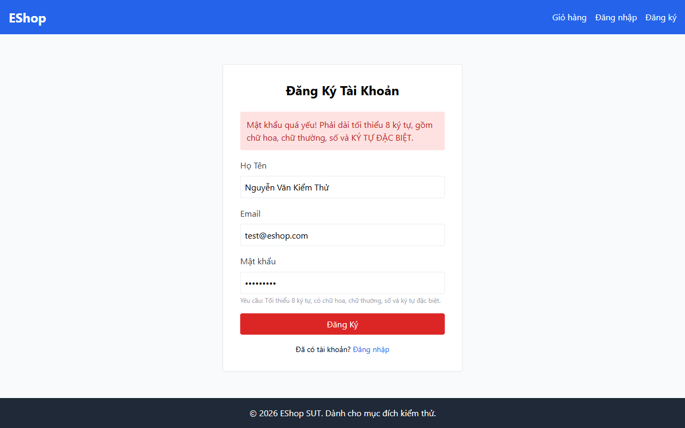

#### Kết quả Kiểm thử Đa Nền tảng (Task 3 — Cross-Browser / Cross-Platform)

| Nền tảng | Trình duyệt & Hệ điều hành | Engine | Độ phân giải | Kết quả | Minh chứng Đa nền tảng |
| :--- | :--- | :---: | :---: | :---: | :--- |
| **Platform 1** | **Google Chrome 136** — Windows 11 Pro | Blink | `1440 × 900` | **Reproduced (Failed)** | [`chrome-register.png`](screenshots/task3/chrome-register.png) |
| **Platform 2** | **Mozilla Firefox 160** — macOS Tahoe 26 (Sauce Labs) | Gecko | `1440 × 900` | **Reproduced (Failed)** | [`firefox-register.png`](screenshots/task3/firefox-register.png) |
| **Platform 3** | **Apple Safari 26** — macOS Tahoe 26 (Sauce Labs) | WebKit | `1440 × 900` | **Reproduced (Failed)** | [`safari-register.png`](screenshots/task3/safari-register.png) |

- **Ghi chú đối chiếu đa trình duyệt:** Lỗi bắt nguồn từ mã nguồn JSX/CSS/API của ứng dụng nên tái hiện đồng nhất 100% trên cả 3 nền tảng: **Google Chrome 136 (Windows 11 — Blink)**, **Mozilla Firefox 160 (macOS Tahoe 26 — Gecko)** và **Apple Safari 26 (macOS Tahoe 26 — WebKit)**.

##### Minh chứng Đa Nền tảng (Chrome 136 · Firefox 160 · Safari 26)

##### Ảnh chụp GitHub Issue [#216](https://github.com/Taylor3691/eshop-sut/issues/216)

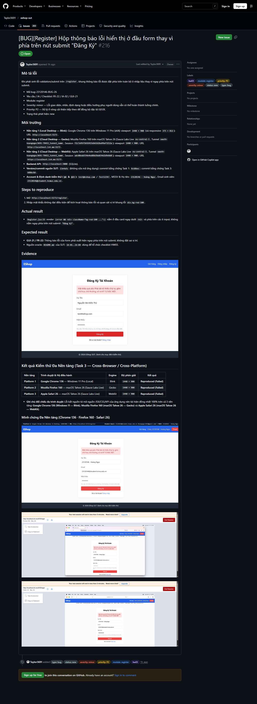

---

### 23120146-BUG-27: [BUG][Forgot Password] Hệ thống sinh OTP 4 chữ số thay vì 6 chữ số và báo lỗi email qua alert() ở Bước 1

- **GitHub Issue:** [#217](https://github.com/Taylor3691/eshop-sut/issues/217)

#### Mô tả lỗi

Chức năng quên mật khẩu sinh mã OTP chỉ dài 4 chữ số (entropy thấp hơn đặc tả 6 chữ số) và báo lỗi email không tồn tại qua `window.alert()` kèm nội dung tiếng Anh lẫn tiếng Việt.

- Mã bug: 23120146-BUG-27
- Yêu cầu / IA / Checklist: FR-03, SEC-07, FR-24 / IA-04 / GUI-42
- Module: forgot-password
- Severity: critical — Ảnh hưởng nghiêm trọng đến bảo mật, toàn vẹn dữ liệu, luồng nghiệp vụ chính hoặc khả năng hoàn thành tác vụ.
- Priority: P0 — Cần ưu tiên xử lý ngay do chặn luồng chính hoặc gây rủi ro bảo mật/dữ liệu.
- Trạng thái phát hiện: new

#### Môi trường

- **Nền tảng 1 (Local Desktop — Blink):** Google Chrome 136 trên Windows 11 Pro (x64); viewport `1440 × 900` (và responsive `375 × 812`); URL `http://localhost:5173`.
- **Nền tảng 2 (Cloud Desktop — Gecko):** Mozilla Firefox 160 trên macOS Tahoe 26 (Sauce Labs Live `eu-central-1`, Tunnel `oauth-hoangngoc3691-78411_tunnel_name`, Session `f2c7a95f3b92415db6162ba99af3212a`); viewport `1440 × 900`; URL `http://localhost.lvh.me:5173`.
- **Nền tảng 3 (Cloud Desktop — WebKit):** Apple Safari 26 trên macOS Tahoe 26 (Sauce Labs Live `eu-central-1`, Tunnel `oauth-hoangngoc3691-78411_tunnel_name`, Session `adc08edd334e4ed88d3bd654d2d9e8d8`); viewport `1440 × 900`; URL `https://localhost.lvh.me:5173`.
- **Backend API:** `http://localhost:3000` (SQLite).
- **Version/commit nguồn SUT:** `13e4a5c` (không sửa mã ứng dụng); commit bằng chứng Task 1: `8c68bec`; commit bằng chứng Task 3: `b88bc8d`.
- **Account & Định danh kiểm thử (`§6` & `§11`):** `test@eshop.com` / `Test1234!`, MSSV & Họ tên: `23120146 - Hoàng Ngọc`, Email sinh viên: `23120146@student.hcmus.edu.vn`.

#### Steps to reproduce

1. Mở `http://localhost:5173/forgot-password`.
2. Thử nhập email không tồn tại trong hệ thống và bấm `"Lấy mã OTP"`.
3. Thử nhập email hợp lệ (`test@eshop.com`), bấm `"Lấy mã OTP"` và kiểm tra độ dài mã OTP hiển thị ở Bước 2.

#### Actual result

- Backend `server.js:72` sinh `Math.floor(1000 + Math.random() * 9000)` khiến UI Bước 2 chỉ nhận và hiển thị OTP **4 chữ số** (quan sát thực tế: `2567`, `3217`, `6183`) thay vì 6 chữ số.
- Khi nhập email chưa đăng ký, Bước 1 hiện `window.alert("Lỗi: User not found.")` (`ForgotPassword.jsx:20`).

#### Expected result

- **GUI-42 / FR-03, SEC-07, FR-24:** Sinh OTP ngẫu nhiên **6 chữ số**; thông báo lỗi email không tồn tại bằng tiếng Việt rõ ràng ngay trên UI thay vì `window.alert()`.
- Nguồn oracle: `README.md` của SUT; `IA-01..IA-04` dùng để tổ chức checklist HW03.

#### Evidence

#### Kết quả Kiểm thử Đa Nền tảng (Task 3 — Cross-Browser / Cross-Platform)

| Nền tảng | Trình duyệt & Hệ điều hành | Engine | Độ phân giải | Kết quả | Minh chứng Đa nền tảng |
| :--- | :--- | :---: | :---: | :---: | :--- |
| **Platform 1** | **Google Chrome 136** — Windows 11 Pro | Blink | `1440 × 900` | **Reproduced (Failed)** | [`chrome-forgot-password.png`](screenshots/task3/chrome-forgot-password.png) |
| **Platform 2** | **Mozilla Firefox 160** — macOS Tahoe 26 (Sauce Labs) | Gecko | `1440 × 900` | **Reproduced (Failed)** | [`firefox-forgot-password.png`](screenshots/task3/firefox-forgot-password.png) |
| **Platform 3** | **Apple Safari 26** — macOS Tahoe 26 (Sauce Labs) | WebKit | `1440 × 900` | **Reproduced (Failed)** | [`safari-forgot-password.png`](screenshots/task3/safari-forgot-password.png) |

- **Ghi chú đối chiếu đa trình duyệt:** Backend trả OTP 4 chữ số (ví dụ `8174`) và hiển thị giống nhau trên cả Chrome 136, Firefox 160 và Safari 26; lỗi email không tồn tại đều gọi `window.alert()`.

##### Minh chứng Đa Nền tảng (Chrome 136 · Firefox 160 · Safari 26)

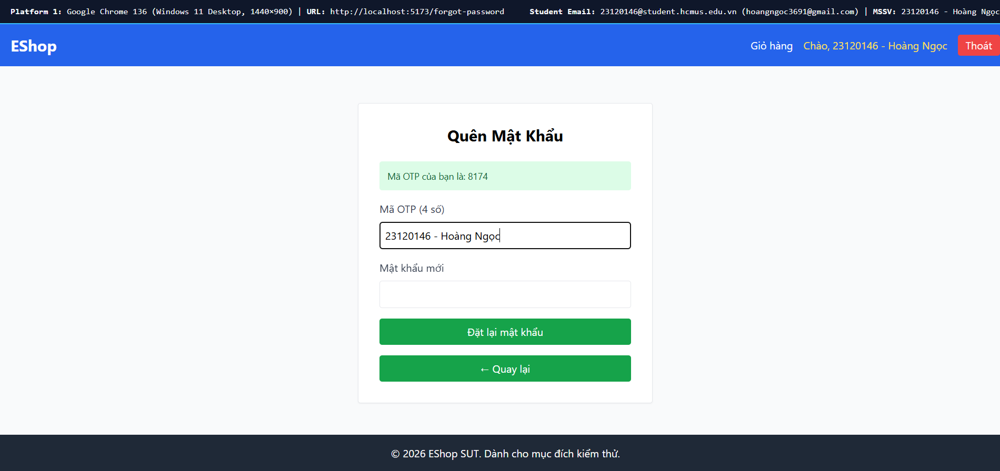

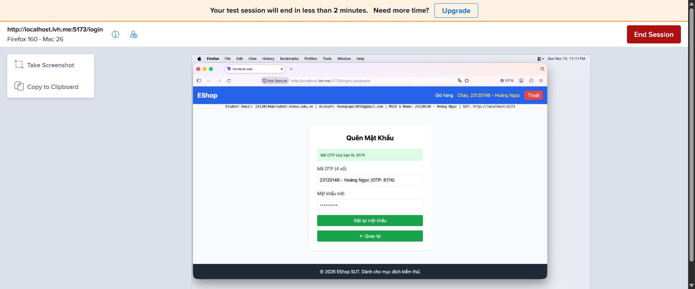

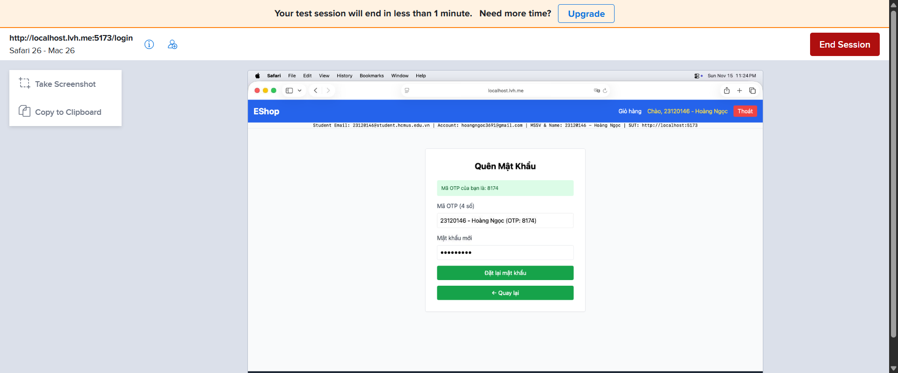

##### Ảnh chụp GitHub Issue [#217](https://github.com/Taylor3691/eshop-sut/issues/217)

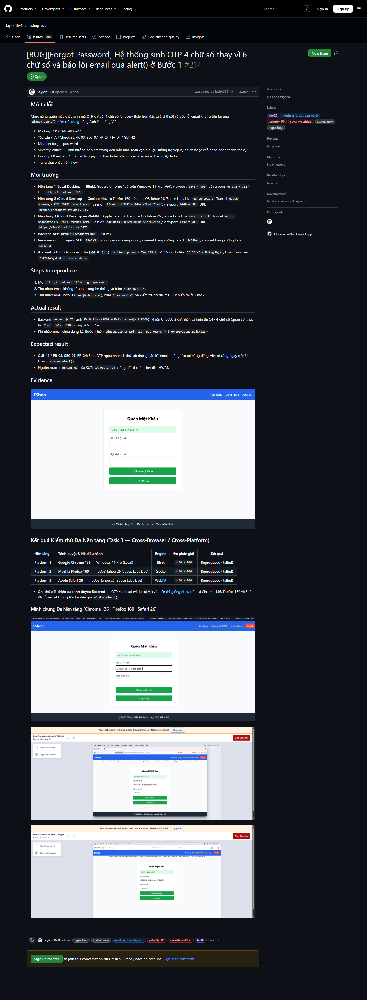

---

### 23120146-BUG-28: [BUG][Forgot Password] Bước 2 từ chối mật khẩu hợp lệ NewPass1!, thiếu loading và báo lỗi qua alert()

- **GitHub Issue:** [#218](https://github.com/Taylor3691/eshop-sut/issues/218)

#### Mô tả lỗi

Bước 2 của `/forgot-password` lặp lại regex mật khẩu lỗi từ `/register`, không có loading khi submit và dùng `window.alert()` cho cả thông báo lỗi OTP lẫn thành công.

- Mã bug: 23120146-BUG-28
- Yêu cầu / IA / Checklist: FR-03, FR-22, FR-24 / IA-02, IA-04 / GUI-24, GUI-43
- Module: forgot-password
- Severity: critical — Ảnh hưởng nghiêm trọng đến bảo mật, toàn vẹn dữ liệu, luồng nghiệp vụ chính hoặc khả năng hoàn thành tác vụ.
- Priority: P0 — Cần ưu tiên xử lý ngay do chặn luồng chính hoặc gây rủi ro bảo mật/dữ liệu.
- Trạng thái phát hiện: new

#### Môi trường

- **Nền tảng 1 (Local Desktop — Blink):** Google Chrome 136 trên Windows 11 Pro (x64); viewport `1440 × 900` (và responsive `375 × 812`); URL `http://localhost:5173`.
- **Nền tảng 2 (Cloud Desktop — Gecko):** Mozilla Firefox 160 trên macOS Tahoe 26 (Sauce Labs Live `eu-central-1`, Tunnel `oauth-hoangngoc3691-78411_tunnel_name`, Session `f2c7a95f3b92415db6162ba99af3212a`); viewport `1440 × 900`; URL `http://localhost.lvh.me:5173`.
- **Nền tảng 3 (Cloud Desktop — WebKit):** Apple Safari 26 trên macOS Tahoe 26 (Sauce Labs Live `eu-central-1`, Tunnel `oauth-hoangngoc3691-78411_tunnel_name`, Session `adc08edd334e4ed88d3bd654d2d9e8d8`); viewport `1440 × 900`; URL `https://localhost.lvh.me:5173`.
- **Backend API:** `http://localhost:3000` (SQLite).
- **Version/commit nguồn SUT:** `13e4a5c` (không sửa mã ứng dụng); commit bằng chứng Task 1: `8c68bec`; commit bằng chứng Task 3: `b88bc8d`.
- **Account & Định danh kiểm thử (`§6` & `§11`):** `test@eshop.com` / `Test1234!`, MSSV & Họ tên: `23120146 - Hoàng Ngọc`, Email sinh viên: `23120146@student.hcmus.edu.vn`.

#### Steps to reproduce

1. Tại `http://localhost:5173/forgot-password`, hoàn thành Bước 1 để chuyển sang Bước 2.
2. **Trường hợp 1 (`GUI-24`):** Nhập OTP đúng và `Mật khẩu mới` hợp lệ theo `FR-01` là `NewPass1!`, rồi bấm `"Đặt lại mật khẩu"`.
3. **Trường hợp 2 (`GUI-43`):** Nhập OTP sai `0000` với mật khẩu thỏa regex rồi bấm `"Đặt lại mật khẩu"` và quan sát trạng thái nút & thông báo lỗi.

#### Actual result

- **GUI-24:** `ForgotPassword.jsx:26-30` dùng regex sai `/^(?=.*[a-z])(?=.*[A-Z])(?=.*\d)(?=.*\s)[A-Za-z\d\s]{8,}$/` nên từ chối `NewPass1!` bằng `window.alert(...)`.
- **GUI-43:** Nút submit không có trạng thái loading/disabled; khi nhập sai OTP `0000`, lỗi hiển thị qua `window.alert("Mã OTP không đúng hoặc có lỗi xảy ra.")` (ghi nhận có dấu chấm đôi trong hộp thoại trình duyệt) thay vì hiển thị inline phía trên nút submit.

#### Expected result

- **GUI-24, GUI-43 / FR-03, FR-22, FR-24:** Chấp nhận mật khẩu mạnh đúng chuẩn `FR-01`, có trạng thái loading chống double-submit và hiển thị thông báo lỗi inline ngay phía trên nút submit.
- Nguồn oracle: `README.md` của SUT; `IA-01..IA-04` dùng để tổ chức checklist HW03.

#### Evidence

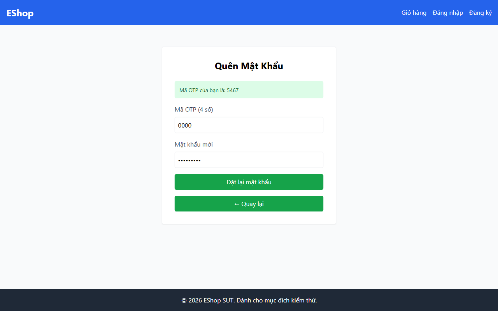

#### Kết quả Kiểm thử Đa Nền tảng (Task 3 — Cross-Browser / Cross-Platform)

| Nền tảng | Trình duyệt & Hệ điều hành | Engine | Độ phân giải | Kết quả | Minh chứng Đa nền tảng |
| :--- | :--- | :---: | :---: | :---: | :--- |
| **Platform 1** | **Google Chrome 136** — Windows 11 Pro | Blink | `1440 × 900` | **Reproduced (Failed)** | [`chrome-forgot-password.png`](screenshots/task3/chrome-forgot-password.png) |
| **Platform 2** | **Mozilla Firefox 160** — macOS Tahoe 26 (Sauce Labs) | Gecko | `1440 × 900` | **Reproduced (Failed)** | [`firefox-forgot-password.png`](screenshots/task3/firefox-forgot-password.png) |
| **Platform 3** | **Apple Safari 26** — macOS Tahoe 26 (Sauce Labs) | WebKit | `1440 × 900` | **Reproduced (Failed)** | [`safari-forgot-password.png`](screenshots/task3/safari-forgot-password.png) |

- **Ghi chú đối chiếu đa trình duyệt:** Bước 2 `/forgot-password` từ chối mật khẩu hợp lệ và bật hộp thoại `window.alert()` chặn luồng thao tác trên cả Chrome 136, Firefox 160 và Safari 26.

##### Minh chứng Đa Nền tảng (Chrome 136 · Firefox 160 · Safari 26)

##### Ảnh chụp GitHub Issue [#218](https://github.com/Taylor3691/eshop-sut/issues/218)

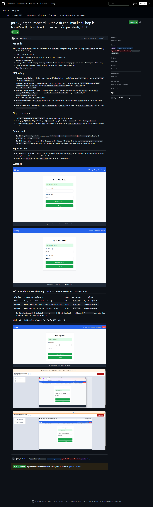

---

### 23120146-BUG-29: [BUG][Forgot Password] Thiếu Step Indicator, Email dùng type="text", thiếu (*) và thiếu Xác nhận mật khẩu mới

- **GitHub Issue:** [#219](https://github.com/Taylor3691/eshop-sut/issues/219)

#### Mô tả lỗi

Form 2 bước của `/forgot-password` không hiển thị chỉ báo bước (`Bước 1 / 2`, `Bước 2 / 2`), thiếu `type="email"`, thiếu `*`, nhãn OTP ghi `(4 số)` và thiếu ô `Xác nhận mật khẩu mới`.

- Mã bug: 23120146-BUG-29
- Yêu cầu / IA / Checklist: FR-03, FR-22 / IA-02 / GUI-22, GUI-23
- Module: forgot-password
- Severity: major — Ảnh hưởng hành vi nghiệp vụ, validation, phản hồi trạng thái hoặc khả năng sử dụng của chức năng chính.
- Priority: P1 — Ưu tiên kiểm tra/sửa sớm vì ảnh hưởng trực tiếp trải nghiệm và tính đúng đắn nghiệp vụ.
- Trạng thái phát hiện: new

#### Môi trường

- **Nền tảng 1 (Local Desktop — Blink):** Google Chrome 136 trên Windows 11 Pro (x64); viewport `1440 × 900` (và responsive `375 × 812`); URL `http://localhost:5173`.
- **Nền tảng 2 (Cloud Desktop — Gecko):** Mozilla Firefox 160 trên macOS Tahoe 26 (Sauce Labs Live `eu-central-1`, Tunnel `oauth-hoangngoc3691-78411_tunnel_name`, Session `f2c7a95f3b92415db6162ba99af3212a`); viewport `1440 × 900`; URL `http://localhost.lvh.me:5173`.
- **Nền tảng 3 (Cloud Desktop — WebKit):** Apple Safari 26 trên macOS Tahoe 26 (Sauce Labs Live `eu-central-1`, Tunnel `oauth-hoangngoc3691-78411_tunnel_name`, Session `adc08edd334e4ed88d3bd654d2d9e8d8`); viewport `1440 × 900`; URL `https://localhost.lvh.me:5173`.
- **Backend API:** `http://localhost:3000` (SQLite).
- **Version/commit nguồn SUT:** `13e4a5c` (không sửa mã ứng dụng); commit bằng chứng Task 1: `8c68bec`; commit bằng chứng Task 3: `b88bc8d`.
- **Account & Định danh kiểm thử (`§6` & `§11`):** `test@eshop.com` / `Test1234!`, MSSV & Họ tên: `23120146 - Hoàng Ngọc`, Email sinh viên: `23120146@student.hcmus.edu.vn`.

#### Steps to reproduce

1. Mở `http://localhost:5173/forgot-password` và kiểm tra Bước 1.
2. Nhập email hợp lệ để chuyển sang Bước 2 và kiểm tra các thành phần form ở Bước 2.

#### Actual result

- **GUI-22:** Cả Bước 1 và Bước 2 đều không có Step Indicator (`"Bước 1 / 2"`, `"Bước 2 / 2"`).
- **GUI-23:** Bước 1 dùng `<input type="text">` cho Email (`ForgotPassword.jsx:50`); tất cả `<label>` ở Bước 1 & 2 thiếu `*`; Bước 2 ghi nhãn `"Mã OTP (4 số)"` thay vì 6 chữ số và thiếu hoàn toàn trường `"Xác nhận mật khẩu mới"`.

#### Expected result

- **GUI-22, GUI-23 / FR-03, FR-22:** Hiển thị Step Indicator ở cả 2 bước; Email dùng `type="email"`; đủ dấu `*` cho trường bắt buộc; OTP khớp chuẩn 6 chữ số và có trường `Xác nhận mật khẩu mới`.
- Nguồn oracle: `README.md` của SUT; `IA-01..IA-04` dùng để tổ chức checklist HW03.

#### Evidence

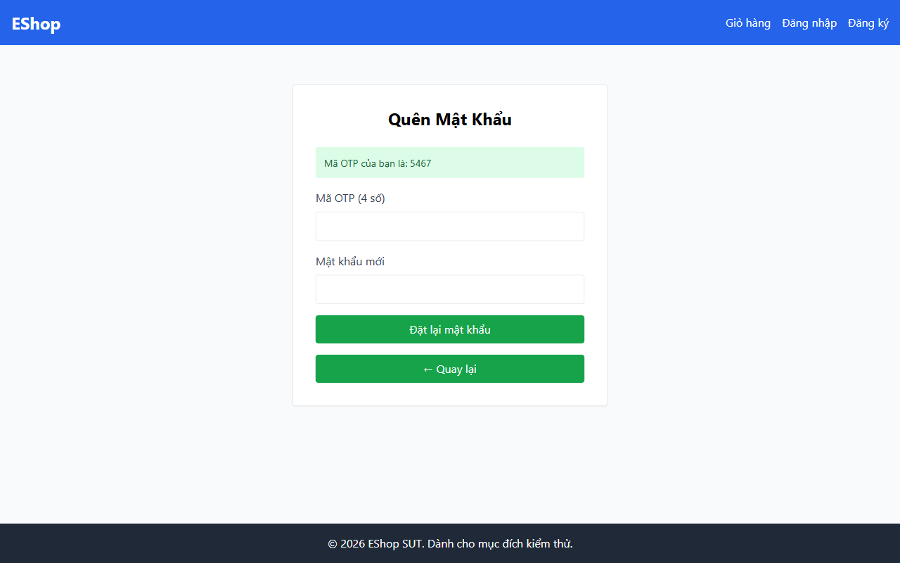

#### Kết quả Kiểm thử Đa Nền tảng (Task 3 — Cross-Browser / Cross-Platform)

| Nền tảng | Trình duyệt & Hệ điều hành | Engine | Độ phân giải | Kết quả | Minh chứng Đa nền tảng |
| :--- | :--- | :---: | :---: | :---: | :--- |
| **Platform 1** | **Google Chrome 136** — Windows 11 Pro | Blink | `1440 × 900` | **Reproduced (Failed)** | [`chrome-forgot-password.png`](screenshots/task3/chrome-forgot-password.png) |
| **Platform 2** | **Mozilla Firefox 160** — macOS Tahoe 26 (Sauce Labs) | Gecko | `1440 × 900` | **Reproduced (Failed)** | [`firefox-forgot-password.png`](screenshots/task3/firefox-forgot-password.png) |
| **Platform 3** | **Apple Safari 26** — macOS Tahoe 26 (Sauce Labs) | WebKit | `1440 × 900` | **Reproduced (Failed)** | [`safari-forgot-password.png`](screenshots/task3/safari-forgot-password.png) |

- **Ghi chú đối chiếu đa trình duyệt:** Lỗi bắt nguồn từ mã nguồn JSX/CSS/API của ứng dụng nên tái hiện đồng nhất 100% trên cả 3 nền tảng: **Google Chrome 136 (Windows 11 — Blink)**, **Mozilla Firefox 160 (macOS Tahoe 26 — Gecko)** và **Apple Safari 26 (macOS Tahoe 26 — WebKit)**.

##### Minh chứng Đa Nền tảng (Chrome 136 · Firefox 160 · Safari 26)

##### Ảnh chụp GitHub Issue [#219](https://github.com/Taylor3691/eshop-sut/issues/219)

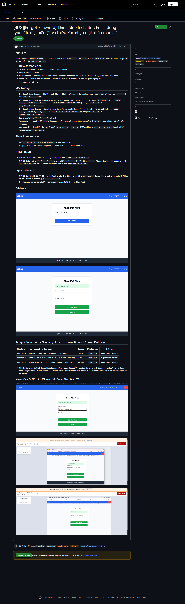

---

### 23120146-BUG-30: [BUG][Forgot Password] Bước 1 thiếu nút/liên kết "Quay lại đăng nhập"

- **GitHub Issue:** [#220](https://github.com/Taylor3691/eshop-sut/issues/220)

#### Mô tả lỗi

Tại Bước 1 của màn hình `/forgot-password`, người dùng không có nút hoặc liên kết nào để quay lại trang `/login`.

- Mã bug: 23120146-BUG-30
- Yêu cầu / IA / Checklist: FR-03 / IA-03 / GUI-32
- Module: forgot-password
- Severity: major — Ảnh hưởng hành vi nghiệp vụ, validation, phản hồi trạng thái hoặc khả năng sử dụng của chức năng chính.
- Priority: P1 — Ưu tiên kiểm tra/sửa sớm vì ảnh hưởng trực tiếp trải nghiệm và tính đúng đắn nghiệp vụ.
- Trạng thái phát hiện: new

#### Môi trường

- **Nền tảng 1 (Local Desktop — Blink):** Google Chrome 136 trên Windows 11 Pro (x64); viewport `1440 × 900` (và responsive `375 × 812`); URL `http://localhost:5173`.
- **Nền tảng 2 (Cloud Desktop — Gecko):** Mozilla Firefox 160 trên macOS Tahoe 26 (Sauce Labs Live `eu-central-1`, Tunnel `oauth-hoangngoc3691-78411_tunnel_name`, Session `f2c7a95f3b92415db6162ba99af3212a`); viewport `1440 × 900`; URL `http://localhost.lvh.me:5173`.
- **Nền tảng 3 (Cloud Desktop — WebKit):** Apple Safari 26 trên macOS Tahoe 26 (Sauce Labs Live `eu-central-1`, Tunnel `oauth-hoangngoc3691-78411_tunnel_name`, Session `adc08edd334e4ed88d3bd654d2d9e8d8`); viewport `1440 × 900`; URL `https://localhost.lvh.me:5173`.
- **Backend API:** `http://localhost:3000` (SQLite).
- **Version/commit nguồn SUT:** `13e4a5c` (không sửa mã ứng dụng); commit bằng chứng Task 1: `8c68bec`; commit bằng chứng Task 3: `b88bc8d`.
- **Account & Định danh kiểm thử (`§6` & `§11`):** `test@eshop.com` / `Test1234!`, MSSV & Họ tên: `23120146 - Hoàng Ngọc`, Email sinh viên: `23120146@student.hcmus.edu.vn`.

#### Steps to reproduce

1. Mở `http://localhost:5173/forgot-password` ở Bước 1.
2. Tìm nút hoặc link `"Quay lại đăng nhập"` bên trong form (`<main>`).

#### Actual result

- Dù `ForgotPassword.jsx:3` đã import `Link`, form Bước 1 (`ForgotPassword.jsx:45-61`) chỉ có nút `"Lấy mã OTP"` và có `0` thẻ `<a>` hay nút quay lại `/login`.

#### Expected result

- **GUI-32 / FR-03:** Bước 1 phải có nút/liên kết `"Quay lại đăng nhập"` trỏ về `/login`.
- Nguồn oracle: `README.md` của SUT; `IA-01..IA-04` dùng để tổ chức checklist HW03.

#### Evidence

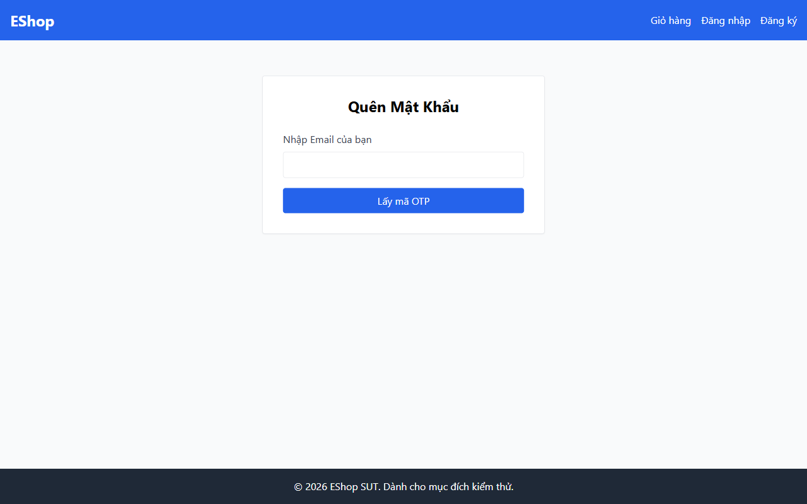

#### Kết quả Kiểm thử Đa Nền tảng (Task 3 — Cross-Browser / Cross-Platform)

| Nền tảng | Trình duyệt & Hệ điều hành | Engine | Độ phân giải | Kết quả | Minh chứng Đa nền tảng |
| :--- | :--- | :---: | :---: | :---: | :--- |
| **Platform 1** | **Google Chrome 136** — Windows 11 Pro | Blink | `1440 × 900` | **Reproduced (Failed)** | [`chrome-forgot-password.png`](screenshots/task3/chrome-forgot-password.png) |
| **Platform 2** | **Mozilla Firefox 160** — macOS Tahoe 26 (Sauce Labs) | Gecko | `1440 × 900` | **Reproduced (Failed)** | [`firefox-forgot-password.png`](screenshots/task3/firefox-forgot-password.png) |
| **Platform 3** | **Apple Safari 26** — macOS Tahoe 26 (Sauce Labs) | WebKit | `1440 × 900` | **Reproduced (Failed)** | [`safari-forgot-password.png`](screenshots/task3/safari-forgot-password.png) |

- **Ghi chú đối chiếu đa trình duyệt:** Lỗi bắt nguồn từ mã nguồn JSX/CSS/API của ứng dụng nên tái hiện đồng nhất 100% trên cả 3 nền tảng: **Google Chrome 136 (Windows 11 — Blink)**, **Mozilla Firefox 160 (macOS Tahoe 26 — Gecko)** và **Apple Safari 26 (macOS Tahoe 26 — WebKit)**.

##### Minh chứng Đa Nền tảng (Chrome 136 · Firefox 160 · Safari 26)

##### Ảnh chụp GitHub Issue [#220](https://github.com/Taylor3691/eshop-sut/issues/220)

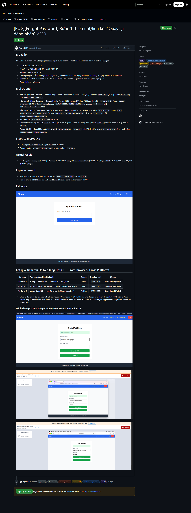

---

### 23120146-BUG-31: [BUG][Forgot Password] Bước 2 gán cùng màu xanh lá (bg-green-600) cho cả nút submit chính và nút "← Quay lại"

- **GitHub Issue:** [#221](https://github.com/Taylor3691/eshop-sut/issues/221)

#### Mô tả lỗi

Hai nút có mức độ ưu tiên khác nhau ở Bước 2 (`/forgot-password`) dùng y hệt một màu xanh lá và không dùng màu xanh dương cho nút submit chính.

- Mã bug: 23120146-BUG-31
- Yêu cầu / IA / Checklist: FR-21 / IA-01 / GUI-07
- Module: forgot-password
- Severity: minor — Lỗi giao diện, nhãn, định dạng hoặc điều hướng phụ; người dùng vẫn có thể hoàn thành luồng chính.
- Priority: P2 — Xử lý ở vòng cải thiện tiếp theo để đồng bộ đặc tả UI/UX.
- Trạng thái phát hiện: new

#### Môi trường

- **Nền tảng 1 (Local Desktop — Blink):** Google Chrome 136 trên Windows 11 Pro (x64); viewport `1440 × 900` (và responsive `375 × 812`); URL `http://localhost:5173`.
- **Nền tảng 2 (Cloud Desktop — Gecko):** Mozilla Firefox 160 trên macOS Tahoe 26 (Sauce Labs Live `eu-central-1`, Tunnel `oauth-hoangngoc3691-78411_tunnel_name`, Session `f2c7a95f3b92415db6162ba99af3212a`); viewport `1440 × 900`; URL `http://localhost.lvh.me:5173`.
- **Nền tảng 3 (Cloud Desktop — WebKit):** Apple Safari 26 trên macOS Tahoe 26 (Sauce Labs Live `eu-central-1`, Tunnel `oauth-hoangngoc3691-78411_tunnel_name`, Session `adc08edd334e4ed88d3bd654d2d9e8d8`); viewport `1440 × 900`; URL `https://localhost.lvh.me:5173`.
- **Backend API:** `http://localhost:3000` (SQLite).
- **Version/commit nguồn SUT:** `13e4a5c` (không sửa mã ứng dụng); commit bằng chứng Task 1: `8c68bec`; commit bằng chứng Task 3: `b88bc8d`.
- **Account & Định danh kiểm thử (`§6` & `§11`):** `test@eshop.com` / `Test1234!`, MSSV & Họ tên: `23120146 - Hoàng Ngọc`, Email sinh viên: `23120146@student.hcmus.edu.vn`.

#### Steps to reproduce

1. Mở `http://localhost:5173/forgot-password` và chuyển sang Bước 2.
2. Quan sát màu sắc và phân cấp trực quan của hai nút `"Đặt lại mật khẩu"` và `"← Quay lại"`.

#### Actual result

- `ForgotPassword.jsx:90-95` gán cùng class `bg-green-600 text-white` (`rgb(22, 163, 74)`) cho cả nút submit chính `"Đặt lại mật khẩu"` lẫn nút phụ `"← Quay lại"`, không phân biệt cấp độ và không dùng màu xanh dương cho hành động chính.

#### Expected result

- **GUI-07 / FR-21:** Nút hành động tích cực chính dùng màu xanh dương; nút phụ `"← Quay lại"` dùng kiểu/màu trung tính phân biệt rõ.
- Nguồn oracle: `README.md` của SUT; `IA-01..IA-04` dùng để tổ chức checklist HW03.

#### Evidence

#### Kết quả Kiểm thử Đa Nền tảng (Task 3 — Cross-Browser / Cross-Platform)

| Nền tảng | Trình duyệt & Hệ điều hành | Engine | Độ phân giải | Kết quả | Minh chứng Đa nền tảng |
| :--- | :--- | :---: | :---: | :---: | :--- |
| **Platform 1** | **Google Chrome 136** — Windows 11 Pro | Blink | `1440 × 900` | **Reproduced (Failed)** | [`chrome-forgot-password.png`](screenshots/task3/chrome-forgot-password.png) |
| **Platform 2** | **Mozilla Firefox 160** — macOS Tahoe 26 (Sauce Labs) | Gecko | `1440 × 900` | **Reproduced (Failed)** | [`firefox-forgot-password.png`](screenshots/task3/firefox-forgot-password.png) |
| **Platform 3** | **Apple Safari 26** — macOS Tahoe 26 (Sauce Labs) | WebKit | `1440 × 900` | **Reproduced (Failed)** | [`safari-forgot-password.png`](screenshots/task3/safari-forgot-password.png) |

- **Ghi chú đối chiếu đa trình duyệt:** Lỗi bắt nguồn từ mã nguồn JSX/CSS/API của ứng dụng nên tái hiện đồng nhất 100% trên cả 3 nền tảng: **Google Chrome 136 (Windows 11 — Blink)**, **Mozilla Firefox 160 (macOS Tahoe 26 — Gecko)** và **Apple Safari 26 (macOS Tahoe 26 — WebKit)**.

##### Minh chứng Đa Nền tảng (Chrome 136 · Firefox 160 · Safari 26)

##### Ảnh chụp GitHub Issue [#221](https://github.com/Taylor3691/eshop-sut/issues/221)

---
