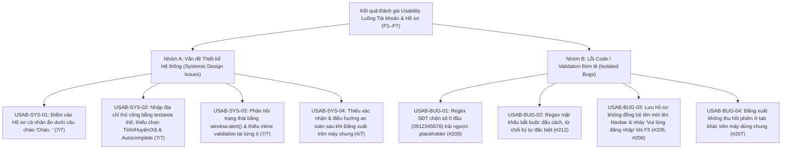
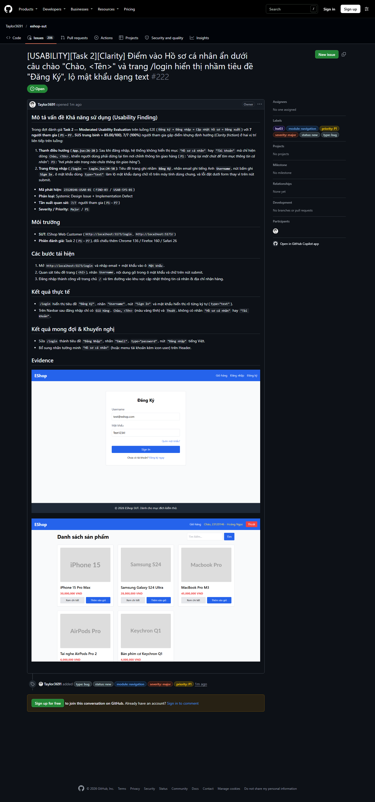
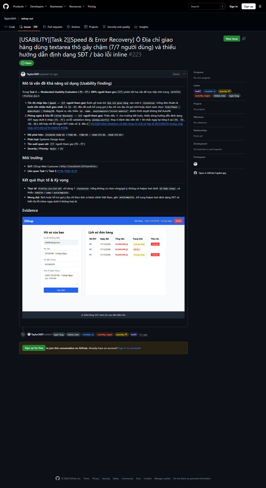
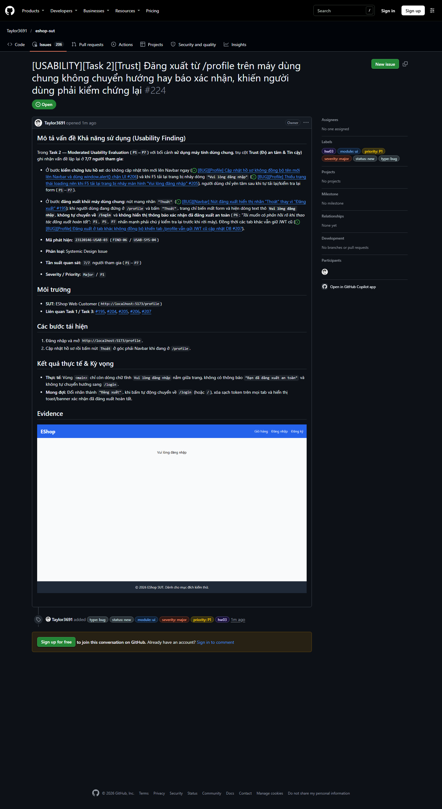

# Task 2 — Báo cáo Phân tích & Đánh giá Khả năng Sử dụng (Usability Evaluation — Phase 2 & 3)

- **MSSV:** `23120146`
- **Họ và tên:** `Hoàng Ngọc`
- **Luồng End-to-End (E2E) đánh giá:** `Đăng ký tài khoản mới (/register) → Đăng nhập (/login) → Cập nhật hồ sơ cá nhân (/profile: Họ tên, Số điện thoại, Địa chỉ giao hàng) → Kiểm tra thông tin đã lưu → Đăng xuất (Navbar)`
- **SUT mục tiêu:** EShop Web Customer (`http://localhost:5173`, Backend API `http://localhost:3000`)
- **Tài liệu liên kết:**
  - Kế hoạch & Kịch bản (Phase 1): [`task2-usability-plan.md`](./task2-usability-plan.md)
  - Biểu mẫu phát cho người tham gia: [`task2-participant-form.md`](./task2-participant-form.md)
  - Dữ liệu phiếu khảo sát thực tế (`P1`–`P7`): [`task2-participant-results.md`](./task2-participant-results.md)
  - Danh mục Bug & GitHub Issues đối chiếu: [`task1-bug-report.md`](./task1-bug-report.md) (`#191` – `#221`)

> [!IMPORTANT]
> **Lưu ý hoàn thiện thông tin định danh trước khi đóng gói nộp Moodle:** Trong file [`task2-participant-results.md`](./task2-participant-results.md), thông tin cá nhân của `P1`–`P7` hiện đang được ẩn/để trống. Trước khi nén file `.zip` nộp bài, sinh viên cần điền bổ sung **Họ tên, Nghề nghiệp (Non-IT) và SĐT/Zalo đã che 4 số giữa (`09xx-xxxx-xx`)** của 1 người chạy Pilot và 7 người tham gia thật ngoài lớp vào **Bảng 1.1** bên dưới theo đúng quy định xác minh của HW03.

---

## 1. Tổng hợp Thông tin Phiên thử nghiệm & Điểm số SUS (`P1` – `P7`)

### 1.1. Bảng Danh sách Người tham gia (Participant Roster — Cần điền đủ SĐT che 4 số giữa trước khi nộp)

| Mã phiên | Vai trò | Họ và tên | Nghề nghiệp / Non-IT? | Liên hệ xác minh (che 4 số giữa) | Trạng thái hoàn thành | Điểm SUS (`/100`) |
| :---: | :---: | :--- | :--- | :--- | :---: | :---: |
| **Pilot** | Pilot | *(Điền tên người chạy thử Pilot)* | *(Cần bổ sung)* | `09xx-xxxx-xx` | *(Chưa ghi trong results)* | *(Phiên hiệu chỉnh)* |
| **P1** | Chính thức | *(Điền tên P1)* | Non-IT | `09xx-xxxx-xx` | Success | **80.0** |
| **P2** | Chính thức | *(Điền tên P2)* | Non-IT | `09xx-xxxx-xx` | Success | **92.5** |
| **P3** | Chính thức | *(Điền tên P3)* | Non-IT | `09xx-xxxx-xx` | Success | **82.5** |
| **P4** | Chính thức | *(Điền tên P4)* | Non-IT | `09xx-xxxx-xx` | Success | **82.5** |
| **P5** | Chính thức | *(Điền tên P5)* | Non-IT | `09xx-xxxx-xx` | Success | **90.0** |
| **P6** | Chính thức | *(Điền tên P6)* | Non-IT | `09xx-xxxx-xx` | Success | **80.0** |
| **P7** | Chính thức | *(Điền tên P7)* | Non-IT | `09xx-xxxx-xx` | Success | **87.5** |

---

### 1.2. Bảng Tính Điểm Chi tiết Thang đo SUS (System Usability Scale)

Công thức tính chuẩn cho từng người tham gia:
$$\text{SUS} = \left(\sum_{i \in \{1,3,5,7,9\}} (Q_i - 1) + \sum_{j \in \{2,4,6,8,10\}} (5 - Q_j)\right) \times 2.5$$

| Người tham gia | Q1 *(+)* | Q2 *(-)* | Q3 *(+)* | Q4 *(-)* | Q5 *(+)* | Q6 *(-)* | Q7 *(+)* | Q8 *(-)* | Q9 *(+)* | Q10 *(-)* | Tổng câu lẻ $\sum(Q_{lẻ}-1)$ | Tổng câu chẵn $\sum(5-Q_{chẵn})$ | Tổng quy đổi $(\times 2.5)$ | Xếp hạng (Bangor et al.) |
| :---: | :---: | :---: | :---: | :---: | :---: | :---: | :---: | :---: | :---: | :---: | :---: | :---: | :---: | :---: |
| **P1** | 4 | 2 | 4 | 1 | 4 | 2 | 4 | 2 | 4 | 1 | 15 | 17 | **80.0** | Good / B+ |
| **P2** | 5 | 1 | 5 | 1 | 4 | 2 | 5 | 1 | 4 | 1 | 18 | 19 | **92.5** | Excellent / A+ |
| **P3** | 4 | 2 | 5 | 2 | 4 | 2 | 5 | 1 | 4 | 2 | 17 | 16 | **82.5** | Excellent / A |
| **P4** | 4 | 1 | 4 | 2 | 4 | 2 | 4 | 2 | 5 | 1 | 16 | 17 | **82.5** | Excellent / A |
| **P5** | 5 | 2 | 4 | 1 | 5 | 1 | 5 | 2 | 4 | 1 | 18 | 18 | **90.0** | Excellent / A+ |
| **P6** | 4 | 2 | 4 | 2 | 4 | 1 | 5 | 2 | 4 | 2 | 16 | 16 | **80.0** | Good / B+ |
| **P7** | 5 | 1 | 4 | 1 | 4 | 2 | 4 | 1 | 5 | 2 | 17 | 18 | **87.5** | Excellent / A |
| **Trung bình (Mean)** | **4.43** | **1.57** | **4.29** | **1.43** | **4.14** | **1.71** | **4.57** | **1.57** | **4.29** | **1.43** | **16.71** | **17.29** | **85.00** | **Excellent (Grade A)** |

### 1.3. Thống kê Mô tả Điểm số SUS (`n = 7`)

| Chỉ số thống kê | Giá trị | Diễn giải theo chuẩn Usability (Sauro & Lewis / Bangor) |
| :--- | :---: | :--- |
| **Điểm trung bình (Mean)** | **85.00 / 100** | Vượt ngưỡng chuẩn công nghiệp (`68.0`) và nằm trong vùng **Excellent (`> 80.3`, Grade A)** về mức độ dễ học và độ gọn của luồng thao tác. |
| **Điểm trung vị (Median)** | **82.50 / 100** | Phân phối điểm ổn định, không bị kéo lệch bởi giá trị ngoại lai. |
| **Điểm thấp nhất (Min)** | **80.00 / 100** (`P1`, `P6`) | Ngay cả các người dùng chấm khắt khe nhất vẫn đánh giá giao diện ít phức tạp, không cần hỗ trợ kỹ thuật (`Q4 <= 2`, `Q10 <= 2`). |
| **Điểm cao nhất (Max)** | **92.50 / 100** (`P2`) | Người dùng hoàn thành nhanh, đánh giá cao tính ngắn gọn của quy trình 4 bước. |
| **Độ lệch chuẩn mẫu ($s$)** | **5.00** ($\sigma = 4.63$) | Độ phân tán thấp (`80.0` – `92.5`), phản ánh sự đồng thuận cao giữa cả 7 người tham gia. |

> [!NOTE]
> **Nhận xét chuyên môn về độ lệch giữa Điểm SUS chủ quan (`85.0`) và Vấn đề Usability thực tế:**  
> Điểm SUS đạt **85.0/100** vì giao diện EShop có số lượng màn hình ít, bố cục tối giản (chỉ có 3–4 ô nhập trên mỗi trang) nên khi đi theo đường dẫn thuận lợi (*happy path*), người dùng không cảm thấy "quá tải nhận thức" (`Q2`, `Q4`, `Q8`, `Q10` đều ở mức 1–2). Tuy nhiên, **phân tích định tính từ câu hỏi phỏng vấn mở (Phần 5)** kết hợp đối chiếu mã nguồn lại chỉ ra **các điểm ma sát lặp lại ở 100% người dùng (`7/7`)** về khả năng nhận diện mục Hồ sơ cá nhân, tốc độ nhập địa chỉ, hướng dẫn định dạng dữ liệu đầu vào và phản hồi trạng thái sau khi lưu/đăng xuất.

---

## 2. Tổng hợp Dữ liệu Định tính theo 4 Trụ cột (`Clarity`, `Error Recovery`, `Speed`, `Trust`)

### 2.1. Bảng Ma trận Phản hồi của 7 Người tham gia (`P1` – `P7`)

| Trụ cột | Tần suất ghi nhận | Tổng hợp ý kiến từ `P1` – `P7` ([`task2-participant-results.md`](./task2-participant-results.md)) | Đối chiếu Nguyên nhân Kỹ thuật trên EShop |
| :--- | :---: | :--- | :--- |
| **1. Clarity** *(Độ rõ ràng & Định hướng)* | **7 / 7** (`100%`) | - Cả 7 người tham gia (`P1`–`P7`) đều cho biết phải **dừng lại / phân vân tìm nơi chứa thông tin cá nhân & địa chỉ nhận hàng** sau khi đăng nhập:   - `P1`: *"Dừng lại một chút để tìm mục thông tin cá nhân"*   - `P2`, `P5`: *"Mục hồ sơ cá nhân / thông tin cá nhân có thể nổi bật và dễ nhận thấy hơn"*   - `P3`, `P4`: *"Hơi phân vân trang nào chứa thông tin giao hàng"*   - `P6`, `P7`: *"Cần thêm thời gian làm quen bố cục trang hồ sơ; tên mục hồ sơ cần cụ thể hơn"* | - Trên `Header` (`App.jsx:26-28`), link dẫn vào `/profile` không có chữ `"Hồ sơ"` hay `"Tài khoản"` mà chỉ hiện câu chào `Chào, <Họ Tên>` màu vàng tĩnh (`GUI-25`, [`#193`](https://github.com/Taylor3691/eshop-sut/issues/193)). - Trang `/login` đặt sai tiêu đề `<h2>Đăng Ký</h2>` và nút `"Sign In"` tiếng Anh (`Login.jsx`). - Trang `/profile` thiếu thẻ `<h1>` (`GUI-01`, [`#191`](https://github.com/Taylor3691/eshop-sut/issues/191)) và thiếu Breadcrumb (`GUI-34`, [`#199`](https://github.com/Taylor3691/eshop-sut/issues/199)). |
| **2. Error Recovery** *(Hiểu & Khắc phục lỗi)* | **7 / 7** (`100%`) | - Khi đánh giá cơ chế phòng ngừa và sửa lỗi nhập liệu, cả 7 người dùng đều yêu cầu:   - **Chỉ dẫn định dạng và ví dụ mẫu ngay dưới ô nhập** (`P3`: *"hướng dẫn định dạng SĐT ngay dưới ô nhập"*; `P7`: *"ví dụ định dạng hợp lệ giúp sửa ngay"*).   - **Đánh dấu lỗi trực tiếp ngay tại ô nhập bị sai** thay vì thông báo chung chung (`P1`, `P2`, `P4`, `P6`).   - **Thông báo ngắn gọn, rõ ràng sau mỗi lần lưu** (`P5`). | - Các nhãn bắt buộc trên `/register` và `/profile` đều thiếu dấu `*` (`GUI-12`, `GUI-17`, [`#210`](https://github.com/Taylor3691/eshop-sut/issues/210), [`#213`](https://github.com/Taylor3691/eshop-sut/issues/213)). - Regex SĐT `/^[1-9][0-9]{8,9}$/` (`Profile.jsx:43`) từ chối chính ví dụ mẫu `VD: 0912345678` (`GUI-14`, [`#200`](https://github.com/Taylor3691/eshop-sut/issues/200)). - Regex mật khẩu `(?=.*\s)` (`Register.jsx:15`) từ chối mật khẩu có ký tự đặc biệt nhưng bắt buộc khoảng trắng (`GUI-20`, [`#212`](https://github.com/Taylor3691/eshop-sut/issues/212)). - Lỗi trên `/profile` dùng `window.alert()` chặn UI thay vì báo lỗi inline tại từng ô (`GUI-15`, `GUI-49`, [`#200`](https://github.com/Taylor3691/eshop-sut/issues/200), [`#206`](https://github.com/Taylor3691/eshop-sut/issues/206)). |
| **3. Speed & Effort** *(Tốc độ & Nỗ lực)* | **7 / 7** (`100%`) | - **100% người tham gia (`P1`–`P7`)** chỉ đích danh **bước nhập Địa chỉ giao hàng** là bước tốn thời gian nhất trong toàn bộ nhiệm vụ. - Đề xuất đồng nhất từ người dùng: bổ sung **gợi ý địa chỉ tự động (autocomplete)**, **lưu địa chỉ gợi nhớ**, hoặc **menu chọn Tỉnh/Thành – Quận/Huyện – Phường/Xã** (`P1`–`P7`). | - Ô `Địa chỉ giao hàng` (`Profile.jsx:150-155`) chỉ là thẻ `<textarea>` trắng đơn thuần, không chia trường Tỉnh/Quận/Phường. - Toàn bộ `<input>` và `<textarea>` trên `/profile` và `/register` thiếu thuộc tính `id`, `name`, `autoComplete="street-address"` / `"tel"` / `"name"` và `<label>` thiếu `htmlFor` (`GUI-45`, `GUI-51`, [`#196`](https://github.com/Taylor3691/eshop-sut/issues/196)), khiến trình duyệt không thể tự động gợi ý địa chỉ hay SĐT đã lưu. |
| **4. Trust** *(Mức độ an tâm & Tin cậy)* | **7 / 7** (`100%`) | - Người dùng chỉ thực sự tin dữ liệu đã lưu sau khi **tự tải lại trang / kiểm tra lại form thấy thông tin vẫn còn** (`P1`, `P2`, `P3`, `P4`, `P5`, `P6`, `P7`). - Ở bước thoát tài khoản trên máy dùng chung, `P6` nhấn mạnh: *"Tôi muốn có phản hồi rõ khi thao tác đăng xuất hoàn tất"*, và `P1`, `P5`, `P7` đều phải tự kiểm tra lại trạng thái đã thoát trước khi rời máy. | - Sau khi bấm `"Cập nhật"` trên `/profile`, hệ thống chỉ bật `window.alert("Cập nhật thành công!")` và **không cập nhật lại tên mới trên thanh Header** (`Chào, ...`) cho tới khi F5 (`GUI-36`, [`#206`](https://github.com/Taylor3691/eshop-sut/issues/206)). - Khi F5 tải lại `/profile`, màn hình bị nháy chữ `"Vui lòng đăng nhập"` do `AuthContext` thiếu trạng thái `loading` (`GUI-35`, [`#205`](https://github.com/Taylor3691/eshop-sut/issues/205)). - Nút đăng xuất đặt nhãn `"Thoát"` thay vì `"Đăng xuất"` (`GUI-27`, [`#195`](https://github.com/Taylor3691/eshop-sut/issues/195)); khi bấm `"Thoát"` lúc đang ở `/profile`, trang không chuyển hướng về `/login` và không có thông báo đã đăng xuất an toàn (`GUI-29`, [`#204`](https://github.com/Taylor3691/eshop-sut/issues/204)), đồng thời các tab khác vẫn giữ nguyên JWT cũ (`GUI-52`, [`#207`](https://github.com/Taylor3691/eshop-sut/issues/207)). |

---

## 3. Phân tách Lỗi Đơn lẻ (Isolated Bugs) và Vấn đề Thiết kế Hệ thống (Systemic Design Issues)

Theo yêu cầu của phương pháp đánh giá Usability ([`usability-evaluation-eshop/SKILL.md`](../.agents/skills/usability-evaluation-eshop/SKILL.md#L24)), các phát hiện từ đợt khảo sát và kiểm tra trên luồng E2E được phân tách rõ thành **2 nhóm bản chất**:

### 3.1. Nhóm A — Vấn đề Thiết kế Hệ thống (Systemic Design Issues)
Đây là các khiếm khuyết về kiến trúc thông tin (*Information Architecture*), luồng tương tác và quy ước phản hồi lặp lại xuyên suốt nhiều màn hình:

1. **`USAB-SYS-01` — Kiến trúc điều hướng thiếu tường minh (Hidden Profile Entry Point & Missing Wayfinding):**
   - **Biểu hiện:** Người dùng sau khi đăng nhập không thấy mục `"Hồ sơ cá nhân"` hay `"Sổ địa chỉ"` trên thanh điều hướng mà phải tự suy đoán câu chào `Chào, <Tên>` là một liên kết bấm được (`7/7` người tham gia phản ánh ở câu *Clarity*). Ngoài ra, liên kết này luôn sáng màu vàng tĩnh ở mọi trang (`#193`), và các trang con không có Breadcrumb (`#199`) hay thẻ `<h1>` (`#191`).
2. **`USAB-SYS-02` — Thiết kế biểu mẫu địa chỉ tự do thiếu hỗ trợ nhập liệu nhanh (Unstructured Address Input & Missing Autofill Semantics):**
   - **Biểu hiện:** Toàn bộ `7/7` người tham gia phản ánh bước gõ địa chỉ giao hàng tốn nhiều thời gian nhất. Việc dùng một ô `<textarea>` trống duy nhất vừa không tận dụng được Autofill của trình duyệt (do thiếu `name`, `id`, `autoComplete="street-address"`, `#196`), vừa buộc người dùng gõ tay toàn bộ Số nhà, Đường, Phường/Xã, Quận/Huyện, Tỉnh/Thành phố.
3. **`USAB-SYS-03` — Cơ chế phản hồi và báo lỗi thiếu gắn kết với trường nhập liệu (Non-Contextual Feedback & Modal Alert Dependence):**
   - **Biểu hiện:** Hệ thống thiếu dấu `*` cho các trường bắt buộc (`#210`, `#213`), thiếu hướng dẫn định dạng cố định dưới ô SĐT (`P3`, `P7`), đặt khung lỗi ở đầu form thay vì cạnh ô nhập/trên nút submit (`#216`), và lạm dụng `window.alert()` (`#206`) gây ngắt quãng mạch thao tác (`P1`–`P7`).
4. **`USAB-SYS-04` — Thiếu phản hồi xác nhận thoát phiên an toàn trên máy tính dùng chung (Ambiguous Logout Lifecycle):**
   - **Biểu hiện:** Nút thoát dùng nhãn `"Thoát"` không chuẩn (`#195`), khi bấm lúc đang đứng ở `/profile` chỉ biến màn hình thành dòng chữ cụt lủn `"Vui lòng đăng nhập"` mà không chuyển về `/login` kèm thông báo `"Bạn đã đăng xuất thành công"` (`P6`, `#204`).

### 3.2. Nhóm B — Lỗi Cài đặt / Validation Đơn lẻ (Isolated Implementation Bugs)
Đây là các lỗi lập trình cụ thể trong từng hàm xử lý hoặc biểu thức chính quy (regex) đã được xác minh và gắn mã GitHub Issues:

1. **`USAB-BUG-01` (`23120146-BUG-10` — [Issue #200](https://github.com/Taylor3691/eshop-sut/issues/200)):** Biểu thức `/^[1-9][0-9]{8,9}$/` trong `Profile.jsx:43` chặn chữ số `0` ở đầu, làm mọi SĐT chuẩn Việt Nam 10 số (như `0912345678`) bị báo lỗi vô lý.
2. **`USAB-BUG-02` (`23120146-BUG-22` — [Issue #212](https://github.com/Taylor3691/eshop-sut/issues/212)):** Biểu thức `/^(?=.*[a-z])(?=.*[A-Z])(?=.*\d)(?=.*\s)[A-Za-z\d\s]{8,}$/` trong `Register.jsx:15` bắt buộc phải có khoảng trắng và cấm ký tự đặc biệt, hoàn toàn trái ngược thông báo lỗi trên giao diện.
3. **`USAB-BUG-03` (`23120146-BUG-15` & `BUG-16` — [Issue #205](https://github.com/Taylor3691/eshop-sut/issues/205), [Issue #206](https://github.com/Taylor3691/eshop-sut/issues/206)):** Lưu hồ sơ xong không cập nhật state `user.name` trong `AuthContext` (khiến Header vẫn hiện tên cũ), và khi người dùng tải lại trang để kiểm tra (`P3`, `P4`, `P5`) thì giao diện nháy dòng chữ `"Vui lòng đăng nhập"`.
4. **`USAB-BUG-04` (`23120146-BUG-17` — [Issue #207](https://github.com/Taylor3691/eshop-sut/issues/207)):** Khi người dùng dùng máy tính chung mở nhiều tab và bấm `"Thoát"` ở một tab, các tab `/profile` còn lại vẫn giữ JWT trong bộ nhớ và cho phép sửa thông tin cá nhân.
5. **`USAB-BUG-05` (`23120146-BUG-21` & `BUG-23` & `BUG-24` — [Issue #211](https://github.com/Taylor3691/eshop-sut/issues/211), [Issue #213](https://github.com/Taylor3691/eshop-sut/issues/213), [Issue #214](https://github.com/Taylor3691/eshop-sut/issues/214)):** Form `/register` thiếu ô `Xác nhận mật khẩu`, dùng `type="text"` cho `Email`, và backend cho phép đăng ký trùng email đã tồn tại.

---

## 4. Bảng Xếp hạng Ưu tiên Theo Mức độ Nghiêm trọng (Severity-Ranked Usability Findings)

| Finding ID | Phân loại (Isolated / Systemic) | Mức độ (Severity) | Tần suất (`P1`–`P7`) | Mô tả Vấn đề & Tác động tới Người dùng | Liên kết GitHub Issue & Ảnh minh chứng | Khuyến nghị Khắc phục (Actionable Fix) |
| :--- | :---: | :---: | :---: | :--- | :---: | :--- |
| **FIND-01** | **Isolated Bug** | **Blocker / Critical** | Tiềm ẩn chặn 100% khi nhập chuẩn | **Regex mật khẩu (`/register`) và SĐT (`/profile`) bị viết sai logic:** Từ chối mật khẩu có ký tự đặc biệt (`Test1234!`) và từ chối SĐT Việt Nam bắt đầu bằng số `0` (`0912345678`). | [#200](https://github.com/Taylor3691/eshop-sut/issues/200), [#212](https://github.com/Taylor3691/eshop-sut/issues/212) ([`GUI-14.png`](./screenshots/GUI-14.png), [`GUI-20.png`](./screenshots/GUI-20.png)) | Sửa regex SĐT thành `/^0\d{9,10}$/` và regex mật khẩu thành `/^(?=.*[a-z])(?=.*[A-Z])(?=.*\d)(?=.*[@$!%*?&])[A-Za-z\d@$!%*?&]{8,}$/`. |
| **FIND-02** | **Isolated Bug** | **Critical** | Rủi ro bảo mật máy dùng chung | **Không đồng bộ đăng xuất đa tab & cho phép đăng ký trùng Email:** Nguy cơ lộ/ghi đè hồ sơ khi dùng máy tính công cộng theo đúng bối cảnh kịch bản Task 2. | [#207](https://github.com/Taylor3691/eshop-sut/issues/207), [#211](https://github.com/Taylor3691/eshop-sut/issues/211) ([`GUI-52.png`](./screenshots/GUI-52.png), [`GUI-41.png`](./screenshots/GUI-41.png)) | Lắng nghe sự kiện `window.addEventListener('storage', ...)` trong `AuthContext.jsx` và thêm ràng buộc `UNIQUE` / kiểm tra trùng email ở backend. |
| **FIND-03** | **Systemic Issue** | **Major** | **7 / 7 (`100%`)** | **Điểm vào trang Hồ sơ cá nhân & Địa chỉ nhận hàng khó nhận biết trên Navbar:** Người dùng mới phải dừng lại mò tìm vì link `/profile` chỉ hiện `Chào, <Tên>` thay vì nhãn chức năng rõ ràng. | [#191](https://github.com/Taylor3691/eshop-sut/issues/191), [#193](https://github.com/Taylor3691/eshop-sut/issues/193), [#199](https://github.com/Taylor3691/eshop-sut/issues/199) ([`GUI-25.png`](./screenshots/GUI-25.png), [`GUI-34.png`](./screenshots/GUI-34.png)) | Đổi nhãn trên Navbar thành `"Hồ sơ cá nhân (Chào, <Tên>)"` kèm icon user, chỉ highlight khi đang ở `/profile`, và thêm thẻ `<h1>` + Breadcrumb. |
| **FIND-04** | **Systemic Issue** | **Major** | **7 / 7 (`100%`)** | **Nhập Địa chỉ giao hàng tốn nhiều thời gian nhất, thiếu gợi ý & thiếu thuộc tính Autofill:** Tất cả 7 người tham gia đều phàn nàn bước gõ tay địa chỉ trong `<textarea>` là chậm nhất. | [#196](https://github.com/Taylor3691/eshop-sut/issues/196) ([`GUI-45.png`](./screenshots/GUI-45.png), [`GUI-51.png`](./screenshots/GUI-51.png)) | Tách chọn `Tỉnh/Thành phố`, `Quận/Huyện`, `Phường/Xã` + ô `Số nhà, tên đường`; bổ sung `htmlFor`/`id`, `name` và `autoComplete="street-address"`. |
| **FIND-05** | **Systemic Issue** | **Major** | **7 / 7 (`100%`)** | **Thiếu hướng dẫn định dạng cố định & thiếu báo lỗi trực tiếp tại từng ô nhập:** Người dùng muốn thấy rõ quy ước định dạng SĐT/mật khẩu và viền đỏ + lời nhắc ngay dưới ô nhập bị sai thay vì `window.alert()`. | [#206](https://github.com/Taylor3691/eshop-sut/issues/206), [#210](https://github.com/Taylor3691/eshop-sut/issues/210), [#213](https://github.com/Taylor3691/eshop-sut/issues/213), [#214](https://github.com/Taylor3691/eshop-sut/issues/214), [#216](https://github.com/Taylor3691/eshop-sut/issues/216) | Thêm dấu `*` cho trường bắt buộc, thêm dòng helper text dưới ô SĐT (`"Nhập 10–11 chữ số, bắt đầu bằng số 0"`), dùng `type="email"`, và hiển thị lỗi inline kèm `aria-invalid="true"`. |
| **FIND-06** | **Systemic Issue & Isolated Bug** | **Major** | **7 / 7 (`100%`)** | **Phản hồi sau khi lưu hồ sơ và đăng xuất chưa tạo sự an tâm tức thì:** Lưu hồ sơ không cập nhật tên trên Header (`#206`), F5 kiểm tra lại thì nháy `"Vui lòng đăng nhập"` (`#205`), bấm `"Thoát"` ở `/profile` không chuyển về `/login` kèm thông báo đã đăng xuất (`P6`, `#195`, `#204`). | [#195](https://github.com/Taylor3691/eshop-sut/issues/195), [#204](https://github.com/Taylor3691/eshop-sut/issues/204), [#205](https://github.com/Taylor3691/eshop-sut/issues/205), [#206](https://github.com/Taylor3691/eshop-sut/issues/206) | Đồng bộ `setUser()` trong `AuthContext` ngay sau `PUT /api/users/me`; đổi nhãn `"Thoát"` thành `"Đăng xuất"`, sau khi bấm tự chuyển về `/login` và hiển thị toast `"Đã đăng xuất an toàn"`. |

---

## 5. Kết luận Đánh giá Khả năng Sử dụng (Task 2 Conclusion)

1. **Về mặt định lượng (Quantitative — SUS):** Luồng `Đăng ký → Đăng nhập → Cập nhật hồ sơ → Đăng xuất` của EShop đạt điểm SUS trung bình **85.00 / 100** (`Min = 80.0`, `Max = 92.5`, `Median = 82.5`, `SD = 5.00`), xếp loại **Excellent (Grade A)** nhờ cấu trúc trang ngắn gọn, dễ làm quen với người dùng phổ thông.
2. **Về mặt định tính & kỹ thuật (Qualitative & Technical Inspection):** Cả **7/7 người tham gia (`100%`)** đều chỉ ra 4 điểm nghẽn thiết kế lặp lại:
   - Khó nhận diện lối vào trang Hồ sơ cá nhân / Địa chỉ giao hàng trên thanh Navbar (`USAB-SYS-01`).
   - Bước nhập địa chỉ thủ công bằng `<textarea>` tốn nhiều thời gian nhất do thiếu gợi ý địa phương và thiếu `autoComplete` (`USAB-SYS-02`).
   - Thiếu chỉ dẫn định dạng đầu vào và thiếu đánh dấu lỗi inline tại từng trường (`USAB-SYS-03`).
   - Phản hồi sau khi lưu hồ sơ và sau khi đăng xuất trên máy dùng chung chưa rõ ràng, buộc người dùng phải tự tải lại trang để kiểm chứng (`USAB-SYS-04`).
3. **Liên kết Báo cáo Lỗi (Traceability to GitHub Issues):**
   - **3 GitHub Issues chuyên biệt cho Task 2 Usability:** [`#222`](https://github.com/Taylor3691/eshop-sut/issues/222) (`23120146-USAB-01`: Clarity Navbar & `/login`), [`#223`](https://github.com/Taylor3691/eshop-sut/issues/223) (`23120146-USAB-02`: Speed nhập địa chỉ & Error recovery), [`#224`](https://github.com/Taylor3691/eshop-sut/issues/224) (`23120146-USAB-03`: Trust đăng xuất trên máy dùng chung).
   - **Các GitHub Issues Task 1/Task 3 liên quan trên cùng luồng E2E:** [`#191`](https://github.com/Taylor3691/eshop-sut/issues/191), [`#193`](https://github.com/Taylor3691/eshop-sut/issues/193), [`#195`](https://github.com/Taylor3691/eshop-sut/issues/195), [`#196`](https://github.com/Taylor3691/eshop-sut/issues/196), [`#199`](https://github.com/Taylor3691/eshop-sut/issues/199), [`#200`](https://github.com/Taylor3691/eshop-sut/issues/200), [`#204`](https://github.com/Taylor3691/eshop-sut/issues/204), [`#205`](https://github.com/Taylor3691/eshop-sut/issues/205), [`#206`](https://github.com/Taylor3691/eshop-sut/issues/206), [`#207`](https://github.com/Taylor3691/eshop-sut/issues/207), [`#210`](https://github.com/Taylor3691/eshop-sut/issues/210) – [`#216`](https://github.com/Taylor3691/eshop-sut/issues/216) (xem thêm [`task1-bug-report.md`](./task1-bug-report.md)).

---

## 6. Minh chứng GitHub Issues & Ảnh chụp Thực tế Task 2

| Mã phát hiện | GitHub Issue | Màn hình & Lỗi chính | Ảnh minh chứng SUT | Ảnh chụp GitHub Issue |
| :--- | :---: | :--- | :--- | :--- |
| **`23120146-USAB-01`** | [`#222`](https://github.com/Taylor3691/eshop-sut/issues/222) | `/login` hiện `"Đăng Ký"`, `"Sign In"`, lộ mật khẩu `type="text"`; Navbar ẩn link hồ sơ dưới `Chào, <Tên>` | [`usab-login-misleading-ui.png`](./screenshots/task2/usab-login-misleading-ui.png) [`usab-navbar-hidden-profile.png`](./screenshots/task2/usab-navbar-hidden-profile.png) | [`issue-222.png`](./screenshots/github-issues/issue-222.png) |
| **`23120146-USAB-02`** | [`#223`](https://github.com/Taylor3691/eshop-sut/issues/223) | `/profile` dùng `<textarea>` thô gây chậm (7/7), thiếu chọn Tỉnh/Huyện/Xã, thiếu gợi ý định dạng SĐT & báo lỗi inline | [`usab-profile-address-and-phone.png`](./screenshots/task2/usab-profile-address-and-phone.png) | [`issue-223.png`](./screenshots/github-issues/issue-223.png) |
| **`23120146-USAB-03`** | [`#224`](https://github.com/Taylor3691/eshop-sut/issues/224) | Bấm `"Thoát"` từ `/profile` không chuyển về `/login`, thiếu thông báo xác nhận đã đăng xuất an toàn | [`usab-logout-ambiguous-state.png`](./screenshots/task2/usab-logout-ambiguous-state.png) | [`issue-224.png`](./screenshots/github-issues/issue-224.png) |

