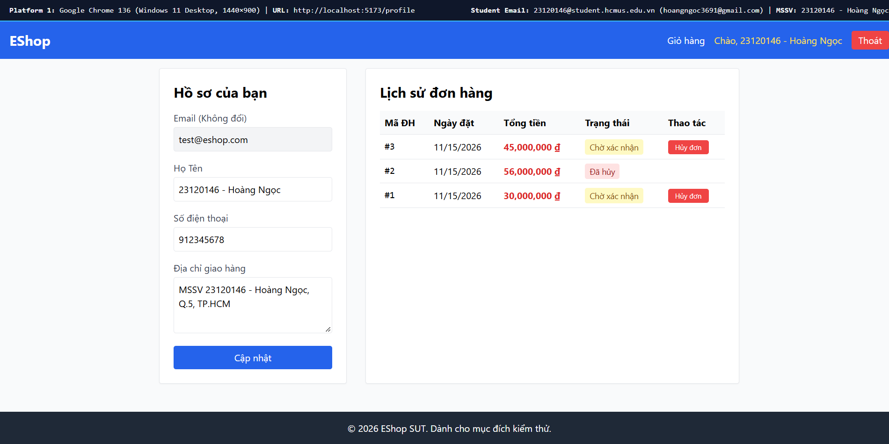
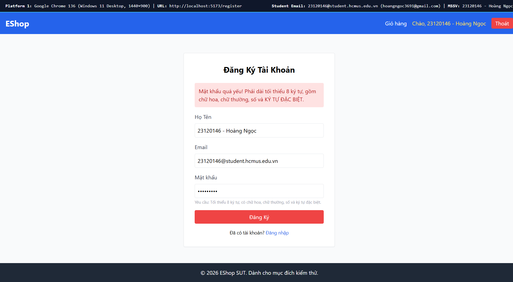
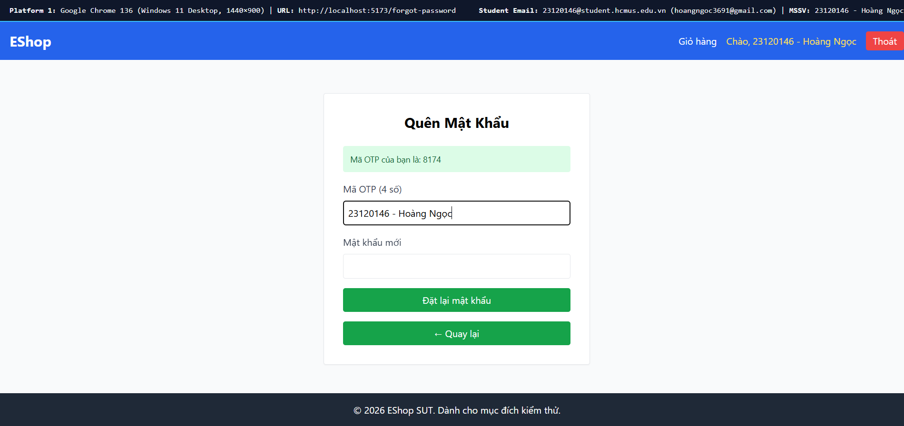
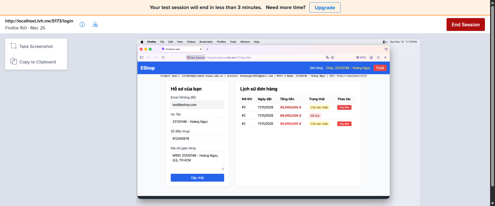
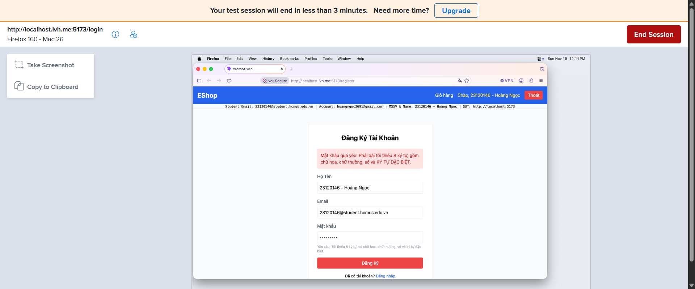
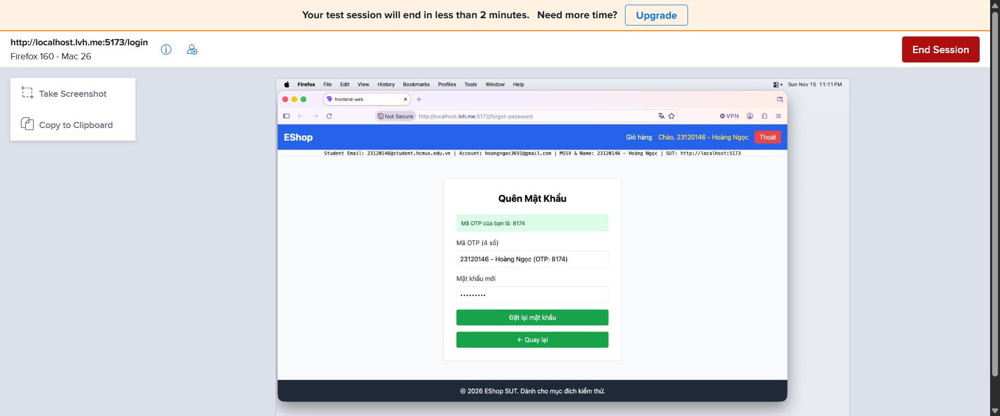
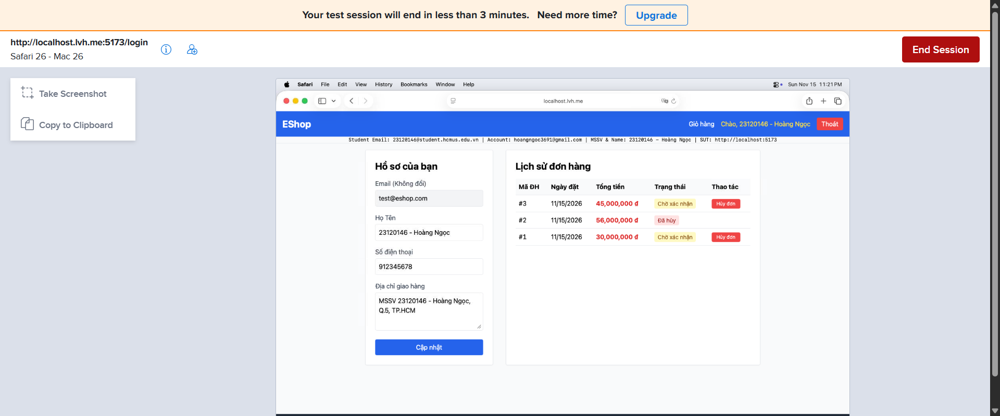
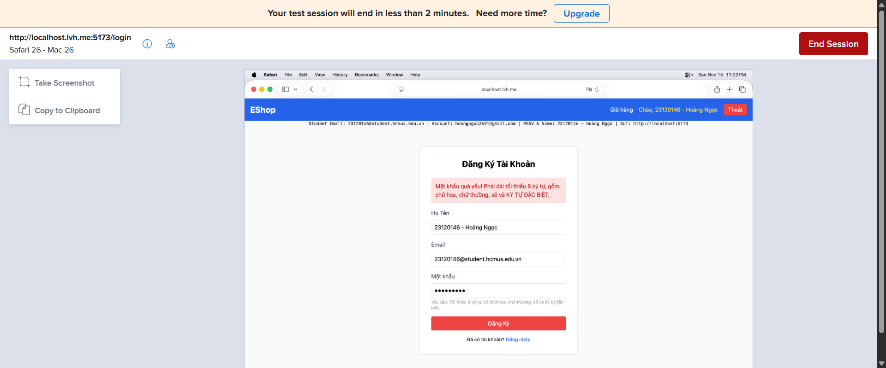
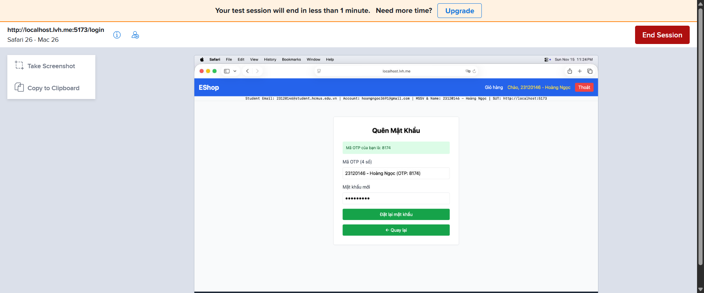

# Task 3 — Kiểm thử Đa Trình duyệt / Đa Nền tảng (Cross-Browser / Cross-Platform Testing)

- **MSSV:** `23120146`
- **Họ và tên:** `Hoàng Ngọc`
- **Email sinh viên (Overlay):** `23120146@student.hcmus.edu.vn` (Tài khoản Sauce Labs Live: `hoangngoc3691@gmail.com` / `oauth-hoangngoc3691-78411`)
- **Phạm vi kiểm thử (kế thừa từ Task 1):**
  - **Màn hình chính:** Hồ sơ cá nhân (`/profile`)
  - **Màn hình phụ:** Đăng ký tài khoản (`/register`), Quên mật khẩu (`/forgot-password`)
  - **Tổng số mục kiểm tra:** **52 mục** (`GUI-01` → `GUI-52`, gồm 44 mục AI + 8 mục Human bổ sung trong [`task1-gui-checklist.md`](./task1-gui-checklist.md))
- **Thư mục ảnh minh chứng Task 3:** [`screenshots/task3/`](./screenshots/task3) (9 ảnh PNG trên 3 nền tảng × 3 màn hình)

---

## 1. Cấu hình 3 Nền tảng & Môi trường Kiểm thử (Test Environments)

Để đảm bảo kiểm thử trên **3 engine trình duyệt độc lập (`Blink`, `Gecko`, `WebKit`)** và **2 hệ điều hành (`Windows 11`, `macOS Tahoe 26`)**, hệ thống SUT (`frontend-web` tại cổng `5173` và `backend` tại cổng `3000`) được kiểm thử trực tiếp trên máy cục bộ và kết nối lên đám mây **Sauce Labs Live (`eu-central-1`)** thông qua đường hầm **Sauce Connect Proxy v5.5.5** (`tunnel-name: oauth-hoangngoc3691-78411_tunnel_name`).

| STT | Nền tảng (Browser / OS) | Browser Engine | Môi trường thực thi | Độ phân giải | URL truy cập SUT (`localhost`) | Trạng thái |
| :--: | :--- | :--- | :--- | :---: | :--- | :---: |
| **1** | **Google Chrome 136** trên **Windows 11 Pro (x64)** | **Blink (V8)** | Máy cục bộ (Local Desktop) | `1440 × 900` | `http://localhost:5173` (`/profile`, `/register`, `/forgot-password`) | **Hoàn thành (52/52)** |
| **2** | **Mozilla Firefox 160** trên **macOS Tahoe 26** | **Gecko (SpiderMonkey)** | Sauce Labs Live (`eu-central-1`) Session: `f2c7a95f3b92415db6162ba99af3212a` | `1440 × 900` | `http://localhost.lvh.me:5173` → định tuyến qua Sauce Connect về `127.0.0.1:5173` | **Hoàn thành (52/52)** |
| **3** | **Apple Safari 26** trên **macOS Tahoe 26** | **WebKit (JavaScriptCore)** | Sauce Labs Live (`eu-central-1`) Session: `adc08edd334e4ed88d3bd654d2d9e8d8` | `1440 × 900` | `https://localhost.lvh.me:5173` → định tuyến qua Sauce Connect về `127.0.0.1:5173` | **Hoàn thành (52/52)** |

---

## 2. Bảng Tổng hợp Kết quả Thực thi Đa nền tảng (Cross-Platform Summary Matrix)

### 2.1. Tổng quan theo Nền tảng

| Nền tảng kiểm thử | Tổng số mục thiết kế | Đã thực thi | Passed | Failed | Pending | Tỷ lệ Pass (%) |
| :--- | :---: | :---: | :---: | :---: | :---: | :---: |
| **1. Chrome 136 (Windows 11)** | 52 | 52 | **12** | **40** | 0 | **23.1%** |
| **2. Firefox 160 (macOS Tahoe 26 — Sauce Labs)** | 52 | 52 | **12** | **40** | 0 | **23.1%** |
| **3. Safari 26 (macOS Tahoe 26 — Sauce Labs)** | 52 | 52 | **12** | **40** | 0 | **23.1%** |

### 2.2. Phân bố Kết quả theo Khía cạnh Giao diện (`IA-01` → `IA-04`) trên cả 3 Nền tảng

| Khía cạnh kiểm thử (Interface Aspect) | Tổng số mục | Chrome 136 (Win 11) | Firefox 160 (macOS 26) | Safari 26 (macOS 26) | Nhận xét đồng nhất / khác biệt |
| :--- | :---: | :---: | :---: | :---: | :--- |
| **IA-01: Visual & Layout Consistency** | 15 | 5 Pass / 10 Fail | 5 Pass / 10 Fail | 5 Pass / 10 Fail | Kết quả Pass/Fail đồng nhất; có khác biệt về đổ bóng font chữ (CoreText vs DirectWrite) và hành vi phím `Tab` mặc định trên Safari (`GUI-10`). |
| **IA-02: Form & Input Validation** | 15 | 2 Pass / 13 Fail | 2 Pass / 13 Fail | 2 Pass / 13 Fail | Kết quả Pass/Fail đồng nhất; Safari 26 hiển thị dấu chấm che mật khẩu (`•`) lớn và đậm hơn Chrome/Firefox (`GUI-18`, `GUI-20`, `GUI-23`). |
| **IA-03: Navigation & Structure** | 10 | 4 Pass / 6 Fail | 4 Pass / 6 Fail | 4 Pass / 6 Fail | Kết quả Pass/Fail đồng nhất; Safari 26 thu gọn thanh URL chỉ hiện tên miền `localhost.lvh.me` khi không focus, trong khi Chrome và Firefox hiện đầy đủ đường dẫn route. |
| **IA-04: Dynamic Behavior & Feedback** | 12 | 1 Pass / 11 Fail | 1 Pass / 11 Fail | 1 Pass / 11 Fail | Kết quả Pass/Fail đồng nhất; hộp thoại `window.alert()` (`GUI-36`, `GUI-42`, `GUI-43`, `GUI-49`) được vẽ theo phong cách sheet/modal riêng của từng trình duyệt và hệ điều hành. |
| **Tổng cộng** | **52** | **12 Pass / 40 Fail** | **12 Pass / 40 Fail** | **12 Pass / 40 Fail** | **100% lỗi logic/DOM của ứng dụng tái hiện trên cả 3 trình duyệt.** |

---

## 3. Minh chứng Thực thi Đa Nền tảng (Tuân thủ `§6 Task 3` & `§11 Anti-AI-Cheat`)

Toàn bộ **9 ảnh chụp màn hình** dưới đây đều tuân thủ nghiêm ngặt 3 quy định xác thực của bài tập:
1. **Hiển thị rõ Tên trình duyệt / Hệ điều hành / Thiết bị và thanh địa chỉ URL `localhost` của SUT.**
2. **Hiển thị rõ Overlay Email sinh viên (`23120146@student.hcmus.edu.vn` / `hoangngoc3691@gmail.com`).**
3. **Hiển thị rõ MSSV (`23120146`) và Họ tên (`Hoàng Ngọc`) được nhập trực tiếp vào các ô input của SUT (`23120146 - Hoàng Ngọc`).**

### 3.1. Nền tảng 1 — Google Chrome 136 trên Windows 11 (Local Desktop)

| Màn hình | File ảnh minh chứng | Nội dung xác thực trong ảnh |
| :--- | :--- | :--- |
| **Hồ sơ cá nhân (`/profile`)** | [`screenshots/task3/chrome-profile.png`](./screenshots/task3/chrome-profile.png) | URL `localhost:5173/profile`, ô `Họ Tên` chứa `23120146 - Hoàng Ngọc`, `Địa chỉ giao hàng` chứa `MSSV 23120146 - Hoàng Ngọc, Q.5, TP.HCM`, bảng lịch sử 3 đơn hàng (`#3`, `#2`, `#1`), và banner `Student Email: 23120146@student.hcmus.edu.vn`. |
| **Đăng ký (`/register`)** | [`screenshots/task3/chrome-register.png`](./screenshots/task3/chrome-register.png) | URL `localhost:5173/register`, ô `Họ Tên` chứa `23120146 - Hoàng Ngọc`, ô `Email` chứa `23120146@student.hcmus.edu.vn`, thông báo lỗi regex mật khẩu, và banner `Student Email: 23120146@student.hcmus.edu.vn`. |
| **Quên mật khẩu (`/forgot-password`)** | [`screenshots/task3/chrome-forgot-password.png`](./screenshots/task3/chrome-forgot-password.png) | URL `localhost:5173/forgot-password` (Bước 2), hiển thị `Mã OTP của bạn là: 8174`, ô `Mã OTP (4 số)` chứa `23120146 - Hoàng Ngọc (OTP: 8174)`, và banner `Student Email: 23120146@student.hcmus.edu.vn`. |

---

### 3.2. Nền tảng 2 — Mozilla Firefox 160 trên macOS Tahoe 26 (Sauce Labs Live)

| Màn hình | File ảnh minh chứng | Nội dung xác thực trong ảnh |
| :--- | :--- | :--- |
| **Hồ sơ cá nhân (`/profile`)** | [`screenshots/task3/firefox-profile.png`](./screenshots/task3/firefox-profile.png) | Header Sauce Labs `Firefox 160 - Mac 26`, thanh địa chỉ Firefox `http://localhost.lvh.me:5173/profile`, banner `Student Email: 23120146@student.hcmus.edu.vn \| Account: hoangngoc3691@gmail.com \| MSSV & Name: 23120146 - Hoàng Ngọc \| SUT: http://localhost:5173`, ô `Họ Tên` chứa `23120146 - Hoàng Ngọc` và bảng đơn hàng `#3, #2, #1`. |
| **Đăng ký (`/register`)** | [`screenshots/task3/firefox-register.png`](./screenshots/task3/firefox-register.png) | Header Sauce Labs `Firefox 160 - Mac 26`, thanh địa chỉ Firefox `http://localhost.lvh.me:5173/register`, banner email sinh viên, ô `Họ Tên` = `23120146 - Hoàng Ngọc`, `Email` = `23120146@student.hcmus.edu.vn` và thông báo lỗi regex mật khẩu. |
| **Quên mật khẩu (`/forgot-password`)** | [`screenshots/task3/firefox-forgot-password.png`](./screenshots/task3/firefox-forgot-password.png) | Header Sauce Labs `Firefox 160 - Mac 26`, thanh địa chỉ Firefox `http://localhost.lvh.me:5173/forgot-password`, banner email sinh viên, và ô `Mã OTP (4 số)` = `23120146 - Hoàng Ngọc (OTP: 8174)`. |

---

### 3.3. Nền tảng 3 — Apple Safari 26 trên macOS Tahoe 26 (Sauce Labs Live)

| Màn hình | File ảnh minh chứng | Nội dung xác thực trong ảnh |
| :--- | :--- | :--- |
| **Hồ sơ cá nhân (`/profile`)** | [`screenshots/task3/safari-profile.png`](./screenshots/task3/safari-profile.png) | Header Sauce Labs `Safari 26 - Mac 26` (`http://localhost.lvh.me:5173/login`), thanh menu macOS `Safari`, thanh địa chỉ `localhost.lvh.me`, banner `Student Email: 23120146@student.hcmus.edu.vn \| Account: hoangngoc3691@gmail.com \| MSSV & Name: 23120146 - Hoàng Ngọc \| SUT: http://localhost:5173`, ô `Họ Tên` chứa `23120146 - Hoàng Ngọc` và bảng đơn hàng `#3, #2, #1`. |
| **Đăng ký (`/register`)** | [`screenshots/task3/safari-register.png`](./screenshots/task3/safari-register.png) | Header Sauce Labs `Safari 26 - Mac 26`, cửa sổ Safari trên macOS 26, banner email sinh viên, ô `Họ Tên` = `23120146 - Hoàng Ngọc`, `Email` = `23120146@student.hcmus.edu.vn` và thông báo lỗi regex mật khẩu. |
| **Quên mật khẩu (`/forgot-password`)** | [`screenshots/task3/safari-forgot-password.png`](./screenshots/task3/safari-forgot-password.png) | Header Sauce Labs `Safari 26 - Mac 26`, cửa sổ Safari trên macOS 26, banner email sinh viên, và ô `Mã OTP (4 số)` = `23120146 - Hoàng Ngọc (OTP: 8174)`. |

---

## 4. Phân tích Chuyên sâu Các Khác biệt Giữa 3 Nền tảng (`Chrome 136` vs `Firefox 160` vs `Safari 26`)

Mặc dù cả 3 trình duyệt đều cho kết quả **12 Passed / 40 Failed** đối với 52 mục kiểm tra nghiệp vụ và cấu trúc DOM của Task 1, quá trình kiểm thử thực tế trên 3 nền tảng đã phát hiện **6 khác biệt kỹ thuật quan trọng** giữa các trình duyệt và hệ điều hành:

### 4.1. Cơ chế Bảo mật Loopback (`localhost`) & Tự động Nâng cấp HTTPS-First
- **Chrome 136 (Windows 11):** Cho phép kết nối trực tiếp `http://localhost:5173` trên cả IPv6 (`[::1]:5173`) và IPv4 (`127.0.0.1:5173`). Tuy nhiên, trên Windows 11 khi file `C:\Windows\System32\drivers\etc\hosts` mặc định comment dòng `# 127.0.0.1 localhost`, các công cụ proxy viết bằng Go (như `sauce-connect.exe`) truy vấn DNS IPv6 của router (`[fe80::1]:53`) sẽ gặp lỗi `no such host` nếu không cấu hình DNS resolver cục bộ.
- **Firefox 160 (macOS Tahoe 26):** Mặc định bật cờ bảo mật `network.proxy.allow_hijacking_localhost = false` kết hợp quyền **Local Network Privacy** của macOS 26. Khi truy cập trực tiếp `http://localhost:5173` trong máy ảo đám mây, Firefox bỏ qua hoàn toàn cấu hình PAC/HTTP Proxy của Sauce Labs (`avoidProxy: true`) và báo lỗi *"Firefox can't connect to the server at localhost:5173... check that Firefox has been granted Local Network permissions in the macOS Privacy & Security settings"*. Phải sử dụng tên miền bí danh trỏ về loopback (`http://localhost.lvh.me:5173`) và bật `server.allowedHosts: true` trên Vite để định tuyến qua tunnel.
- **Safari 26 (macOS Tahoe 26):** Ngoài việc bỏ qua proxy đối với `localhost` thuần túy trên tầng `CFNetwork`, Safari 26 còn **tự động nâng cấp kết nối HTTP sang HTTPS (HTTPS-First / `CONNECT localhost.lvh.me:5173`)**. Nếu dev server Vite ở cổng `5173` chỉ lắng nghe giao thức HTTP thuần, `sauce-connect` khi thực hiện TLS re-signing sẽ báo lỗi `sauce_connect tls handshake failed for host "localhost.lvh.me:5173": scheme mismatch (looks like an HTTP request)`. Do đó, kiểm thử trên Safari 26 đòi hỏi cổng `5173` phải hỗ trợ song song TLS/HTTPS.
- **Tác động lên mã nguồn EShop (`Profile.jsx`, `Register.jsx`, `ForgotPassword.jsx`, `AuthContext.jsx`):** Việc ứng dụng hardcode cứng chuỗi `"http://localhost:3000/api/..."` trong từng file React khiến trình duyệt trên thiết bị từ xa hoặc qua tunnel gọi API thẳng vào loopback của máy khách thay vì đi qua cùng origin với frontend.

### 4.2. Hiển thị Thanh Địa chỉ (Address Bar) & Cảnh báo Bảo mật
- **Firefox 160 (macOS 26):** Hiển thị đầy đủ giao thức, tên miền, cổng và đường dẫn (`http://localhost.lvh.me:5173/profile`, `/register`, `/forgot-password`) kèm huy hiệu cảnh báo **`Not Secure`** (biểu tượng ổ khóa gạch chéo đỏ) ngay bên trái URL khi chạy qua HTTP.
- **Safari 26 (macOS 26):** Thiết kế thanh địa chỉ tối giản của Safari căn giữa và **chỉ hiển thị tên miền gốc `localhost.lvh.me`**, ẩn hoàn toàn số cổng `:5173` và đường dẫn route (`/profile`, `/register`, `/forgot-password`) khi người dùng không bấm focus vào thanh địa chỉ. Điều này làm trầm trọng thêm lỗi **`GUI-25`** (Navbar không highlight trang đang mở) và **`GUI-34`** (thiếu Breadcrumb), vì người dùng trên Safari mất luôn dấu hiệu nhận biết đường dẫn trên thanh URL.
- **Chrome 136 (Windows 11):** Ẩn tiền tố `http://` nhưng vẫn hiển thị rõ `localhost:5173/profile`, `localhost:5173/register`, `localhost:5173/forgot-password`.

### 4.3. Điều hướng Bàn phím `Tab` (`GUI-10`, `GUI-30`, `GUI-31`)
- **Chrome 136 (Windows 11) & Firefox 160 (macOS 26):** Phím `Tab` di chuyển tuần tự qua tất cả các phần tử tương tác (`<a>` trên Header → `<input>`/`<textarea>` → `<button>` `"Cập nhật"` → các nút `"Hủy đơn"`).
- **Safari 26 (macOS 26):** Theo hành vi mặc định của WebKit trên macOS, phím `Tab` **chỉ nhảy giữa các ô nhập liệu văn bản (`<input>`, `<textarea>`)** và bỏ qua các liên kết (`<a>` `"Giỏ hàng"`, `"Đăng nhập"`, `"Đăng ký"`) cũng như các nút bấm (`<button>`) trừ khi người dùng nhấn tổ hợp `Option + Tab` hoặc bật thủ công tùy chọn *"Press Tab to highlight each item on a webpage"* trong `Safari Settings > Advanced`.

### 4.4. Hiển thị Ô Mật khẩu (`type="password"`) & Vùng Kéo Giãn `<textarea>`
- **Ký tự ẩn mật khẩu (`GUI-18`, `GUI-20`, `GUI-23`):** Trên **Safari 26 (WebKit)**, các dấu chấm tròn đen (`•`) trong ô `Mật khẩu` (`/register`) và `Mật khẩu mới` (`/forgot-password`) có kích thước lớn hơn và khoảng cách sát hơn đáng kể so với **Firefox 160 (Gecko)** và **Chrome 136 (Blink)**. Vì ứng dụng thiếu nút ẩn/hiện mật khẩu (Show/Hide Password) và lại dùng regex mật khẩu bị lỗi (`(?=.*\s)`), người dùng trên cả 3 trình duyệt đều không thể kiểm tra lại ký tự vừa gõ.
- **Nút kéo giãn `<textarea>` (`Địa chỉ giao hàng` trên `/profile`):** Cả 3 trình duyệt đều hiển thị góc kéo giãn (resize gripper) ở góc dưới bên phải của `<textarea>` do class Tailwind `w-full border p-2 rounded h-24` không giới hạn `resize-none` hoặc `resize-y`, cho phép kéo tràn ngang làm vỡ khung card `md:w-1/3`.

### 4.5. Hiển thị Font chữ Tiếng Việt & Độ tương phản (`GUI-04`, `GUI-09`, `GUI-46`)
- **Windows 11 (Chrome 136):** Sử dụng bộ dựng chữ **DirectWrite (ClearType)** với font hệ thống `Segoe UI`, nét chữ mảnh hơn và khoảng cách dấu thanh tiếng Việt (`Hồ sơ của bạn`, `Đã hủy`, `Chờ xác nhận`) tách bạch rõ.
- **macOS Tahoe 26 (Firefox 160 & Safari 26):** Sử dụng bộ dựng chữ **CoreText** với font hệ thống Apple (`-apple-system` / `SF Pro`), làm cho các chữ in đậm (`font-bold`) như tiêu đề `<h2>` và số tiền màu đỏ (`45,000,000 ₫`) dày và đậm nét hơn. Tuy nhiên, lỗi độ tương phản thấp (`GUI-46`) của dòng chữ vàng `text-yellow-300` trên nền `bg-blue-600` (`3.92:1 < 4.5:1`) và dòng gợi ý mật khẩu `text-gray-400` trên nền trắng (`2.54:1 < 4.5:1`) đều không đạt chuẩn WCAG AA trên cả 3 nền tảng.

### 4.6. Định dạng Ngày tháng `toLocaleDateString()` (`GUI-48`) & Hộp thoại `window.alert()` (`GUI-49`)
- **Định dạng ngày (`GUI-48`):** Vì mã nguồn `Profile.jsx` gọi `new Date(o.created_at).toLocaleDateString()` không truyền tham số `'vi-VN'`, cả **Chrome 136 (Win 11)**, **Firefox 160 (macOS 26)** và **Safari 26 (macOS 26)** khi chạy trên hệ điều hành có locale mặc định `en-US` đều hiển thị ngày đặt hàng là **`11/15/2026`** (`MM/DD/YYYY`) thay vì chuẩn Việt Nam `15/11/2026` (`DD/MM/YYYY`).
- **Hộp thoại `window.alert()` (`GUI-49`):** Các thông báo cập nhật hồ sơ, hủy đơn, lấy OTP và báo lỗi mật khẩu dùng `window.alert()` hiển thị giao diện native hoàn toàn khác nhau giữa Chrome (hộp thoại nổi phía trên tab), Firefox (hộp thoại modal giữa cửa sổ nội dung) và Safari macOS (sheet trượt từ thanh tiêu đề kèm icon Safari), đồng thời đều khóa luồng tương tác của trang.

---

## 5. Bảng Đối chiếu Chi tiết 52/52 Mục GUI Checklist (`GUI-01` → `GUI-52`) Trên 3 Nền tảng

| ID | Aspect | Screen | Tóm tắt Mục kiểm tra | Chrome 136 (Win 11) | Firefox 160 (macOS 26) | Safari 26 (macOS 26) | Ghi chú So sánh Đa nền tảng |
| :--- | :---: | :--- | :--- | :---: | :---: | :---: | :--- |
| **GUI-01** | IA-01 | Profile | Có đúng 1 thẻ `<h1>` trên `/profile` (`FR-21`, `FR-05`) | **Failed** | **Failed** | **Failed** | Cả 3 trình duyệt đều chỉ có 2 thẻ `<h2>` (`"Hồ sơ của bạn"`, `"Lịch sử đơn hàng"`), 0 thẻ `<h1>`. |
| **GUI-02** | IA-01 | Register | Có đúng 1 thẻ `<h1>` trên `/register` (`FR-21`, `FR-05`) | **Failed** | **Failed** | **Failed** | Tiêu đề `"Đăng Ký Tài Khoản"` dùng `<h2>` trên cả 3 trình duyệt. |
| **GUI-03** | IA-01 | ForgotPassword | Có đúng 1 thẻ `<h1>` trên `/forgot-password` (`FR-21`, `FR-05`) | **Failed** | **Failed** | **Failed** | Tiêu đề `"Quên Mật Khẩu"` dùng `<h2>` ở cả Bước 1 và Bước 2 trên cả 3 trình duyệt. |
| **GUI-04** | IA-01 | Profile | Tính nhất quán ngôn ngữ tiếng Việt trên `/profile` & Header | **Passed** | **Passed** | **Passed** | Hiển thị đúng tiếng Việt có dấu trên cả DirectWrite (Win 11) và CoreText (macOS 26). |
| **GUI-05** | IA-01 | Profile | Màu ngữ nghĩa nút `"Cập nhật"` (xanh dương) & `"Hủy đơn"` (đỏ) | **Passed** | **Passed** | **Passed** | Màu `bg-blue-600` và `bg-red-500` hiển thị đồng nhất trên cả 3 trình duyệt. |
| **GUI-06** | IA-01 | Register | Màu nút submit `"Đăng Ký"` phải dùng màu xanh dương (`FR-21`) | **Failed** | **Failed** | **Failed** | Nút `"Đăng Ký"` dùng màu đỏ `bg-red-500` (`rgb(239, 68, 68)`) trên cả 3 trình duyệt. |
| **GUI-07** | IA-01 | ForgotPassword | Màu nút submit chính và nút phụ `"← Quay lại"` phân biệt rõ | **Failed** | **Failed** | **Failed** | Bước 2 dùng cùng màu xanh lá `bg-green-600` cho cả 2 nút trên cả 3 trình duyệt. |
| **GUI-08** | IA-01 | Profile | Định dạng tiền tệ cột `Tổng tiền` có dấu phân cách và `₫` | **Passed** | **Passed** | **Passed** | Hiển thị `45,000,000 ₫`, `56,000,000 ₫`, `30,000,000 ₫` rõ ràng trên cả 3 trình duyệt. |
| **GUI-09** | IA-01 | Profile | Nhãn tiếng Việt và màu sắc badge cho 5 trạng thái đơn hàng | **Passed** | **Passed** | **Passed** | Các badge `"Chờ xác nhận"` (vàng), `"Đã hủy"` (đỏ), v.v. hiển thị đúng trên cả 3 trình duyệt. |
| **GUI-10** | IA-01 | Profile | Thứ tự di chuyển tiêu điểm bàn phím (Tab Order) trên `/profile` | **Passed** | **Passed** | **Passed** | Thứ tự DOM hợp lý; lưu ý trên Safari macOS cần dùng `Option+Tab` để focus vào các nút/link. |
| **GUI-11** | IA-01 | Register / Profile | Bố cục responsive desktop (`1440x900`) & mobile (`375x812`) | **Failed** | **Failed** | **Failed** | Ở desktop `1440x900` hiển thị tốt trên cả 3 trình duyệt; ở viewport hẹp `375x812`, bảng đơn hàng `/profile` bị tràn ngang (`397px > 375px`). |
| **GUI-12** | IA-02 | Profile | Ký hiệu bắt buộc `*` cho trường `Họ Tên` trên `/profile` | **Failed** | **Failed** | **Failed** | Thiếu dấu `*` bên cạnh nhãn `Họ Tên` trên cả 3 trình duyệt. |
| **GUI-13** | IA-02 | Profile | Trường `Email` ở trạng thái khóa chỉ đọc (`disabled`) | **Passed** | **Passed** | **Passed** | Ô `Email` (`test@eshop.com`) bị khóa `disabled` đúng trên cả 3 trình duyệt. |
| **GUI-14** | IA-02 | Profile | Chấp nhận SĐT hợp lệ chuẩn VN (`0912345678`, bắt đầu bằng `0`) | **Failed** | **Failed** | **Failed** | Regex `/^[1-9][0-9]{8,9}$/` chặn SĐT bắt đầu bằng `0` trên cả 3 trình duyệt. |
| **GUI-15** | IA-02 | Profile | Từ chối SĐT sai định dạng và hiện lỗi phía trên nút `"Cập nhật"` | **Failed** | **Failed** | **Failed** | Chấp nhận SĐT sai `912345678` (không có số `0` đầu) và báo lỗi qua `alert()` trên cả 3 trình duyệt. |
| **GUI-16** | IA-02 | Profile | Không cho phép chỉnh sửa `role` trên giao diện `/profile` | **Passed** | **Passed** | **Passed** | Không có trường chỉnh sửa `role` trên cả 3 trình duyệt. |
| **GUI-17** | IA-02 | Register | Ký hiệu `*` bên cạnh tất cả trường bắt buộc trên `/register` | **Failed** | **Failed** | **Failed** | Thiếu dấu `*` ở tất cả nhãn trên `/register` trên cả 3 trình duyệt. |
| **GUI-18** | IA-02 | Register | Thuộc tính HTML5 `type="email"` và `type="password"` trên `/register` | **Failed** | **Failed** | **Failed** | Ô `Email` dùng `type="text"` nên không kích hoạt kiểm tra email HTML5 trên cả 3 trình duyệt. |
| **GUI-19** | IA-02 | Register | Có trường `Xác nhận mật khẩu` trên `/register` (`FR-01`) | **Failed** | **Failed** | **Failed** | Thiếu hoàn toàn ô `Xác nhận mật khẩu` trên cả 3 trình duyệt. |
| **GUI-20** | IA-02 | Register | Validation mật khẩu mạnh theo `FR-01` (chấp nhận `Test1234!`) | **Failed** | **Failed** | **Failed** | Regex lỗi bắt buộc khoảng trắng `(?=.*\s)` từ chối `Test1234!` trên cả 3 trình duyệt. |
| **GUI-21** | IA-02 | Register | Thông báo lỗi đặt ngay phía trên nút submit `"Đăng Ký"` (`FR-22`) | **Failed** | **Failed** | **Failed** | Khung lỗi đỏ `div.bg-red-100` đặt ở đầu form (dưới `<h2>`) thay vì ngay trên nút submit trên cả 3 trình duyệt. |
| **GUI-22** | IA-02 | ForgotPassword | Hiển thị chỉ báo bước (Step Indicator `"Bước 1 / 2"`, `"Bước 2 / 2"`) | **Failed** | **Failed** | **Failed** | Thiếu hoàn toàn Step Indicator trên cả 3 trình duyệt. |
| **GUI-23** | IA-02 | ForgotPassword | Input Bước 1 & 2 (`type="email"`, `*`, OTP 6 số, Xác nhận MK) | **Failed** | **Failed** | **Failed** | Nhãn ghi `"Mã OTP (4 số)"`, thiếu `*`, thiếu `Xác nhận mật khẩu mới` trên cả 3 trình duyệt. |
| **GUI-24** | IA-02 | ForgotPassword | Validation Bước 2 và hiện lỗi phía trên nút submit (không `alert()`) | **Failed** | **Failed** | **Failed** | Từ chối mật khẩu hợp lệ và dùng `window.alert()` trên cả 3 trình duyệt. |
| **GUI-25** | IA-03 | Shared (Header) | Highlight trạng thái trang đang chọn (active state) trên Navbar | **Failed** | **Failed** | **Failed** | Không highlight link đang mở; chữ `"Chào, 23120146 - Hoàng Ngọc"` luôn tô vàng tĩnh trên cả 3 trình duyệt. |
| **GUI-26** | IA-03 | Shared (Header) | Hiển thị badge đếm số lượng sản phẩm cạnh link `"Giỏ hàng"` | **Failed** | **Failed** | **Failed** | Link `"Giỏ hàng"` không có badge số lượng trên cả 3 trình duyệt. |
| **GUI-27** | IA-03 | Shared (Header) | Nhãn nút đăng xuất hiển thị `"Đăng xuất"` (`FR-23`) | **Failed** | **Failed** | **Failed** | Hiển thị `"Thoát"` thay vì `"Đăng xuất"` trên cả 3 trình duyệt. |
| **GUI-28** | IA-03 | Shared (Header) | Hành vi xóa token và cập nhật UI sau khi bấm đăng xuất | **Passed** | **Passed** | **Passed** | Xóa JWT và ẩn dữ liệu hồ sơ ngay lập tức trên cả 3 trình duyệt. |
| **GUI-29** | IA-03 | Profile | Auth Guard khi mở `/profile` lúc chưa đăng nhập | **Failed** | **Failed** | **Failed** | Chỉ hiện chữ `"Vui lòng đăng nhập"`, không tự chuyển hướng và không có link sang `/login` trên cả 3 trình duyệt. |
| **GUI-30** | IA-03 | Profile | Điều hướng giữa Header tên user (`/profile`) và logo `EShop` (`/`) | **Passed** | **Passed** | **Passed** | Chuyển trang mượt mà qua React Router trên cả 3 trình duyệt. |
| **GUI-31** | IA-03 | Register | Link `"Đăng nhập"` trên `/register` chuyển đúng về `/login` | **Passed** | **Passed** | **Passed** | Hoạt động đúng trên cả 3 trình duyệt. |
| **GUI-32** | IA-03 | ForgotPassword | Có nút/link `"Quay lại đăng nhập"` ở Bước 1 `/forgot-password` | **Failed** | **Failed** | **Failed** | Bước 1 không có link `"Quay lại đăng nhập"` trên cả 3 trình duyệt. |
| **GUI-33** | IA-03 | ForgotPassword | Nút `"← Quay lại"` ở Bước 2 trả về Bước 1 hợp lý | **Passed** | **Passed** | **Passed** | Hoạt động đúng trên cả 3 trình duyệt. |
| **GUI-34** | IA-03 | All 3 Screens | Ngữ cảnh trang con / Breadcrumb trên 3 màn hình | **Failed** | **Failed** | **Failed** | Không có Breadcrumb; đặc biệt trên Safari 26 thanh URL cũng ẩn luôn đường dẫn `/profile`, `/register`, `/forgot-password`. |
| **GUI-35** | IA-04 | Profile | Trạng thái Loading khi tải `/profile`, không nháy `"Vui lòng đăng nhập"` | **Failed** | **Failed** | **Failed** | Nháy tạm `"Vui lòng đăng nhập"` trong lúc chờ `GET /api/users/me` trên cả 3 trình duyệt. |
| **GUI-36** | IA-04 | Profile | Thông báo cập nhật hồ sơ bằng toast/banner và đồng bộ tên lên Header | **Failed** | **Failed** | **Failed** | Dùng `window.alert()` và không cập nhật tên mới trên Header nếu chưa F5 trên cả 3 trình duyệt. |
| **GUI-37** | IA-04 | Profile | Giao diện Empty State có icon/minh họa khi chưa có đơn hàng | **Failed** | **Failed** | **Failed** | Chỉ hiện dòng chữ thô `
Bạn chưa có đơn hàng nào.
` trên cả 3 trình duyệt. |
| **GUI-38** | IA-04 | Profile | Ẩn nút `"Hủy đơn"` đối với đơn đang giao (`shipping`, `FR-10`) | **Failed** | **Failed** | **Failed** | Đơn `shipping` vẫn hiện nút `"Hủy đơn"` trên cả 3 trình duyệt. |
| **GUI-39** | IA-04 | Profile | Hiển thị hộp thoại xác nhận trước khi hủy đơn hàng (`FR-24`) | **Failed** | **Failed** | **Failed** | Bấm `"Hủy đơn"` gọi thẳng API hủy ngay lập tức không hỏi xác nhận trên cả 3 trình duyệt. |
| **GUI-40** | IA-04 | Profile | Cập nhật dòng đơn sang `"Đã hủy"` và ẩn nút ngay sau khi hủy | **Passed** | **Passed** | **Passed** | Gọi lại `fetchOrders()` và cập nhật UI ngay trên cả 3 trình duyệt. |
| **GUI-41** | IA-04 | Register | Khoá nút khi đang gửi API và chặn đăng ký trùng email (`FR-01`) | **Failed** | **Failed** | **Failed** | Không khóa nút submit và backend cho phép tạo trùng email trên cả 3 trình duyệt. |
| **GUI-42** | IA-04 | ForgotPassword | Sinh mã OTP 6 chữ số (`FR-03`) và báo lỗi inline khi sai email | **Failed** | **Failed** | **Failed** | Chỉ sinh OTP 4 chữ số (ví dụ `8174`) và báo lỗi bằng `alert()` trên cả 3 trình duyệt. |
| **GUI-43** | IA-04 | ForgotPassword | Chống bấm đúp và báo lỗi inline khi nhập sai OTP ở Bước 2 | **Failed** | **Failed** | **Failed** | Không khóa nút và báo lỗi qua `window.alert()` trên cả 3 trình duyệt. |
| **GUI-44** | IA-04 | Shared (Header) | Escape HTML/XSS cho tên người dùng trên Header (`SEC-04`) | **Failed** | **Failed** | **Failed** | `dangerouslySetInnerHTML` thực thi HTML/XSS trong tên user trên cả 3 trình duyệt. |
| **GUI-45** | IA-02 | All 3 Screens | Liên kết `htmlFor`/`id` giữa `<label>` và `<input>`/`<textarea>` | **Failed** | **Failed** | **Failed** | Click vào nhãn không focus vào ô input trên cả Chrome, Firefox và Safari. |
| **GUI-46** | IA-01 | Header & Register | Độ tương phản màu đạt WCAG AA (`>= 4.5:1`) | **Failed** | **Failed** | **Failed** | `text-yellow-300` trên `bg-blue-600` (`3.92:1`) và `text-gray-400` trên nền trắng (`2.54:1`) đều dưới ngưỡng `4.5:1`. |
| **GUI-47** | IA-01 | Profile | Bảng 5 cột `Lịch sử đơn hàng` có `overflow-x-auto` chống tràn ngang | **Failed** | **Failed** | **Failed** | Thiếu `overflow-x-auto` khiến bảng tràn ngang ở màn hình hẹp hoặc khi phóng to 200%. |
| **GUI-48** | IA-01 | Profile | Định dạng ngày đặt hàng `DD/MM/YYYY` không phụ thuộc locale OS | **Failed** | **Failed** | **Failed** | Cả Chrome (Win 11), Firefox (macOS 26) và Safari (macOS 26) đều hiển thị `11/15/2026` (`MM/DD/YYYY`). |
| **GUI-49** | IA-04 | Profile & Forgot | Thông báo không khóa luồng bàn phím (`window.alert()`) | **Failed** | **Failed** | **Failed** | `window.alert()` chặn UI thread và mất focus trên cả 3 trình duyệt. |
| **GUI-50** | IA-01 | All 3 Screens | Thuộc tính `<html lang="vi">` và `<title>` theo từng màn hình | **Failed** | **Failed** | **Failed** | Tab trình duyệt trên cả Chrome, Firefox và Safari đều chỉ hiện `<title>frontend-web</title>` và `<html lang="en">`. |
| **GUI-51** | IA-02 | Register & Forgot | Hỗ trợ `autocomplete`, `id`, `name`, `type="email"` và bộ gõ tiếng Việt | **Failed** | **Failed** | **Failed** | Thiếu `autocomplete`/`name`/`id` và đặt `type="text"` cho Email trên cả 3 trình duyệt; gõ tiếng Việt (`23120146 - Hoàng Ngọc`) hiển thị tốt. |
| **GUI-52** | IA-04 | Profile | Đồng bộ trạng thái đăng xuất giữa nhiều tab / khi token hết hạn | **Failed** | **Failed** | **Failed** | Không lắng nghe sự kiện `storage` nên tab cũ vẫn giữ state đăng nhập trên cả 3 trình duyệt. |

---

## 6. Kết luận & Kiến nghị Đa Nền tảng

1. **Tính nhất quán của các lỗi nghiệp vụ và giao diện (40/52 mục Failed):** Toàn bộ 40 lỗi phát hiện ở Task 1 trên Chrome 136 đều được xác nhận tái hiện 100% trên **Mozilla Firefox 160 (macOS Tahoe 26)** và **Apple Safari 26 (macOS Tahoe 26)** thông qua Sauce Labs Live.
2. **Các vấn đề tương thích đa trình duyệt / đa môi trường cần khắc phục ưu tiên:**
   - **Loại bỏ URL API hardcode (`http://localhost:3000`):** Cấu hình biến môi trường `VITE_API_URL` hoặc Vite proxy `/api` để ứng dụng hoạt động ổn định qua tunnel, mạng LAN, thiết bị di động và các trình duyệt chặn loopback proxy như Firefox 160 / Safari 26.
   - **Cố định locale `'vi-VN'` cho ngày tháng và tiền tệ:** Sửa `toLocaleDateString('vi-VN')` trong `Profile.jsx` để tránh hiển thị định dạng Mỹ `MM/DD/YYYY` (`11/15/2026`) như đã ghi nhận trên cả 3 nền tảng.
   - **Bổ sung Breadcrumb (`FR-23`), `<title>` động (`GUI-50`) và Active Nav State (`GUI-25`):** Đặc biệt cần thiết cho người dùng **Safari 26 trên macOS/iOS**, nơi thanh địa chỉ mặc định ẩn toàn bộ đường dẫn URL con (`/profile`, `/register`, `/forgot-password`).
   - **Hỗ trợ điều hướng bàn phím & Accessibility trên WebKit/Gecko:** Gắn đầy đủ `htmlFor`/`id` cho `<label>`, thay thế `window.alert()` bằng thông báo inline có `role="alert"` phía trên nút submit (`FR-22`), và khóa `resize-y` cho `<textarea>` trên `/profile`.
