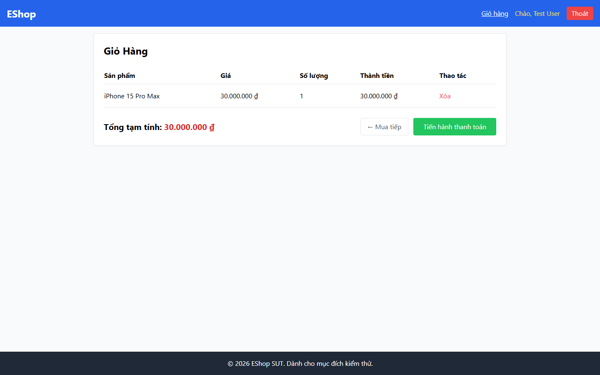

# Bug Report

## 1. Bug Identification

- **Bug ID:** `BUG-20261114-002`
- **Title:** `[BUG][Header] Nút đăng xuất dùng nhãn Thoát`
- **Related Checklist Item ID:** `GUI-03`, `GUI-27`
- **Function Name:** `Đăng xuất`
- **Affected Screen / Module:** `Header / Navbar`
- **Reported By:** `Puppeteer GUI TestScript`
- **Report Date:** `2026-11-14`
- **Assigned To:** `Unassigned`

## 2. Problem Summary

**What was tested:** Nhãn của hành động đăng xuất trong Navbar.

**What happened:** Nút màu đỏ hiển thị `Thoát`.

**Why this is incorrect:** FR-23 yêu cầu nhãn chính xác là `Đăng xuất`; nhãn rõ ràng giúp phân biệt hành động với thao tác đóng hoặc rời trang.

## 3. Environment

- **Application URL:** `http://localhost:5173/`
- **Backend API URL:** `http://localhost:3000`
- **Browser and version:** `Google Chrome 157.0.8103.78`
- **Operating System:** `Windows 11 Pro 64-bit (Microsoft Windows NT 10.0.26200.0)`
- **Viewport / Screen Resolution:** `1440 × 900`
- **Application version or Git commit:** `ef8da40`
- **Test account** `test@eshop.com`

## 4. Preconditions

Đăng nhập bằng tài khoản người dùng.

## 5. Steps to Reproduce

1. Mở bất kỳ màn hình nào trong luồng mua sắm.
2. Quan sát nút màu đỏ ở góc phải Navbar.

## 6. Expected Result

Nút hiển thị nhãn `Đăng xuất` nhất quán trên các màn hình.

## 7. Actual Result

Nút hiển thị nhãn `Thoát`.

## 8. Evidence

