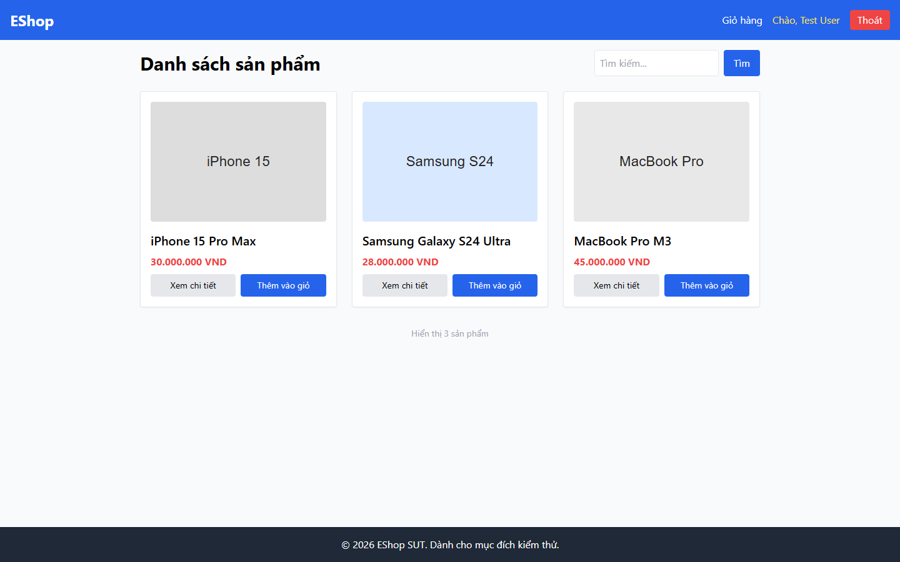

# Bug Report

## 1. Bug Identification

- **Bug ID:** `BUG-20261114-003`
- **Title:** `[BUG][Product List] Giá sản phẩm dùng VND thay vì ký hiệu ₫`
- **Related Checklist Item ID:** `GUI-04`
- **Function Name:** `Hiển thị giá sản phẩm`
- **Affected Screen / Module:** `Danh sách sản phẩm`
- **Reported By:** `Puppeteer GUI TestScript`
- **Report Date:** `2026-11-14`
- **Assigned To:** `Unassigned`

## 2. Problem Summary

**What was tested:** Định dạng tiền tệ trên giao diện.

**What happened:** Giá trong danh sách dùng hậu tố `VND`.

**Why this is incorrect:** FR-05 và FR-21 yêu cầu dùng ký hiệu `₫` cùng định dạng phân cách hàng nghìn nhất quán.

## 3. Environment

- **Application URL:** `http://localhost:5173/`
- **Backend API URL:** `http://localhost:3000`
- **Browser and version:** `Google Chrome 157.0.8103.78`
- **Operating System:** `Windows 11 Pro 64-bit (Microsoft Windows NT 10.0.26200.0)`
- **Viewport / Screen Resolution:** `1440 × 900`
- **Application version or Git commit:** `ef8da40`
- **Test account** `test@eshop.com`

## 4. Preconditions

Danh sách sản phẩm có ít nhất một sản phẩm có giá.

## 5. Steps to Reproduce

1. Mở trang Danh sách sản phẩm.
2. Quan sát giá của bất kỳ product card nào.

## 6. Expected Result

Giá hiển thị dạng như `30.000.000 ₫`.

## 7. Actual Result

Giá hiển thị dạng như `30.000.000 VND`.

## 8. Evidence

