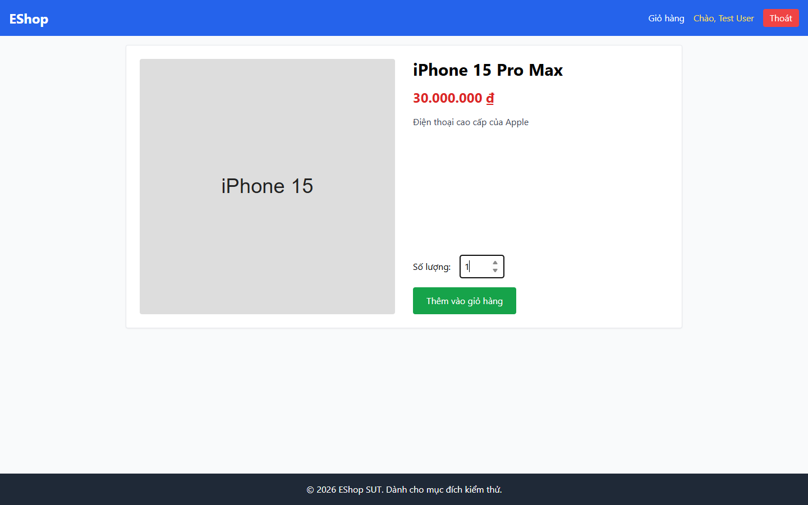

# Bug Report

## 1. Bug Identification

- **Bug ID:** `BUG-20261114-006`
- **Title:** `[BUG][Accessibility] Control không có tên truy cập rõ ràng`
- **Related Checklist Item ID:** `GUI-14`, `GUI-44`, `GUI-49`
- **Function Name:** `Tìm kiếm; nhập số lượng; điều hướng bằng bàn phím`
- **Affected Screen / Module:** `Danh sách sản phẩm; Chi tiết sản phẩm`
- **Reported By:** `Puppeteer GUI TestScript`
- **Report Date:** `2026-11-14`
- **Assigned To:** `Unassigned`

## 2. Problem Summary

**What was tested:** Tên truy cập của input và khả năng dùng bằng bàn phím.

**What happened:** Ô tìm kiếm không có `label`, `aria-label` hoặc tên truy cập khác; control không có tên làm trình đọc màn hình và điều hướng bàn phím không xác định được mục đích.

**Why this is incorrect:** Người dùng công nghệ hỗ trợ phải nhận biết được công dụng của mỗi control.

## 3. Environment

- **Application URL:** `http://localhost:5173/`, `http://localhost:5173/product/1`
- **Backend API URL:** `http://localhost:3000`
- **Browser and version:** `Google Chrome 157.0.8103.78`
- **Operating System:** `Windows 11 Pro 64-bit (Microsoft Windows NT 10.0.26200.0)`
- **Viewport / Screen Resolution:** `1440 × 900`
- **Application version or Git commit:** `ef8da40`
- **Test account** `test@eshop.com`

## 4. Preconditions

Mở Danh sách sản phẩm hoặc Chi tiết sản phẩm.

## 5. Steps to Reproduce

1. Mở Danh sách sản phẩm.
2. Kiểm tra thuộc tính truy cập của ô `Tìm kiếm...`.
3. Dùng phím Tab để đến các control trong luồng.

## 6. Expected Result

Mỗi control có nhãn liên kết hoặc `aria-label` rõ nghĩa; người dùng bàn phím và trình đọc màn hình nhận biết được control.

## 7. Actual Result

Ô tìm kiếm không có tên truy cập; test bàn phím phát hiện control không có tên.

## 8. Evidence

