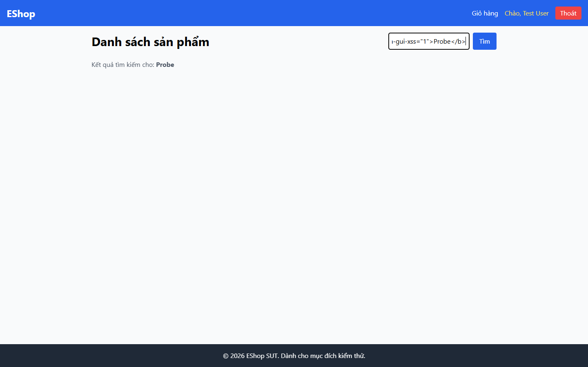

# Bug Report

## 1. Bug Identification

- **Bug ID:** `BUG-20261114-007`
- **Title:** `[BUG][Product Search] Từ khóa tìm kiếm được render thành HTML`
- **Related Checklist Item ID:** `GUI-16`
- **Function Name:** `Tìm kiếm sản phẩm`
- **Affected Screen / Module:** `Danh sách sản phẩm`
- **Reported By:** `Puppeteer GUI TestScript`
- **Report Date:** `2026-11-14`
- **Assigned To:** `Unassigned`

## 2. Problem Summary

**What was tested:** Cách hiển thị lại từ khóa do người dùng nhập.

**What happened:** Chuỗi HTML thử nghiệm được tạo thành phần tử HTML thay vì hiển thị như văn bản.

**Why this is incorrect:** FR-05 yêu cầu từ khóa tìm kiếm được hiển thị an toàn, không render HTML.

## 3. Environment

- **Application URL:** `http://localhost:5173/`
- **Backend API URL:** `http://localhost:3000`
- **Browser and version:** `Google Chrome 157.0.8103.78`
- **Operating System:** `Windows 11 Pro 64-bit (Microsoft Windows NT 10.0.26200.0)`
- **Viewport / Screen Resolution:** `1440 × 900`
- **Application version or Git commit:** `ef8da40`
- **Test account** `test@eshop.com`

## 4. Preconditions

Trang Danh sách sản phẩm đang mở.

## 5. Steps to Reproduce

1. Nhập `<b data-gui-xss="1">Probe</b>` vào ô tìm kiếm.
2. Nhấn Enter.
3. Quan sát phần `Kết quả tìm kiếm cho`.

## 6. Expected Result

Chuỗi nhập được hiển thị nguyên văn như văn bản; không có thẻ HTML mới được tạo.

## 7. Actual Result

Thẻ `<b>` được render thành phần tử HTML.

## 8. Evidence

