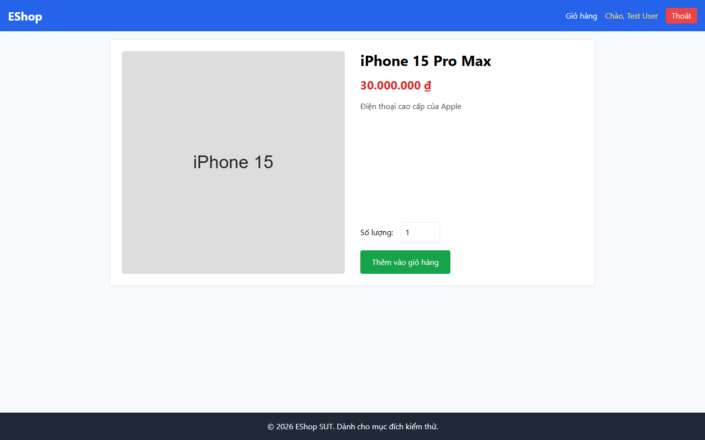

# Bug Report

## 1. Bug Identification

- **Bug ID:** `BUG-20261114-008`
- **Title:** `[BUG][Product Detail] Ô Số lượng thiếu ràng buộc và thông báo lỗi`
- **Related Checklist Item ID:** `GUI-17`, `GUI-19`, `GUI-20`, `GUI-45`
- **Function Name:** `Chọn số lượng và Thêm vào giỏ hàng`
- **Affected Screen / Module:** `Chi tiết sản phẩm`
- **Reported By:** `Puppeteer GUI TestScript`
- **Report Date:** `2026-11-14`
- **Assigned To:** `Unassigned`

## 2. Problem Summary

**What was tested:** Ràng buộc nhập số lượng, dấu bắt buộc và thông báo lỗi hỗ trợ accessibility.

**What happened:** Ô số lượng không có `min=1`, `required` hoặc dấu `*`; nhập giá trị rỗng/không hợp lệ không tạo thông báo lỗi và không có `aria-invalid`.

**Why this is incorrect:** FR-06 yêu cầu số nguyên dương tối thiểu 1; FR-22 yêu cầu trường bắt buộc và lỗi rõ ràng.

## 3. Environment

- **Application URL:** `http://localhost:5173/product/1`
- **Backend API URL:** `http://localhost:3000`
- **Browser and version:** `Google Chrome 157.0.8103.78`
- **Operating System:** `Windows 11 Pro 64-bit (Microsoft Windows NT 10.0.26200.0)`
- **Viewport / Screen Resolution:** `1440 × 900`
- **Application version or Git commit:** `ef8da40`
- **Test account** `test@eshop.com`

## 4. Preconditions

Mở sản phẩm có thể thêm vào giỏ.

## 5. Steps to Reproduce

1. Mở Chi tiết sản phẩm.
2. Kiểm tra thuộc tính của ô `Số lượng`.
3. Để trống hoặc nhập `0`, `-1`, `1.5`.
4. Nhấn `Thêm vào giỏ hàng`.

## 6. Expected Result

Ô chỉ nhận số nguyên từ 1, có dấu bắt buộc; lỗi hiển thị phía trên nút và được trình đọc màn hình thông báo.

## 7. Actual Result

Không có ràng buộc `min`/`required`, không có dấu `*`, không có lỗi hiển thị hoặc trạng thái `aria-invalid`.

## 8. Evidence

