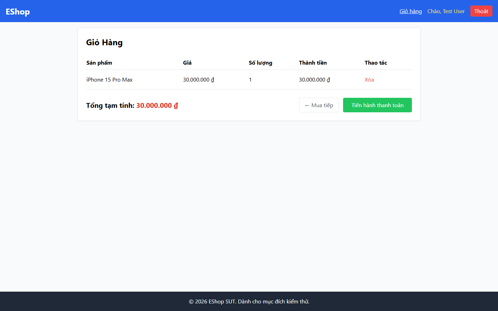

# Bug Report

## 1. Bug Identification

- **Bug ID:** `BUG-20261114-009`
- **Title:** `[BUG][Cart] Không có nút tăng giảm số lượng`
- **Related Checklist Item ID:** `GUI-23`, `GUI-37`
- **Function Name:** `Cập nhật số lượng giỏ hàng`
- **Affected Screen / Module:** `Giỏ hàng`
- **Reported By:** `Puppeteer GUI TestScript`
- **Report Date:** `2026-11-14`
- **Assigned To:** `Unassigned`

## 2. Problem Summary

**What was tested:** Control tăng/giảm số lượng và cập nhật tổng tiền.

**What happened:** Mỗi dòng giỏ hàng chỉ có nút `Xóa`; không có nút `-` hoặc `+`.

**Why this is incorrect:** FR-07 yêu cầu có nút `+/-` để chỉnh số lượng và cập nhật thành tiền/tổng cộng.

## 3. Environment

- **Application URL:** `http://localhost:5173/cart`
- **Backend API URL:** `http://localhost:3000`
- **Browser and version:** `Google Chrome 157.0.8103.78`
- **Operating System:** `Windows 11 Pro 64-bit (Microsoft Windows NT 10.0.26200.0)`
- **Viewport / Screen Resolution:** `1440 × 900`
- **Application version or Git commit:** `ef8da40`
- **Test account** `test@eshop.com`

## 4. Preconditions

Giỏ hàng có một sản phẩm.

## 5. Steps to Reproduce

1. Thêm một sản phẩm vào giỏ.
2. Mở trang Giỏ hàng.
3. Quan sát cột `Số lượng` và thao tác của dòng sản phẩm.

## 6. Expected Result

Có nút `-` và `+`; khi sử dụng, số lượng, thành tiền và tổng cộng cập nhật ngay.

## 7. Actual Result

Không có nút `-` và `+`, nên không thể thay đổi số lượng.

## 8. Evidence

