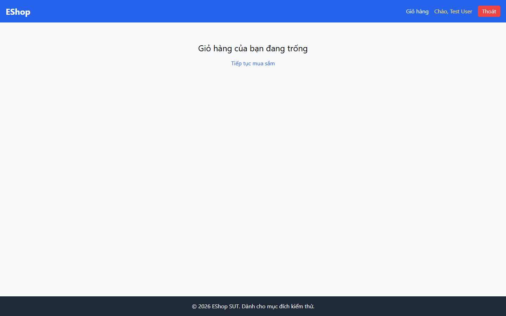

# Bug Report

## 1. Bug Identification

- **Bug ID:** `BUG-20261114-010`
- **Title:** `[BUG][Navbar] Không có trạng thái trang hiện tại rõ ràng`
- **Related Checklist Item ID:** `GUI-25`, `GUI-43`
- **Function Name:** `Điều hướng Navbar`
- **Affected Screen / Module:** `Header / Navbar`
- **Reported By:** `Puppeteer GUI TestScript`
- **Report Date:** `2026-11-14`
- **Assigned To:** `Unassigned`

## 2. Problem Summary

**What was tested:** Mục Navbar đang mở và dấu hiệu ngoài màu sắc.

**What happened:** Không có mục nào có trạng thái active, `aria-current="page"` hoặc dấu hiệu văn bản/thuộc tính tương đương.

**Why this is incorrect:** FR-23 yêu cầu Navbar highlight trang hiện tại; trạng thái không nên chỉ phụ thuộc vào màu.

## 3. Environment

- **Application URL:** `http://localhost:5173/`
- **Backend API URL:** `http://localhost:3000`
- **Browser and version:** `Google Chrome 157.0.8103.78`
- **Operating System:** `Windows 11 Pro 64-bit (Microsoft Windows NT 10.0.26200.0)`
- **Viewport / Screen Resolution:** `1440 × 900`
- **Application version or Git commit:** `ef8da40`
- **Test account** `test@eshop.com`

## 4. Preconditions

Đăng nhập và mở một trang trong luồng mua sắm.

## 5. Steps to Reproduce

1. Mở Danh sách sản phẩm hoặc Giỏ hàng.
2. Quan sát Navbar và kiểm tra mục đang mở.

## 6. Expected Result

Đúng một mục Navbar được highlight và có dấu hiệu truy cập được như `aria-current="page"`.

## 7. Actual Result

Không có mục active được đánh dấu.

## 8. Evidence

