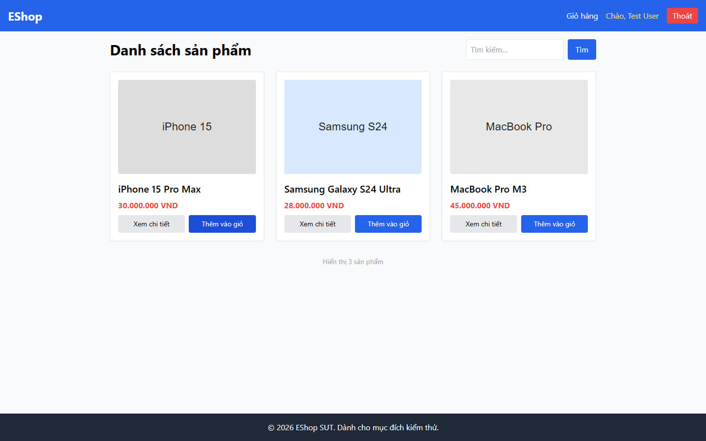

# Bug Report

## 1. Bug Identification

- **Bug ID:** `BUG-20261114-011`
- **Title:** `[BUG][Navbar] Link Giỏ hàng không hiển thị badge số lượng`
- **Related Checklist Item ID:** `GUI-26`
- **Function Name:** `Hiển thị số lượng giỏ hàng`
- **Affected Screen / Module:** `Header / Navbar`
- **Reported By:** `Puppeteer GUI TestScript`
- **Report Date:** `2026-11-14`
- **Assigned To:** `Unassigned`

## 2. Problem Summary

**What was tested:** Badge trên link `Giỏ hàng` sau khi thêm một sản phẩm.

**What happened:** Link chỉ hiển thị chữ `Giỏ hàng`, không có số lượng.

**Why this is incorrect:** FR-23 yêu cầu link Giỏ hàng hiển thị badge số lượng sản phẩm.

## 3. Environment

- **Application URL:** `http://localhost:5173/`
- **Backend API URL:** `http://localhost:3000`
- **Browser and version:** `Google Chrome 157.0.8103.78`
- **Operating System:** `Windows 11 Pro 64-bit (Microsoft Windows NT 10.0.26200.0)`
- **Viewport / Screen Resolution:** `1440 × 900`
- **Application version or Git commit:** `ef8da40`
- **Test account** `test@eshop.com`

## 4. Preconditions

Người dùng đã đăng nhập và giỏ hàng đang trống.

## 5. Steps to Reproduce

1. Thêm một sản phẩm từ Danh sách sản phẩm.
2. Quan sát link `Giỏ hàng` trên Navbar.

## 6. Expected Result

Link Giỏ hàng có badge hiển thị số `1`.

## 7. Actual Result

Không có badge số lượng.

## 8. Evidence

