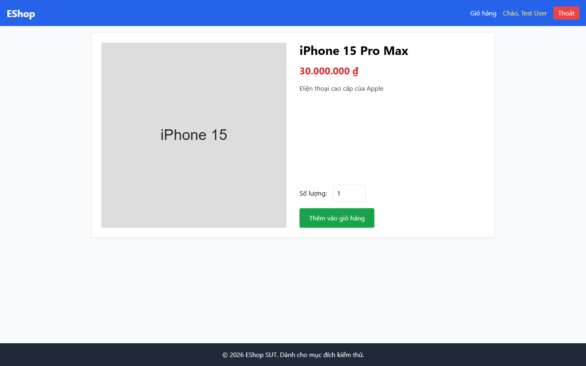

# Bug Report

## 1. Bug Identification

- **Bug ID:** `BUG-20261114-012`
- **Title:** `[BUG][Product Detail] Thiếu breadcrumb`
- **Related Checklist Item ID:** `GUI-28`
- **Function Name:** `Điều hướng breadcrumb`
- **Affected Screen / Module:** `Chi tiết sản phẩm`
- **Reported By:** `Puppeteer GUI TestScript`
- **Report Date:** `2026-11-14`
- **Assigned To:** `Unassigned`

## 2. Problem Summary

**What was tested:** Breadcrumb trên trang Chi tiết sản phẩm.

**What happened:** Trang không hiển thị breadcrumb.

**Why this is incorrect:** FR-23 yêu cầu breadcrumb ở trang Chi tiết sản phẩm.

## 3. Environment

- **Application URL:** `http://localhost:5173/product/1`
- **Backend API URL:** `http://localhost:3000`
- **Browser and version:** `Google Chrome 157.0.8103.78`
- **Operating System:** `Windows 11 Pro 64-bit (Microsoft Windows NT 10.0.26200.0)`
- **Viewport / Screen Resolution:** `1440 × 900`
- **Application version or Git commit:** `ef8da40`
- **Test account** `test@eshop.com`

## 4. Preconditions

Có thể mở một sản phẩm từ danh sách.

## 5. Steps to Reproduce

1. Mở trang Chi tiết sản phẩm.
2. Quan sát phía trên nội dung chính.

## 6. Expected Result

Hiển thị breadcrumb từ trang gốc đến sản phẩm hiện tại; các cấp trước có thể nhấn được.

## 7. Actual Result

Không có breadcrumb.

## 8. Evidence

