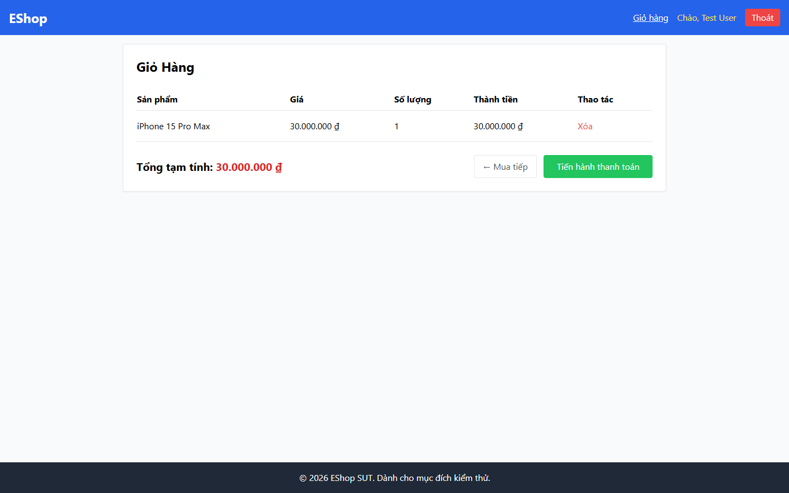

# Bug Report

## 1. Bug Identification

- **Bug ID:** `BUG-20261114-014`
- **Title:** `[BUG][Cart] Nút quay lại mua sắm dùng nhãn không đúng`
- **Related Checklist Item ID:** `GUI-31`
- **Function Name:** `Tiếp tục mua sắm`
- **Affected Screen / Module:** `Giỏ hàng`
- **Reported By:** `Puppeteer GUI TestScript`
- **Report Date:** `2026-11-14`
- **Assigned To:** `Unassigned`

## 2. Problem Summary

**What was tested:** Nút quay về Danh sách sản phẩm từ Giỏ hàng.

**What happened:** Giao diện hiển thị `← Mua tiếp` thay vì `Tiếp tục mua sắm`.

**Why this is incorrect:** FR-07 yêu cầu nút `Tiếp tục mua sắm`; nhãn khác làm test và ngôn ngữ giao diện không nhất quán.

## 3. Environment

- **Application URL:** `http://localhost:5173/cart`
- **Backend API URL:** `http://localhost:3000`
- **Browser and version:** `Google Chrome 157.0.8103.78`
- **Operating System:** `Windows 11 Pro 64-bit (Microsoft Windows NT 10.0.26200.0)`
- **Viewport / Screen Resolution:** `1440 × 900`
- **Application version or Git commit:** `ef8da40`
- **Test account** `test@eshop.com`

## 4. Preconditions

Giỏ hàng có ít nhất một sản phẩm.

## 5. Steps to Reproduce

1. Mở trang Giỏ hàng.
2. Quan sát nút quay lại mua sắm.

## 6. Expected Result

Có nút với nhãn `Tiếp tục mua sắm`; khi nhấn sẽ về Danh sách sản phẩm và giữ giỏ hàng.

## 7. Actual Result

Nút hiển thị `← Mua tiếp`.

## 8. Evidence

