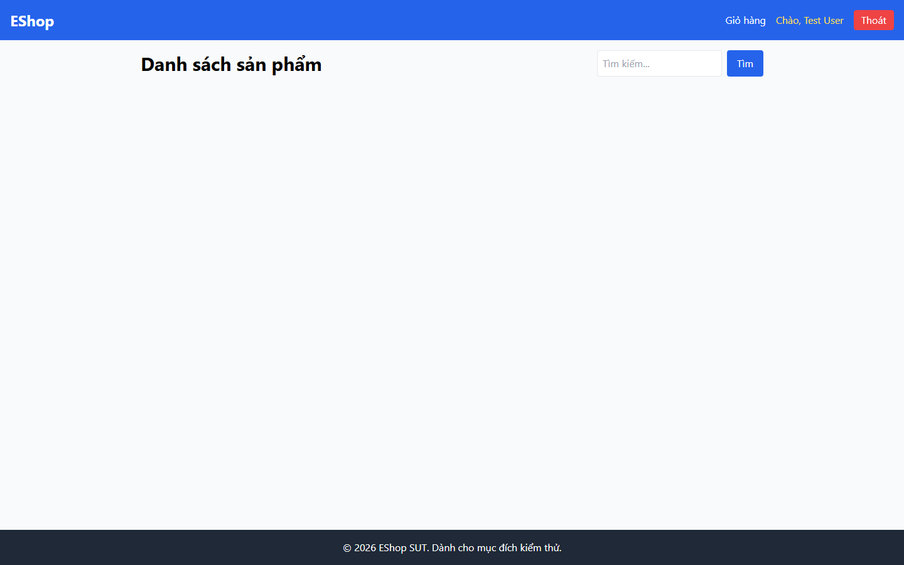

# Bug Report

## 1. Bug Identification

- **Bug ID:** `BUG-20261114-015`
- **Title:** `[BUG][Product List] Thiếu trạng thái loading và thông báo hỗ trợ`
- **Related Checklist Item ID:** `GUI-32`, `GUI-50`
- **Function Name:** `Tải danh sách sản phẩm`
- **Affected Screen / Module:** `Danh sách sản phẩm`
- **Reported By:** `Puppeteer GUI TestScript`
- **Report Date:** `2026-11-14`
- **Assigned To:** `Unassigned`

## 2. Problem Summary

**What was tested:** Phản hồi khi API sản phẩm đang tải.

**What happened:** Trong thời gian API trả dữ liệu chậm, trang trống và không có loading hoặc vùng thông báo `role=status`/`aria-live`.

**Why this is incorrect:** FR-05 yêu cầu hiển thị loading; người dùng công nghệ hỗ trợ cũng cần nhận biết trạng thái đang tải.

## 3. Environment

- **Application URL:** `http://localhost:5173/`
- **Backend API URL:** `http://localhost:3000`
- **Browser and version:** `Google Chrome 157.0.8103.78`
- **Operating System:** `Windows 11 Pro 64-bit (Microsoft Windows NT 10.0.26200.0)`
- **Viewport / Screen Resolution:** `1440 × 900`
- **Application version or Git commit:** `ef8da40`
- **Test account** `test@eshop.com`

## 4. Preconditions

API danh sách sản phẩm phản hồi chậm.

## 5. Steps to Reproduce

1. Mở Danh sách sản phẩm khi request API đang bị trì hoãn.
2. Quan sát giao diện trước khi dữ liệu xuất hiện.

## 6. Expected Result

Hiển thị loading rõ ràng và vùng trạng thái để công nghệ hỗ trợ đọc được.

## 7. Actual Result

Trang không có loading hoặc vùng thông báo trạng thái.

## 8. Evidence

