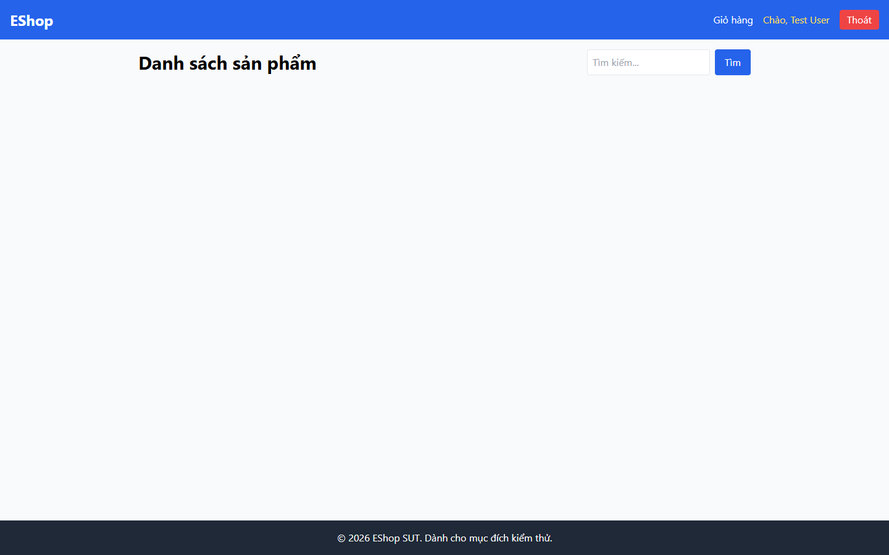
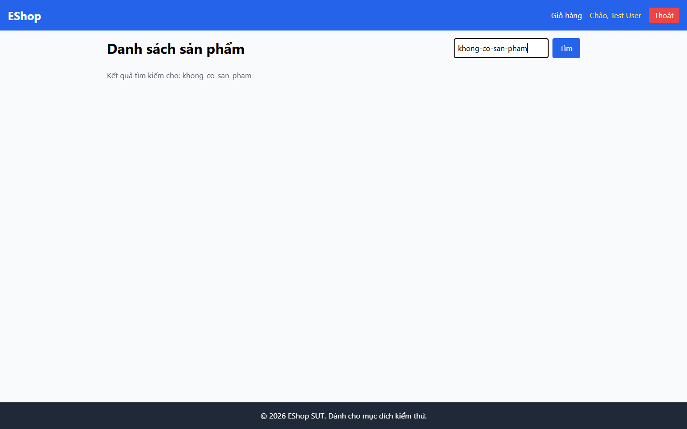

# Bug Report

## 1. Bug Identification

- **Bug ID:** `BUG-20261114-016`
- **Title:** `[BUG][Product Search] Không có Empty State khi không tìm thấy sản phẩm`
- **Related Checklist Item ID:** `GUI-33`, `GUI-48`
- **Function Name:** `Tìm kiếm sản phẩm`
- **Affected Screen / Module:** `Danh sách sản phẩm`
- **Reported By:** `Puppeteer GUI TestScript`
- **Report Date:** `2026-11-14`
- **Assigned To:** `Unassigned`

## 2. Problem Summary

**What was tested:** Giao diện khi kết quả tìm kiếm rỗng.

**What happened:** Sau khi tìm từ khóa không có dữ liệu, khu vực sản phẩm trống; không có hình minh họa, thông báo hoặc hành động phục hồi.

**Why this is incorrect:** FR-05 và FR-24 yêu cầu Empty State phù hợp, có hình/icon và thông điệp thân thiện.

## 3. Environment

- **Application URL:** `http://localhost:5173/`
- **Backend API URL:** `http://localhost:3000`
- **Browser and version:** `Google Chrome 157.0.8103.78`
- **Operating System:** `Windows 11 Pro 64-bit (Microsoft Windows NT 10.0.26200.0)`
- **Viewport / Screen Resolution:** `1440 × 900`
- **Application version or Git commit:** `ef8da40`
- **Test account** `test@eshop.com`

## 4. Preconditions

Trang Danh sách sản phẩm đang mở.

## 5. Steps to Reproduce

1. Nhập `khong-co-san-pham` vào ô tìm kiếm.
2. Nhấn Enter.

## 6. Expected Result

Hiển thị hình minh họa, thông báo không có kết quả và hành động tìm lại phù hợp.

## 7. Actual Result

Chỉ còn dòng `Kết quả tìm kiếm cho: khong-co-san-pham`; không có Empty State.

## 8. Evidence

