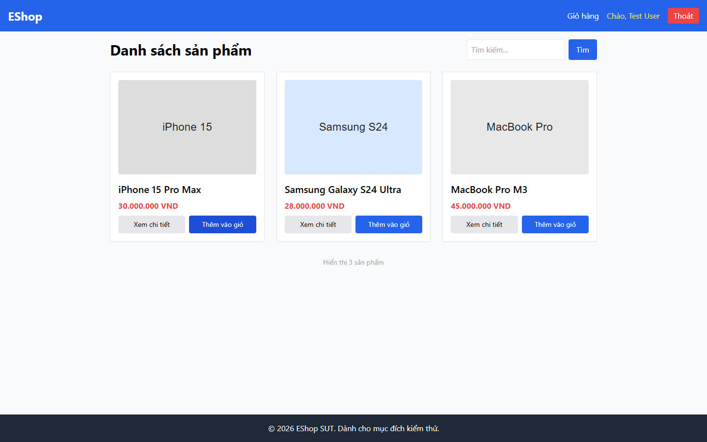

# Bug Report

## 1. Bug Identification

- **Bug ID:** `BUG-20261114-017`
- **Title:** `[BUG][Product List] Thêm vào giỏ không có phản hồi trực quan`
- **Related Checklist Item ID:** `GUI-34`, `GUI-46`
- **Function Name:** `Thêm vào giỏ hàng từ product card`
- **Affected Screen / Module:** `Danh sách sản phẩm`
- **Reported By:** `Puppeteer GUI TestScript`
- **Report Date:** `2026-11-14`
- **Assigned To:** `Unassigned`

## 2. Problem Summary

**What was tested:** Toast/badge sau khi thêm sản phẩm từ product card.

**What happened:** Sau khi nhấn `Thêm vào giỏ`, không có toast và Navbar không có badge số lượng.

**Why this is incorrect:** FR-24 yêu cầu phản hồi trực quan; phản hồi phải nhất quán với điểm thêm từ Chi tiết sản phẩm.

## 3. Environment

- **Application URL:** `http://localhost:5173/`
- **Backend API URL:** `http://localhost:3000`
- **Browser and version:** `Google Chrome 157.0.8103.78`
- **Operating System:** `Windows 11 Pro 64-bit (Microsoft Windows NT 10.0.26200.0)`
- **Viewport / Screen Resolution:** `1440 × 900`
- **Application version or Git commit:** `ef8da40`
- **Test account** `test@eshop.com`

## 4. Preconditions

Giỏ hàng đang trống.

## 5. Steps to Reproduce

1. Mở Danh sách sản phẩm.
2. Nhấn `Thêm vào giỏ` trên một product card.
3. Quan sát vùng thông báo và Navbar.

## 6. Expected Result

Toast hoặc badge xuất hiện, xác nhận sản phẩm đã được thêm và cập nhật số lượng giỏ.

## 7. Actual Result

Không có toast hoặc badge.

## 8. Evidence

