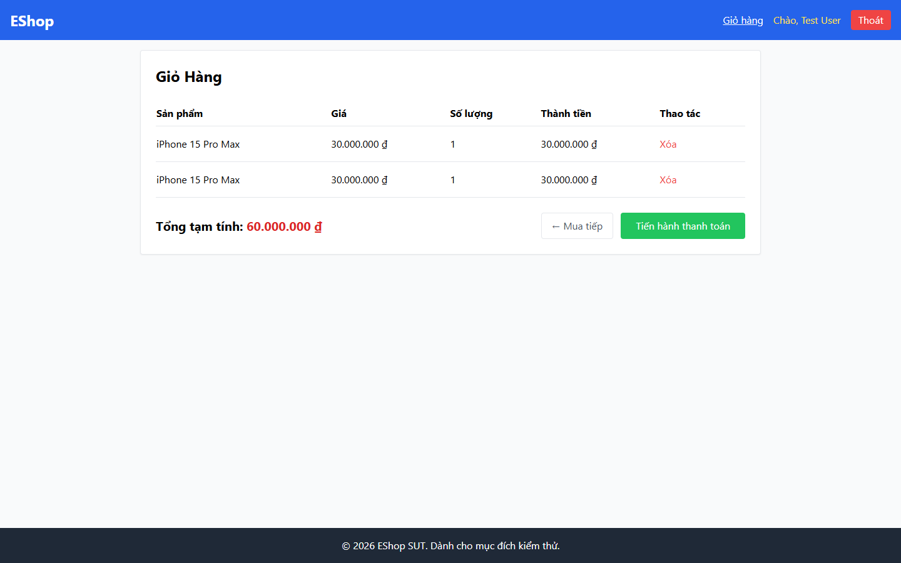

# Bug Report

## 1. Bug Identification

- **Bug ID:** `BUG-20261114-019`
- **Title:** `[BUG][Cart] Thêm cùng sản phẩm tạo dòng trùng`
- **Related Checklist Item ID:** `GUI-36`
- **Function Name:** `Thêm vào giỏ hàng`
- **Affected Screen / Module:** `Danh sách sản phẩm; Giỏ hàng`
- **Reported By:** `Puppeteer GUI TestScript`
- **Report Date:** `2026-11-14`
- **Assigned To:** `Unassigned`

## 2. Problem Summary

**What was tested:** Thêm cùng một sản phẩm nhiều lần.

**What happened:** Giỏ hàng tạo hai dòng cho cùng sản phẩm.

**Why this is incorrect:** FR-07 yêu cầu tăng số lượng trên dòng hiện có, không tạo dòng mới.

## 3. Environment

- **Application URL:** `http://localhost:5173/`, `http://localhost:5173/cart`
- **Backend API URL:** `http://localhost:3000`
- **Browser and version:** `Google Chrome 157.0.8103.78`
- **Operating System:** `Windows 11 Pro 64-bit (Microsoft Windows NT 10.0.26200.0)`
- **Viewport / Screen Resolution:** `1440 × 900`
- **Application version or Git commit:** `ef8da40`
- **Test account** `test@eshop.com`

## 4. Preconditions

Giỏ hàng đang trống.

## 5. Steps to Reproduce

1. Mở Danh sách sản phẩm.
2. Nhấn `Thêm vào giỏ` hai lần cho cùng một sản phẩm.
3. Mở Giỏ hàng.

## 6. Expected Result

Chỉ có một dòng sản phẩm với số lượng là `2`.

## 7. Actual Result

Có hai dòng của cùng sản phẩm, mỗi dòng số lượng `1`.

## 8. Evidence

