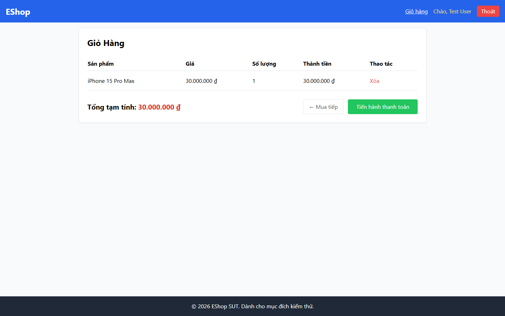

# Bug Report

## 1. Bug Identification

- **Bug ID:** `BUG-20261114-020`
- **Title:** `[BUG][Cart] Tổng tiền dùng nhãn Tổng tạm tính`
- **Related Checklist Item ID:** `GUI-38`
- **Function Name:** `Hiển thị tổng tiền`
- **Affected Screen / Module:** `Giỏ hàng`
- **Reported By:** `Puppeteer GUI TestScript`
- **Report Date:** `2026-11-14`
- **Assigned To:** `Unassigned`

## 2. Problem Summary

**What was tested:** Nhãn tổng tiền trong Giỏ hàng.

**What happened:** Giao diện hiển thị `Tổng tạm tính`.

**Why this is incorrect:** FR-07 yêu cầu đúng nhãn `Tổng cộng`.

## 3. Environment

- **Application URL:** `http://localhost:5173/cart`
- **Backend API URL:** `http://localhost:3000`
- **Browser and version:** `Google Chrome 157.0.8103.78`
- **Operating System:** `Windows 11 Pro 64-bit (Microsoft Windows NT 10.0.26200.0)`
- **Viewport / Screen Resolution:** `1440 × 900`
- **Application version or Git commit:** `ef8da40`
- **Test account** `test@eshop.com`

## 4. Preconditions

Giỏ hàng có ít nhất một sản phẩm.

## 5. Steps to Reproduce

1. Thêm sản phẩm vào giỏ.
2. Mở trang Giỏ hàng.
3. Quan sát nhãn tổng tiền.

## 6. Expected Result

Khu vực tổng tiền hiển thị nhãn `Tổng cộng`.

## 7. Actual Result

Khu vực tổng tiền hiển thị `Tổng tạm tính`.

## 8. Evidence

