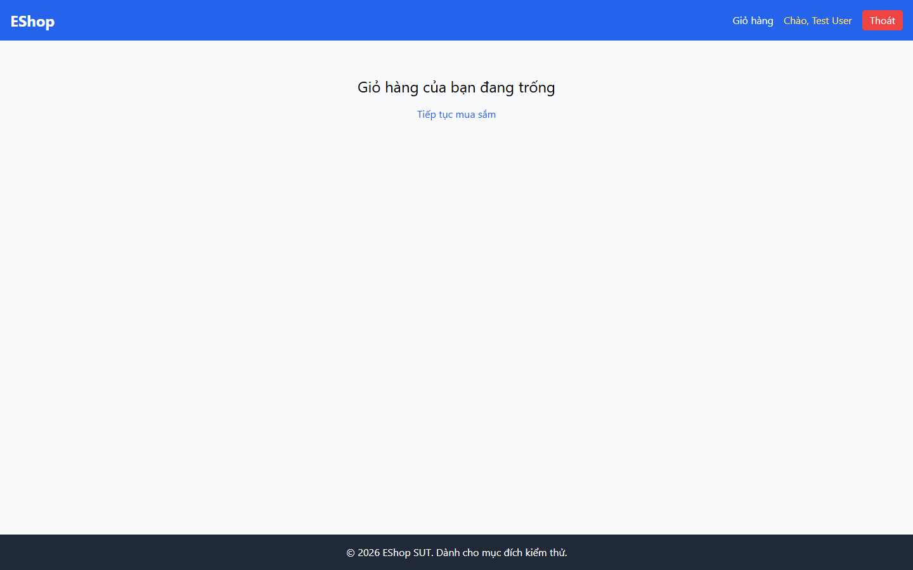

# Bug Report

## 1. Bug Identification

- **Bug ID:** `BUG-20261114-021`
- **Title:** `[BUG][Cart] Xóa sản phẩm không có dialog xác nhận`
- **Related Checklist Item ID:** `GUI-39`, `GUI-47`
- **Function Name:** `Xóa sản phẩm khỏi giỏ`
- **Affected Screen / Module:** `Giỏ hàng`
- **Reported By:** `Puppeteer GUI TestScript`
- **Report Date:** `2026-11-14`
- **Assigned To:** `Unassigned`

## 2. Problem Summary

**What was tested:** Xác nhận trước khi xóa sản phẩm.

**What happened:** Nhấn `Xóa` xóa sản phẩm ngay; không có dialog nêu sản phẩm, nút `Xác nhận` hoặc `Hủy`.

**Why this is incorrect:** FR-07 và FR-24 yêu cầu dialog xác nhận để ngăn xóa nhầm.

## 3. Environment

- **Application URL:** `http://localhost:5173/cart`
- **Backend API URL:** `http://localhost:3000`
- **Browser and version:** `Google Chrome 157.0.8103.78`
- **Operating System:** `Windows 11 Pro 64-bit (Microsoft Windows NT 10.0.26200.0)`
- **Viewport / Screen Resolution:** `1440 × 900`
- **Application version or Git commit:** `ef8da40`
- **Test account** `test@eshop.com`

## 4. Preconditions

Giỏ hàng có sản phẩm `iPhone 15 Pro Max`.

## 5. Steps to Reproduce

1. Mở Giỏ hàng.
2. Nhấn `Xóa` trên dòng sản phẩm.

## 6. Expected Result

Hiển thị dialog nêu rõ sản phẩm cần xóa, có `Xác nhận` và `Hủy`; chỉ xóa khi xác nhận.

## 7. Actual Result

Không có dialog; sản phẩm bị xóa ngay.

## 8. Evidence

