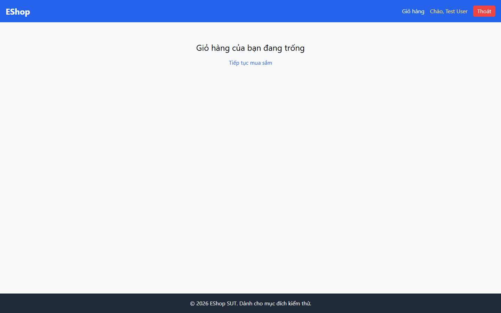

# Bug Report

## 1. Bug Identification

- **Bug ID:** `BUG-20261114-022`
- **Title:** `[BUG][Cart] Giỏ hàng rỗng thiếu hình minh họa`
- **Related Checklist Item ID:** `GUI-40`
- **Function Name:** `Hiển thị Giỏ hàng rỗng`
- **Affected Screen / Module:** `Giỏ hàng`
- **Reported By:** `Puppeteer GUI TestScript`
- **Report Date:** `2026-11-14`
- **Assigned To:** `Unassigned`

## 2. Problem Summary

**What was tested:** Empty State của Giỏ hàng.

**What happened:** Trang chỉ có dòng chữ và link mua sắm; không có icon hoặc hình minh họa.

**Why this is incorrect:** FR-07 và FR-24 yêu cầu Empty State có hình/icon và thông điệp rõ ràng.

## 3. Environment

- **Application URL:** `http://localhost:5173/cart`
- **Backend API URL:** `http://localhost:3000`
- **Browser and version:** `Google Chrome 157.0.8103.78`
- **Operating System:** `Windows 11 Pro 64-bit (Microsoft Windows NT 10.0.26200.0)`
- **Viewport / Screen Resolution:** `1440 × 900`
- **Application version or Git commit:** `ef8da40`
- **Test account** `test@eshop.com`

## 4. Preconditions

Giỏ hàng không có sản phẩm.

## 5. Steps to Reproduce

1. Mở Giỏ hàng khi giỏ trống.
2. Quan sát nội dung Empty State.

## 6. Expected Result

Có hình minh họa/icon, thông báo rõ ràng và nút `Tiếp tục mua sắm`.

## 7. Actual Result

Không có hình minh họa/icon.

## 8. Evidence

