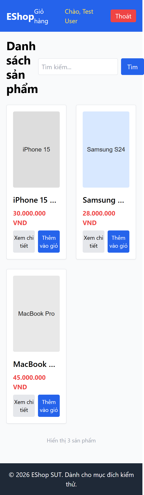

# Bug Report

## 1. Bug Identification

- **Bug ID:** `BUG-20261114-024`
- **Title:** `[BUG][Product List] Trang tràn ngang khi phóng to 200%`
- **Related Checklist Item ID:** `GUI-42`
- **Function Name:** `Responsive và zoom`
- **Affected Screen / Module:** `Danh sách sản phẩm`
- **Reported By:** `Puppeteer GUI TestScript`
- **Report Date:** `2026-11-14`
- **Assigned To:** `Unassigned`

## 2. Problem Summary

**What was tested:** Khả năng sử dụng khi phóng to 200%.

**What happened:** Chiều rộng nội dung là 728 px trong viewport 720 px, tạo tràn ngang.

**Why this is incorrect:** Khi phóng to, nội dung và control vẫn phải sử dụng được mà không cần cuộn ngang ngoài ý muốn.

## 3. Environment

- **Application URL:** `http://localhost:5173/`
- **Backend API URL:** `http://localhost:3000`
- **Browser and version:** `Google Chrome 157.0.8103.78`
- **Operating System:** `Windows 11 Pro 64-bit (Microsoft Windows NT 10.0.26200.0)`
- **Viewport / Screen Resolution:** `720 × 800`, CSS zoom `200%`
- **Application version or Git commit:** `ef8da40`
- **Test account** `test@eshop.com`

## 4. Preconditions

Danh sách sản phẩm hiển thị dữ liệu.

## 5. Steps to Reproduce

1. Mở Danh sách sản phẩm ở viewport 720 × 800.
2. Phóng to giao diện đến 200%.
3. Kiểm tra chiều rộng trang.

## 6. Expected Result

Không có cuộn ngang; nội dung và nút vẫn nhìn thấy, sử dụng được.

## 7. Actual Result

Trang rộng 728 px, lớn hơn viewport 720 px.

## 8. Evidence

