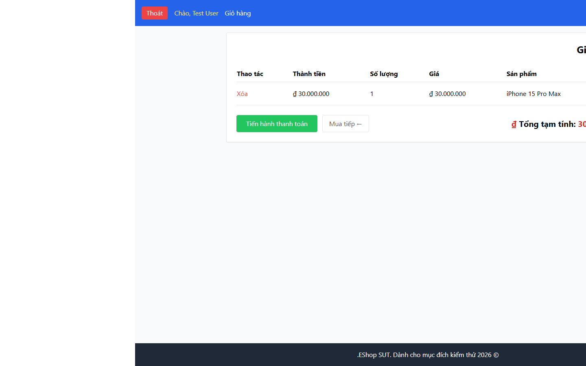

# Bug Report

## 1. Bug Identification

- **Bug ID:** `BUG-20261114-025`
- **Title:** `[BUG][Cart][RTL] Bảng Giỏ hàng vẫn căn trái trong RTL`
- **Related Checklist Item ID:** `GUI-53`
- **Function Name:** `Hiển thị Giỏ hàng ở RTL`
- **Affected Screen / Module:** `Giỏ hàng`
- **Reported By:** `Puppeteer GUI TestScript`
- **Report Date:** `2026-11-14`
- **Assigned To:** `Unassigned`

## 2. Problem Summary

**What was tested:** Thứ tự và căn chỉnh Giỏ hàng khi tài liệu dùng `dir="rtl"`.

**What happened:** Bảng Giỏ hàng vẫn có `text-align: left`; mũi tên quay lại cũng không được đảo hướng.

**Why this is incorrect:** Ở RTL, dữ liệu và điều hướng phải phù hợp chiều phải sang trái.

## 3. Environment

- **Application URL:** `http://localhost:5173/cart`
- **Backend API URL:** `http://localhost:3000`
- **Browser and version:** `Google Chrome 157.0.8103.78`
- **Operating System:** `Windows 11 Pro 64-bit (Microsoft Windows NT 10.0.26200.0)`
- **Viewport / Screen Resolution:** `1440 × 900`, `dir="rtl"`
- **Application version or Git commit:** `ef8da40`
- **Test account** `test@eshop.com`

## 4. Preconditions

Giỏ hàng có ít nhất một sản phẩm và tài liệu được đặt `dir="rtl"`.

## 5. Steps to Reproduce

1. Mở Giỏ hàng.
2. Đặt thuộc tính `dir="rtl"` cho phần tử `<html>`.
3. Quan sát bảng và nút quay lại mua sắm.

## 6. Expected Result

Bảng căn theo RTL, thứ tự đọc/Tab phù hợp và mũi tên quay lại đổi hướng.

## 7. Actual Result

Bảng vẫn căn trái và ký hiệu quay lại không phù hợp RTL.

## 8. Evidence

