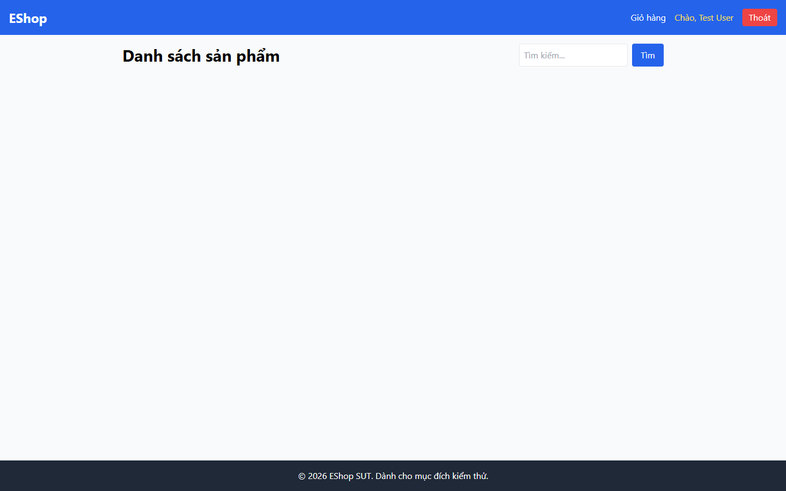

# Bug Report

## 1. Bug Identification

- **Bug ID:** `BUG-20261114-026`
- **Title:** `[BUG][Theme] Ứng dụng không hỗ trợ dark mode`
- **Related Checklist Item ID:** `GUI-54`, `GUI-55`, `GUI-56`
- **Function Name:** `Dark mode`
- **Affected Screen / Module:** `Danh sách sản phẩm; Chi tiết sản phẩm; Giỏ hàng`
- **Reported By:** `Puppeteer GUI TestScript`
- **Report Date:** `2026-11-14`
- **Assigned To:** `Unassigned`

## 2. Problem Summary

**What was tested:** Giao diện khi hệ điều hành yêu cầu `prefers-color-scheme: dark`.

**What happened:** Nền chính vẫn sáng; giao diện, độ tương phản trạng thái và các phản hồi như Empty State/toast/dialog không chuyển sang theme tối.

**Why this is incorrect:** Checklist yêu cầu dark mode có giao diện tối nhất quán và các trạng thái vẫn dễ nhìn.

## 3. Environment

- **Application URL:** `http://localhost:5173/`
- **Backend API URL:** `http://localhost:3000`
- **Browser and version:** `Google Chrome 157.0.8103.78`
- **Operating System:** `Windows 11 Pro 64-bit (Microsoft Windows NT 10.0.26200.0)`
- **Viewport / Screen Resolution:** `1440 × 900`, `prefers-color-scheme: dark`
- **Application version or Git commit:** `ef8da40`
- **Test account** `test@eshop.com`

## 4. Preconditions

Trình duyệt được mô phỏng chế độ tối qua `prefers-color-scheme: dark`.

## 5. Steps to Reproduce

1. Bật hoặc mô phỏng dark mode trong trình duyệt.
2. Mở Danh sách sản phẩm, Chi tiết sản phẩm hoặc Giỏ hàng.
3. Quan sát nền, chữ, control và trạng thái phản hồi.

## 6. Expected Result

Toàn bộ giao diện chuyển sang bảng màu tối; chữ, nút, Empty State, toast/badge và dialog vẫn rõ ràng.

## 7. Actual Result

Ứng dụng vẫn hiển thị nền sáng và không có theme tối.

## 8. Evidence

