# Trạng thái sau review 18/10/2026

Có 23 mã. **19 bug theo đặc tả** và **4 phát hiện cần làm rõ oracle**: BUG-07 (trim khoảng trắng), BUG-12 (ngày NULL), BUG-13 (tiền NULL), BUG-19 (MaxLength import). BUG-23 là bug mới của bộ web, issue #66. Phát hiện thứ tự Tab ở FR-11 (TC-28) chưa lập bug vì FR-21 chưa rõ cách đọc bố cục hai cột. Kết quả mới nằm ở `05-execution-results.md` của từng chức năng.

# Bug report — FR-05

Các bug dưới đây đã chạy trên Web `http://localhost:5173` và API `http://localhost:3000` ngày 2026-10-15. Ảnh lỗi nằm trong `docs/bugs/`.

TC-04 (`iphone` vẫn trả `iPhone 15 Pro Max`) không lập bug. FR-05 không cấm tìm không phân biệt hoa thường với chữ ASCII.

Repo GitHub `Taylor3691/eshop-sut` đang private. Ảnh lỗi đã được chèn vào issue #44–#66 bằng liên kết file trên nhánh `hw02/toanhuynh-fr05/11/16/19`. Ảnh trang issue chụp từ Chrome đã đăng nhập, lưu tại `docs/bugs/BUG-01-github.png` đến `docs/bugs/BUG-22-github.png`; ảnh trang issue #66 chưa chụp.

## BUG-01 — Giá hiển thị VND thay vì ₫

- **Feature:** FR-05
- **Test case:** TC-01, TC-06, TC-08
- **Severity:** Minor
- **Environment:** Web `http://localhost:5173`, Chrome, seed mặc định
- **Spec:** README FR-05 và FR-21 — giá dùng ký hiệu `₫`, có phân cách hàng nghìn.
- **Steps:**
  1. Mở trang chủ.
  2. Tìm `iPhone`.
- **Expected:** Giá hiện `30.000.000 ₫`.
- **Actual:** Giá hiện `30.000.000 VND`.
- **Screenshot:** `docs/bugs/BUG-01-actual.png`

- **GitHub issue:** https://github.com/Taylor3691/eshop-sut/issues/44
- **Issue page screenshot:** `docs/bugs/BUG-01-github.png`

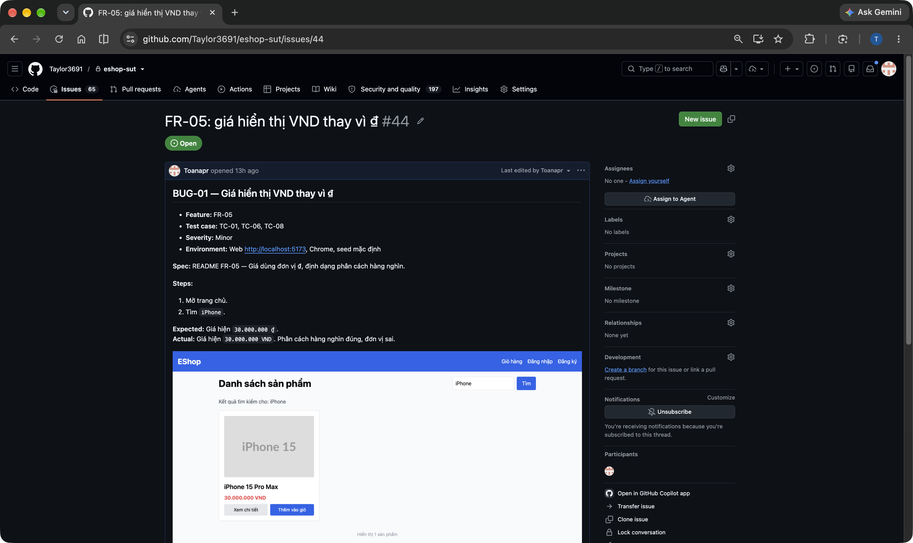

## BUG-02 — Ảnh sản phẩm có alt rỗng

- **Feature:** FR-05
- **Test case:** TC-01
- **Severity:** Major
- **Environment:** Web `http://localhost:5173`, Chrome, seed mặc định
- **Spec:** README FR-05 và FR-24 — ảnh sản phẩm phải có `alt` mô tả, không để rỗng.
- **Steps:**
  1. Mở trang chủ.
  2. Tìm `iPhone`.
  3. Đọc thuộc tính `alt` của `img` trong thẻ sản phẩm.
- **Expected:** `alt` mô tả sản phẩm.
- **Actual:** `alt=""`.
- **Screenshot:** `docs/bugs/BUG-02-actual.png`

- **GitHub issue:** https://github.com/Taylor3691/eshop-sut/issues/45
- **Issue page screenshot:** `docs/bugs/BUG-02-github.png`

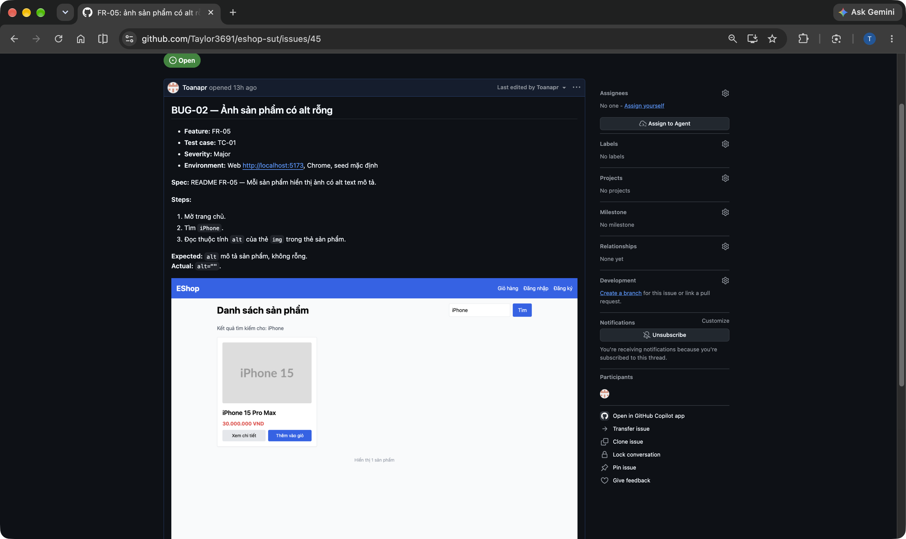

## BUG-03 — Trang danh sách có hai thẻ h1

- **Feature:** FR-05
- **Test case:** TC-01
- **Severity:** Major
- **Environment:** Web `http://localhost:5173`, Chrome, seed mặc định
- **Spec:** README FR-05 và FR-21 — mỗi trang chỉ có đúng một thẻ `h1`.
- **Steps:**
  1. Mở trang chủ.
  2. Tìm `iPhone`.
  3. Đếm thẻ `h1`.
- **Expected:** Đúng một `h1`.
- **Actual:** Hai `h1`: `Danh sách sản phẩm` và `Hiển thị 1 sản phẩm`.
- **Screenshot:** `docs/bugs/BUG-03-actual.png`

- **GitHub issue:** https://github.com/Taylor3691/eshop-sut/issues/46
- **Issue page screenshot:** `docs/bugs/BUG-03-github.png`

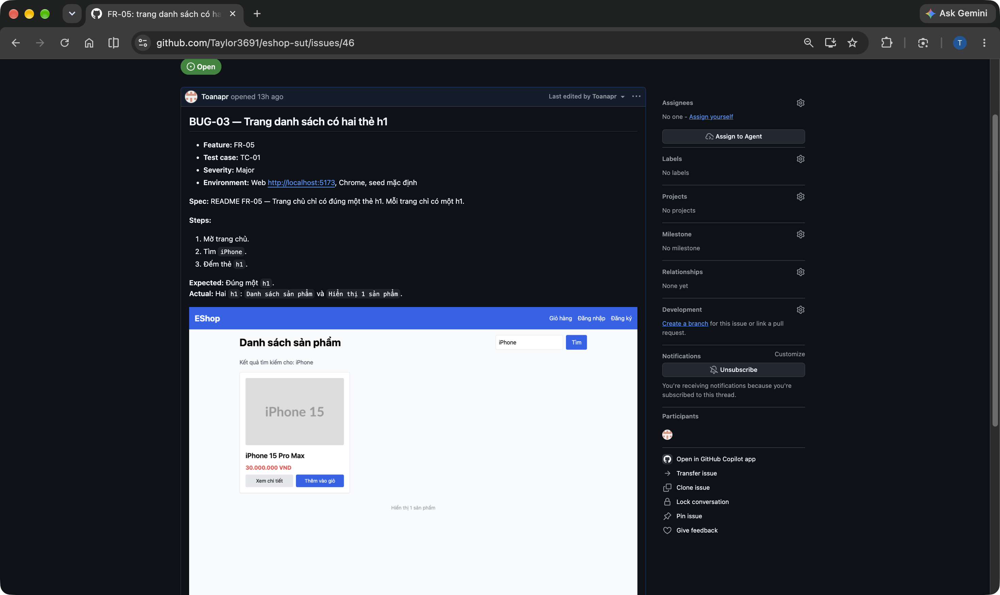

## BUG-04 — Không có trạng thái loading khi tải sản phẩm

- **Feature:** FR-05
- **Test case:** TC-01
- **Severity:** Major
- **Environment:** Web `http://localhost:5173`, Chrome. Ảnh chụp khi `GET /api/products` bị giữ 1,2 giây.
- **Spec:** README FR-05 — khi đang tải dữ liệu phải hiển thị trạng thái loading.
- **Steps:**
  1. Mở trang chủ trong lúc API chưa trả về.
  2. Tìm chữ đang tải, loading, hoặc `aria-busy`.
- **Expected:** Có trạng thái loading.
- **Actual:** Trang trống, không có thông báo loading.
- **Screenshot:** `docs/bugs/BUG-04-actual.png`

- **GitHub issue:** https://github.com/Taylor3691/eshop-sut/issues/47
- **Issue page screenshot:** `docs/bugs/BUG-04-github.png`

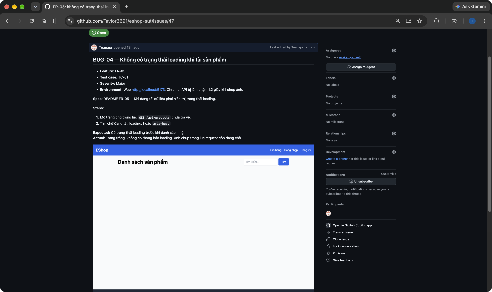

## BUG-05 — Không có empty state khi tìm không ra kết quả

- **Feature:** FR-05
- **Test case:** TC-03, TC-05, TC-07, TC-11, TC-12, TC-13, TC-31, TC-49, TC-52 (bổ sung 18/10)
- **Severity:** Major
- **Environment:** Web `http://localhost:5173`, Chrome, seed mặc định
- **Spec:** README FR-05 và FR-24 — không có kết quả thì phải có thông báo empty state.
- **Steps:**
  1. Mở trang chủ.
  2. Tìm `zzzz-khong-co`.
- **Expected:** Có thông báo empty state.
- **Actual:** Không có sản phẩm và không có thông báo. Chỉ còn dòng "Kết quả tìm kiếm cho: zzzz-khong-co".
- **Screenshot:** `docs/bugs/BUG-05-actual.png`

- **GitHub issue:** https://github.com/Taylor3691/eshop-sut/issues/48
- **Issue page screenshot:** `docs/bugs/BUG-05-github.png`

## BUG-06 — Từ khóa HTML không được hiện dạng chữ

- **Feature:** FR-05
- **Test case:** TC-09
- **Severity:** Major
- **Environment:** Web `http://localhost:5173`, Chrome, seed mặc định
- **Spec:** README FR-05 và SEC-04 — từ khóa phải hiển thị an toàn, không render HTML, không dùng `innerHTML` trực tiếp.
- **Steps:**
  1. Mở trang chủ.
  2. Tìm `<script>`.
- **Expected:** Trang hiện đúng các ký tự `<script>` dạng chữ, không chạy script.
- **Actual:** Dòng kết quả chỉ còn "Kết quả tìm kiếm cho:" rồi trống. Thẻ script bị đưa vào HTML nên chữ biến mất. Script không chạy.
- **Screenshot:** `docs/bugs/BUG-06-actual.png`

- **GitHub issue:** https://github.com/Taylor3691/eshop-sut/issues/49
- **Issue page screenshot:** `docs/bugs/BUG-06-github.png`

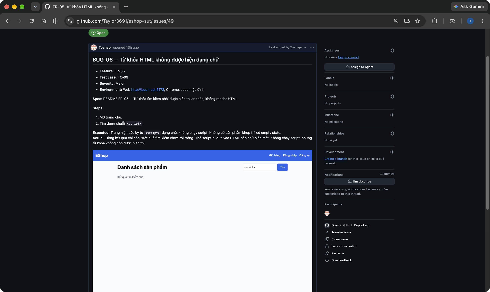

## BUG-07 — Từ khóa chỉ gồm dấu cách vẫn trả cả danh sách

**Trạng thái: CẦN XÁC NHẬN, không tính bug theo đặc tả.** Spec chưa chốt có trim khoảng trắng; trả cả danh sách sau trim chưa đủ kết luận là bug. Nội dung Expected/Actual bên dưới được giữ làm bằng chứng lịch sử.

- **Feature:** FR-05
- **Test case:** TC-27
- **Severity:** Major
- **Environment:** Web `http://localhost:5173`, Chrome, seed 5 sản phẩm
- **Spec:** README FR-05 — tìm theo tên sản phẩm. Việc hiện mọi sản phẩm gắn với trang chủ khi không có từ khóa.
- **Steps:**
  1. Mở trang chủ.
  2. Nhập 3 dấu cách.
  3. Bấm Tìm.
- **Expected:** Không hiện đủ 5 sản phẩm.
- **Actual:** Trang vẫn hiện đủ 5 sản phẩm.
- **Screenshot:** `docs/bugs/BUG-07-actual.png`

- **GitHub issue:** https://github.com/Taylor3691/eshop-sut/issues/50
- **Issue page screenshot:** `docs/bugs/BUG-07-github.png`

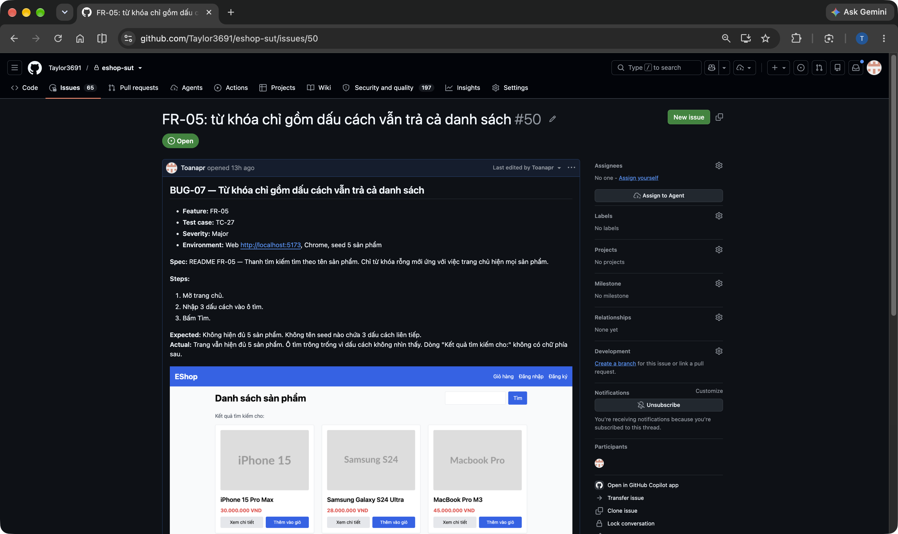

## BUG-08 — Ký tự % và _ được coi là ký tự đại diện khi tìm

- **Feature:** FR-05
- **Test case:** TC-28, TC-29
- **Severity:** Major
- **Environment:** Web `http://localhost:5173`, API `http://localhost:3000`, Chrome, seed 5 sản phẩm
- **Spec:** README FR-05 — tìm theo tên sản phẩm. `%` và `_` không được định nghĩa là ký tự đại diện.
- **Steps:**
  1. Mở trang chủ.
  2. Tìm `%`.
  3. Tìm `_`.
- **Expected:** Không trả về mọi sản phẩm.
- **Actual:** Cả hai từ khóa đều trả đủ 5 sản phẩm.
- **Screenshot:** `docs/bugs/BUG-08-actual.png`

- **GitHub issue:** https://github.com/Taylor3691/eshop-sut/issues/51
- **Issue page screenshot:** `docs/bugs/BUG-08-github.png`

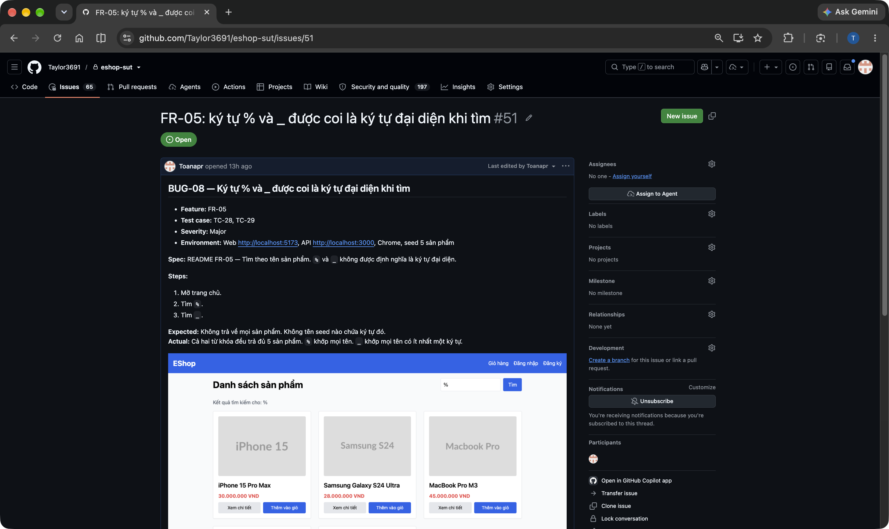

## BUG-09 — Dấu nháy đơn trong từ khóa gây lỗi SQL

- **Feature:** FR-05
- **Test case:** TC-30
- **Severity:** Major
- **Environment:** Web `http://localhost:5173`, API `http://localhost:3000`, Chrome, seed mặc định
- **Spec:** README FR-05, SEC-04 và SEC-05 — từ khóa hiển thị an toàn; truy vấn CSDL phải tham số hóa, không nối chuỗi.
- **Steps:**
  1. Mở trang chủ.
  2. Tìm `'`.
- **Expected:** Không có trang lỗi SQL. Dấu nháy hiện dạng chữ.
- **Actual:** Khối đỏ `Database Error` và `SQLITE_ERROR: unrecognized token: "'"`. Lỗi được render thành HTML. Dòng "Hiển thị 5 sản phẩm" vẫn còn.
- **Screenshot:** `docs/bugs/BUG-09-actual.png`

- **GitHub issue:** https://github.com/Taylor3691/eshop-sut/issues/52
- **Issue page screenshot:** `docs/bugs/BUG-09-github.png`

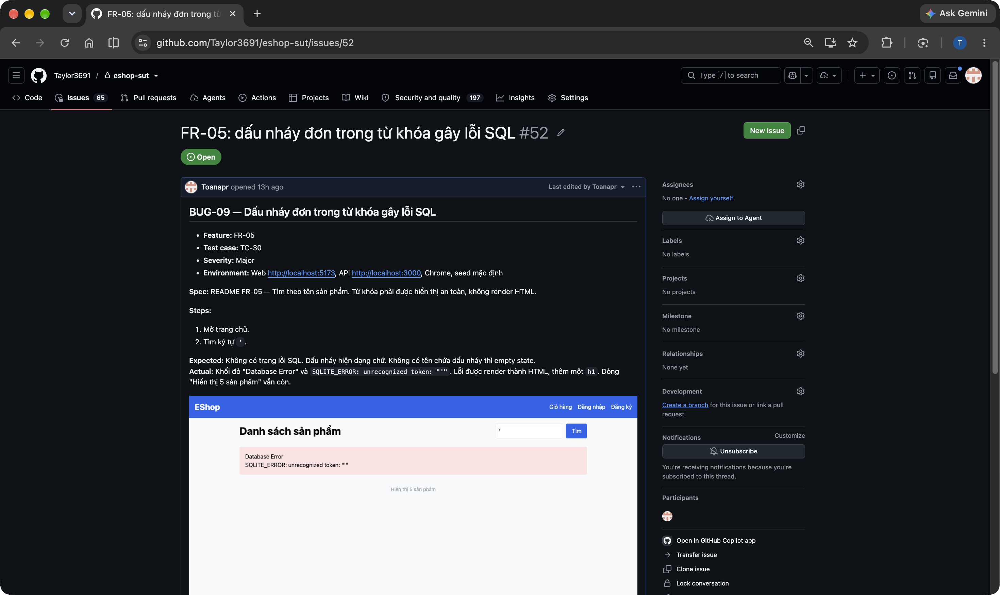

## FR-11

Các bug dưới đây đã chạy trên Web `http://localhost:5173/profile` ngày 2026-10-15, user `test@eshop.com`. Ảnh lỗi nằm trong `docs/bugs/`.

TC-23 (`status=returned` hiện `RETURNED`) không lập bug. FR-11 không chốt nhãn cho trạng thái ngoài năm trạng thái của FR-10, và trang không lỗi.

## BUG-10 — Trang hồ sơ không có thẻ h1

- **Feature:** FR-11
- **Test case:** TC-01
- **Severity:** Major
- **Environment:** Web `http://localhost:5173/profile`, Chrome, user `test@eshop.com`
- **Spec:** README FR-21 — Mỗi trang có đúng 1 thẻ `<h1>` mô tả nội dung trang.
- **Steps:**
  1. Đăng nhập `test@eshop.com`.
  2. Tạo một đơn của user này.
  3. Mở `/profile`.
  4. Đếm thẻ `h1`.
- **Expected:** Trang có đúng một `h1`.
- **Actual:** Không có `h1`. Hai tiêu đề nhìn thấy là "Hồ sơ của bạn" và "Lịch sử đơn hàng".
- **Screenshot:** `docs/bugs/BUG-10-actual.png`

- **GitHub issue:** https://github.com/Taylor3691/eshop-sut/issues/53
- **Issue page screenshot:** `docs/bugs/BUG-10-github.png`

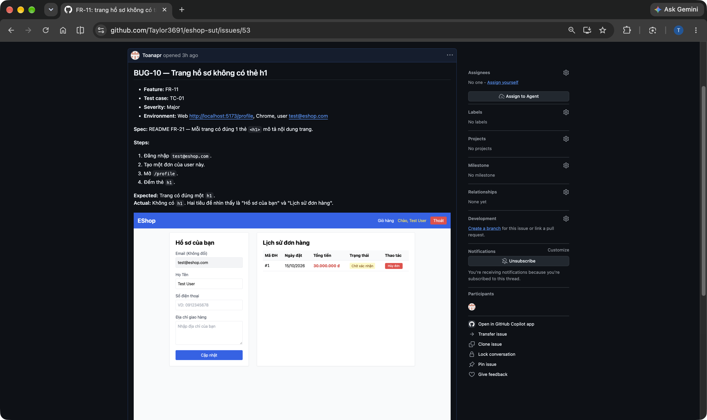

## BUG-11 — Lịch sử trống không có icon

- **Feature:** FR-11
- **Test case:** TC-02
- **Severity:** Major
- **Environment:** Web `http://localhost:5173/profile`, Chrome, user `test@eshop.com`, không có đơn
- **Spec:** README FR-24 — Trang trống (Empty State) phải có icon/hình minh họa và message thân thiện.
- **Steps:**
  1. Đăng nhập `test@eshop.com`.
  2. Xóa hết đơn của user này.
  3. Mở `/profile`.
- **Expected:** Empty state có icon và message thân thiện. Không có bảng đơn.
- **Actual:** Có câu "Bạn chưa có đơn hàng nào." Không có icon hay hình minh họa.
- **Screenshot:** `docs/bugs/BUG-11-actual.png`

- **GitHub issue:** https://github.com/Taylor3691/eshop-sut/issues/54
- **Issue page screenshot:** `docs/bugs/BUG-11-github.png`

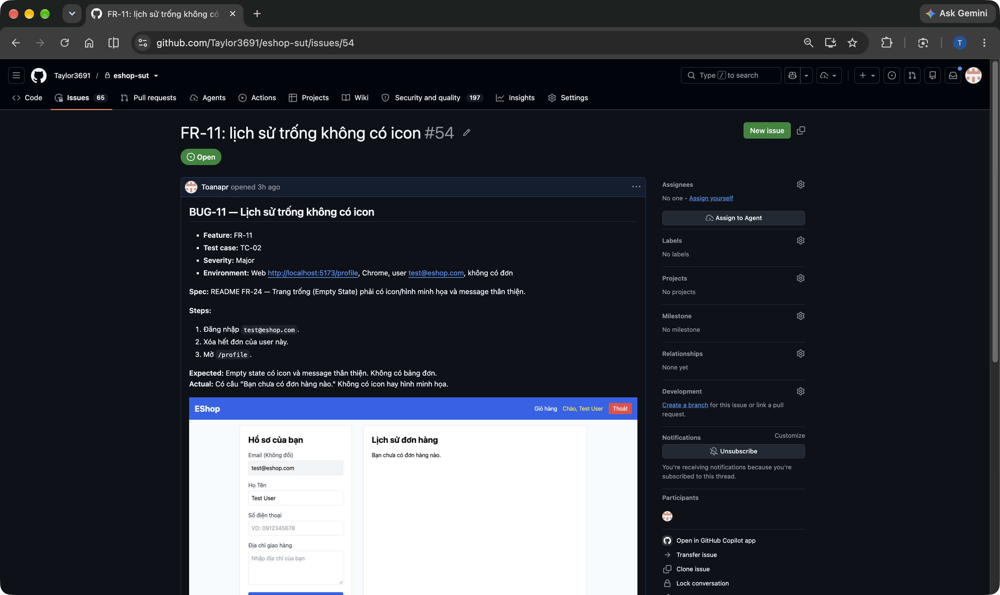

## BUG-12 — Ngày đặt null hiện thành 1/1/1970

**Trạng thái: CẦN XÁC NHẬN, không tính bug theo đặc tả.** Spec yêu cầu hiện ngày đặt nhưng chưa chốt cách hiển thị dữ liệu NULL được chèn trực tiếp. Nội dung Expected/Actual bên dưới được giữ làm bằng chứng lịch sử.

- **Feature:** FR-11
- **Test case:** TC-21
- **Severity:** Major
- **Environment:** Web `http://localhost:5173/profile`, Chrome, user `test@eshop.com`
- **Spec:** README FR-11 — Hiển thị ngày đặt của đơn.
- **Steps:**
  1. Đăng nhập `test@eshop.com`.
  2. Tạo một đơn của user này với `created_at` là NULL, tổng `30000000`, trạng thái `pending`.
  3. Mở `/profile`.
- **Expected:** Ô ngày không hiện một ngày được bịa ra. Trang không lỗi.
- **Actual:** Ô ngày hiện `1/1/1970`. Mã `#1` và tiền `30.000.000 ₫` vẫn hiện.
- **Screenshot:** `docs/bugs/BUG-12-actual.png`

- **GitHub issue:** https://github.com/Taylor3691/eshop-sut/issues/55
- **Issue page screenshot:** `docs/bugs/BUG-12-github.png`

## BUG-13 — Tổng tiền null hiện thành 0 ₫

**Trạng thái: CẦN XÁC NHẬN, không tính bug theo đặc tả.** Spec chưa chốt cách hiển thị total_amount NULL; tiêu chí không chuyển NULL thành 0 là đề xuất. Nội dung Expected/Actual bên dưới được giữ làm bằng chứng lịch sử.

- **Feature:** FR-11
- **Test case:** TC-22
- **Severity:** Major
- **Environment:** Web `http://localhost:5173/profile`, Chrome, user `test@eshop.com`
- **Spec:** README FR-11 — Hiển thị tổng tiền của đơn. README FR-21 — tiền dùng ký hiệu `₫`.
- **Steps:**
  1. Đăng nhập `test@eshop.com`.
  2. Tạo một đơn của user này với `total_amount` là NULL, ngày `2026-10-15 10:00:00`, trạng thái `pending`.
  3. Mở `/profile`.
- **Expected:** Ô tiền không hiện `0 ₫` khi đơn không có tổng tiền. Trang không lỗi.
- **Actual:** Ô tiền hiện `0 ₫`. Mã `#1` và ngày `15/10/2026` vẫn hiện.
- **Screenshot:** `docs/bugs/BUG-13-actual.png`

- **GitHub issue:** https://github.com/Taylor3691/eshop-sut/issues/56
- **Issue page screenshot:** `docs/bugs/BUG-13-github.png`

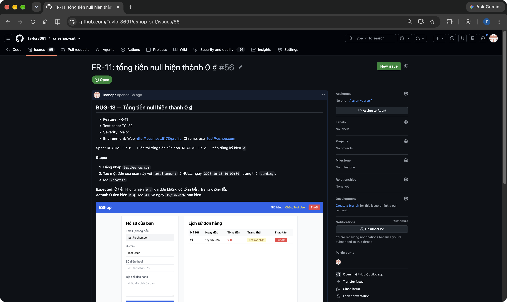

## FR-16

Các bug dưới đây đã chạy trên Admin `http://localhost:5174` và API `http://localhost:3000` ngày 2026-10-15. Ảnh lỗi nằm trong `docs/bugs/`.

TC-16 (tên trống bị từ chối và có báo lỗi) không lập bug. Hệ thống đã từ chối đúng đặc tả.

## BUG-14 — Import CSV không đọc trường bọc nháy kép

- **Feature:** FR-16
- **Test case:** TC-03, TC-15
- **Severity:** Major
- **Environment:** Admin `http://localhost:5174`, Chrome, `admin@eshop.com`
- **Spec:** README FR-16 — Hỗ trợ các trường có chứa dấu phẩy nếu được bọc trong dấu nháy kép (RFC 4180).
- **Steps:**
  1. Đăng nhập `admin@eshop.com` trên Admin.
  2. Mở tab Sản phẩm.
  3. Chọn `hang.csv` có mô tả `"Mo ta, co phay"`.
  4. Xem bảng xem trước.
- **Expected:** Mô tả là `Mo ta, co phay`.
- **Actual:** Bảng xem trước cắt mô tả thành `"Mo ta` và đẩy `co phay"` sang cột imageUrl. File không bọc nháy kép (TC-15) vẫn thêm sản phẩm với mô tả `Mo ta` và báo thành công, không có lỗi.
- **Screenshot:** `docs/bugs/BUG-14-actual.png`

- **GitHub issue:** https://github.com/Taylor3691/eshop-sut/issues/57
- **Issue page screenshot:** `docs/bugs/BUG-14-github.png`

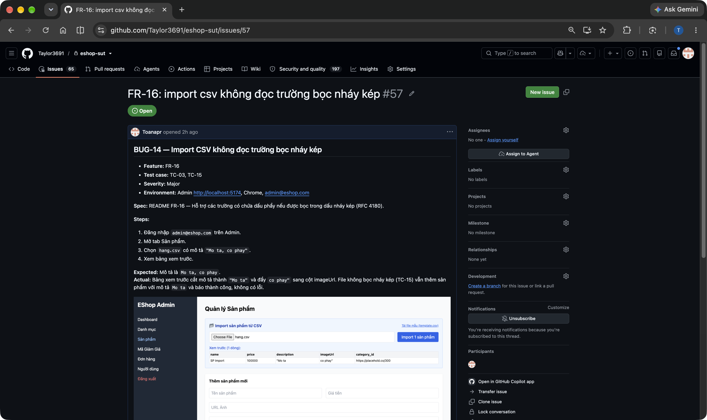

## BUG-15 — API import không kiểm tra role admin

- **Feature:** FR-16
- **Test case:** TC-12
- **Severity:** Major
- **Environment:** API `http://localhost:3000`, token của `test@eshop.com`
- **Spec:** README FR-12 — Mọi API `/api/admin/*` phải có token hợp lệ và `role = 'admin'`. README SEC-03 — API Admin phải kiểm tra `role = 'admin'` trong Token, không chỉ kiểm tra sự tồn tại của Token.
- **Steps:**
  1. Đăng nhập `test@eshop.com` / `Test1234!` để lấy token.
  2. `POST /api/admin/import-products` với Bearer token đó và một sản phẩm `SP Import`, giá 100000.
- **Expected:** Bị từ chối vì không phải admin. Không thêm `SP Import`.
- **Actual:** HTTP 200. `{"message":"Import hoàn tất: 1/1 sản phẩm được thêm","inserted":1,"errors":[]}`. Sản phẩm `SP Import` được thêm.
- **Screenshot:** `docs/bugs/BUG-15-actual.png`

- **GitHub issue:** https://github.com/Taylor3691/eshop-sut/issues/58
- **Issue page screenshot:** `docs/bugs/BUG-15-github.png`

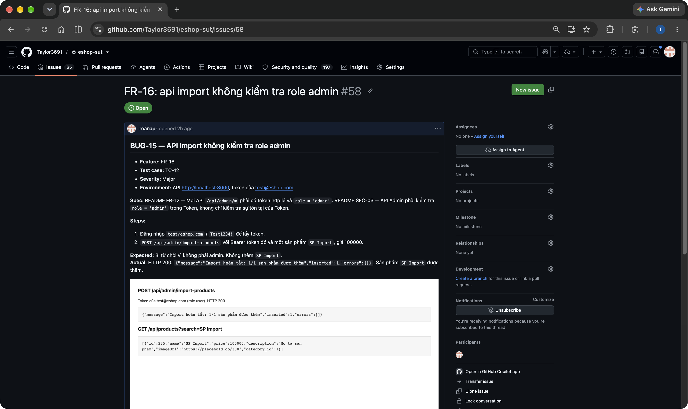

## BUG-16 — File không phải .csv vẫn được import

- **Feature:** FR-16
- **Test case:** TC-13
- **Severity:** Major
- **Environment:** Admin `http://localhost:5174`, Chrome, `admin@eshop.com`
- **Spec:** README FR-16 — Đuôi file phải là `.csv`.
- **Steps:**
  1. Đăng nhập `admin@eshop.com` trên Admin.
  2. Mở tab Sản phẩm.
  3. Chọn file `hang.txt` có nội dung CSV chuẩn một dòng `SP Import`.
  4. Bấm Import.
- **Expected:** Từ chối vì đuôi không phải `.csv`. Không thêm sản phẩm.
- **Actual:** Báo `Import hoàn tất: 1/1 sản phẩm được thêm`. Bảng có `SP Import`, giá 100000.
- **Screenshot:** `docs/bugs/BUG-16-actual.png`

- **GitHub issue:** https://github.com/Taylor3691/eshop-sut/issues/59
- **Issue page screenshot:** `docs/bugs/BUG-16-github.png`

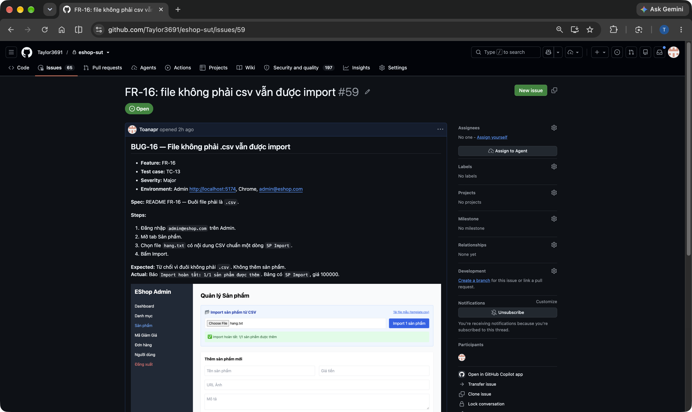

## BUG-17 — Header sai vẫn được import

- **Feature:** FR-16
- **Test case:** TC-14
- **Severity:** Major
- **Environment:** Admin `http://localhost:5174`, Chrome, `admin@eshop.com`
- **Spec:** README FR-16 — Dòng đầu tiên là header: `name,price,description,imageUrl,category_id`.
- **Steps:**
  1. Đăng nhập `admin@eshop.com` trên Admin.
  2. Mở tab Sản phẩm.
  3. Chọn `hang.csv` có header `ten,gia,mo_ta,image,danh_muc` và một dòng `SP Import`.
- **Expected:** Từ chối vì header sai. Không thêm sản phẩm.
- **Actual:** Bảng xem trước nhận header `ten,gia,mo_ta,image,danh_muc` và bật nút Import. Khi import, sản phẩm `SP Import` được thêm và báo thành công.
- **Screenshot:** `docs/bugs/BUG-17-actual.png`

- **GitHub issue:** https://github.com/Taylor3691/eshop-sut/issues/60
- **Issue page screenshot:** `docs/bugs/BUG-17-github.png`

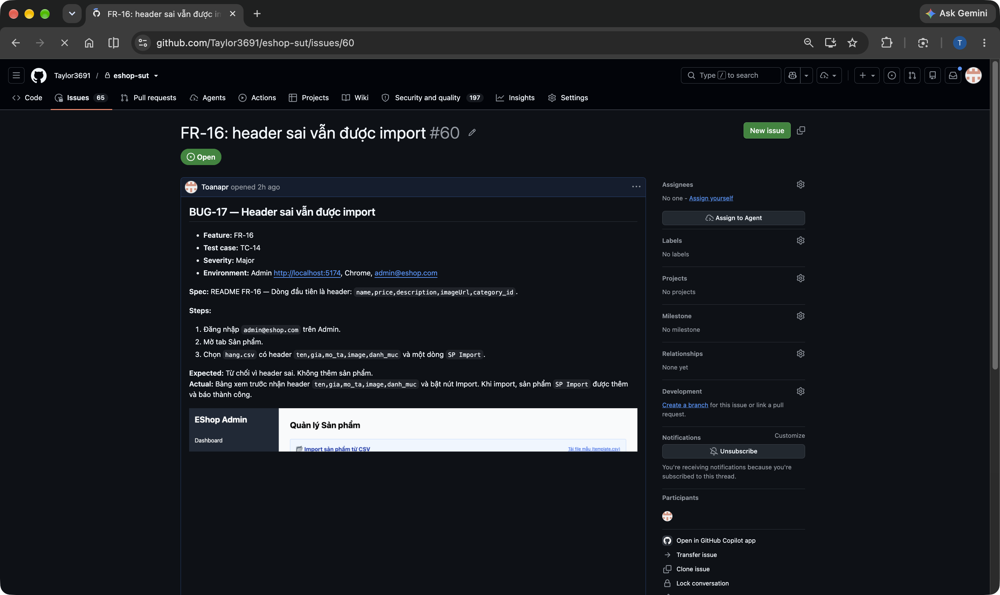

## BUG-18 — Giá không dương vẫn được import

- **Feature:** FR-16
- **Test case:** TC-17, TC-18, TC-19, TC-20
- **Severity:** Major
- **Environment:** Admin `http://localhost:5174`, Chrome, `admin@eshop.com`
- **Spec:** README FR-16 — `price` phải là số dương.
- **Steps:**
  1. Đăng nhập `admin@eshop.com` trên Admin.
  2. Mở tab Sản phẩm.
  3. Import `hang.csv` một dòng, giá `-1`. Các lần khác dùng giá `0`, `abc`, `100@`.
- **Expected:** Không thêm sản phẩm. Báo lỗi giá.
- **Actual:** Giá `-1` được thêm. Báo `Import hoàn tất: 1/1 sản phẩm được thêm`. Bảng hiện `SP Import` giá `-1 ₫`. Giá `0`, `abc` và `100@` cũng được thêm và báo thành công.
- **Screenshot:** `docs/bugs/BUG-18-actual.png`

- **GitHub issue:** https://github.com/Taylor3691/eshop-sut/issues/61
- **Issue page screenshot:** `docs/bugs/BUG-18-github.png`

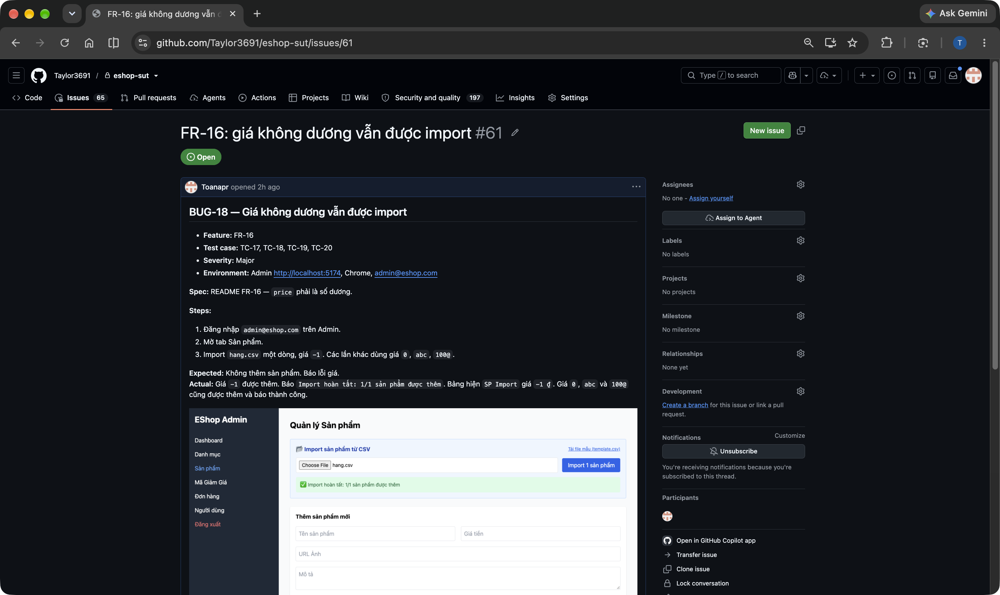

## BUG-19 — Tên dài hơn 255 ký tự vẫn được import

**Trạng thái: CẦN XÁC NHẬN, không tính bug theo đặc tả.** Giới hạn 255 thuộc FR-15; chưa xác nhận áp dụng cho đường import FR-16. TC-21 đã rút khỏi bộ hiện hành. Nội dung Expected/Actual bên dưới được giữ làm bằng chứng lịch sử.

- **Feature:** FR-16
- **Test case:** TC-21
- **Severity:** Major
- **Environment:** Admin `http://localhost:5174`, Chrome, `admin@eshop.com`
- **Spec:** README FR-15 — Tên sản phẩm bắt buộc, tối đa 255 ký tự. Dòng import trở thành sản phẩm nên cùng ràng buộc này.
- **Steps:**
  1. Đăng nhập `admin@eshop.com` trên Admin.
  2. Mở tab Sản phẩm.
  3. Import `hang.csv` một dòng, tên gồm 256 ký tự `a`, giá 100000.
- **Expected:** Từ chối vì tên dài hơn 255. Không thêm sản phẩm.
- **Actual:** Báo `Import hoàn tất: 1/1 sản phẩm được thêm`. Bảng có sản phẩm tên 256 ký tự `a`.
- **Screenshot:** `docs/bugs/BUG-19-actual.png`

- **GitHub issue:** https://github.com/Taylor3691/eshop-sut/issues/62
- **Issue page screenshot:** `docs/bugs/BUG-19-github.png`

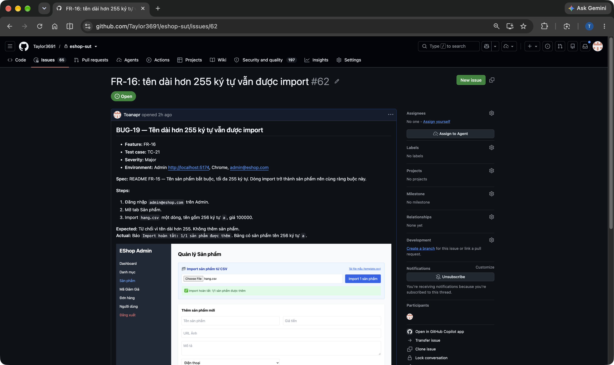

## BUG-20 — Dòng lỗi không rollback cả file

- **Feature:** FR-16
- **Test case:** TC-23
- **Severity:** Major
- **Environment:** Admin `http://localhost:5174`, Chrome, `admin@eshop.com`
- **Spec:** README FR-16 — Nếu có lỗi ở bất kỳ dòng nào, toàn bộ import phải được rollback (giao dịch nguyên tử — all-or-nothing).
- **Steps:**
  1. Đăng nhập `admin@eshop.com` trên Admin.
  2. Mở tab Sản phẩm.
  3. Import `hang.csv` hai dòng: dòng 1 là `SP Import` giá 100000, dòng 2 để trống tên.
- **Expected:** Rollback cả file. Không có `SP Import`. Báo lỗi tên ở dòng 2.
- **Actual:** `SP Import` giá 100000 vẫn nằm trong bảng. Báo `Import hoàn tất: 1/2 sản phẩm được thêm` và `Hàng 3: Thiếu tên sản phẩm`.
- **Screenshot:** `docs/bugs/BUG-20-actual.png`

- **GitHub issue:** https://github.com/Taylor3691/eshop-sut/issues/63
- **Issue page screenshot:** `docs/bugs/BUG-20-github.png`

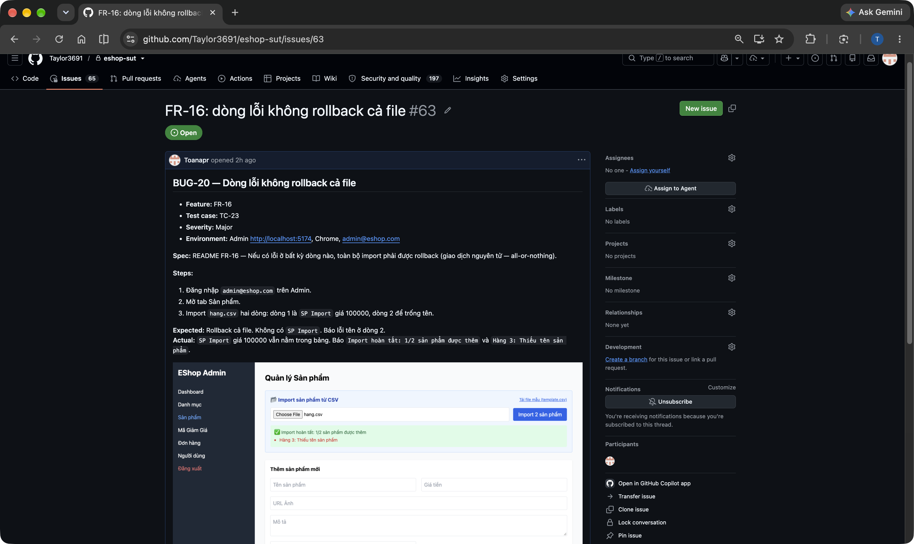

## FR-05 mobile

Các bug dưới đây đã chạy trên app mobile qua Expo web `http://127.0.0.1:8081` ngày 2026-10-15. API là `http://127.0.0.1:3000`. Đây là React Native chạy bằng `react-native-web` trong Chrome, không phải điện thoại thật.

Không lập bug mới cho:

- TC-04 (`iphone` vẫn ra iPhone). README không cấm tìm không phân biệt hoa thường.
- TC-15 và TC-16. BLOCKED: Chrome cắt dấu cách cuối URL, request thành `search=` rỗng.
- TC-17 và TC-18 (`%`, `_` trả đủ 5 sản phẩm). Cùng lỗi API đã ghi ở BUG-08, issue #51.
- TC-19 (dấu nháy trả `SQLITE_ERROR`). Cùng lỗi API đã ghi ở BUG-09, issue #52. App mobile hiện nguyên HTML lỗi trong khung lỗi.

## BUG-21 — App mobile không có empty state khi tìm không ra kết quả

- **Feature:** FR-05
- **Test case:** TC-03, TC-05, TC-07, TC-09, TC-11, TC-12, TC-13, TC-22, TC-23, TC-24 (bổ sung 18/10)
- **Severity:** Major
- **Environment:** App mobile qua Expo web `http://127.0.0.1:8081`, Chrome, API `http://127.0.0.1:3000`, seed mặc định
- **Spec:** README FR-05 — Khi không có kết quả tìm kiếm phải hiển thị thông báo empty state phù hợp.
- **Steps:**
  1. Mở app mobile.
  2. Nhập `zzzz-khong-co` vào ô Tìm kiếm.
  3. Bấm Tìm.
- **Expected:** Có thông báo empty state.
- **Actual:** Không có sản phẩm và không có thông báo. Chỉ còn dòng "Kết quả tìm kiếm cho: zzzz-khong-co".
- **Screenshot:** `docs/bugs/BUG-21-actual.png`

- **GitHub issue:** https://github.com/Taylor3691/eshop-sut/issues/64
- **Issue page screenshot:** `docs/bugs/BUG-21-github.png`

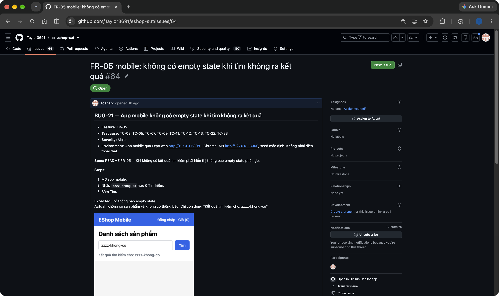

## BUG-22 — Từ khóa có & hoặc # bị cắt khi tìm trên app mobile

- **Feature:** FR-05
- **Test case:** TC-20, TC-21
- **Severity:** Major
- **Environment:** App mobile qua Expo web `http://127.0.0.1:8081`, Chrome, API `http://127.0.0.1:3000`, seed 5 sản phẩm
- **Spec:** README FR-05 — Thanh tìm kiếm tìm theo tên sản phẩm.
- **Steps:**
  1. Mở app mobile.
  2. Tìm `a&b`.
  3. Tìm `a#b`.
- **Expected:** Tìm đúng chuỗi đã gõ. Không tên seed nào chứa `a&b` hay `a#b`, nên không được trả sản phẩm chỉ vì tên chứa chữ `a`.
- **Actual:** `a&b` gửi `search=a&b` và trả 4 sản phẩm có chữ a: iPhone 15 Pro Max, Samsung Galaxy S24 Ultra, MacBook Pro M3, Tai nghe AirPods Pro 2. Dòng kết quả vẫn hiện `a&b`. `a#b` gửi `search=a` và trả cùng 4 sản phẩm đó.
- **Screenshot:** `docs/bugs/BUG-22-actual.png`

- **GitHub issue:** https://github.com/Taylor3691/eshop-sut/issues/65
- **Issue page screenshot:** `docs/bugs/BUG-22-github.png`

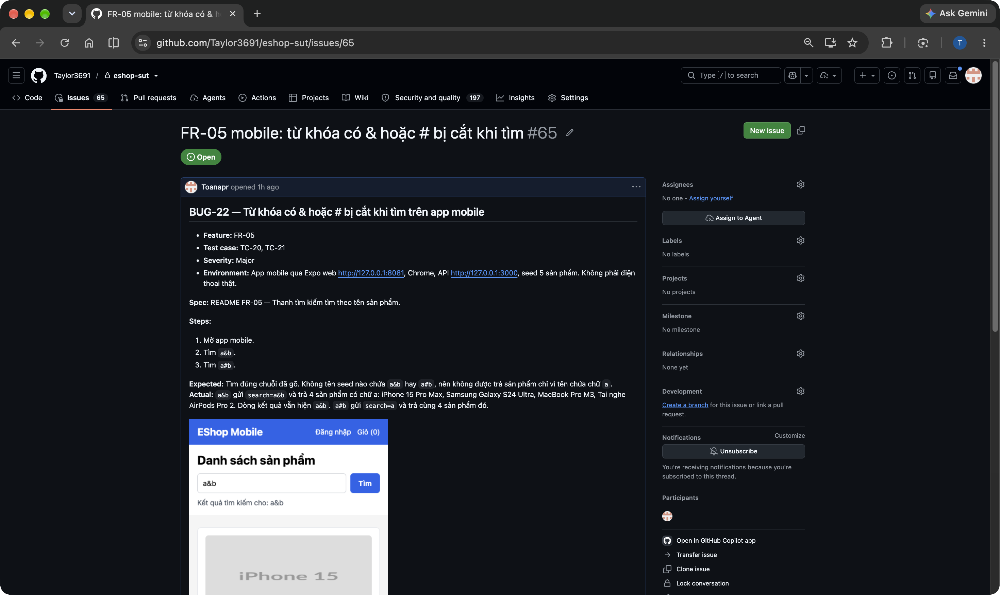

## BUG-23 — Từ khóa có & hoặc # bị cắt khi tìm trên Web

- **Feature:** FR-05
- **Test case:** TC-47, TC-48 (bộ web)
- **Severity:** Major
- **Environment:** Web `http://localhost:5173`, Chrome, API `http://localhost:3000`, seed 5 sản phẩm
- **Spec:** README FR-05 — Thanh tìm kiếm tìm theo tên sản phẩm.
- **Steps:**
  1. Mở trang chủ.
  2. Tìm `a&b`.
  3. Tìm `a#b`.
- **Expected:** Tìm đúng chuỗi đã gõ. Không tên seed nào chứa `a&b` hay `a#b`, nên không có kết quả và có empty state.
- **Actual:** `a&b` gửi `GET /api/products?search=a&b`; server chỉ nhận `search=a` và trả 4 sản phẩm có chữ `a` (iPhone 15 Pro Max, Samsung Galaxy S24 Ultra, MacBook Pro M3, Tai nghe AirPods Pro 2). `a#b` trả cùng 4 sản phẩm.
- **Screenshot:** `docs/bugs/BUG-23-actual.png` (khung vàng là chú thích do script chèn, ghi URL request thực tế)
- **GitHub issue:** https://github.com/Taylor3691/eshop-sut/issues/66
- **Issue page screenshot:** chưa có. Repo private; Chrome đã đăng nhập mở được issue nhưng máy chưa cấp quyền chụp màn hình cho công cụ tự động.

Bug này tách khỏi BUG-22 vì nằm ở component khác (`frontend-web/src/pages/Home.jsx` so với `frontend-mobile/App.js`), phải sửa ở hai nơi. Bản ghi ngày 18/10 trước đây gộp TC-47/48 vào BUG-22; đã đính chính.

## Bằng chứng bổ sung ngày 18/10/2026

Ảnh `BUG-xx-actual.png` cũ được giữ vì đã gắn trên issue. Ảnh dưới đây chụp lại để thấy đúng chỗ lỗi; khung vàng và viền đỏ là chú thích do script kiểm thử chèn (`scripts/evidence-fr05.mjs`, `scripts/fr16-execute.mjs`), không đổi dữ liệu trang.

- BUG-01: [BUG-01-evidence](bugs/BUG-01-evidence.png) — giá `30.000.000 VND`. Ảnh cũ của BUG-01/02/03 là cùng một file, không cho thấy `alt` hay `h1`.
- BUG-02: [BUG-02-evidence](bugs/BUG-02-evidence.png) — DOM của ảnh sản phẩm có `alt=""`.
- BUG-03: [BUG-03-evidence](bugs/BUG-03-evidence.png) — hai thẻ `h1` được viền đỏ: "Danh sách sản phẩm" và "Hiển thị 1 sản phẩm".
- BUG-05: TC-52, CSDL không có sản phẩm, trang chủ cũng không có trang trống. Ảnh: [fr05-TC-52](bugs/fr05-TC-52.png).
- BUG-14: TC-03 và TC-25, trang chi tiết sản phẩm sau import thấy mô tả bị cắt (`"Mo ta`) và còn nháy thừa (`"Mo ta ""dep"""`). TC-26, bảng admin có hai dòng mới (`SP Import` và `Dong 2"`) từ một dòng CSV. Ảnh: [TC-03](bugs/review-fr16-TC-03.png), [TC-25](bugs/review-fr16-TC-25.png), [TC-26](bugs/review-fr16-TC-26.png).
- BUG-18: TC-31, bảng admin có dòng `SP Import` giá `-0.01 ₫`. Ảnh: [TC-31](bugs/review-fr16-TC-31.png).
- BUG-21: TC-24, CSDL không có sản phẩm, màn `home` mobile không có trang trống. Ảnh: [fr05-mobile-TC-24](bugs/fr05-mobile-TC-24.png).

Ảnh bổ sung đã gắn bằng comment trên issue [#44](https://github.com/Taylor3691/eshop-sut/issues/44), [#45](https://github.com/Taylor3691/eshop-sut/issues/45), [#46](https://github.com/Taylor3691/eshop-sut/issues/46), [#48](https://github.com/Taylor3691/eshop-sut/issues/48), [#57](https://github.com/Taylor3691/eshop-sut/issues/57), [#61](https://github.com/Taylor3691/eshop-sut/issues/61) và [#64](https://github.com/Taylor3691/eshop-sut/issues/64).
