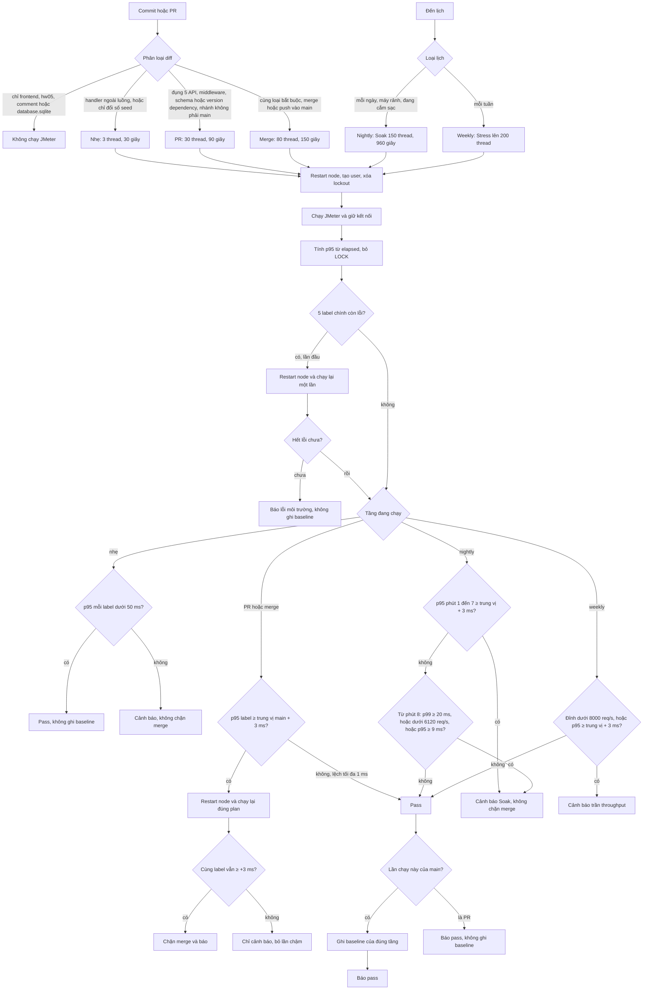

# Luồng kiểm thử hiệu năng liên tục

Luồng ghép quy tắc phân loại commit với ba tầng đo. p95 lấy từ cột `elapsed` của từng label `01`–`05`. Sample `LOCK_*` không đưa vào p95 và không làm lần chạy thất bại.

Nhãn PR và commit message không có mặt trên sơ đồ, vì chúng không được phép hạ mức phân loại. Baseline chỉ ghi khi lần chạy đạt và xảy ra trên `main`. PR, tầng nhẹ, lần chạy lại trở về mức khỏe, và lần Soak từ phút 8 bị lệch đều không ghi đè baseline. p95 của cả file Soak vẫn là 2 ms dù phút 8 đã hỏng, nên nightly xét từng phút chứ không xét một p95 cho cả 960 giây.
