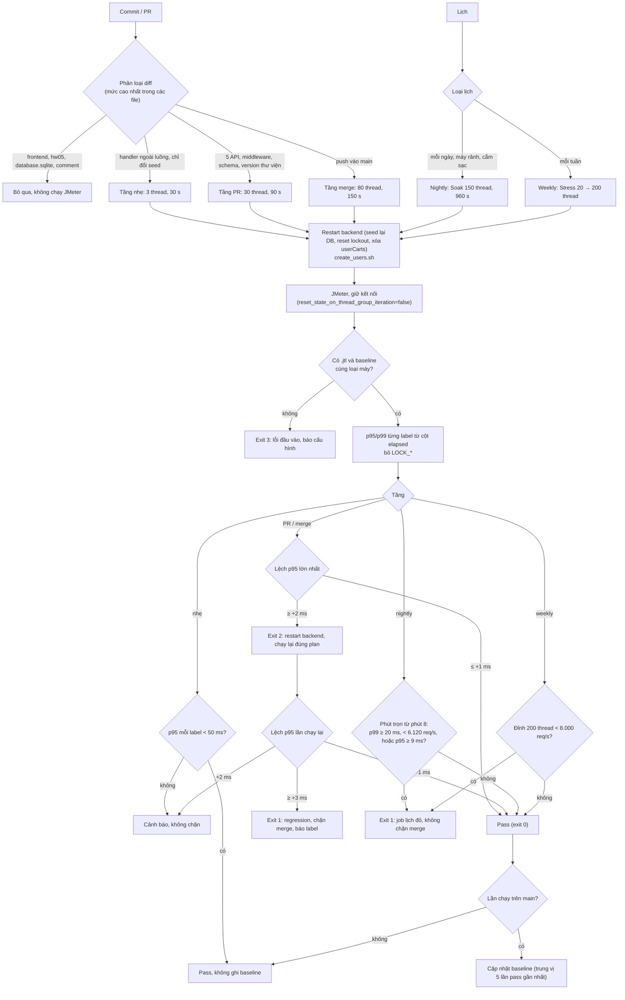

# HW05 – Performance Testing · Báo cáo chính

| | |
|---|---|
| **MSSV** | 23120175 |
| **Bài** | HW05-AI – Performance Testing |
| **SUT** | EShop backend (`backend/server.js`, Node.js + Express + SQLite), `http://localhost:3000` |
| **Repo** | https://github.com/Taylor3691/eshop-sut, nhánh `hw05/toanhuynh`, thư mục `hw05/` |
| **Công cụ** | Apache JMeter 5.6.3 (+ plugin `jpgc-casutg`), htop, curl, Python 3 |
| **AI** | Cursor (Grok 4.7), Claude Code (Claude Opus 5.5) – xem Phần 6 |
| **Máy** | MacBook Air M5, 10 nhân, 16 GB, macOS 27.2, hostname `CT-TOAN-HUYNH` |

> Báo cáo này được ghép từ `REPORT_TASK1.md`, `REPORT_TASK2.md`, `REPORT_TASK3.md` và các phần trong `report/` bằng `report/build_report.py`. Các đường dẫn tương đối tính từ thư mục `hw05/`.

## Tóm tắt

| Hạng mục | Kết quả |
|---|---|
| Luồng test | Đăng nhập → Xem chi tiết sản phẩm → Thêm vào giỏ → Áp mã giảm giá → Thanh toán (auth-heavy, read-heavy, transactional) |
| Kịch bản đã chạy | Load (30 thread, 10 phút), Stress (20 → 200 thread), Spike (nền 20, đỉnh 150), Soak (150 thread, 16 phút) |
| Lỗi luồng chính | 0 ở cả 4 lần chạy; lỗi duy nhất là `LOCK_04` (assertion bắt bug khóa tài khoản) |
| **Ngưỡng chịu tải** | **≈ 6.800 request/giây ổn định** (p95 2 ms, p99 3 ms) trong 7 phút; duy trì 15 phút ở **≈ 5.000–5.500 request/giây** (p95 ≤ 27 ms, p99 ≈ 190–236 ms); RAM `node` **79 → 329 MB**; điểm bão hòa (đo riêng) **≈ 11.400 request/giây** |
| Nút thắt | Luồng xử lý chính duy nhất của Node.js (CPU `node` 101,4% lúc đỉnh Stress) |
| Bug / vấn đề hiệu năng | 5 issue mới (#225–#229, trong đó 1 vấn đề hiệu năng #229), 4 bug xác nhận lại (#20, #34, #68, #70); demo skill phát hiện thêm lỗi SQL injection ở tìm kiếm (chưa tạo issue) |
| Task 2 | 6 chỗ AI đọc sai số liệu (có giá trị đúng từ `.jtl`), 5 đề xuất tối ưu được phân loại |
| Task 3 | Mô hình 5 tầng + cổng p95 tuyệt đối; prototype `p95_regression.py` bắt đúng regression +5 ms ở 2/2 lần lặp, không báo động giả |
| Video demo Task 1 | https://youtu.be/7uUt8abLXus |
| Agent Skill | `skill/perf-test/` + video demo https://youtu.be/aPxXErQeGD0 |

## Mục lục

1. Task 1: Thiết kế và thực thi kiểm thử hiệu năng
2. Task 2: AI phân tích kết quả và săn lỗi đọc sai
3. Agent Skill
4. Kết luận và đề xuất Continuous Performance Testing (Task 3)
5. AI Critique
6. AI Audit Report

---

## Phần 1 – Task 1: Thiết kế và thực thi kiểm thử hiệu năng

### 1. Môi trường

JMeter và backend chạy **chung một máy**, nên kết quả phản ánh giới hạn của cả hai.

| Thành phần | Giá trị |
|---|---|
| Máy | MacBook Air 13-inch M5 (2026), Mac17,3, **không quạt** |
| CPU | Apple M5, 10 nhân (4 Super + 6 Efficiency) |
| RAM | 16 GB |
| OS | macOS 27.2 (26B123), arm64 |
| Hostname | `CT-TOAN-HUYNH` |
| Backend | Node.js, một process, một luồng xử lý chính |

Bằng chứng: [`evidence/hardware/`](evidence/hardware/) (`fastfetch`, `system_profiler`, bảng spec).

---

### 2. Luồng end-to-end và độ phủ nhóm endpoint

Mỗi virtual user lặp lại luồng 5 bước:

```
01_Login → 02_ProductDetail → 03_AddToCart → 04_ApplyCoupon → 05_Checkout
```

| Bước | API | Nhóm | Lý do |
|---|---|---|---|
| 01_Login | `POST /api/login` | **Auth-heavy** | Đọc user, so mật khẩu, ghi lại `login_attempts`, ký JWT; chịu cơ chế khóa tài khoản FR-02 |
| 02_ProductDetail | `GET /api/products/:id` | **Read-heavy** | `SELECT` theo id, không cần token |
| 03_AddToCart | `POST /api/cart` | **Transactional** | Ghi giỏ hàng (lưu trong RAM), cần JWT |
| 04_ApplyCoupon | `POST /api/apply-coupon` | Transactional (nghiệp vụ) / read (code) | Theo code chỉ `SELECT` và tính toán; xếp vào transactional vì là một bước của giao dịch mua hàng |
| 05_Checkout | `POST /api/checkout` | **Transactional** | `INSERT` vào bảng `orders`, cần JWT |

Luồng không trùng với các bạn trong nhóm: điểm phân biệt là bước **áp mã giảm giá (FR-09)**.

**Correlation:** token lấy từ `01_Login` bằng JSON Extractor `$.token`, gắn `Authorization: Bearer ${token}` cho bước 03 và 05; `final_amount` lấy từ bước 04 làm `total_amount` của bước 05.

---

### 3. Dữ liệu CSV (data-driven)

| File | Nội dung | Cấu hình CSV Data Set |
|---|---|---|
| [`data/users.csv`](data/users.csv) | 200 tài khoản `loaduser001…200@eshop.com` (email, password, user_id), tạo bằng [`scripts/create_users.sh`](scripts/create_users.sh) | Recycle on EOF = true, Stop thread = false, Sharing = All threads |
| [`data/products.csv`](data/products.csv) | 5 sản phẩm seed (id, price) | như trên |
| [`data/coupons.csv`](data/coupons.csv) | `BIGBUY`, `VIP100` (mã còn hiệu lực, không dính bug) | như trên |
| [`data/coupons_negative.csv`](data/coupons_negative.csv) | `EXPIRED`, dành cho test negative | không dùng trong tải chính |

`SAVE10` bị loại khỏi tải chính vì dính bug tính tiền (#20): giữ lại sẽ làm 1/3 vòng lặp lỗi assertion và che mất số liệu hiệu năng.

---

### 4. Quy trình dùng AI từng bước

AI được dẫn dắt theo đúng các bước của kỹ thuật, không dùng một prompt chung chung. Prompt nguyên văn và output ở [`AILOG.md`](AILOG.md).

| Bước | Việc | AI | Log |
|---|---|---|---|
| 1 | Phân tích SUT: endpoint, header, body, giá trị cần trích xuất; phân loại nhóm; hành vi ảnh hưởng test tải | Cursor | #01 |
| 2 | Thiết kế CSV và script tạo 200 user | Cursor | #02 |
| 3 | Chọn tham số Load/Stress/Spike theo cấu hình máy | Cursor | #03 |
| 4 | Sinh plan Load | Cursor | #04 |
| 5 | Sinh plan Stress | Cursor | #05 |
| 6 | Sinh plan Spike | Cursor | **TODO: chưa có mục log** |
| 7 | Review 3 plan theo 8 tiêu chí, sửa lỗi, chạy thử | Claude Code + tự kiểm tra | [`REVIEW_TESTPLANS.md`](REVIEW_TESTPLANS.md) |
| 8 | Tăng tải Stress sau khi đo không tìm được điểm bão hòa | Claude Code | #06 |
| 9 | Đề xuất và sinh plan Soak (AI đọc sai `IdleTime`, đã sửa) | Cursor | #07, #08 |

---

### 5. Thiết kế 3 kịch bản

| | Load | Stress | Spike |
|---|---|---|---|
| File | `23120175_Load_20261121.jmx` | `23120175_Stress_20261121.jmx` | `23120175_Spike_20261121.jmx` |
| Thread Group | Thread Group thường | Stepping Thread Group (plugin) | Ultimate Thread Group (plugin) |
| Số thread | 30 | 20 → 200, mỗi bậc +20 sau 25 s | nền 20, spike +130 (đỉnh 150) |
| Ramp-up | 60 s | 5 s mỗi bậc | nền 20 s, spike 10 s |
| Thời lượng | 600 s | ≈ 350 s (giữ đỉnh 60 s) | ≈ 280 s (spike giữ 40 s, phục hồi 120 s) |
| Think-time (Uniform Random) | 1–3 s | 0–50 ms | 0,5–1,5 s |
| Listener | **Aggregate Report** | **Summary Report** | **View Results Tree** (chỉ lỗi) |
| Ngưỡng chấp nhận | p95 < 300 ms, lỗi < 1% | tìm điểm p95 tăng / throughput ngừng tăng | p95 < 1 s lúc spike, phục hồi về mức nền |

**Lý do chọn tham số**
- **Load:** 30 người dùng đồng thời với think-time 1–3 s mô phỏng tải bình thường; ramp-up 60 s tránh biến Load thành spike.
- **Stress:** think-time gần 0 để mỗi thread tạo ~45 request/giây, đủ đẩy backend lên vùng cao. Bản đầu (200–500 ms) chỉ đạt ~700 request/giây ở 200 thread, không tìm được điểm gãy (review dòng 8).
- **Spike:** tăng 130 thread trong 10 giây để mô phỏng đột biến, sau đó giữ tải nền 120 s để quan sát phục hồi.

**Thành phần chung của cả 3 plan** (sau review):
- **Assertion:** mã HTTP 200 và JSON cho từng bước (`$.token`, `$.id` khớp `product_id`, `"Added to cart"`, `$.success`, `$.orderId`); JSR223 kiểm tra `discount_amount >= 0` và `final_amount <= total_amount`.
- **Xử lý lỗi:** login lỗi (bất kỳ mã nào) hoặc áp mã lỗi thì bỏ phần còn lại của vòng lặp (If Controller + Start Next Thread Loop), tránh lỗi dây chuyền đổ sai cho bước sau. Login 403 được gắn nhãn `01_Login_403_Locked`.
- **Kiểm tra lockout:** setUp Thread Group đăng ký tài khoản riêng, sai mật khẩu 2 lần (kỳ vọng 401), rồi đúng mật khẩu (kỳ vọng 200 theo FR-02).

---

### 6. Human review: AI sai gì, sửa thế nào, vì sao AI bỏ sót

Chi tiết và kiểm chứng: [`REVIEW_TESTPLANS.md`](REVIEW_TESTPLANS.md).

| # | AI sai/thiếu | Sửa | Vì sao AI bỏ sót |
|---|---|---|---|
| 1 | Assertion áp mã chỉ kiểm tra `success = true`, để lọt bug `SAVE10` (tổng tiền ×10) | JSR223 kiểm tra số tiền; bỏ `SAVE10` khỏi tải chính | Đặc thù endpoint: response "trông" thành công; prompt không yêu cầu kiểm tra ngữ nghĩa số tiền |
| 2 | Load không xử lý login thất bại: 1 lỗi login thành 3 lỗi | If Controller `last_sample_ok == false` → Start Next Thread Loop | Prompt chỉ yêu cầu xử lý lockout ở plan Stress; AI sinh từng plan độc lập |
| 3 | Stress/Spike chỉ bỏ qua khi login trả 403 | Bỏ qua mọi lỗi login, giữ nhãn riêng cho 403 | AI làm đúng nghĩa đen của prompt |
| 4 | Có code xử lý lockout nhưng không bao giờ chạy (mọi user đúng mật khẩu) | setUp Thread Group kiểm tra lockout thật | Prompt chỉ yêu cầu "xử lý", không yêu cầu "kiểm thử" lockout |
| 5 | Áp mã lỗi vẫn gửi checkout với JSON hỏng | Bỏ checkout khi bước 04 lỗi | AI không lần theo hậu quả của giá trị mặc định ở bước sau |
| 6 | Think-time Stress/Spike 200–500 ms, không thực tế | Stress 0–50 ms (có chủ đích), Spike 0,5–1,5 s | AI tối ưu cho đẩy tải, bỏ qua tính thực tế |
| 7 | Spike chỉ quan sát phục hồi 40 s | Tăng lên 120 s | AI rút ngắn thời lượng cho "gọn" |
| 8 | Stress không đủ tải để tìm điểm gãy (~700 req/s, p95 3 ms) | Giảm think-time; đo được Node bão hòa ~11.400 req/s ở ~50 thread khi không think-time | AI không ước lượng throughput mỗi thread so với năng lực server |
| 9 | Không lường trước macOS hết cổng TCP khi giảm think-time (`BindException`, 28% lỗi giả) | Chạy với `-Jhttpclient.reset_state_on_thread_group_iteration=false` | Lỗi nằm ở môi trường máy test, AI không chạy thử nên không thấy |
| 10 | Đề xuất Soak: đọc cột `IdleTime = 0` thành "không có think-time", đề xuất đặt timer về 0 ở 150 thread (vượt điểm bão hòa) | Giữ think-time 0–50 ms; `IdleTime` không ghi thời gian timer; 45 req/s/thread chứng minh có think-time | AI suy luận từ tên cột thay vì ngữ nghĩa của JMeter (AILOG #07, #08) |

---

### 7. Thực thi

#### 7.1 Lệnh chạy (thư mục `hw05/`)

```bash
jmeter -n -t 23120175_Load_20261121.jmx   -l results/load.jtl   -e -o reports/load
jmeter -n -t 23120175_Stress_20261121.jmx -l results/stress.jtl -e -o reports/stress \
  -Jhttpclient.reset_state_on_thread_group_iteration=false
jmeter -n -t 23120175_Spike_20261121.jmx  -l results/spike.jtl  -e -o reports/spike
```

Chạy thử nhanh trước khi chạy thật: [`scripts/smoke_test.sh`](scripts/smoke_test.sh) (bản rút gọn trong thư mục tạm, không sửa plan gốc).

#### 7.2 Reset lockout giữa các lần chạy

Mỗi plan cố ý khóa 1 tài khoản trong setUp; ngoài ra login lỗi dưới tải cao có thể làm tăng `login_attempts`. Trước **mỗi** lần chạy:

1. Dừng backend (Ctrl+C trong terminal chạy `node server.js`).
2. Khởi động lại: `cd backend && node server.js`. Hàm `initDatabase()` xóa và seed lại toàn bộ DB, nên `login_attempts`, `locked_until`, `orders`, `coupon_usage` về trạng thái ban đầu; giỏ hàng trong RAM (`userCarts`) cũng bị xóa.
3. Tạo lại user test: `bash hw05/scripts/create_users.sh` (200 user, ghi lại `data/users.csv`).
4. Kiểm tra: `curl -s -X POST localhost:3000/api/login -H 'Content-Type: application/json' -d '{"email":"loaduser001@eshop.com","password":"LoadUser123!"}'` trả token.

Bằng chứng: khung dưới của các ảnh trong `evidence/load/`, `evidence/stress/`, `evidence/spike/` ghi lại bước 1–3 trước mỗi lần chạy (Ctrl+C, `node database.js && node server.js` với dòng "Database initialized and seeded", `create_users.sh` với dòng "Wrote 200 rows"). Bước 4 (curl kiểm tra login) chưa có ảnh riêng.

#### 7.3 Bằng chứng

| Lần chạy | `.jtl` thô | Báo cáo HTML | Ảnh JMeter + resource monitor | Ảnh listener |
|---|---|---|---|---|
| Load (15:26–15:36) | [`results/load.jtl`](results/load.jtl) | [`reports/load/`](reports/load/) | [`evidence/load/`](evidence/load/): giữa bài 15:32, kết thúc 15:36 | [Aggregate Report](evidence/listeners/load_aggregate_report.png) |
| Stress (15:42–15:48) | `results/stress.jtl` (244 MB, nộp trong zip; repo lưu [`stress.jtl.gz`](results/stress.jtl.gz)) | [`reports/stress/`](reports/stress/) | [`evidence/stress/`](evidence/stress/): đỉnh 200 thread 15:47, kết thúc 15:48 | [Summary Report](evidence/listeners/stress_summary_report.png) |
| Spike (15:51–15:56) | [`results/spike.jtl`](results/spike.jtl) | [`reports/spike/`](reports/spike/) | [`evidence/spike/`](evidence/spike/): đang spike 15:53, ngay sau spike 15:54, kết thúc 15:56 | [View Results Tree](evidence/listeners/spike_view_results_tree.png) (chỉ lỗi: `LOCK_04` 403) |
| Soak | `results/soak.jtl` (714 MB, nộp trong zip; repo lưu [`soak.jtl.gz`](results/soak.jtl.gz)) | [`reports/soak/`](reports/soak/) | [`evidence/soak/`](evidence/soak/) (4 ảnh) | không áp dụng |

**Video demo (YouTube, Unlisted):** https://youtu.be/7uUt8abLXus (JMeter và resource monitor cùng khung hình, thuyết minh tiếng Việt).

---

### 8. Kết quả

Số liệu tính trực tiếp từ file `.jtl` (luồng chính, bỏ sample `LOCK_*`). Lỗi duy nhất trong mỗi file là `LOCK_04` (bug #225, kỳ vọng).

#### 8.1 Tổng hợp

| Kịch bản | Request | Lỗi luồng chính | Throughput | p95 | p99 | Max |
|---|---|---|---|---|---|---|
| Load | 10.739 | 0 | ~18,9 req/s (ổn định) | 4 ms | 5 ms | 41 ms |
| Stress | 1.852.603 | 0 | đỉnh ~8.900 req/s ở 200 thread | 2 ms | 4 ms | 87 ms |
| Spike | 14.473 | 0 | nền ~24 req/s, đỉnh ~186 req/s | 4 ms | 5 ms | 28 ms |

#### 8.2 Load: đạt

Tải giữ đều 30 thread, ~18,9 request/giây trong 9 phút sau ramp-up; p95 = 4 ms, p99 = 5 ms ở mọi phút, 0 lỗi. Phút đầu chậm hơn một chút (trung bình 2,95 ms so với ~2,1 ms các phút sau) do khởi động. Bước chậm nhất là `05_Checkout` (trung bình 3,7 ms, p95 5 ms), hợp lý vì là bước duy nhất ghi SQLite. **Đạt** ngưỡng p95 < 300 ms và lỗi < 1% với khoảng cách rất xa.

#### 8.3 Stress: chưa chạm điểm gãy trong plan, điểm bão hòa đo riêng

| Thời điểm | Thread | Request/giây | p95 |
|---|---|---|---|
| 0–30 s | 20 | 814 | 3 ms |
| 90–120 s | 80 | 3.556 | 2 ms |
| 180–210 s | 140 | 6.315 | 2 ms |
| 270–330 s | 200 | 8.862–8.930 | 3 ms |

Throughput tăng tuyến tính (~45 request/giây mỗi thread), p95 không đổi, 0 lỗi: ở 200 thread với think-time 0–50 ms backend **chưa bão hòa**. Lần đo riêng không think-time (ghi trong review dòng 8, chạy ngoài plan nộp) cho thấy Node bão hòa ở **~50 thread, ~11.400 request/giây**; tăng lên 200 thread throughput giảm còn ~8.600 request/giây và p95 tăng từ 4 lên 35 ms, CPU `node` ~125–130% (một nhân chạy kín). Ngay trong lần chạy nộp, ảnh htop lúc đỉnh 200 thread (`evidence/stress/stress_01_peak_200threads_1547.png`, ~8.950 request/giây) cho thấy `node` đã ở **101,4% CPU**: luồng chính sát mức bão hòa dù p95 vẫn 2–3 ms. Nút thắt là **luồng xử lý chính duy nhất của Node.js**: máy có 10 nhân nhưng backend chỉ dùng được một.

#### 8.4 Spike: không suy giảm, nhưng biên độ spike quá nhỏ

| Giai đoạn | Thread | Request/giây | p95 |
|---|---|---|---|
| Nền trước spike (10–70 s) | 20 | ~24 | 4–5 ms |
| Spike (80–130 s) | 150 | ~183–189 | 4–5 ms |
| Phục hồi (140–260 s) | 20 | ~24–26 | 4–5 ms |

Hệ thống không suy giảm lúc spike và trở về mức nền ngay lập tức. **Hạn chế:** với think-time 0,5–1,5 s, đỉnh spike chỉ ~186 request/giây, chưa tới 3% năng lực đo được (~6.800 request/giây ổn định), nên kịch bản chưa thử được phản ứng của hệ thống với đột biến gần ngưỡng. Muốn spike có ý nghĩa cần spike tới vùng 6.000–11.000 request/giây (ví dụ think-time 0–50 ms, 50 → 200 thread).

#### 8.5 Lưu ý khi đọc báo cáo HTML của JMeter

Với lần chạy lớn, percentile trong `statistics.json` khác giá trị tính trực tiếp từ `.jtl`:

| Soak | `statistics.json` | Tính từ `soak.jtl` |
|---|---|---|
| Total p99 | 3 ms | **86 ms** |
| `01_Login` p99 | 110 ms | **58 ms** |
| `04_ApplyCoupon` p99 | 211 ms | **177 ms** |

Báo cáo này dùng giá trị tính từ `.jtl`. Nguyên nhân chênh lệch chưa xác minh (có thể do cách report generator ước lượng percentile với dữ liệu lớn).

---

### 9. Ngưỡng chịu tải (Soak)

Chi tiết theo từng phút: [`SOAK_RESULT.md`](SOAK_RESULT.md). Plan `23120175_Soak_20261121.jmx`: 150 thread, think-time 0–50 ms, 16 phút, 5.651.325 request, 0 lỗi luồng chính.

| Chỉ số | Giá trị |
|---|---|
| **RPS ổn định tối đa** | **≈ 6.800 request/giây** trong phút 1–7, p95 = 2 ms, p99 = 3 ms |
| **RPS duy trì được suốt 15 phút** | **≈ 5.000–5.500 request/giây**, p95 ≤ 27 ms, p99 ≈ 190–236 ms |
| **Bắt đầu suy giảm** | Phút thứ 8: throughput −20%, p99 tăng ~70 lần (3 → 125–236 ms), vẫn 0 lỗi |
| **Memory ceiling** | RSS `node` 79 MB (trước khi chạy) → **329 MB** (cao nhất) (≈ 9–10 MB/phút), chưa chạm trần |
| **Điểm bão hòa** (đo riêng) | ~11.400 request/giây ở ~50 thread không think-time |

**Nhận định:** hệ thống không lỗi nhưng **suy giảm theo thời gian** dù tải không đổi, điều Load/Stress (≤ 10 phút) không thấy được. Giả thuyết chính: `userCarts` không giải phóng (#229) làm heap V8 phình, GC dừng lâu hơn. Giả thuyết khác chưa loại trừ: máy không quạt bị hạ xung khi chạy kín nhiều phút.

---

### 10. Bug và vấn đề hiệu năng

Tổng hợp: [`BUG_REPORTS.md`](BUG_REPORTS.md). **5 issue mới** (#225–#229, nhãn `hw05`) và **4 bug xác nhận lại** đã có issue (#20, #34, #68, #70).

| Issue | Nội dung | Loại |
|---|---|---|
| [#225](https://github.com/Taylor3691/eshop-sut/issues/225) | Khóa tài khoản sau 2 lần sai thay vì 3 | Chức năng |
| [#226](https://github.com/Taylor3691/eshop-sut/issues/226) | Lộ stack trace HTML khi JSON không hợp lệ | Bảo mật |
| [#227](https://github.com/Taylor3691/eshop-sut/issues/227) | `GET /api/products/:id` trả 200 `{}` khi không tồn tại | Chức năng |
| [#228](https://github.com/Taylor3691/eshop-sut/issues/228) | `price` dạng chuỗi với sản phẩm id chẵn | Chức năng |
| [#229](https://github.com/Taylor3691/eshop-sut/issues/229) | RAM tăng liên tục do `userCarts` không giải phóng | **Hiệu năng** |

---

### 11. Hạn chế

- JMeter và backend chạy chung một máy: ở tải cao JMeter (~35% CPU) cạnh tranh tài nguyên với backend.
- Điểm bão hòa ~11.400 request/giây đo bằng plan rút gọn ngoài 3 plan nộp; plan Stress nộp chưa chạm tới mức đó.
- Spike có biên độ quá nhỏ so với năng lực hệ thống (mục 8.4).
- Nguyên nhân suy giảm sau 7 phút ở Soak mới là giả thuyết, chưa có dữ liệu GC hoặc nhiệt độ để khẳng định.

---

## Phần 2 – Task 2: AI phân tích kết quả và săn lỗi đọc sai

Mọi "giá trị đúng" bên dưới tính trực tiếp từ file `.jtl` gốc (cột `elapsed`, `timeStamp`, `label`, `success`, `allThreads`), luồng chính, bỏ sample `LOCK_*`, phân vị nearest-rank trên mảng `elapsed` đã sắp xếp.


### 1. Quy trình


| Bước | Prompt (tóm tắt)                                                                      | Đầu vào                              | Log |
| ---- | ------------------------------------------------------------------------------------- | ------------------------------------ | --- |
| 1    | Tóm tắt số liệu 4 lần chạy, đánh giá đạt/không, đề xuất SLA, kết luận năng lực tối đa | `reports/*/statistics.json`          | #10 |
| 2    | Phân tích `.jtl` thô theo cửa sổ thời gian, đối chiếu với bước 1                      | `results/*.jtl`, `soak_node_rss.csv` | #11 |
| 3    | Đề xuất tối ưu kèm vị trí sửa, mức cải thiện dự kiến, rủi ro                          | `backend/server.js`, `database.js`   | #12 |


**Hạn chế của quy trình:** ở bước 1, Cursor có đọc được ghi chú trong AILOG #09 (đã nêu percentile Soak trong report lệch với `.jtl`). Vì vậy việc Cursor nhận ra chênh lệch percentile ở bước 2 **không phải phát hiện độc lập**. Lần sau nên chạy phân tích trong một phiên AI không đọc được file log và báo cáo đã có.

---

### 2. Tóm tắt phân tích của AI

- **Bước 1:** throughput tổng Load 17,90; Stress 5.292,79; Spike 51,81; Soak 5.886,43 request/giây. Lỗi duy nhất là `LOCK_04`. Nút thắt: `05_Checkout` (Load, Spike), `04_ApplyCoupon` (Stress, Soak). SLA đề xuất cho từng bước: p95 ≤ 50 ms, p99 ≤ 100 ms, lỗi ≤ 0,1%, throughput ≥ 15 request/giây ở profile Load. Năng lực: "khoảng 5.300–5.900 request/giây trung bình".
- **Bước 2:** Stress chưa bão hòa, cao nhất 200 thread / 8.930 request/giây. Spike phục hồi ngay, đỉnh chỉ ~2% năng lực. Soak: phút 1–7 ~6.820 request/giây, từ phút 8 giảm ~22% còn ~5.300, p99 ~200 ms; RSS 78,6 → 319,7 MB. Nguyên nhân: `userCarts` không xóa, "khớp GC". Percentile Soak trong `statistics.json` sai, đúng là từ cột `elapsed`.

---

### 3. Những chỗ AI đọc sai hoặc suy luận sai


| #   | AI nói (AILOG)                                                                                                                                     | Giá trị đúng từ `.jtl`                                                                                                                                         | Vì sao sai                                                                                                                                                                                         |
| --- | -------------------------------------------------------------------------------------------------------------------------------------------------- | -------------------------------------------------------------------------------------------------------------------------------------------------------------- | -------------------------------------------------------------------------------------------------------------------------------------------------------------------------------------------------- |
| 1   | #10: "`Total.pct3ResTime` của Soak là 3 ms trong khi p99 từng bước là 48–211 ms, **vì đuôi của một bước chỉ chiếm khoảng một phần năm số sample**" | `soak.jtl`: p99 toàn bộ = **86 ms** (p99,9 = 354 ms)                                                                                                           | Lời giải thích sai về toán: nếu **mỗi** bước đều có ≥ 1% sample trên 48 ms thì tập gộp cũng có ≥ 1% sample trên 48 ms, nên p99 gộp không thể là 3 ms. AI hợp lý hóa con số sai thay vì nghi ngờ nó |
| 2   | #10: "Soak vượt p99 100 ms ở **Login**, ProductDetail, Checkout và ApplyCoupon" (dựa trên p99 report: 110, 168, 189, 211 ms)                       | p99 từ `soak.jtl`: Login **58**, ProductDetail **108**, Checkout **127**, ApplyCoupon **177** ms                                                               | Dùng percentile của report (sai với lần chạy lớn). **Login thực ra đạt** ngưỡng p99 ≤ 100 ms; các bước khác vượt nhưng mức vượt nhỏ hơn AI nói                                                     |
| 3   | #10: "Năng lực đọc từ bốn file: **khoảng 5.300–5.900 request/giây trung bình**"                                                                    | Stress đạt **8.862–8.930 request/giây** ở 200 thread (giây 270–330) mà p95 = 3 ms; Soak giữ **\~6.820 request/giây** ổn định phút 1–7                          | Lấy `throughput` trung bình cả bài (gồm cả lúc tăng/giảm thread) làm năng lực. Trung bình thấp hơn đỉnh 40%. Chính AI ở bước 2 đã đưa ra 8.930, mâu thuẫn với kết luận bước 1                      |
| 4   | #10: "Soak p99 `04_ApplyCoupon` = 211 ms"                                                                                                          | `.jtl`: **177 ms**                                                                                                                                             | Cùng nguyên nhân #2. Thứ hạng "ApplyCoupon chậm nhất" vẫn đúng                                                                                                                                     |
| 5   | #10: throughput tối thiểu SLA "≥ 15 request/giây ở profile Load" dựa trên 17,90                                                                    | Load ổn định **18,6–18,9 request/giây** mỗi phút sau ramp-up; phút đầu 9,6                                                                                     | 17,90 là trung bình gồm phút ramp-up. Ngưỡng 15 vẫn dùng được, nhưng lý do nên dựa trên mức ổn định                                                                                                |
| 6   | #11: "Nhịp RSS tụt phút 7 rồi độ trễ gãy phút 8 **khớp GC** trên một thread Node" (#12 viết thành "p99 … **là do** heap và GC")                    | Dữ liệu chỉ có RSS (`soak_node_rss.csv`) và độ trễ; **không có log GC**. `pmset -g therm` sau bài: chưa ghi nhận cảnh báo nhiệt, nhưng không đo trong lúc chạy | Tương quan thời gian bị trình bày như nguyên nhân. Giả thuyết máy không quạt bị hạ xung CPU chưa được loại trừ. Cần `node --trace-gc` hoặc chạy lại sau khi sửa `userCarts`                        |


**Nhận định của AI đã kiểm chứng là đúng** (không phải lỗi): Stress chưa bão hòa, 8.930 request/giây ở 200 thread, p95 2–3 ms, p99 3–5 ms (`.jtl`: p95 2, p99 4 cả bài); Spike đỉnh 184–187 request/giây, phục hồi ngay; Soak phút 1–7 ~6.820 request/giây, giảm ~22% từ phút 8; p99 `04_ApplyCoupon` 188 ms ở phút 8 lên 325 ms ở phút 11, `05_Checkout` 144 → 277 ms; RSS 78,6 → 319,7 MB; lỗi duy nhất là `LOCK_04`.

---

### 4. Phân loại đề xuất tối ưu (AILOG #12)


| #   | Đề xuất                                             | Phân loại                                                                | Lý do                                                                                                                                                                                                                                                                                                                               |
| --- | --------------------------------------------------- | ------------------------------------------------------------------------ | ----------------------------------------------------------------------------------------------------------------------------------------------------------------------------------------------------------------------------------------------------------------------------------------------------------------------------------- |
| 1   | Xóa `userCarts[userId]` sau checkout                | **Khả thi** (đúng nguyên nhân); **mức cải thiện dự kiến chưa có căn cứ** | Sửa đúng bug #229/#70: `POST /api/cart` chỉ `push` (`server.js:293`), checkout không xóa. Nhưng dự đoán "giữ 6.800 request/giây, p99 \~3 ms suốt 15 phút, RSS < 150 MB" dựa trên giả định suy giảm do GC (mục 3, dòng 6), chưa đo lại                                                                                               |
| 2   | WAL + `synchronous=NORMAL` + `busy_timeout`         | Cách làm **khả thi**; mức cải thiện **bịa**                              | Nhận định nền đúng (SQLite mặc định `synchronous = 2` FULL; hai lần ghi ở `server.js:48` và `:302`). Nhưng "trần lên 12.500–13.500 request/giây" không dựa trên lần đo nào. Thư viện `sqlite3` chạy truy vấn ngoài luồng chính của Node; nút thắt đo được là CPU luồng chính (\~125–130% lúc bão hòa), nên giảm fsync khó nâng trần |
| 3   | Bỏ `SELECT COUNT(*)` trên `coupon_usage` / cache mã | **Không nên áp dụng**                                                    | Bỏ đếm làm mất quy tắc `max_uses_per_user` (FR-09): đổi tính đúng lấy tốc độ. "Không gọi COUNT khi chưa có bản ghi" luẩn quẩn vì phải truy vấn mới biết. Lợi ích nhỏ: COUNT trên bảng rỗng, chạy ngoài luồng chính. Bảng rỗng chỉ vì luồng test không gọi `/api/coupon-usage`, không phải hành vi thật                              |
| 4   | Chỉ `UPDATE login_attempts` khi cần reset           | **Khả thi**, rủi ro thấp                                                 | Logic đúng, bớt một lần ghi mỗi vòng. Mức cải thiện lại dựa vào con số 12.500–13.500 không có căn cứ của mục 2                                                                                                                                                                                                                      |
| 5   | `CREATE INDEX idx_users_email`                      | **Khả thi**, lợi ích nhỏ                                                 | Bảng `users` không có index cho `email` (`database.js`). AI tự đánh giá < 1% với 200 user là hợp lý. Lưu ý về `UNIQUE` đúng (đăng ký trùng email hiện vẫn thành công, issue #211)                                                                                                                                                   |


**AI bỏ sót:**

- **Nút thắt chính không được xử lý:** backend một process, một luồng chính, chỉ dùng 1/10 nhân. Đề xuất đúng hướng là chạy nhiều process (cluster/PM2), nhưng phải chuyển giỏ hàng ra khỏi RAM trước, vì mỗi process có `userCarts` riêng.
- Mọi con số "dự kiến" đều chưa đo. AI có ghi chú ở đầu, nhưng từng mục vẫn nêu số cụ thể như kết quả.

---

### 5. Bài học

- **Không tin percentile của report HTML với lần chạy lớn**: luôn tính lại từ `.jtl`.
- **Throughput trung bình ≠ năng lực**: đọc theo cửa sổ thời gian và số thread.
- **AI hợp lý hóa số liệu sai** (dòng 1) thay vì nghi ngờ: cần kiểm tra tính nhất quán toán học giữa các con số.
- **Tương quan ≠ nhân quả**: AI biến "RSS tụt rồi độ trễ gãy" thành "do GC".
- **Cô lập ngữ cảnh khi dùng AI phân tích**: AI đọc được log/báo cáo cũ sẽ "biết trước" bẫy.

---

## Phần 3 – Agent Skill

- **Skill:** [`skill/perf-test/`](skill/perf-test/) (liên kết sẵn vào `.claude/skills/perf-test` để Claude Code nhận skill)
- **Video demo (YouTube, Unlisted):** https://youtu.be/aPxXErQeGD0
- **Demo trên nhóm endpoint khác:** [`skill-demo/search/`](skill-demo/search/)

### Nội dung skill

Skill đóng gói quy trình của HW05 để áp dụng cho nhóm endpoint mới. [`SKILL.md`](skill/perf-test/SKILL.md) mô tả 9 bước (phân tích endpoint → CSV → tham số → sinh plan từ khung → review → chạy thử → chạy thật → phân tích → cổng p95), mỗi bước có lệnh cụ thể và mục review bắt buộc.

| Thành phần | Vai trò |
|---|---|
| `scripts/jtl_analyze.py` | Percentile chính xác từ cột `elapsed` (đọc được `.jtl.gz`, file hàng trăm MB), bảng theo label và theo cửa sổ thời gian kèm số thread, ghép RAM, `--compare` chỉ ra chỗ `statistics.json` lệch |
| `scripts/shrink_plan.py` | Rút gọn plan bất kỳ (Thread Group thường, Stepping, Ultimate) để chạy thử |
| `scripts/reset_sut.sh` | Đưa SUT về trạng thái sạch trước mỗi lần chạy (dừng, khởi động lại, health check, tạo dữ liệu) |
| `scripts/create_users.sh`, `record_node_rss.sh`, `p95_regression.py` | Tổng quát hóa từ HW05 |
| `templates/plan_template.jmx` | Khung plan tham số hóa bằng `-J` (threads, duration, think-time, host, port, file CSV) |
| `templates/prompts.md` | Prompt từng bước, rút từ AILOG |
| `references/pitfalls.md` | **29 bẫy** đã gặp trong HW05 (thiết kế plan, môi trường, phân tích, cổng regression), mỗi bẫy có cách xử lý và bằng chứng |

### Demo: nhóm endpoint read-heavy (tìm kiếm và danh mục)

Luồng `GET /api/categories` → `GET /api/products?search=` → `GET /api/products/:id`, plan `skill-demo/search/23120175_SearchLoad_20261122.jmx` (30 thread, 120 s, think-time 0–50 ms).

| Kết quả | Giá trị (từ `jtl_analyze.py`) |
|---|---|
| Request | 185.571, 0 lỗi |
| p95 / p99 gộp | 2 ms / 3 ms |
| Throughput ổn định | ≈ 1.610 request/giây (30 thread) |
| Bug phát hiện | Từ khóa có dấu nháy đơn làm `GET /api/products?search=` trả **HTTP 500** kèm HTML `SQLITE_ERROR` (chuỗi tìm kiếm được nối trực tiếp vào câu SQL) |

Chi tiết: [`skill-demo/search/ANALYSIS.md`](skill-demo/search/ANALYSIS.md), [`skill-demo/search/REVIEW.md`](skill-demo/search/REVIEW.md).

---

## Phần 4 – Kết luận và đề xuất Continuous Performance Testing (Task 3)

### Kết luận

1. **Hệ thống đáp ứng tải bình thường rất tốt:** Load 30 thread có p95 4 ms, 0 lỗi; Spike không làm suy giảm (dù biên độ spike nhỏ so với năng lực).
2. **Năng lực bị giới hạn bởi một luồng Node.js:** đỉnh Stress ≈ 8.930 request/giây khi CPU `node` đã ≈ 101%; điểm bão hòa đo riêng ≈ 11.400 request/giây. Máy 10 nhân nhưng backend chỉ dùng được một.
3. **Vấn đề nghiêm trọng nhất chỉ lộ ra khi chạy lâu:** Soak giữ ≈ 6.800 request/giây trong 7 phút rồi suy giảm (throughput −20%, p99 tăng ~70 lần) trong khi RAM tăng 79 → 329 MB. Giả thuyết chính là `userCarts` không được giải phóng (#229); chưa loại trừ khả năng máy không quạt bị hạ xung.
4. **Bug chức năng tìm được qua kiểm thử hiệu năng:** khóa tài khoản sau 2 lần sai (#225), coupon phần trăm tính sai (#20), lộ stack trace (#226), `price` sai kiểu (#228), 200 thay vì 404 (#227), SQL injection ở tìm kiếm (demo skill).
5. **Về làm việc với AI:** AI sinh plan và phân tích nhanh nhưng sai ở những chỗ cần đối chiếu dữ liệu thật (percentile của report, throughput trung bình, cột `IdleTime`, cặp dữ liệu so sánh). Mọi kết luận trong báo cáo đều tính lại từ file `.jtl`.

Để phát hiện sớm các vấn đề trên (đặc biệt là suy giảm theo thời gian và regression vài millisecond), phần dưới đề xuất một mô hình kiểm thử hiệu năng liên tục.


### 1. Vì sao cần mô hình riêng cho hệ thống này

Ba đặc điểm đo được ở Task 1 quyết định thiết kế:

1. **Độ trễ rất nhỏ:** p95 chỉ 1–4 ms. JMeter đo theo đơn vị 1 ms, nên tăng 1 ms đã là +25–50%. Ngưỡng tương đối kiểu "p95 tăng > 10%" không dùng được.
2. **Suy giảm theo thời gian:** Soak ổn định ~6.800 request/giây trong 7 phút rồi mới gãy (p99 3 → 125–236 ms). Test ngắn mỗi commit không thấy được.
3. **Percentile của report HTML sai với lần chạy lớn** (Soak: Total p99 3 ms so với 86 ms thật). Cổng phải tính từ file `.jtl`.

---

### 2. Mô hình tổng quan

Mô hình gồm ba khâu: **phân loại thay đổi** → **chọn tầng test** → **cổng phát hiện regression**.

#### 2.1 Phân loại thay đổi (quyết định có chạy hay không)

Quyết định theo đường dẫn file, rồi nâng mức theo nội dung diff. Commit lấy mức cao nhất trong các file. **Nhãn PR và commit message không được hạ mức** (dễ bị ghi sai hoặc lợi dụng).

| Mức | Thay đổi | Lý do |
|---|---|---|
| **Bắt buộc** | Middleware (`app.use`, `bodyParser`), `authenticateToken`, thân 5 route trong luồng test, `userCarts`; `database.js` khi đổi kết nối, PRAGMA, schema, index của bảng trong luồng; lockfile khi đổi version `express`, `body-parser`, `cors`, `jsonwebtoken`, `sqlite3`; file `backend/**/*.js` mới được nạp | Cả 5 API dùng chung một process Node và một kết nối SQLite: sửa một chỗ có thể làm chậm cả luồng |
| **Chạy nhẹ** | Handler ngoài luồng test (quên mật khẩu, admin, CRUD sản phẩm/danh mục, hủy đơn) nếu không đụng middleware hay `userCarts`; chỉ đổi số liệu seed | Ít khả năng ảnh hưởng, nhưng vẫn cùng process |
| **Bỏ qua** | `frontend-*`, `backend/database.sqlite` (seed lại mỗi lần khởi động), `hw05/**`, chỉ comment/khoảng trắng | Không nằm trên đường đo (JMeter gọi thẳng `localhost:3000`) |

#### 2.2 Các tầng test

| Tầng | Khi nào | Kịch bản | Chi phí **đo được** | Hành động khi lỗi |
|---|---|---|---|---|
| Nhẹ | PR mức "chạy nhẹ" | 3 thread, 30 s | ~35 s + khởi động (chưa đo riêng) | Chỉ cảnh báo |
| **PR** | PR mức "bắt buộc" | 30 thread, 90 s, think-time 0–50 ms | **92–111 s / lần** + 4–6 s khởi động; nếu phải xác nhận: **~223 s** | Chặn merge sau khi xác nhận |
| Merge | Push vào `main` | 80 thread, 150 s | **Chưa đo** | Như PR; pass thì cập nhật baseline |
| **Nightly** | Mỗi ngày, máy rảnh, cắm sạc | Soak 150 thread, 960 s | **16 phút**; `.jtl` 714 MB (36 MB nén) | Job đỏ, không chặn merge |
| Weekly | Mỗi tuần | Stress 20 → 200 thread | **~350 s**; `.jtl` 244 MB (12 MB nén) | Job đỏ, không chặn merge |

Mọi tầng: khởi động lại backend (DB seed lại, reset lockout, xóa `userCarts`), chạy `create_users.sh`, chạy JMeter với `-Jhttpclient.reset_state_on_thread_group_iteration=false`.

#### 2.3 Cổng phát hiện regression

- **Nguồn số:** p95 từng label `01`–`05` tính từ cột `elapsed` của `.jtl` (nearest-rank). **Bỏ label `LOCK_*`**, vì `LOCK_04` fail ở mọi lần do bug #225; không bỏ thì pipeline đỏ vĩnh viễn.
- **Baseline:** trung vị p95 của **5 lần chạy đạt** trên `main`, cùng plan, **cùng loại máy**. Chỉ ghi baseline từ lần pass trên `main`.
- **Ngưỡng tuyệt đối** (đã kiểm chứng ở mục 4):

| Lệch p95 so với baseline | Lần đầu | Lần chạy lại (`--confirm`) |
|---|---|---|
| ≤ +1 ms | Pass (exit 0) | Pass |
| +2 ms | Chạy lại (exit 2) | Chỉ cảnh báo (exit 0) |
| ≥ +3 ms | Chạy lại (exit 2) | **Regression, chặn merge** (exit 1) |

- **p99** chỉ để tham khảo, không làm cổng: p99 lệch +2 ms ngay ở lần không đổi code.
- **Throughput** không làm cổng ở tầng PR: dao động −7% dù code không đổi.
- **Nightly** xét **từng phút** (bỏ phút ramp-up và phút cuối không đủ 60 s): từ phút 8, cảnh báo nếu p99 ≥ 20 ms, throughput < 6.120 request/giây (90% của 6.800) hoặc p95 ≥ 9 ms. p95 gộp cả bài Soak vẫn 2 ms nên không dùng.
- **Weekly** cảnh báo nếu đỉnh ở 200 thread < 8.000 request/giây (đo được 8.930).
- Thiếu file `.jtl` hoặc baseline: exit 3 (lỗi đầu vào, không chạy lại).

---

### 3. Flow chart

Sơ đồ dưới vẽ theo **hành vi đã kiểm chứng của `p95_regression.py`**. Sơ đồ gốc của AI ở [`PERF_PIPELINE_FLOW.md`](PERF_PIPELINE_FLOW.md) chỉ chạy lại khi lệch ≥ +3 ms (xem mục 6, dòng 10).



---

### 4. Prototype và thí nghiệm kiểm chứng

#### 4.1 Prototype

- [`scripts/p95_regression.py`](scripts/p95_regression.py): lệnh `baseline` (trung vị từ nhiều `.jtl`/`.jtl.gz`) và `check` (so với baseline, exit 0/1/2/3), hỗ trợ `--tier pr|merge|nightly|weekly`, kiểm tra cùng loại máy (`--machine`).
- [`ci/perf.yml`](ci/perf.yml): workflow GitHub Actions phác thảo cho tầng PR (lọc đường dẫn, cài Node/Java/JMeter, chạy plan rút gọn, gọi script, tự chạy lại khi exit 2, lưu `.jtl` làm artifact). **Cố ý đặt ngoài `.github/workflows/`** để không chạy trên PR của cả nhóm trong repo chung (muốn bật thì chép sang `.github/workflows/`).

#### 4.2 Kiểm tra trên dữ liệu Task 1

| Đầu vào | Kết quả |
|---|---|
| `load.jtl` so với chính nó (tầng PR) | Pass, exit 0 |
| `spike.jtl` so với baseline Load | Pass, lệch p95 ≤ 1 ms |
| `soak.jtl.gz` tầng nightly | Regression, exit 1: phát hiện đúng phút 8–15 (p99 125–236 ms, 5.006–5.885 request/giây) |
| File `.jtl` không tồn tại | Exit 3 |

#### 4.3 Thí nghiệm regression giả

Chi tiết: [`T3_EXPERIMENT.md`](T3_EXPERIMENT.md). Hai lần lặp độc lập, mỗi lần: 5 lần baseline, 1 lần không đổi code, 2 lần backend có checkout chậm thêm 5 ms ([`slow_checkout.patch`](results/t3/slow_checkout.patch), chạy trên bản sao, không sửa code repo).

| Lần chạy | Exit (lần 1 / lần 2) | p95 `05_Checkout` (baseline 3 ms) |
|---|---|---|
| Không đổi code | 0 / 0 | 4 / 3 |
| Chậm, lần đầu | 2 / 2 | 9 / 9 |
| Chậm, chạy lại xác nhận | **1 / 1** | **9 / 8** |

**Kết quả:** bắt đúng regression ở đúng label ở cả 2 lần lặp, không báo động giả. Ảnh: [`evidence/t3/`](evidence/t3/).

---

### 5. Đánh đổi

#### 5.1 Chi phí

- **Tầng PR:** ~1,5–2 phút mỗi lần; tối đa ~4 phút nếu phải chạy lại. Chỉ chạy khi diff ở mức "bắt buộc", nên phần lớn commit (frontend, tài liệu, `hw05/`) không tốn gì.
- **Nightly:** 16 phút máy bận; `.jtl` 714 MB vượt giới hạn 100 MB của GitHub, phải nén (36 MB) và chỉ giữ lần mới nhất.
- **Chi phí đo phụ thuộc môi trường:** cùng plan 90 s, run 1 mất 92–93 s nhưng run 2 mất 104–110 s (run 2 chạy kèm Terminal hiển thị, htop và chụp màn hình).
- **Một máy chỉ chạy được một job một lúc** (cùng cổng 3000): các job phải xếp hàng.

#### 5.2 Báo động giả

| Nguồn nhiễu | Số đo | Cách giảm |
|---|---|---|
| p95 dao động giữa các lần | Tối đa **1 ms** qua 12 lần không đổi code | Dải đạt +1 ms; baseline là trung vị 5 lần |
| Label không bị sửa nhích theo | 1 lần `04_ApplyCoupon` +2 ms (trên 24 lần kiểm tra label không bị sửa, ~4%) | **Bắt buộc chạy lại** trước khi chặn; lần chạy lại đưa về +1 ms |
| p99 | Lệch +2 ms ngay ở lần không đổi code | Không dùng p99 làm cổng |
| Throughput | −7% giữa các lần không đổi code (lớn hơn −4% do regression) | Không dùng throughput làm cổng ở tầng PR |
| Khác loại máy | Baseline 1–4 ms đo trên M5; **chưa đo** trên runner khác | Baseline gắn tên máy; workflow bỏ qua cổng khi chưa có baseline cùng loại máy |
| Phút cuối của Soak | 144 sample trong 34 ms bị tính 4.235 request/giây | Bỏ phút không đủ 60 s (đã sửa) |

**Biên an toàn mỏng:** ở lần lặp 1, lần không đổi code có 4/5 label lệch đúng +1 ms, sát mức tối đa còn đạt.

#### 5.3 Regression bị bỏ sót

- **Regression nhỏ hơn 3 ms:** +2 ms chỉ cảnh báo, +1 ms không phân biệt được với nhiễu.
- **Suy giảm theo thời gian:** chỉ nightly thấy (Soak gãy từ phút 8); tầng PR 90 s và p95 gộp cả bài Soak (2 ms) đều bỏ sót.
- **Rò bộ nhớ:** RSS 79 → 329 MB trong Soak; tầng PR không đo RAM. Đề xuất: nightly ghi RSS (đã có `scripts/record_node_rss.sh`) và cảnh báo theo độ dốc MB/phút.
- **API ngoài luồng test** (tìm kiếm, admin, quên mật khẩu): không có trong plan.
- **Bug chức năng trả 200** (ví dụ mã `SAVE10` tính sai, #20): cổng hiệu năng không thấy; cần assertion nghiệp vụ như ở Task 1.

#### 5.4 Runner dùng chung (GitHub) so với máy riêng

| | Runner GitHub dùng chung | Máy riêng (self-hosted) |
|---|---|---|
| Chi phí | Không cần máy | Cần máy luôn bật |
| Độ ổn định số đo | Không kiểm soát được, phần cứng thay đổi giữa các lần | Ổn định nếu máy chỉ chạy test |
| Dùng baseline M5 | Không | Có |
| Rủi ro | Báo động giả do khác máy | Máy cá nhân có thể tắt, mang đi, khóa màn hình; MacBook Air **không quạt** có thể hạ xung khi chạy Soak |

#### 5.5 Cấu hình đề xuất cho nhóm 4–5 sinh viên

- Một máy cố định làm self-hosted runner, xếp hàng job, không chạy song song.
- Tầng PR chỉ cho diff mức "bắt buộc"; chặn merge chỉ sau lần chạy lại xác nhận.
- Nightly Soak (kèm ghi RSS) khi máy rảnh và cắm sạc; weekly Stress. Hai tầng này báo đỏ nhưng không chặn merge.
- Baseline là trung vị 5 lần; chỉ lập lại khi đổi máy hoặc đổi plan.

---

### 6. Human review: AI đề xuất gì, đúng hay sai, chỉnh thế nào

Chi tiết đối chiếu từng con số: [`REVIEW_TASK3.md`](REVIEW_TASK3.md).

| # | AI đề xuất / nhận định | Đúng với hệ thống này? | Chỉnh thế nào |
|---|---|---|---|
| 1 | Ngưỡng tuyệt đối p95 (≤ +1 / +2 / ≥ +3 ms), không dùng ngưỡng % | Đúng; thí nghiệm bắt được +5 ms ở cả 2 lần lặp, không báo động giả | Giữ; ghi rõ giới hạn mẫu và ngưỡng phát hiện tối thiểu +3 ms |
| 2 | Chỉ dùng p95 làm cổng, không dùng p99 | Đúng: p99 lệch +2 ms ngay ở lần không đổi code | Giữ |
| 3 | Nightly xét từng phút | Đúng: p95 gộp Soak 2 ms che suy giảm phút 8 | Giữ |
| 4 | Nightly tính cả phút cuối không trọn | **Sai**: luôn báo động giả | Đã sửa trong `p95_regression.py` |
| 5 | Lỗi thiếu file trả exit 2 (chạy lại) | **Sai**: chạy lại không tạo ra file bị ghi sai đường dẫn | Tách thành exit 3 |
| 6 | Đặt workflow trong `.github/workflows/` | **Không phù hợp**: repo chung, sẽ chạy trên PR của cả nhóm; cần quyền `workflow` | Chuyển sang `hw05/ci/perf.yml` |
| 7 | "Run 1 lệch p95 +1 ms ở cả năm label" | **Sai**: 4/5 label (AddToCart lệch 0) | AI tự sửa khi được yêu cầu kiểm tra lại |
| 8 | Dẫn `base_1` so với `slow_1` làm bằng chứng throughput trôi do máy bận | **Sai bằng chứng**: `slow_1` có regression giả | Dùng `base_1` so với `unchanged` (−7%) |
| 9 | "Dải +1 ms hẹp hơn chênh lệch giữa hai loại máy" | Đúng hướng nhưng **chưa đo** | Ghi rõ là suy luận |
| 10 | Flow chart: chạy lại khi lệch ≥ +3 ms | **Không khớp** script (chạy lại từ +2 ms); theo flow chart, lệch +2 ms sẽ pass luôn | Flow chart trong báo cáo vẽ theo hành vi script đã kiểm chứng |
| 11 | Phần "bỏ sót" chỉ nêu suy giảm Soak, +2 ms, đuôi p99 | **Thiếu** RAM, API ngoài luồng, bug chức năng trả 200 | Bổ sung ở mục 5.3 |
| 12 | Một máy M5 dùng chung cho nhóm | Khả thi nhưng thiếu rủi ro | Bổ sung rủi ro laptop cá nhân, không quạt (mục 5.4) |

---

### 7. Hạn chế và hướng phát triển

- Ngưỡng dựa trên 12 lần chạy không đổi code và một mức regression (+5 ms) ở một API; cần thêm dữ liệu để ước lượng tỉ lệ báo động giả.
- Tầng merge (80 thread, 150 s) và tầng nhẹ chưa chạy thử.
- Workflow chưa chạy trên GitHub; chưa có baseline cho runner Ubuntu.
- Hướng phát triển: thêm cổng RSS cho nightly; thêm API ngoài luồng vào plan merge; khi đã sửa #229, chạy lại Soak để đặt lại ngưỡng nightly theo hệ thống khỏe.

---

## Phần 5 – AI Critique

<!-- Bản nháp do Claude Code viết theo yêu cầu, sinh viên review và chỉnh sửa trước khi nộp. Độ dài phần thân: 286 từ (yêu cầu 200–300). Xóa dòng này sau khi review. -->

Trong HW05, AI giúp tôi đi nhanh ở khâu sinh test plan và phân tích, nhưng lại sai ở đúng những chỗ cần đối chiếu với dữ liệu thật. Report HTML ghi p99 tổng của bài Soak là 3 ms trong khi mọi bước đều có p99 từ 48 ms trở lên, vậy mà AI không nghi ngờ, còn giải thích rằng "đuôi chỉ chiếm một phần năm số sample"; tính lại từ file .jtl, p99 thật là 86 ms. AI cũng lấy throughput trung bình 5.293 request/giây làm năng lực dù đỉnh đo được là 8.930, đọc cột IdleTime bằng 0 thành "không có think-time", và viết assertion chỉ kiểm tra success = true nên để lọt mã giảm giá làm tổng tiền tăng gấp mười. Trợ lý review cũng từng khẳng định sai rằng tài khoản bị khóa sau một lần nhập sai, trong khi chạy thử cho thấy là hai lần. Nguyên nhân chung là AI suy luận từ tên cột, đặc tả và thông lệ thay vì chạy thử; nó hợp lý hóa con số đầu vào thay vì kiểm tra tính nhất quán, và trình bày giả thuyết như thể đã đo. Một phần lỗi đến từ prompt của tôi: tôi yêu cầu "xử lý" lockout chứ không yêu cầu "kiểm thử" nó. Nguyên tắc tôi rút ra là luôn tính lại từ dữ liệu thô, kiểm tra mâu thuẫn giữa các con số, buộc AI ghi nguồn từng con số và đánh dấu "chưa đo", và review sau từng bước. Tôi đã biến các lỗi này thành checklist trong Agent Skill để lần sau AI tự soát trước khi tôi review.

---

## Phần 6 – AI Audit Report

**I use AI tools for the following tasks.**

| AI tool | Model | Dùng cho |
|---|---|---|
| Cursor | Grok 4.7 | Phân tích luồng và endpoint; thiết kế CSV và script tạo user; tham số kịch bản; sinh plan Load/Stress/Spike/Soak; phân tích log và đề xuất tối ưu (Task 2); phân loại commit, tầng test, flow chart, `p95_regression.py`, workflow phác thảo, thảo luận đánh đổi (Task 3) |
| Claude Code | Claude Opus 5.5 | Đọc đề và chọn luồng; kế hoạch prompt; review và sửa test plan; chạy thử, đo điểm bão hòa, chạy Soak; tạo bug report và GitHub Issues; thí nghiệm cổng p95; đối chiếu số liệu cho Task 2 và Task 3; viết nháp báo cáo; tạo Agent Skill `perf-test` |

Nhật ký đầy đủ (tên tool, ngày giờ, prompt nguyên văn, output) cho từng lần dùng AI: [`AILOG.md`](AILOG.md). Demo skill có nhật ký riêng: [`skill-demo/search/AILOG.md`](skill-demo/search/AILOG.md).

> **TODO:** AILOG hiện chưa ghi đủ các lần dùng Claude Code trong quá trình review, chạy thử, chạy Soak, tạo issue, thí nghiệm Task 3 và viết nháp báo cáo; cùng một số prompt Cursor (sinh plan Spike, sửa lỗi nightly, đánh giá ngưỡng sau thí nghiệm). Cần bổ sung trước khi nộp.
