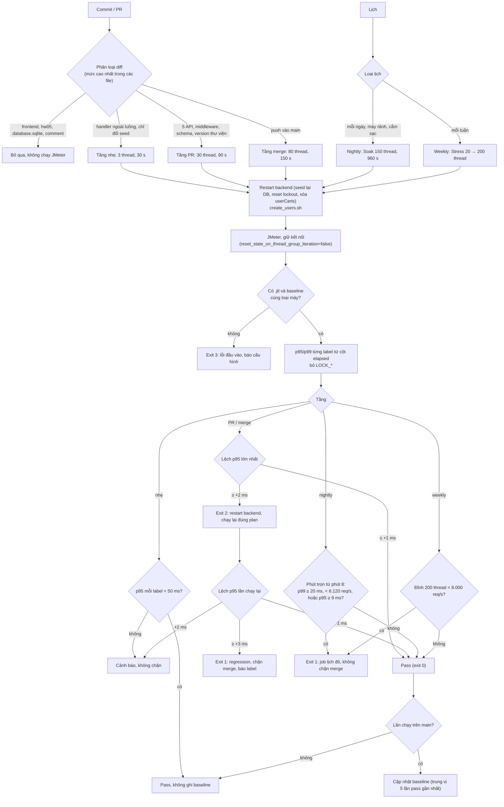

# HW05 – Task 3: Đề xuất Continuous Performance Testing (G9.6 Disrupt)

- **Sinh viên:** 23120175 · **Nhánh:** `hw05/toanhuynh`
- **AI:** Cursor (Grok 4.7) thiết kế mô hình, flow chart, prototype (AILOG #13–#17); Claude Code (Claude Opus 5.5) chạy thí nghiệm kiểm chứng và đối chiếu số liệu
- **Tài liệu liên quan:** [`PERF_PIPELINE_FLOW.md`](PERF_PIPELINE_FLOW.md) (flow chart gốc của AI), [`scripts/p95_regression.py`](scripts/p95_regression.py), [`ci/perf.yml`](ci/perf.yml), [`T3_EXPERIMENT.md`](T3_EXPERIMENT.md), [`REVIEW_TASK3.md`](REVIEW_TASK3.md)

---

## 1. Vì sao cần mô hình riêng cho hệ thống này

Ba đặc điểm đo được ở Task 1 quyết định thiết kế:

1. **Độ trễ rất nhỏ:** p95 chỉ 1–4 ms. JMeter đo theo đơn vị 1 ms, nên tăng 1 ms đã là +25–50%. Ngưỡng tương đối kiểu "p95 tăng > 10%" không dùng được.
2. **Suy giảm theo thời gian:** Soak ổn định ≈6.800 request/giây trong 7 phút rồi mới gãy (p99 3 → 125–236 ms). Test ngắn mỗi commit không thấy được.
3. **Percentile của report HTML sai với lần chạy lớn** (Soak: Total p99 3 ms so với 86 ms thật). Cổng phải tính từ file `.jtl`.

---

## 2. Mô hình tổng quan

Mô hình gồm ba khâu: **phân loại thay đổi** → **chọn tầng test** → **cổng phát hiện regression**.

### 2.1 Phân loại thay đổi (quyết định có chạy hay không)

Quyết định theo đường dẫn file, rồi nâng mức theo nội dung diff. Commit lấy mức cao nhất trong các file. **Nhãn PR và commit message không được hạ mức** (dễ bị ghi sai hoặc lợi dụng).

| Mức | Thay đổi | Lý do |
|---|---|---|
| **Bắt buộc** | Middleware (`app.use`, `bodyParser`), `authenticateToken`, thân 5 route trong luồng test, `userCarts`; `database.js` khi đổi kết nối, PRAGMA, schema, index của bảng trong luồng; lockfile khi đổi version `express`, `body-parser`, `cors`, `jsonwebtoken`, `sqlite3`; file `backend/**/*.js` mới được nạp | Cả 5 API dùng chung một process Node và một kết nối SQLite: sửa một chỗ có thể làm chậm cả luồng |
| **Chạy nhẹ** | Handler ngoài luồng test (quên mật khẩu, admin, CRUD sản phẩm/danh mục, hủy đơn) nếu không đụng middleware hay `userCarts`; chỉ đổi số liệu seed | Ít khả năng ảnh hưởng, nhưng vẫn cùng process |
| **Bỏ qua** | `frontend-*`, `backend/database.sqlite` (seed lại mỗi lần khởi động), `hw05/**`, chỉ comment/khoảng trắng | Không nằm trên đường đo (JMeter gọi thẳng `localhost:3000`) |

### 2.2 Các tầng test

| Tầng | Khi nào | Kịch bản | Chi phí **đo được** | Hành động khi lỗi |
|---|---|---|---|---|
| Nhẹ | PR mức "chạy nhẹ" | 3 thread, 30 s | ≈35 s + khởi động (chưa đo riêng) | Chỉ cảnh báo |
| **PR** | PR mức "bắt buộc" | 30 thread, 90 s, think-time 0–50 ms | **92–111 s / lần** + 4–6 s khởi động; nếu phải xác nhận: **≈223 s** | Chặn merge sau khi xác nhận |
| Merge | Push vào `main` | 80 thread, 150 s | **Chưa đo** | Như PR; pass thì cập nhật baseline |
| **Nightly** | Mỗi ngày, máy rảnh, cắm sạc | Soak 150 thread, 960 s | **16 phút**; `.jtl` 714 MB (36 MB nén) | Job đỏ, không chặn merge |
| Weekly | Mỗi tuần | Stress 20 → 200 thread | **≈350 s**; `.jtl` 244 MB (12 MB nén) | Job đỏ, không chặn merge |

Mọi tầng: khởi động lại backend (DB seed lại, reset lockout, xóa `userCarts`), chạy `create_users.sh`, chạy JMeter với `-Jhttpclient.reset_state_on_thread_group_iteration=false`.

### 2.3 Cổng phát hiện regression

- **Nguồn số:** p95 từng label `01`–`05` tính từ cột `elapsed` của `.jtl` (nearest-rank). **Bỏ label `LOCK_*`**, vì `LOCK_04` fail ở mọi lần do bug #225; không bỏ thì pipeline đỏ vĩnh viễn.
- **Baseline:** trung vị p95 của **5 lần chạy đạt** trên `main`, cùng plan, **cùng loại máy**. Chỉ ghi baseline từ lần pass trên `main`.
- **Ngưỡng tuyệt đối** (đã kiểm chứng ở mục 4):

| Lệch p95 so với baseline | Lần đầu | Lần chạy lại (`--confirm`) |
|---|---|---|
| ≤ +1 ms | Pass (exit 0) | Pass |
| +2 ms | Chạy lại (exit 2) | Chỉ cảnh báo (exit 0) |
| ≥ +3 ms | Chạy lại (exit 2) | **Regression, chặn merge** (exit 1) |

- **p99** chỉ để tham khảo, không làm cổng: p99 lệch +2 ms ngay ở lần không đổi code.
- **Throughput** không làm cổng ở tầng PR: dao động −7% dù code không đổi.
- **Nightly** xét **từng phút** (bỏ phút ramp-up và phút cuối không đủ 60 s): từ phút 8, cảnh báo nếu p99 ≥ 20 ms, throughput < 6.120 request/giây (90% của 6.800) hoặc p95 ≥ 9 ms. p95 gộp cả bài Soak vẫn 2 ms nên không dùng.
- **Weekly** cảnh báo nếu đỉnh ở 200 thread < 8.000 request/giây (đo được 8.930).
- Thiếu file `.jtl` hoặc baseline: exit 3 (lỗi đầu vào, không chạy lại).

---

## 3. Flow chart

Sơ đồ dưới vẽ theo **hành vi đã kiểm chứng của `p95_regression.py`**. Sơ đồ gốc của AI ở [`PERF_PIPELINE_FLOW.md`](PERF_PIPELINE_FLOW.md) chỉ chạy lại khi lệch ≥ +3 ms (xem mục 6, dòng 10).

---

## 4. Prototype và thí nghiệm kiểm chứng

### 4.1 Prototype

- [`scripts/p95_regression.py`](scripts/p95_regression.py): lệnh `baseline` (trung vị từ nhiều `.jtl`/`.jtl.gz`) và `check` (so với baseline, exit 0/1/2/3), hỗ trợ `--tier pr|merge|nightly|weekly`, kiểm tra cùng loại máy (`--machine`).
- [`ci/perf.yml`](ci/perf.yml): workflow GitHub Actions phác thảo cho tầng PR (lọc đường dẫn, cài Node/Java/JMeter, chạy plan rút gọn, gọi script, tự chạy lại khi exit 2, lưu `.jtl` làm artifact). **Cố ý đặt ngoài `.github/workflows/`** để không chạy trên PR của cả nhóm trong repo chung (muốn bật thì chép sang `.github/workflows/`).

### 4.2 Kiểm tra trên dữ liệu Task 1

| Đầu vào | Kết quả |
|---|---|
| `load.jtl` so với chính nó (tầng PR) | Pass, exit 0 |
| `spike.jtl` so với baseline Load | Pass, lệch p95 ≤ 1 ms |
| `soak.jtl.gz` tầng nightly | Regression, exit 1: phát hiện đúng phút 8–15 (p99 125–236 ms, 5.006–5.885 request/giây) |
| File `.jtl` không tồn tại | Exit 3 |

### 4.3 Thí nghiệm regression giả

Chi tiết: [`T3_EXPERIMENT.md`](T3_EXPERIMENT.md). Hai lần lặp độc lập, mỗi lần: 5 lần baseline, 1 lần không đổi code, 2 lần backend có checkout chậm thêm 5 ms ([`slow_checkout.patch`](results/t3/slow_checkout.patch), chạy trên bản sao, không sửa code repo).

| Lần chạy | Exit (lần 1 / lần 2) | p95 `05_Checkout` (baseline 3 ms) |
|---|---|---|
| Không đổi code | 0 / 0 | 4 / 3 |
| Chậm, lần đầu | 2 / 2 | 9 / 9 |
| Chậm, chạy lại xác nhận | **1 / 1** | **9 / 8** |

**Kết quả:** bắt đúng regression ở đúng label ở cả 2 lần lặp, không báo động giả. Ảnh: [`evidence/t3/`](evidence/t3/).

---

## 5. Đánh đổi

### 5.1 Chi phí

- **Tầng PR:** ≈1,5–2 phút mỗi lần; tối đa ≈4 phút nếu phải chạy lại. Chỉ chạy khi diff ở mức "bắt buộc", nên phần lớn commit (frontend, tài liệu, `hw05/`) không tốn gì.
- **Nightly:** 16 phút máy bận; `.jtl` 714 MB vượt giới hạn 100 MB của GitHub, phải nén (36 MB) và chỉ giữ lần mới nhất.
- **Chi phí đo phụ thuộc môi trường:** cùng plan 90 s, run 1 mất 92–93 s nhưng run 2 mất 104–110 s (run 2 chạy kèm Terminal hiển thị, htop và chụp màn hình).
- **Một máy chỉ chạy được một job một lúc** (cùng cổng 3000): các job phải xếp hàng.

### 5.2 Báo động giả

| Nguồn nhiễu | Số đo | Cách giảm |
|---|---|---|
| p95 dao động giữa các lần | Tối đa **1 ms** qua 12 lần không đổi code | Dải đạt +1 ms; baseline là trung vị 5 lần |
| Label không bị sửa nhích theo | 1 lần `04_ApplyCoupon` +2 ms (trên 24 lần kiểm tra label không bị sửa, ≈4%) | **Bắt buộc chạy lại** trước khi chặn; lần chạy lại đưa về +1 ms |
| p99 | Lệch +2 ms ngay ở lần không đổi code | Không dùng p99 làm cổng |
| Throughput | −7% giữa các lần không đổi code (lớn hơn −4% do regression) | Không dùng throughput làm cổng ở tầng PR |
| Khác loại máy | Baseline 1–4 ms đo trên M5; **chưa đo** trên runner khác | Baseline gắn tên máy; workflow bỏ qua cổng khi chưa có baseline cùng loại máy |
| Phút cuối của Soak | 144 sample trong 34 ms bị tính 4.235 request/giây | Bỏ phút không đủ 60 s (đã sửa) |

**Biên an toàn mỏng:** ở lần lặp 1, lần không đổi code có 4/5 label lệch đúng +1 ms, sát mức tối đa còn đạt.

### 5.3 Regression bị bỏ sót

- **Regression nhỏ hơn 3 ms:** +2 ms chỉ cảnh báo, +1 ms không phân biệt được với nhiễu.
- **Suy giảm theo thời gian:** chỉ nightly thấy (Soak gãy từ phút 8); tầng PR 90 s và p95 gộp cả bài Soak (2 ms) đều bỏ sót.
- **Rò bộ nhớ:** RSS 79 → 329 MB trong Soak; tầng PR không đo RAM. Đề xuất: nightly ghi RSS (đã có `scripts/record_node_rss.sh`) và cảnh báo theo độ dốc MB/phút.
- **API ngoài luồng test** (tìm kiếm, admin, quên mật khẩu): không có trong plan.
- **Bug chức năng trả 200** (ví dụ mã `SAVE10` tính sai, #20): cổng hiệu năng không thấy; cần assertion nghiệp vụ như ở Task 1.

### 5.4 Runner dùng chung (GitHub) so với máy riêng

| | Runner GitHub dùng chung | Máy riêng (self-hosted) |
|---|---|---|
| Chi phí | Không cần máy | Cần máy luôn bật |
| Độ ổn định số đo | Không kiểm soát được, phần cứng thay đổi giữa các lần | Ổn định nếu máy chỉ chạy test |
| Dùng baseline M5 | Không | Có |
| Rủi ro | Báo động giả do khác máy | Máy cá nhân có thể tắt, mang đi, khóa màn hình; MacBook Air **không quạt** có thể hạ xung khi chạy Soak |

### 5.5 Cấu hình đề xuất cho nhóm 4–5 sinh viên

- Một máy cố định làm self-hosted runner, xếp hàng job, không chạy song song.
- Tầng PR chỉ cho diff mức "bắt buộc"; chặn merge chỉ sau lần chạy lại xác nhận.
- Nightly Soak (kèm ghi RSS) khi máy rảnh và cắm sạc; weekly Stress. Hai tầng này báo đỏ nhưng không chặn merge.
- Baseline là trung vị 5 lần; chỉ lập lại khi đổi máy hoặc đổi plan.

---

## 6. Human review: AI đề xuất gì, đúng hay sai, chỉnh thế nào

Chi tiết đối chiếu từng con số: [`REVIEW_TASK3.md`](REVIEW_TASK3.md).

| # | AI đề xuất / nhận định | Đúng với hệ thống này? | Chỉnh thế nào |
|---|---|---|---|
| 1 | Ngưỡng tuyệt đối p95 (≤ +1 / +2 / ≥ +3 ms), không dùng ngưỡng % | Đúng; thí nghiệm bắt được +5 ms ở cả 2 lần lặp, không báo động giả | Giữ; ghi rõ giới hạn mẫu và ngưỡng phát hiện tối thiểu +3 ms |
| 2 | Chỉ dùng p95 làm cổng, không dùng p99 | Đúng: p99 lệch +2 ms ngay ở lần không đổi code | Giữ |
| 3 | Nightly xét từng phút | Đúng: p95 gộp Soak 2 ms che suy giảm phút 8 | Giữ |
| 4 | Nightly tính cả phút cuối không trọn | **Sai**: luôn báo động giả | Đã sửa trong `p95_regression.py` |
| 5 | Lỗi thiếu file trả exit 2 (chạy lại) | **Sai**: chạy lại không tạo ra file bị ghi sai đường dẫn | Tách thành exit 3 |
| 6 | Đặt workflow trong `.github/workflows/` | **Không phù hợp**: repo chung, sẽ chạy trên PR của cả nhóm; cần quyền `workflow` | Chuyển sang `hw05/ci/perf.yml` |
| 7 | "Run 1 lệch p95 +1 ms ở cả năm label" | **Sai**: 4/5 label (AddToCart lệch 0) | AI tự sửa khi được yêu cầu kiểm tra lại |
| 8 | Dẫn `base_1` so với `slow_1` làm bằng chứng throughput trôi do máy bận | **Sai bằng chứng**: `slow_1` có regression giả | Dùng `base_1` so với `unchanged` (−7%) |
| 9 | "Dải +1 ms hẹp hơn chênh lệch giữa hai loại máy" | Đúng hướng nhưng **chưa đo** | Ghi rõ là suy luận |
| 10 | Flow chart: chạy lại khi lệch ≥ +3 ms | **Không khớp** script (chạy lại từ +2 ms); theo flow chart, lệch +2 ms sẽ pass luôn | Flow chart trong báo cáo vẽ theo hành vi script đã kiểm chứng |
| 11 | Phần "bỏ sót" chỉ nêu suy giảm Soak, +2 ms, đuôi p99 | **Thiếu** RAM, API ngoài luồng, bug chức năng trả 200 | Bổ sung ở mục 5.3 |
| 12 | Một máy M5 dùng chung cho nhóm | Khả thi nhưng thiếu rủi ro | Bổ sung rủi ro laptop cá nhân, không quạt (mục 5.4) |

---

## 7. Hạn chế và hướng phát triển

- Ngưỡng dựa trên 12 lần chạy không đổi code và một mức regression (+5 ms) ở một API; cần thêm dữ liệu để ước lượng tỉ lệ báo động giả.
- Tầng merge (80 thread, 150 s) và tầng nhẹ chưa chạy thử.
- Workflow chưa chạy trên GitHub; chưa có baseline cho runner Ubuntu.
- Hướng phát triển: thêm cổng RSS cho nightly; thêm API ngoài luồng vào plan merge; khi đã sửa #229, chạy lại Soak để đặt lại ngưỡng nightly theo hệ thống khỏe.
