# Bug Report — EShop

**Phạm vi:** FR-02, FR-08, FR-13, FR-15 Mobile  

**Ngày tổng hợp:** 19-10-2026  

**Nguồn yêu cầu:** README.md — System Requirements  

**Test runs:** [FR-02](../tests/test-runs/FR-02/FR02-test-run-001.md), [FR-08](../tests/test-runs/FR-08/FR08-checkout-test-run-001.md), [FR-13](../tests/test-runs/FR-13/FR13-dashboard-test-run-001.md), [FR-15 Mobile](../tests/test-runs/FR-15-mobile/FR15-mobile-test-run-001.md)

> Báo cáo này tổng hợp defect candidates theo nguyên nhân gốc từ test run, báo cáo kiểm thử và rà soát mã nguồn/schema.

## Tóm tắt

| FR | Bug | Mức độ đề xuất | Test case | Nguồn bằng chứng |
|---|---|---|---|---|
| FR-02 | Bộ đếm sai tăng 2 thay vì 1 | Major | 007, 009, 011–013 | Báo cáo kiểm thử |
| FR-02 | Khóa tài khoản lâu hơn 30 giây | Major | 016–017 | Báo cáo kiểm thử |
| FR-02 | Trường email không dùng HTML5 email type | Medium | 029, 031 | Báo cáo kiểm thử |
| FR-02 | Client chấp nhận response thiếu/rỗng token | Major | 034–035 | Báo cáo kiểm thử |
| FR-02 | Login response lộ mật khẩu plaintext | Critical | 036 | Báo cáo kiểm thử |
| FR-02 | UI không thông báo tài khoản bị khóa | Medium | 038 | Báo cáo kiểm thử |
| FR-08 | Backend tin tổng tiền do client gửi | Major | 001, 003, 004, 009 |  Báo cáo kiểm thử, Source review |
| FR-08 | Tổng tiền checkout có thể sửa trực tiếp | Major | 005 |  Báo cáo kiểm thử,Source review |
| FR-08 | Giỏ không xóa sau checkout thành công | Major | 001, 007 |  Báo cáo kiểm thử,Source review |
| FR-13 | Doanh thu delivered bị cộng hai lần | Major | 001, 006 |  Báo cáo kiểm thử,Source review |
| FR-15 | API chấp nhận tên dài hơn 255 ký tự | Medium | 006 |  Báo cáo kiểm thử, API/schema review |
| FR-15 | API chấp nhận tên thiếu/rỗng | Major | 007 |  Báo cáo kiểm thử, API/schema review |
| FR-15 | API chấp nhận giá bằng 0 hoặc âm | Major | 009 |  Báo cáo kiểm thử, API/schema review |
| FR-15 | API cho phép thiếu danh mục | Major | 010 |  Báo cáo kiểm thử, API/schema review |

**Tổng cộng:** 14 bug candidates: 6 FR-02, 3 FR-08, 1 FR-13 và 4 FR-15.

## FR-02 — Đăng nhập và khóa tài khoản

### BUG-FR02-001 — Bộ đếm đăng nhập sai tăng 2 thay vì 1

**Mức độ:** Major  
**Test case:** TC-FR-02-LOGIN-007, 009, 011, 012, 013

**Tái hiện:** Đặt login_attempts về 0, gửi một lần login với mật khẩu sai, rồi kiểm tra bộ đếm.

**Thực tế:** Bộ đếm tăng 0 → 2; tài khoản có thể bị khóa sau hai lần sai.  

**Mong đợi:** Mỗi lần sai tăng đúng một; khóa khi đạt từ ba lần sai liên tiếp.  

**Bằng chứng:** Báo cáo ghi backend tính user.login_attempts + 2.  

**Đề xuất:** Sửa mức tăng thành 1 và kiểm tra tại các mốc 1, 2, 3.  

**Nguồn:** [Bug report FR-02](../tests/bug-reports/FR-02/BUG-FR02-all.md).

### BUG-FR02-002 — Tài khoản vẫn bị khóa sau khi hết 30 giây

**Mức độ:** Major  

**Test case:** TC-FR-02-LOGIN-016, 017

**Tái hiện:** Khóa tài khoản, đợi 30 giây rồi đăng nhập đúng; thử lại sau 31 giây nếu vẫn bị từ chối.

**Thực tế:** Báo cáo ghi nhận tài khoản vẫn bị khóa sau 30 giây và hơn 31 giây.  

**Mong đợi:** Cho phép thử đăng nhập lại sau thời gian khóa 30 giây.  

**Bằng chứng:** Test run ghi tài khoản vẫn bị khóa sau 30 giây và hơn 31 giây; mã đặt lockedUntil sau 180.000 ms. Kết quả mong đợi chính xác tại mốc 30 giây cần chốt theo đặc tả.  

**Đề xuất:** Dùng thời gian khóa 30 giây và kiểm tra 29/30/31 giây.

### BUG-FR02-003 — Trường email không dùng HTML5 type=email

**Mức độ:** Medium  

**Test case:** TC-FR-02-LOGIN-029, 031

**Tái hiện:** Mở form login, kiểm tra type của input email hoặc nhập abc và submit.

**Thực tế:** Trường được ghi nhận dùng type=text; request được gửi với email sai định dạng.  

**Mong đợi:** Dùng type=email để browser chặn input sai định dạng trước khi gửi.  

**Bằng chứng:** Login.jsx được báo cáo khai báo type=text.  

**Đề xuất:** Đổi thành type=email và xác nhận browser validation.

### BUG-FR02-004 — Client chấp nhận response đăng nhập thiếu token hoặc token rỗng

**Mức độ:** Major  
**Test case:** TC-FR-02-LOGIN-034, 035

**Tái hiện:** Mô phỏng login response thiếu token hoặc token rỗng; quan sát auth state và Local Storage.

**Thực tế:** Client vẫn có thể xử lý login thành công và lưu undefined hoặc token rỗng.  

**Mong đợi:** Từ chối response không có token hợp lệ; không lưu token và không xác thực người dùng.  

**Bằng chứng:** AuthContext được báo cáo lưu res.data.token mà không validate trước.  

**Đề xuất:** Validate response token trước khi cập nhật trạng thái đăng nhập.

### BUG-FR02-005 — Login response chứa mật khẩu plaintext

**Mức độ:** Critical  
**Test case:** TC-FR-02-LOGIN-036

**Tái hiện:** Đăng nhập hợp lệ, mở Network response của /api/login và kiểm tra object user.

**Thực tế:** Báo cáo ghi response có trường password plaintext.  

**Mong đợi:** Không trả mật khẩu hoặc secret trong response.  

**Bằng chứng:** Backend được báo cáo trả nguyên user lấy từ SELECT *.  

**Đề xuất:** Chỉ trả các trường user được phép như id, name, email, role.

### BUG-FR02-006 — Giao diện không thông báo tài khoản đang bị khóa

**Mức độ:** Medium  
**Test case:** TC-FR-02-LOGIN-038

**Tái hiện:** Đưa tài khoản vào trạng thái khóa, thử login lại bằng mật khẩu đúng và quan sát UI.

**Thực tế:** UI hiển thị thông báo chung “Đăng nhập thất bại. Vui lòng kiểm tra lại.”  

**Mong đợi:** Hiển thị hướng dẫn an toàn, ví dụ “Tài khoản đang bị khóa. Vui lòng thử lại sau.” Không tiết lộ số lần sai hoặc thông tin nội bộ.  

**Bằng chứng:** Login.jsx được báo cáo thay mọi lỗi bằng cùng một thông báo.  

**Đề xuất:** Phân loại lỗi khóa tài khoản (ví dụ status 403) và hiển thị nội dung thân thiện.

## FR-08 — Checkout

### BUG-FR08-001 — Backend tin tổng tiền do client gửi

**Mức độ:** Major  

**Test case:** TC-FR-08-CHECKOUT-001, 003, 004, 009

**Tái hiện:** Tạo giỏ có tổng đã biết, gửi checkout với total_amount thấp/cao hơn tổng giỏ, rồi kiểm tra đơn hàng.

**Thực tế:** Theo source review, handler lưu tổng client gửi và không tính lại từ giỏ hiện tại.  

**Mong đợi:** Backend tự tính tổng từ dữ liệu giỏ/giá có thẩm quyền và không dùng tổng client làm nguồn quyết định.  

**Đề xuất:** Tính lại server-side; kiểm tra giá trị client thấp hơn, cao hơn và tổng cũ khi cart đã đổi. 

**Bằng chứng:** FR-08 test run ghi nhận handler dùng giá trị total_amount từ request thay vì tính lại từ giỏ.

### BUG-FR08-002 — Tổng tiền trên UI có thể sửa trực tiếp

**Mức độ:** Major  

**Test case:** TC-FR-08-CHECKOUT-005

**Tái hiện:** Mở checkout với giỏ đã có hàng và thử sửa trường tổng tiền.

**Thực tế:** Source review ghi tổng tiền được hiển thị bằng input có thể chỉnh sửa.  

**Mong đợi:** Hiển thị tổng tính tự động dưới dạng chỉ đọc; người dùng không sửa trực tiếp.  

**Đề xuất:** Dùng nội dung chỉ đọc hoặc văn bản hiển thị; backend vẫn phải tự tính lại.  

**Bằng chứng:** TC-FR-08-CHECKOUT-005 ghi nhận tổng tiền được hiển thị dưới dạng input có thể chỉnh sửa.

### BUG-FR08-003 — Giỏ không được xóa sau checkout thành công

**Mức độ:** Major

**Test case:** TC-FR-08-CHECKOUT-001, 007

**Tái hiện:** Checkout giỏ có hàng thành công, mở lại giỏ và kiểm tra nội dung.

**Thực tế:** Source review ghi nhánh thành công không gọi clearCart().  

**Mong đợi:** Xóa giỏ sau khi server xác nhận checkout thành công.  

**Đề xuất:** Xóa cart sau success; giữ cart nếu checkout thất bại.  

**Bằng chứng:** TC-FR-08-CHECKOUT-001 và TC-FR-08-CHECKOUT-007 ghi nhận nhánh thành công không gọi clearCart().

## FR-13 — Dashboard

### BUG-FR13-001 — Doanh thu đơn delivered bị cộng hai lần

**Mức độ:** Major  

**Test case:** TC-FR-13-DASHBOARD-001, 006

**Tái hiện:** Dùng dữ liệu có đơn delivered, ghi lại total_amount, mở Dashboard admin và so sánh doanh thu hiển thị với tổng các đơn delivered.

**Thực tế:** Source review ghi phép tính cộng o.total_amount * 2 cho đơn delivered. 

**Mong đợi:** Mỗi đơn delivered đóng góp total_amount đúng một lần; đơn trạng thái khác không tính vào doanh thu.  

**Đề xuất:** Sửa phép tính và đối chiếu với fixture có kết quả tính sẵn.  

**Bằng chứng:** TC-FR-13-DASHBOARD-001 và TC-FR-13-DASHBOARD-006 ghi nhận phép tính totalRevenue nhân đôi total_amount. Kiểm tra quyền API theo role thuộc FR-12 và cần test riêng.

## FR-15 Mobile — Quản lý sản phẩm và catalog

### BUG-FR15-001 — API chấp nhận tên sản phẩm dài hơn 255 ký tự

**Mức độ:** Medium  
**Test case:** TC-FR-15-PRODUCT-MOBILE-006

**Tái hiện:** Gửi tạo sản phẩm có tên 256 ký tự trở lên, kiểm tra response và bản ghi.

**Thực tế:** API/schema review ghi không giới hạn độ dài tên; SQLite TEXT chấp nhận giá trị.  

**Mong đợi:** Từ chối tên dài hơn 255 ký tự.  

**Đề xuất:** Validate độ dài trong API và trả lỗi validation.  

**Bằng chứng:** TC-FR-15-PRODUCT-MOBILE-006 ghi nhận API/schema không giới hạn độ dài tên.

### BUG-FR15-002 — API chấp nhận tên sản phẩm thiếu hoặc rỗng

**Mức độ:** Major  
**Test case:** TC-FR-15-PRODUCT-MOBILE-007

**Tái hiện:** Gửi request tạo sản phẩm với name bị bỏ trống, null hoặc chuỗi rỗng.

**Thực tế:** Test run ghi API không kiểm tra tên rỗng; schema cho phép NULL/chuỗi rỗng.  

**Mong đợi:** Từ chối sản phẩm thiếu tên hoặc tên rỗng. Quy tắc với chuỗi chỉ có khoảng trắng cần được xác nhận.  

**Đề xuất:** Bắt buộc tên, trim và từ chối chuỗi rỗng sau trim.  

**Bằng chứng:** TC-FR-15-PRODUCT-MOBILE-007 ghi nhận API/schema cho phép thiếu hoặc để rỗng tên sản phẩm.

### BUG-FR15-003 — API chấp nhận giá bằng 0 hoặc âm

**Mức độ:** Major  
**Test case:** TC-FR-15-PRODUCT-MOBILE-009

**Tái hiện:** Tạo/cập nhật sản phẩm với price=0 rồi price=-1; kiểm tra response và dữ liệu.

**Thực tế:** API không kiểm tra price > 0; schema không có CHECK để chặn 0/giá âm.  

**Mong đợi:** Từ chối giá không dương.  

**Đề xuất:** Validate kiểu số và điều kiện price > 0; xem xét constraint ở schema.  

**Bằng chứng:** TC-FR-15-PRODUCT-MOBILE-009 ghi nhận API/schema không chặn giá bằng 0 hoặc âm.

### BUG-FR15-004 — API cho phép sản phẩm thiếu danh mục

**Mức độ:** Major  
**Test case:** TC-FR-15-PRODUCT-MOBILE-010

**Tái hiện:** Tạo sản phẩm không có category_id hoặc đặt null; kiểm tra response và bản ghi.

**Thực tế:** API không xác thực category bắt buộc; schema cho phép NULL và không khai báo foreign key.  

**Mong đợi:** Từ chối sản phẩm thiếu danh mục hoặc tham chiếu đến danh mục không tồn tại.  

**Đề xuất:** Validate category_id và kiểm tra danh mục tồn tại trước khi lưu.  

**Bằng chứng:** TC-FR-15-PRODUCT-MOBILE-010 ghi nhận API/schema không bắt buộc và không liên kết category_id.

## Các mục chưa kết luận

- FR-08 TC-008: checkout với giỏ rỗng chưa có expected result trong đặc tả.
- FR-13: truy cập API theo role cần kiểm thử theo FR-12, không kết luận từ UI test.
- FR-15: tên chỉ có khoảng trắng và category ID không tồn tại cần xác nhận expected behavior.

## Phụ lục — Ảnh minh chứng

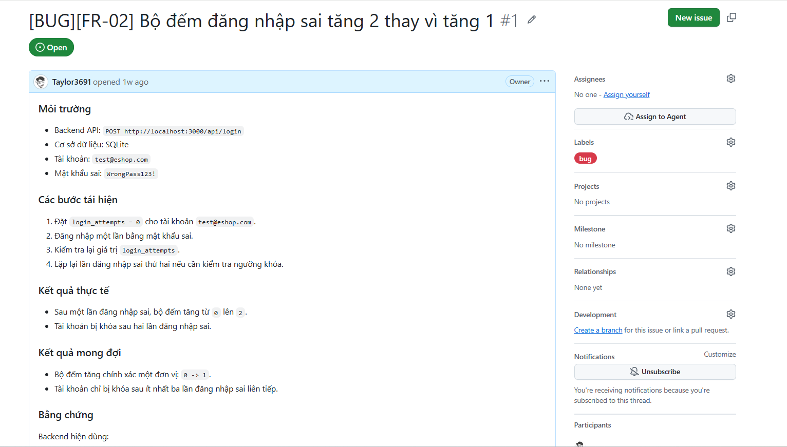

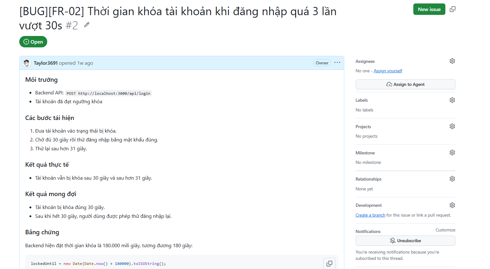

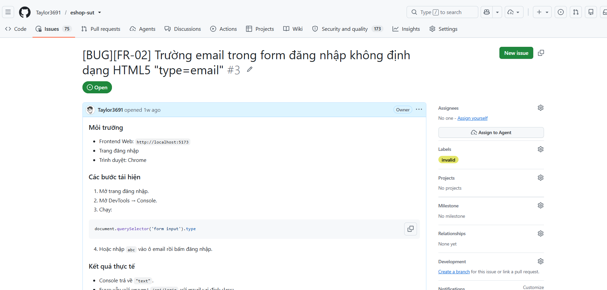

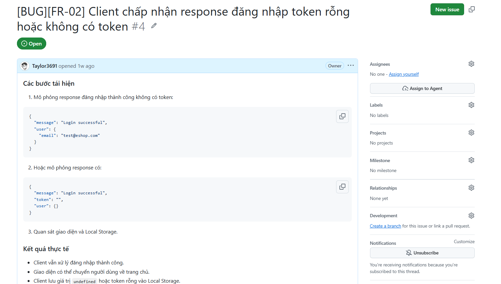

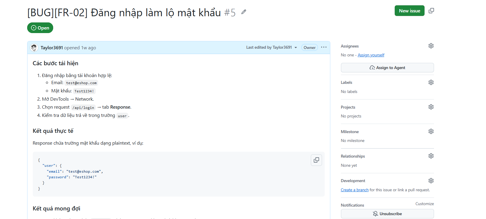

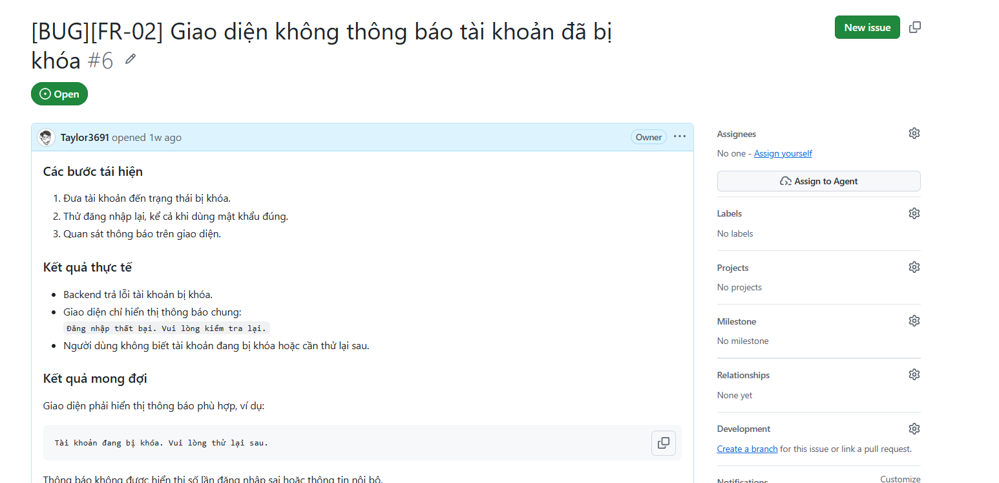

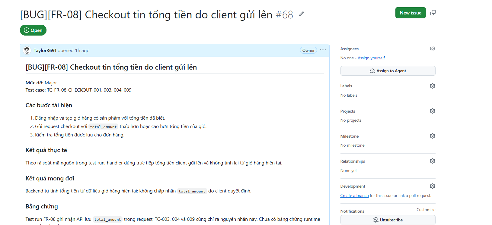

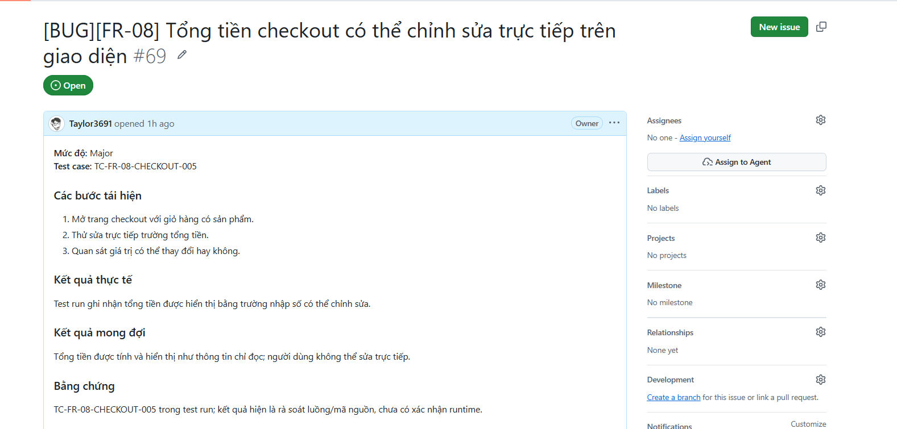

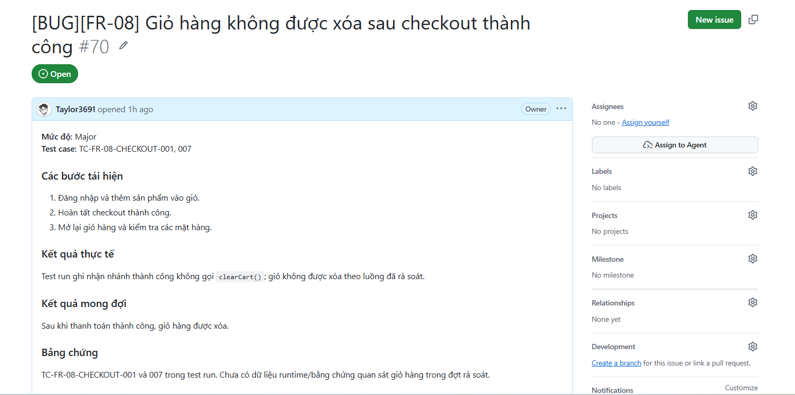

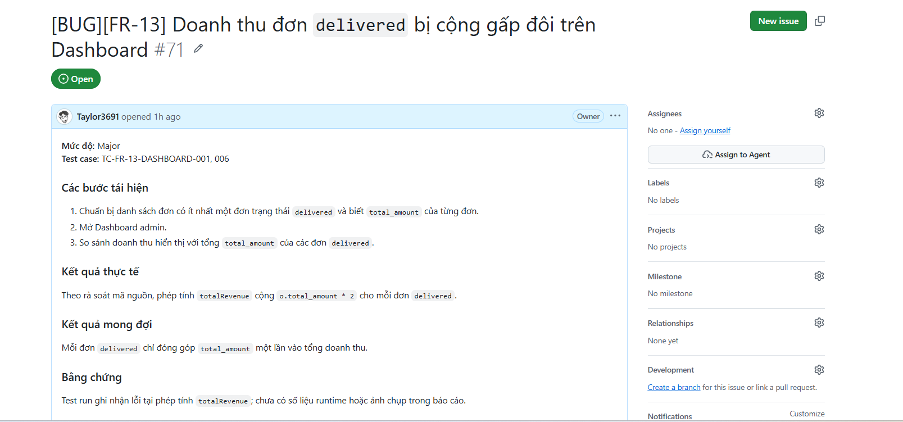

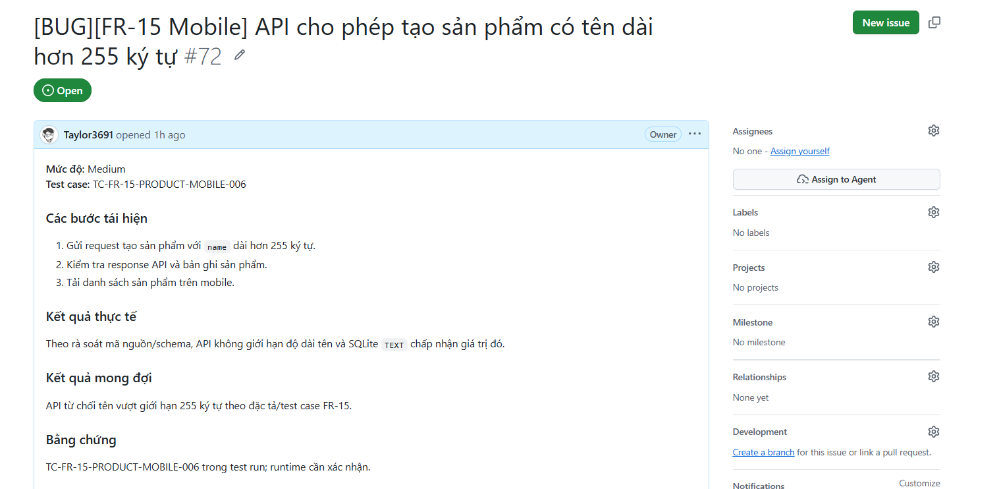

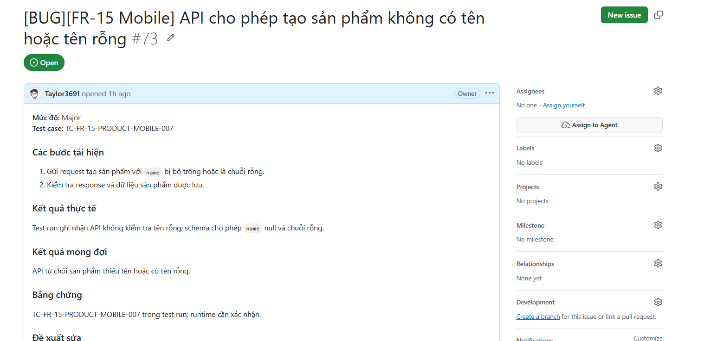

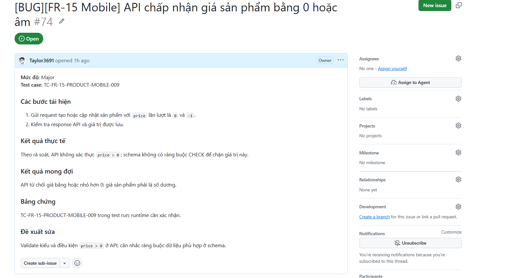

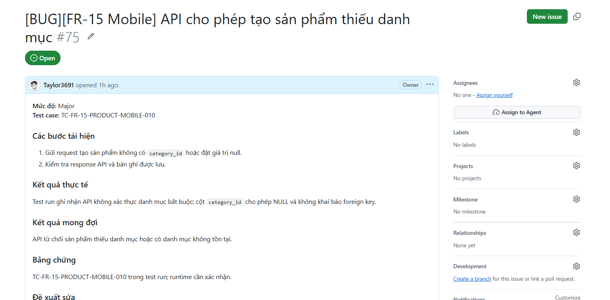

