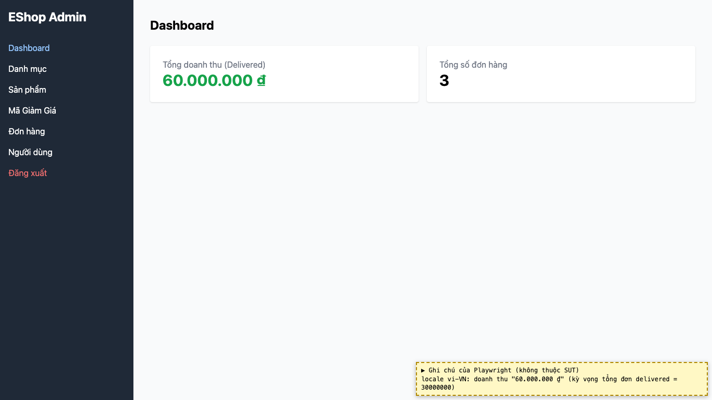
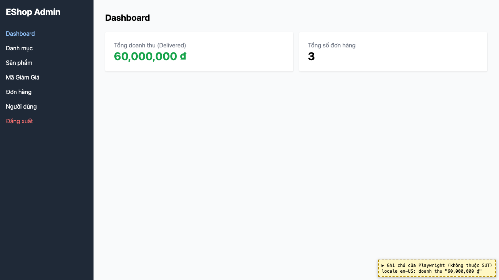

# BUG-01: [Dashboard] Tổng doanh thu gấp đôi tổng tiền các đơn đã giao

| Trường | Giá trị |
|---|---|
| GitHub Issue | Trùng issue có sẵn [#71](https://github.com/Taylor3691/eshop-sut/issues/71) (không tạo issue mới) |
| Nguồn phát hiện | Checklist GUI-01-10 |
| Màn hình | Dashboard |
| Môi trường | macOS 27.2, Google Chrome 157.0.8103.51 (Playwright, headless), http://localhost:5174 |
| Severity | Major — số liệu kinh doanh sai, người quản lý ra quyết định dựa trên con số gấp đôi thực tế |
| Priority | High |
| Tham chiếu spec | FR-13 |

**Điều kiện tiên quyết:** SUT chạy bằng `scripts/start-sut.sh` (+ `scripts/seed-hw03.sh 3`); đăng nhập Web Admin bằng `admin@eshop.com` / `Admin123!`.

**Bước tái hiện:**
1. Chuyển một đơn hàng sang trạng thái `delivered` (tab Đơn hàng: Xác nhận → Giao hàng → Hoàn thành). Ở lần chạy này, đơn #1 có `total_amount` = 30.000.000 ₫ và là đơn đã giao duy nhất.
2. Mở tab Dashboard, xem thẻ "Tổng doanh thu (Delivered)".

**Kết quả mong đợi:** FR-13: "Hiển thị tổng doanh thu: Chỉ tính tổng `total_amount` của các đơn có `status = 'delivered'`" → 30.000.000 ₫.

**Kết quả thực tế:** Thẻ hiển thị **60.000.000 ₫**, gấp đôi tổng thực tế. Cùng một giá trị gấp đôi xuất hiện ở cả trình duyệt vi-VN lẫn en-US.

**Ảnh chụp:**

