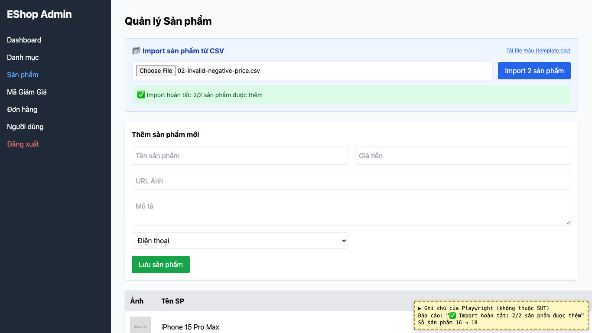
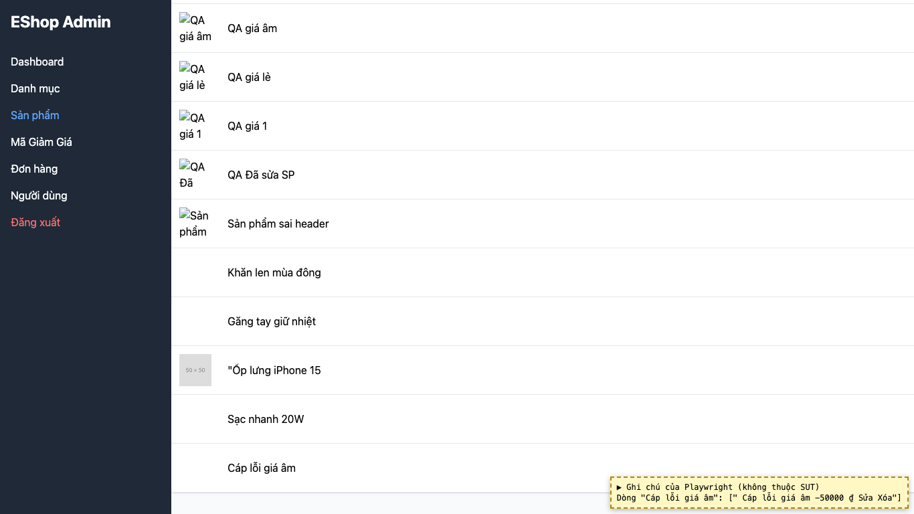

# BUG-02: [Quản lý Sản phẩm] Import CSV thêm cả dòng không hợp lệ, không rollback và báo cáo không có lỗi theo dòng

| Trường | Giá trị |
|---|---|
| GitHub Issue | Trùng issue có sẵn [#61](https://github.com/Taylor3691/eshop-sut/issues/61), [#63](https://github.com/Taylor3691/eshop-sut/issues/63) (không tạo issue mới) |
| Nguồn phát hiện | Checklist GUI-04-13 |
| Màn hình | Quản lý Sản phẩm (Import CSV) |
| Môi trường | macOS 27.2, Google Chrome 157.0.8103.51 (Playwright, headless), http://localhost:5174 |
| Severity | Major — dữ liệu sai (giá âm) lọt vào CSDL, vi phạm yêu cầu all-or-nothing |
| Priority | High |
| Tham chiếu spec | FR-16 |

**Điều kiện tiên quyết:** SUT chạy bằng `scripts/start-sut.sh` (+ `scripts/seed-hw03.sh 3`); đăng nhập Web Admin bằng `admin@eshop.com` / `Admin123!`.

**Bước tái hiện:**
1. Mở tab Sản phẩm, ghi lại số sản phẩm hiện có.
2. Ở khung "Import sản phẩm từ CSV", chọn file `submission/test-data/csv/02-invalid-negative-price.csv` (dòng 2 hợp lệ, dòng 3 có `price` = -50000).
3. Bấm "Import 2 sản phẩm".

**Kết quả mong đợi:** FR-16: `price` phải là số dương; "Nếu có lỗi ở bất kỳ dòng nào, toàn bộ import phải được rollback"; hệ thống báo bao nhiêu dòng thành công, bao nhiêu dòng lỗi và lý do.

**Kết quả thực tế:** Báo cáo hiện "✅ Import hoàn tất: 2/2 sản phẩm được thêm". Cả 2 dòng được thêm, trong đó có "Cáp lỗi giá âm" với giá **-50000 ₫**. Không có dòng lỗi nào được báo, không rollback.

**Ảnh chụp:**

