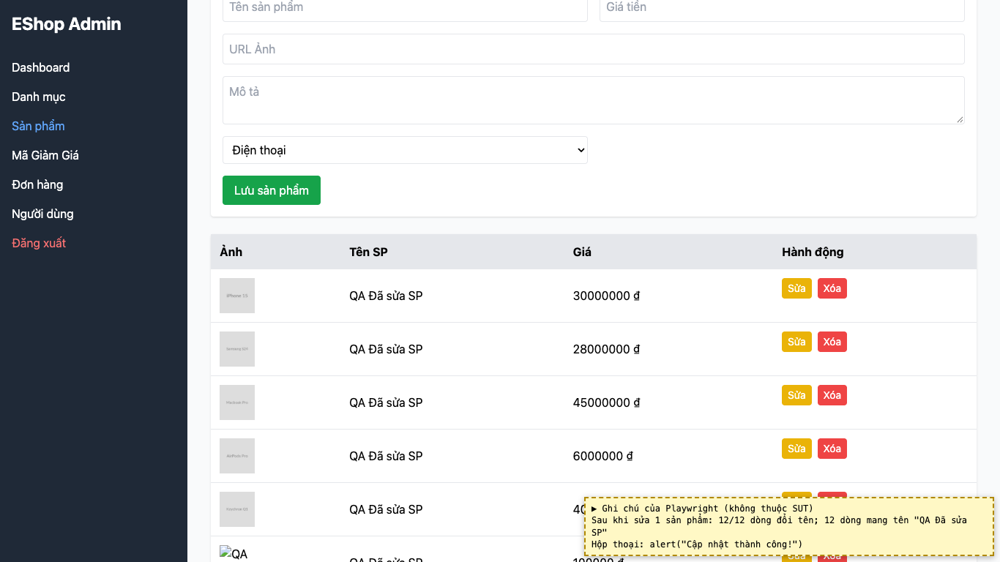
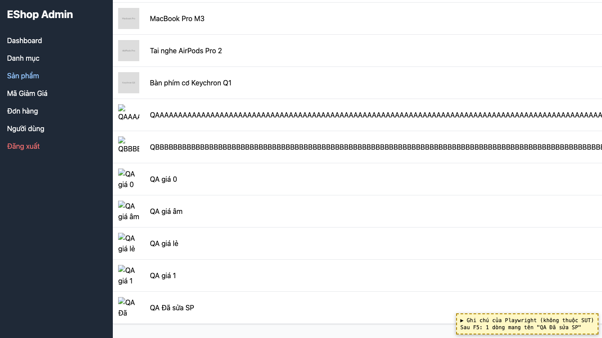

# BUG-03: [Quản lý Sản phẩm] Sau khi sửa một sản phẩm, mọi dòng trong bảng hiển thị cùng tên mới

| Trường | Giá trị |
|---|---|
| GitHub Issue | [#126](https://github.com/Taylor3691/eshop-sut/issues/126) |
| Nguồn phát hiện | Checklist GUI-04-04 |
| Màn hình | Quản lý Sản phẩm |
| Môi trường | macOS 27.2, Google Chrome 157.0.8103.51 (Playwright, headless), http://localhost:5174 |
| Severity | Major — bảng hiển thị sai dữ liệu, người dùng tưởng đã đổi tên toàn bộ sản phẩm |
| Priority | High |
| Tham chiếu spec | FR-15 |

**Điều kiện tiên quyết:** SUT chạy bằng `scripts/start-sut.sh` (+ `scripts/seed-hw03.sh 3`); đăng nhập Web Admin bằng `admin@eshop.com` / `Admin123!`.

**Bước tái hiện:**
1. Mở tab Sản phẩm, bấm "Sửa" ở một sản phẩm bất kỳ.
2. Đổi Tên sản phẩm (ví dụ "QA Đã sửa SP"), bấm "Lưu sản phẩm", đóng hộp thoại "Cập nhật thành công!".
3. Quan sát cột "Tên SP"; sau đó nhấn F5.

**Kết quả mong đợi:** FR-15: "Khi Sửa một sản phẩm, chỉ sản phẩm đó bị thay đổi — các sản phẩm khác giữ nguyên."

**Kết quả thực tế:** Ngay sau khi lưu, **cả 12/12 dòng** trong bảng hiển thị tên "QA Đã sửa SP". Sau F5 chỉ còn 1 dòng mang tên mới: dữ liệu trong CSDL đúng, nhưng bảng hiển thị sai cho tới khi tải lại trang.

**Ảnh chụp:**

