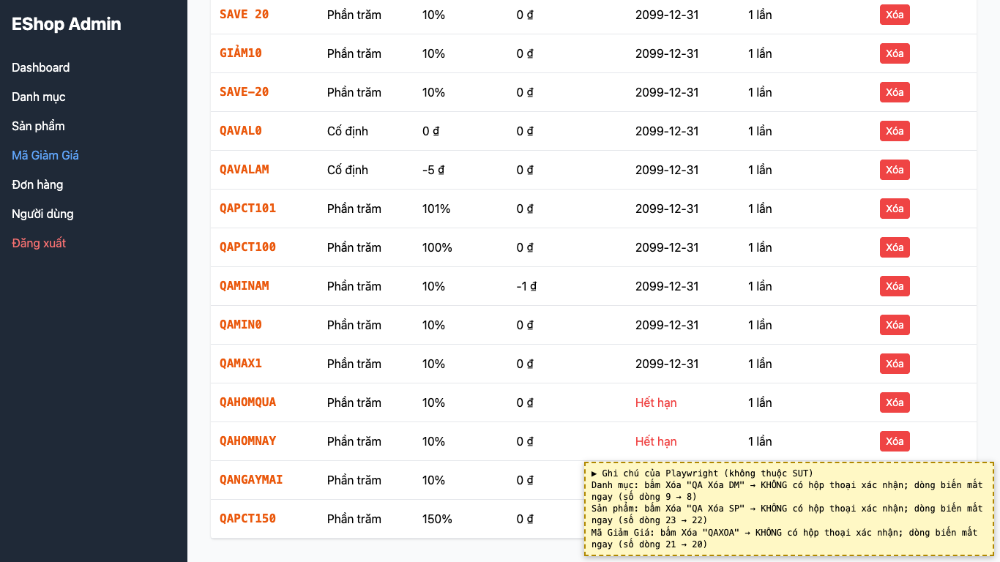

# BUG-04: [Danh mục, Sản phẩm, Mã giảm giá] Bấm "Xóa" xóa ngay, không có hộp thoại xác nhận

| Trường | Giá trị |
|---|---|
| GitHub Issue | [#127](https://github.com/Taylor3691/eshop-sut/issues/127) |
| Nguồn phát hiện | Checklist GUI-04-06 |
| Màn hình | Quản lý Danh mục, Quản lý Sản phẩm, Quản lý Mã giảm giá |
| Môi trường | macOS 27.2, Google Chrome 157.0.8103.51 (Playwright, headless), http://localhost:5174 |
| Severity | Major — một cú bấm nhầm làm mất dữ liệu, không thể hoàn tác |
| Priority | High |
| Tham chiếu spec | FR-24 (mở rộng theo giải đáp 6), BP Nielsen #5 |

**Điều kiện tiên quyết:** SUT chạy bằng `scripts/start-sut.sh` (+ `scripts/seed-hw03.sh 3`); đăng nhập Web Admin bằng `admin@eshop.com` / `Admin123!`.

**Bước tái hiện:**
1. Mở tab Danh mục, bấm "Xóa" ở một danh mục.
2. Lặp lại ở tab Sản phẩm và tab Mã Giảm Giá.

**Kết quả mong đợi:** Giải đáp 6 (mở rộng FR-24): mọi thao tác xóa ở admin phải có dialog xác nhận; chọn Hủy thì dữ liệu giữ nguyên.

**Kết quả thực tế:** Ở cả 3 bảng, dòng bị xóa ngay lập tức, không có hộp thoại xác nhận nào.

**Ảnh chụp:**

