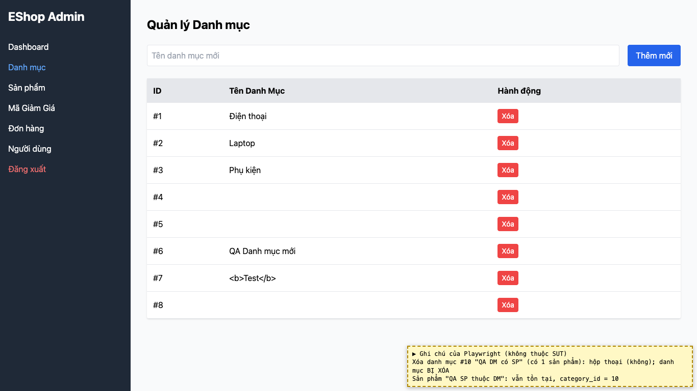

# BUG-05: [Quản lý Danh mục] Xóa được danh mục đang có sản phẩm, không chặn và không cảnh báo

| Trường | Giá trị |
|---|---|
| GitHub Issue | [#128](https://github.com/Taylor3691/eshop-sut/issues/128) |
| Nguồn phát hiện | Checklist GUI-04-07 |
| Màn hình | Quản lý Danh mục |
| Môi trường | macOS 27.2, Google Chrome 157.0.8103.51 (Playwright, headless), http://localhost:5174 |
| Severity | Major — sản phẩm còn lại trỏ tới danh mục không tồn tại (dữ liệu mồ côi) |
| Priority | Medium |
| Tham chiếu spec | FR-14 (theo giải đáp 12) |

**Điều kiện tiên quyết:** SUT chạy bằng `scripts/start-sut.sh` (+ `scripts/seed-hw03.sh 3`); đăng nhập Web Admin bằng `admin@eshop.com` / `Admin123!`.

**Bước tái hiện:**
1. Tạo danh mục "QA DM có SP".
2. Tạo một sản phẩm thuộc danh mục đó.
3. Quay lại tab Danh mục, bấm "Xóa" ở "QA DM có SP".

**Kết quả mong đợi:** Giải đáp 12: xóa danh mục đang có sản phẩm phải bị chặn hoặc có cảnh báo.

**Kết quả thực tế:** Danh mục bị xóa ngay, không có thông báo. Sản phẩm "QA SP thuộc DM" vẫn còn với `category_id` = 10, trỏ tới danh mục đã xóa.

**Ảnh chụp:**

