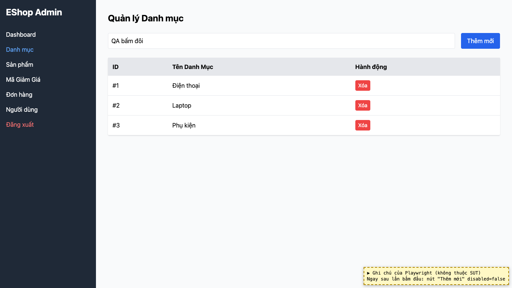
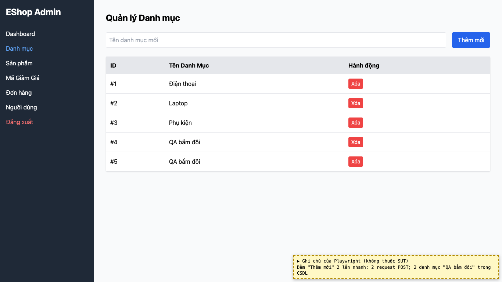

# BUG-06: [Danh mục, Login] Nút submit không bị khóa khi đang gửi, bấm đôi tạo bản ghi trùng

| Trường | Giá trị |
|---|---|
| GitHub Issue | Chưa tạo |
| Nguồn phát hiện | Checklist GUI-04-02 |
| Màn hình | Quản lý Danh mục, Admin Login |
| Môi trường | macOS 27.2, Google Chrome 157.0.8103.51 (Playwright, headless), http://localhost:5174 |
| Severity | Major — tạo dữ liệu trùng khi mạng chậm |
| Priority | Medium |
| Tham chiếu spec | BP Nielsen #1 (theo giải đáp 8) |

**Điều kiện tiên quyết:** SUT chạy bằng `scripts/start-sut.sh` (+ `scripts/seed-hw03.sh 3`); đăng nhập Web Admin bằng `admin@eshop.com` / `Admin123!`.

**Bước tái hiện:**
1. Mở DevTools → Network → chọn throttling chậm (ví dụ Slow 3G).
2. Tab Danh mục: nhập "QA bấm đôi", bấm nhanh 2 lần vào "Thêm mới".
3. Chờ tải xong, đếm số danh mục "QA bấm đôi".

**Kết quả mong đợi:** Giải đáp 8: nút submit phải bị khóa trong lúc đang gửi để tránh bấm hai lần.

**Kết quả thực tế:** Nút "Thêm mới" không bị khóa sau lần bấm đầu; 2 request được gửi và **2 danh mục "QA bấm đôi"** được tạo. Nút "Login" cũng không khóa (2 request `/api/login`).

**Ảnh chụp:**

