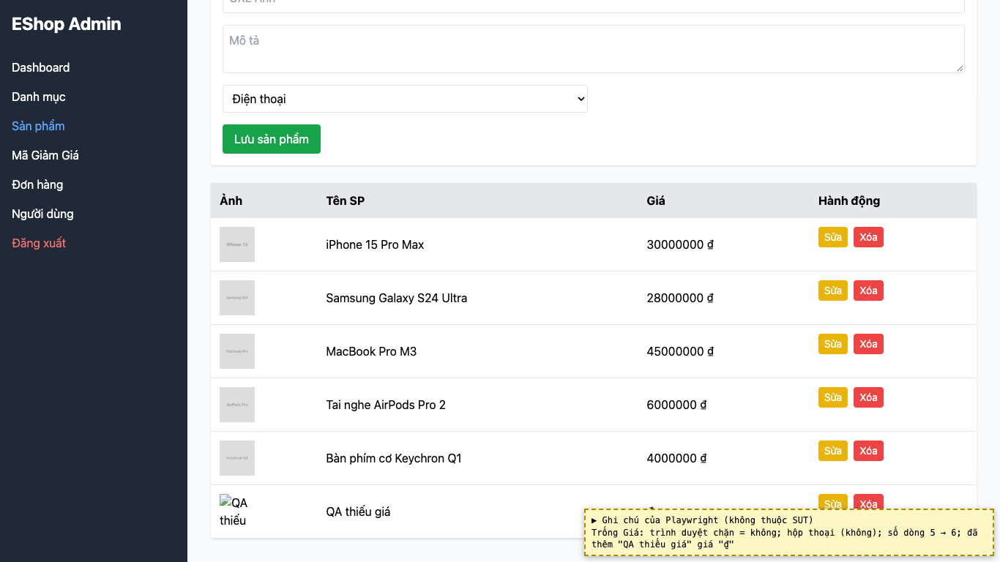
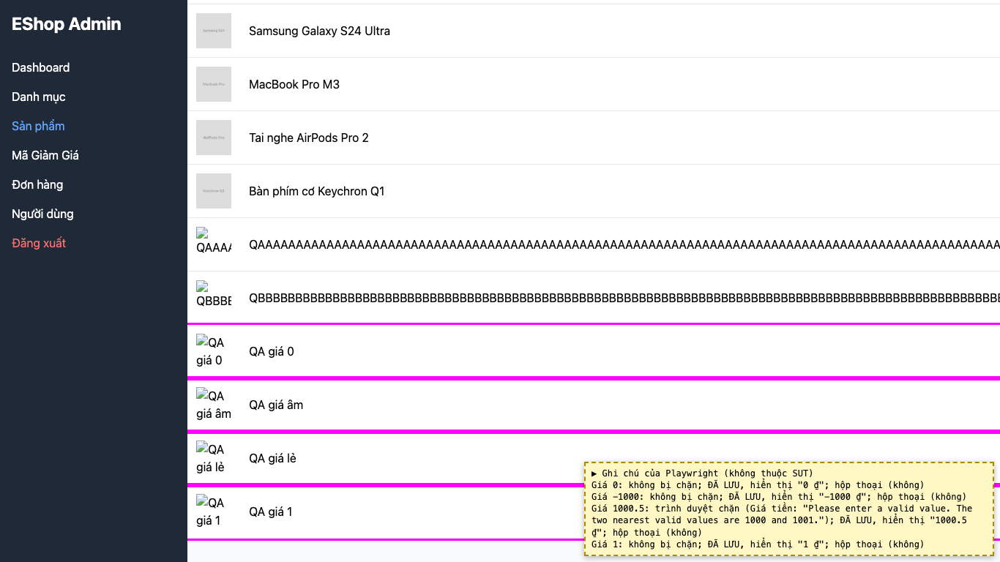
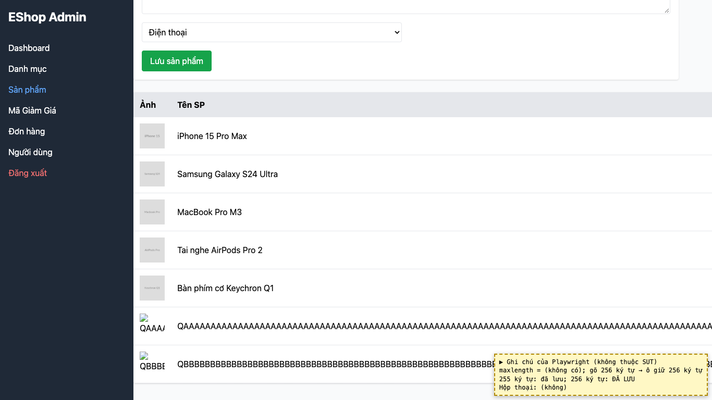

# BUG-07: [Quản lý Sản phẩm] Form sản phẩm lưu được giá trống, 0, âm, số lẻ và tên dài hơn 255 ký tự

| Trường | Giá trị |
|---|---|
| GitHub Issue | Trùng issue có sẵn [#29](https://github.com/Taylor3691/eshop-sut/issues/29) (không tạo issue mới); quan sát bổ sung đã ghi bằng [comment](https://github.com/Taylor3691/eshop-sut/issues/29#issuecomment-6830789665) |
| Nguồn phát hiện | Checklist GUI-02-11, GUI-02-12, GUI-02-13, GUI-02-03 |
| Màn hình | Quản lý Sản phẩm |
| Môi trường | macOS 27.2, Google Chrome 157.0.8103.51 (Playwright, headless), http://localhost:5174 |
| Severity | Major — dữ liệu sản phẩm sai (giá ≤ 0) được lưu và hiển thị cho khách |
| Priority | High |
| Tham chiếu spec | FR-15, giải đáp 13 |

**Điều kiện tiên quyết:** SUT chạy bằng `scripts/start-sut.sh` (+ `scripts/seed-hw03.sh 3`); đăng nhập Web Admin bằng `admin@eshop.com` / `Admin123!`.

**Bước tái hiện:**
1. Tab Sản phẩm, form "Thêm sản phẩm mới": nhập Tên "QA thiếu giá", để trống Giá, bấm "Lưu sản phẩm".
2. Lặp lại với Giá = `0`, `-1000`, `1000.5`.
3. Nhập Tên dài 256 ký tự, Giá 100000, bấm "Lưu sản phẩm".

**Kết quả mong đợi:** FR-15: Tên bắt buộc, tối đa 255 ký tự; Giá bắt buộc, phải là số dương (> 0). Giải đáp 13: giá là số nguyên. Dữ liệu sai phải bị từ chối kèm thông báo.

**Kết quả thực tế:** Tất cả đều được lưu, không có thông báo: giá trống hiển thị "₫", các giá "0 ₫", "-1000 ₫", "1000.5 ₫"; tên 256 ký tự được lưu (ô không có `maxlength`). Riêng Tên trống thì bị chặn (`required`). Với giá `1000.5`, Chrome đánh dấu ô không hợp lệ (step mismatch) nhưng form vẫn gửi và backend lưu `1000.5` (đã kiểm lại riêng).

**Ảnh chụp:**

