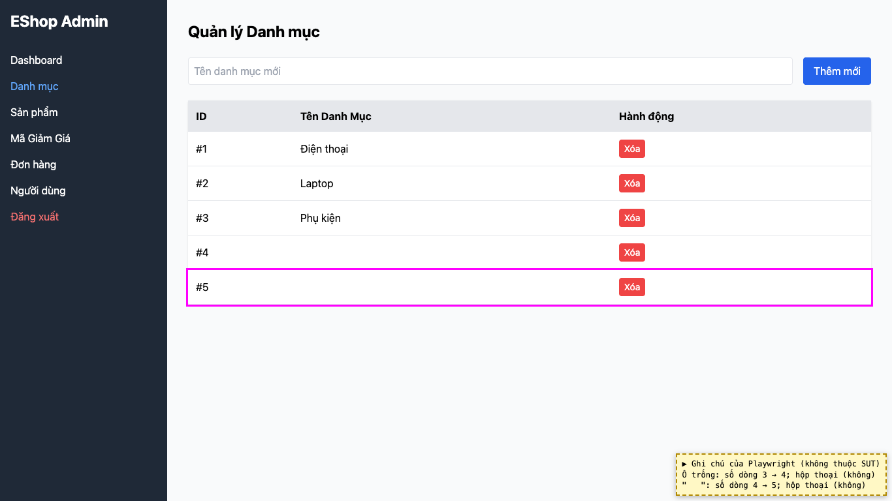
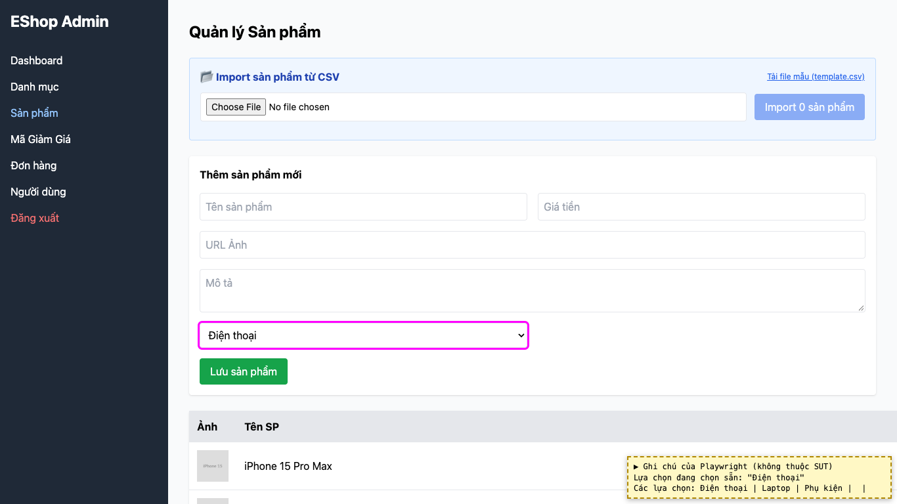

# BUG-08: [Quản lý Danh mục] Thêm được danh mục có tên trống hoặc chỉ có khoảng trắng

| Trường | Giá trị |
|---|---|
| GitHub Issue | Trùng issue có sẵn [#23](https://github.com/Taylor3691/eshop-sut/issues/23) (không tạo issue mới) |
| Nguồn phát hiện | Checklist GUI-02-10, GUI-02-03 |
| Màn hình | Quản lý Danh mục |
| Môi trường | macOS 27.2, Google Chrome 157.0.8103.51 (Playwright, headless), http://localhost:5174 |
| Severity | Major — tạo danh mục rỗng, xuất hiện thành lựa chọn trống trong form sản phẩm |
| Priority | Medium |
| Tham chiếu spec | FR-14, giải đáp 12 |

**Điều kiện tiên quyết:** SUT chạy bằng `scripts/start-sut.sh` (+ `scripts/seed-hw03.sh 3`); đăng nhập Web Admin bằng `admin@eshop.com` / `Admin123!`.

**Bước tái hiện:**
1. Tab Danh mục: để trống ô "Tên danh mục mới", bấm "Thêm mới".
2. Nhập `"   "` (3 khoảng trắng), bấm "Thêm mới".
3. Mở tab Sản phẩm, mở ô chọn danh mục.

**Kết quả mong đợi:** FR-14: tên danh mục bắt buộc, không được để trống. Giải đáp 12: tên chỉ gồm khoảng trắng được tính là rỗng và bị từ chối, có thông báo.

**Kết quả thực tế:** Cả 2 lần đều tạo được danh mục (số dòng 3 → 4 → 5), không có thông báo. Ô chọn danh mục ở form sản phẩm có thêm 2 lựa chọn trống.

**Ảnh chụp:**

