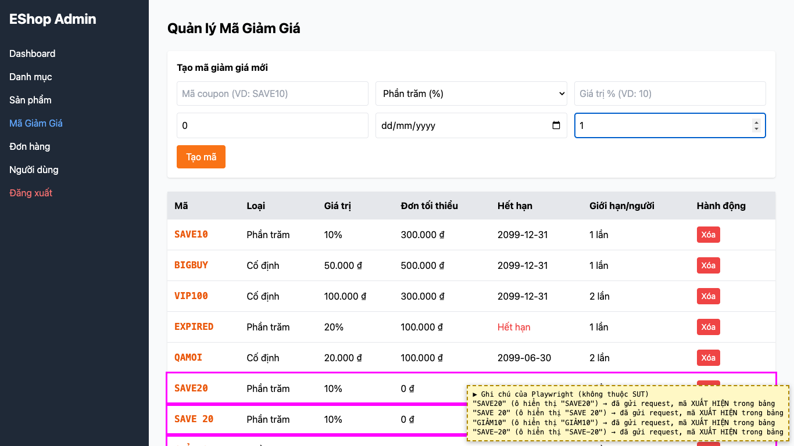
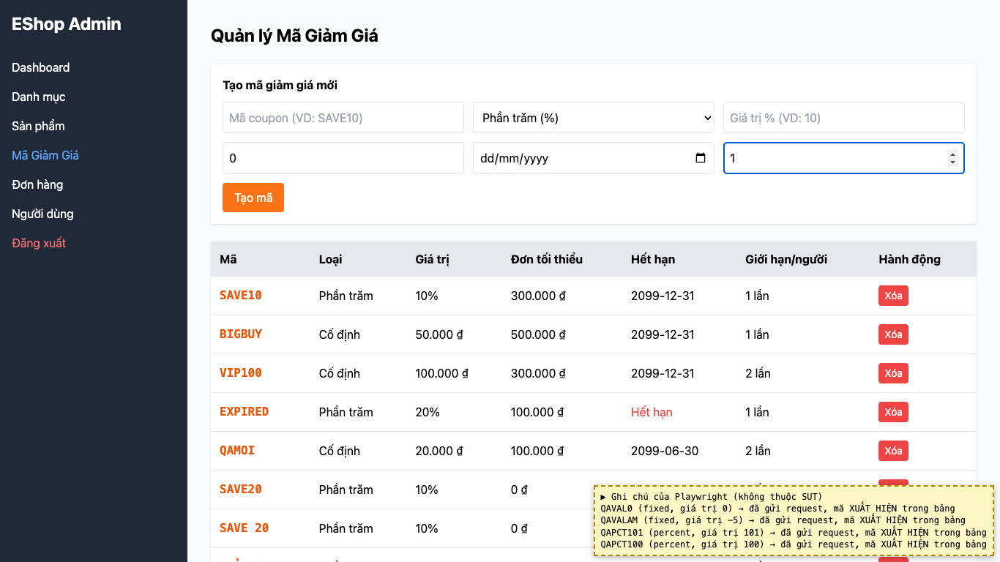
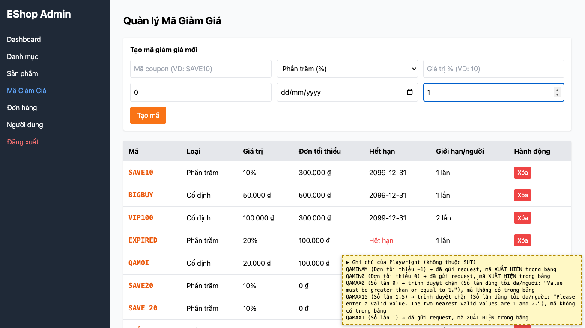
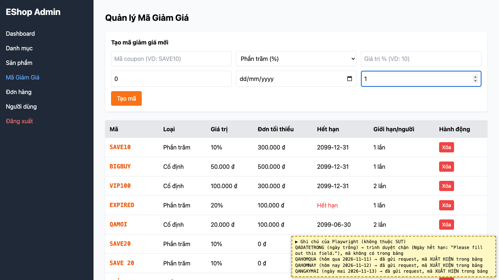

# BUG-09: [Quản lý Mã giảm giá] Form tạo mã không kiểm tra dữ liệu: mã sai định dạng, giá trị ≤ 0, phần trăm > 100, đơn tối thiểu âm, ngày đã qua

| Trường | Giá trị |
|---|---|
| GitHub Issue | Trùng issue có sẵn [#89](https://github.com/Taylor3691/eshop-sut/issues/89), [#84](https://github.com/Taylor3691/eshop-sut/issues/84) (không tạo issue mới); quan sát bổ sung đã ghi bằng [comment](https://github.com/Taylor3691/eshop-sut/issues/89#issuecomment-6830790328) |
| Nguồn phát hiện | Checklist GUI-02-19, GUI-02-20, GUI-02-21, GUI-02-22, GUI-02-03 |
| Màn hình | Quản lý Mã giảm giá |
| Môi trường | macOS 27.2, Google Chrome 157.0.8103.51 (Playwright, headless), http://localhost:5174 |
| Severity | Major — tạo được mã giảm giá vô nghĩa hoặc gây thiệt hại (giảm > 100%) |
| Priority | High |
| Tham chiếu spec | FR-17, giải đáp 15 |

**Điều kiện tiên quyết:** SUT chạy bằng `scripts/start-sut.sh` (+ `scripts/seed-hw03.sh 3`); đăng nhập Web Admin bằng `admin@eshop.com` / `Admin123!`.

**Bước tái hiện:**
1. Tab Mã Giảm Giá, tạo lần lượt (các trường khác hợp lệ, ngày 2099-12-31):
2. Mã `SAVE 20`, `GIẢM10`, `SAVE-20`.
3. Loại Số tiền cố định, giá trị `0` và `-5`; loại Phần trăm, giá trị `101` và `150`.
4. Đơn tối thiểu `-1`.
5. Ngày hết hạn là hôm qua và hôm nay.

**Kết quả mong đợi:** FR-17: `discount_value` dương, `min_order_amount` ≥ 0. Giải đáp 15: mã chỉ gồm chữ hoa và số, không khoảng trắng; loại phần trăm ≤ 100; ngày hết hạn sau hôm nay. Dữ liệu sai phải bị từ chối kèm thông báo.

**Kết quả thực tế:** Tất cả các mã trên đều được tạo và xuất hiện trong bảng, không có thông báo nào. Chỉ ngày trống (`required`) và Số lần 0 / 1.5 (`min=1`) bị trình duyệt chặn.

**Ảnh chụp:**

