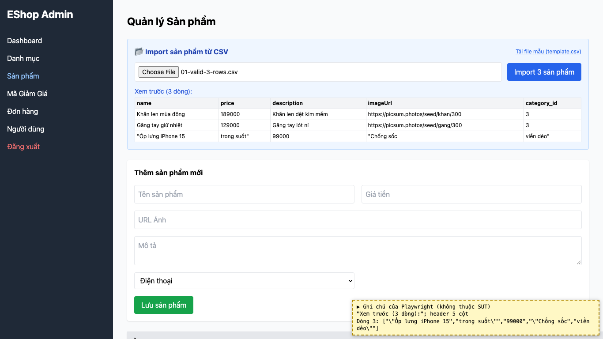
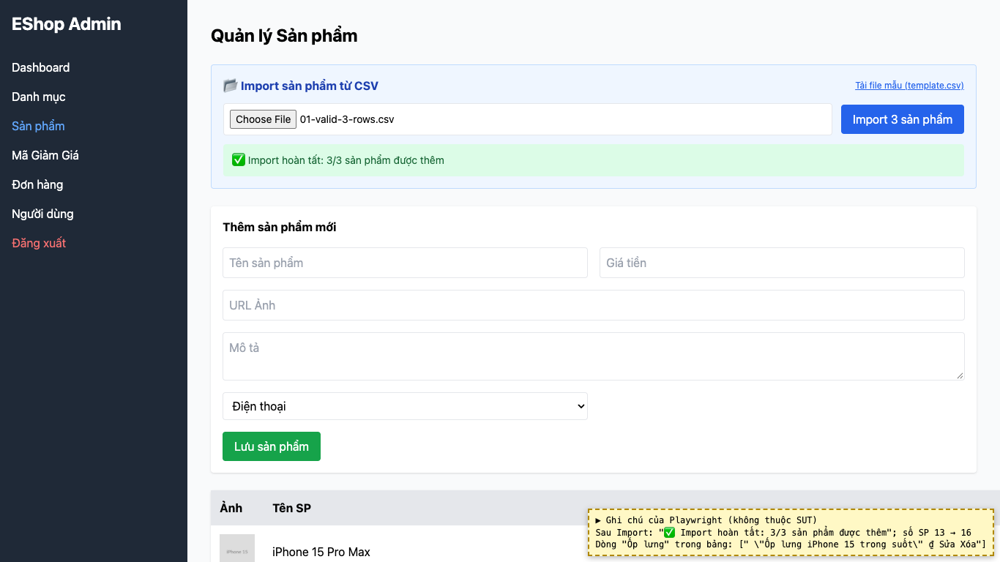

# BUG-10: [Quản lý Sản phẩm] Import CSV tách sai trường có dấu phẩy trong nháy kép

| Trường | Giá trị |
|---|---|
| GitHub Issue | Chưa tạo |
| Nguồn phát hiện | Checklist GUI-04-12 |
| Màn hình | Quản lý Sản phẩm (Import CSV) |
| Môi trường | macOS 27.2, Google Chrome 157.0.8103.51 (Playwright, headless), http://localhost:5174 |
| Severity | Major — sản phẩm bị import với tên và giá sai |
| Priority | Medium |
| Tham chiếu spec | FR-16 (RFC 4180) |

**Điều kiện tiên quyết:** SUT chạy bằng `scripts/start-sut.sh` (+ `scripts/seed-hw03.sh 3`); đăng nhập Web Admin bằng `admin@eshop.com` / `Admin123!`.

**Bước tái hiện:**
1. Tab Sản phẩm, chọn file `submission/test-data/csv/01-valid-3-rows.csv` (dòng 3: `"Ốp lưng iPhone 15, trong suốt",99000,"Chống sốc, viền dẻo",...`).
2. Xem bảng "Xem trước", rồi bấm "Import 3 sản phẩm".

**Kết quả mong đợi:** FR-16: "Hỗ trợ các trường có chứa dấu phẩy nếu được bọc trong dấu nháy kép (RFC 4180)."

**Kết quả thực tế:** Xem trước tách dòng 3 thành `"Ốp lưng iPhone 15` | `trong suốt"` | `99000` | …: tên bị cắt, chữ "trong suốt" lệch sang cột price. Sau khi import, sản phẩm có tên `"Ốp lưng iPhone 15 trong suốt"` (còn dấu nháy) và giá trống "₫"; báo cáo vẫn ghi "3/3 sản phẩm được thêm".

**Ảnh chụp:**

