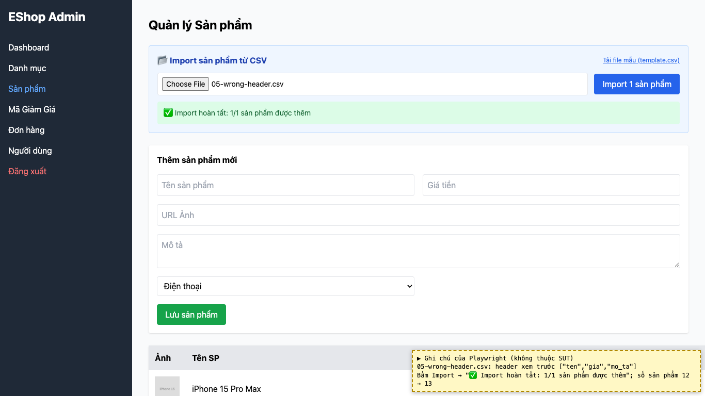

# BUG-11: [Quản lý Sản phẩm] Import CSV chấp nhận file sai header và vẫn thêm sản phẩm

| Trường | Giá trị |
|---|---|
| GitHub Issue | Chưa tạo |
| Nguồn phát hiện | Checklist GUI-02-18 |
| Màn hình | Quản lý Sản phẩm (Import CSV) |
| Môi trường | macOS 27.2, Google Chrome 157.0.8103.51 (Playwright, headless), http://localhost:5174 |
| Severity | Major — file không đúng định dạng vẫn ghi dữ liệu vào CSDL |
| Priority | Medium |
| Tham chiếu spec | FR-16, giải đáp 14 |

**Điều kiện tiên quyết:** SUT chạy bằng `scripts/start-sut.sh` (+ `scripts/seed-hw03.sh 3`); đăng nhập Web Admin bằng `admin@eshop.com` / `Admin123!`.

**Bước tái hiện:**
1. Tab Sản phẩm, chọn file `submission/test-data/csv/05-wrong-header.csv` (header `ten,gia,mo_ta`).
2. Bấm "Import 1 sản phẩm".

**Kết quả mong đợi:** FR-16: dòng đầu tiên là header `name,price,description,imageUrl,category_id`. Giải đáp 14: header phải đúng tên cột (không phân biệt hoa thường); sai header thì báo lỗi, không import.

**Kết quả thực tế:** Không có cảnh báo; báo cáo "✅ Import hoàn tất: 1/1 sản phẩm được thêm" và sản phẩm "Sản phẩm sai header" xuất hiện trong bảng (code đọc cả các tên cột thay thế như `ten`, `gia`).

**Ảnh chụp:**

