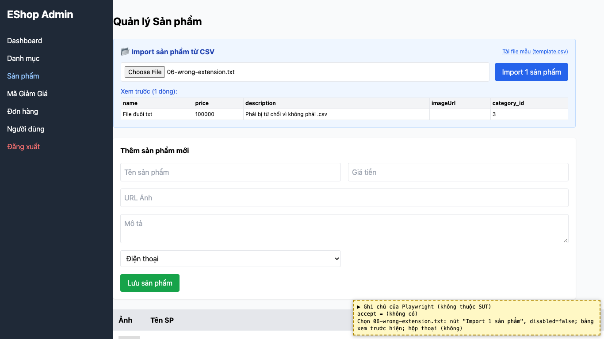
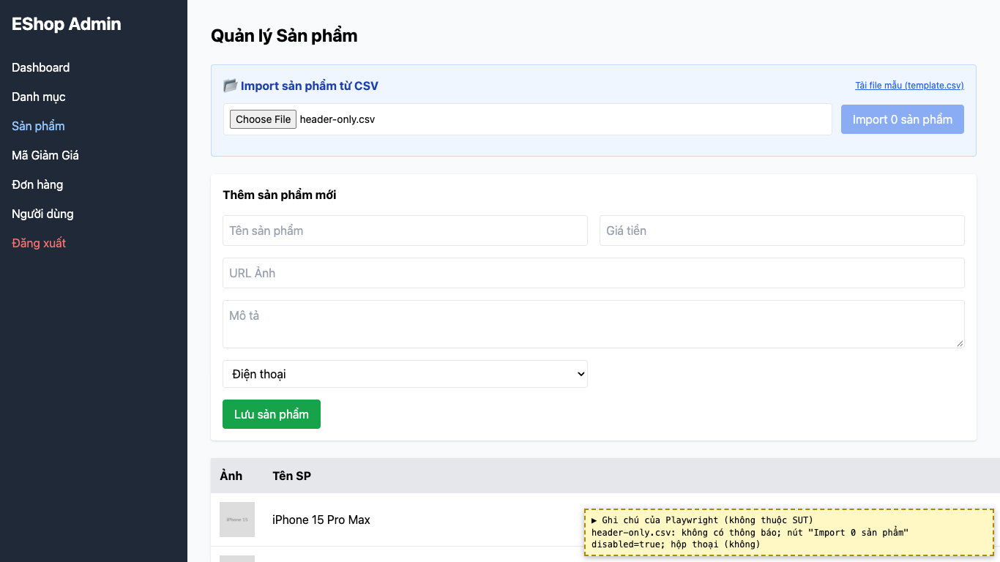

# BUG-12: [Quản lý Sản phẩm] Ô Import nhận file không phải .csv và file rỗng mà không báo lỗi

| Trường | Giá trị |
|---|---|
| GitHub Issue | Chưa tạo |
| Nguồn phát hiện | Checklist GUI-02-17, GUI-02-18 |
| Màn hình | Quản lý Sản phẩm (Import CSV) |
| Môi trường | macOS 27.2, Google Chrome 157.0.8103.51 (Playwright, headless), http://localhost:5174 |
| Severity | Minor — người dùng không biết vì sao không import được hoặc import nhầm file |
| Priority | Medium |
| Tham chiếu spec | FR-16, giải đáp 14 |

**Điều kiện tiên quyết:** SUT chạy bằng `scripts/start-sut.sh` (+ `scripts/seed-hw03.sh 3`); đăng nhập Web Admin bằng `admin@eshop.com` / `Admin123!`.

**Bước tái hiện:**
1. Tab Sản phẩm, bấm chọn file: hộp chọn file hiển thị mọi loại file.
2. Chọn `submission/test-data/csv/06-wrong-extension.txt`.
3. Chọn một file `.csv` rỗng (0 byte), rồi một file chỉ có dòng header.

**Kết quả mong đợi:** FR-16: đuôi file phải là `.csv`. Giải đáp 14: chọn file khác `.csv` phải báo lỗi; file rỗng cũng phải báo lỗi.

**Kết quả thực tế:** Ô chọn file không có `accept`; file `.txt` được nhận, bảng xem trước hiện nội dung và nút "Import 1 sản phẩm" vẫn bật. File rỗng / chỉ header: không có thông báo, chỉ có nút bị khóa với nhãn "Import 0 sản phẩm".

**Ảnh chụp:**

