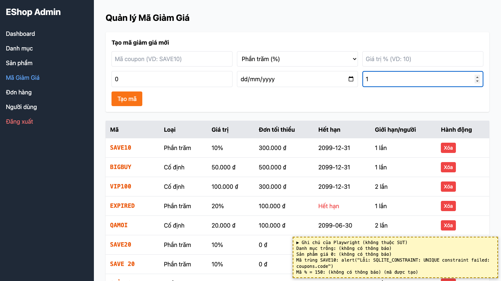
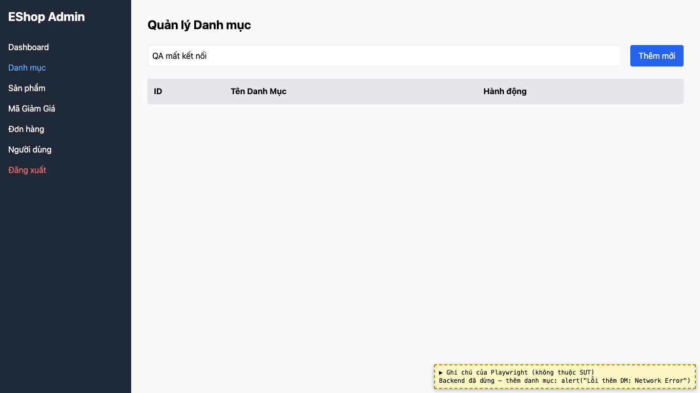

# BUG-13: [Nhiều màn hình] Thông báo lỗi hiển thị chuỗi kỹ thuật, tiếng Anh và viết tắt

| Trường | Giá trị |
|---|---|
| GitHub Issue | Chưa tạo |
| Nguồn phát hiện | Checklist GUI-01-04, GUI-02-03, GUI-04-09 |
| Màn hình | Quản lý Mã giảm giá, Quản lý Danh mục (và các form khác dùng `err.message`) |
| Môi trường | macOS 27.2, Google Chrome 157.0.8103.51 (Playwright, headless), http://localhost:5174 |
| Severity | Major — người dùng không hiểu lỗi, lộ chi tiết CSDL |
| Priority | Medium |
| Tham chiếu spec | FR-21, FR-22, giải đáp 2 và 4 |

**Điều kiện tiên quyết:** SUT chạy bằng `scripts/start-sut.sh` (+ `scripts/seed-hw03.sh 3`); đăng nhập Web Admin bằng `admin@eshop.com` / `Admin123!`.

**Bước tái hiện:**
1. Tab Mã Giảm Giá: tạo mã trùng `SAVE10`, bấm "Tạo mã".
2. Dừng backend (`lsof -ti tcp:3000 | xargs kill`), sang tab Danh mục, thêm một danh mục bất kỳ.

**Kết quả mong đợi:** Giải đáp 4: khi có lỗi phải hiện thông báo tiếng Việt, nêu được lý do, người dùng hiểu được; thông báo kỹ thuật như "Request failed with status code 400" thì Fail. Giải đáp 2: thông báo lỗi kỹ thuật phải được dịch.

**Kết quả thực tế:** Bước 1: `alert("Lỗi: SQLITE_CONSTRAINT: UNIQUE constraint failed: coupons.code")`. Bước 2: `alert("Lỗi thêm DM: Network Error")` (viết tắt "DM", chuỗi tiếng Anh của axios).

**Ảnh chụp:**

