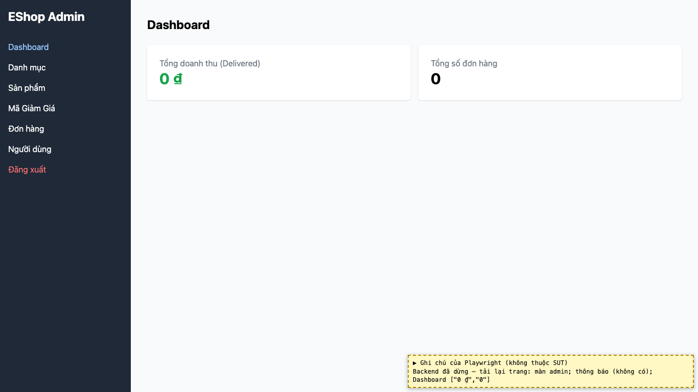
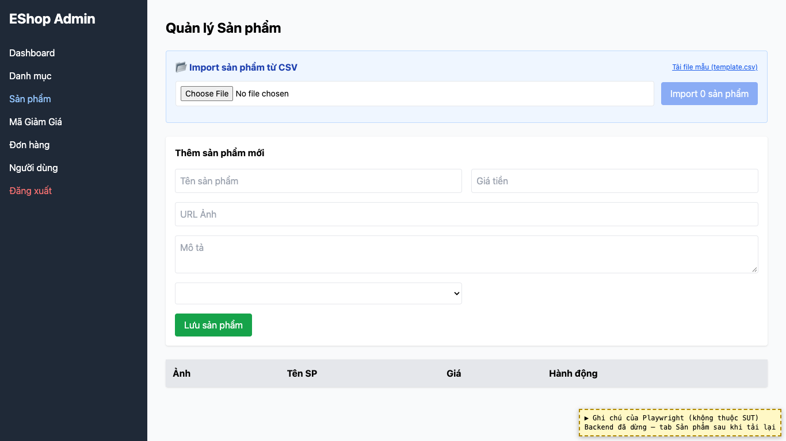
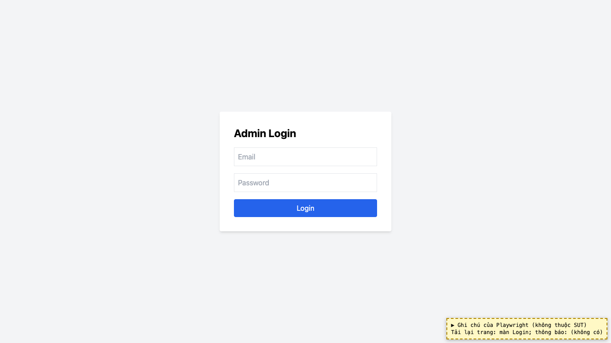

# BUG-14: [Nhiều màn hình] Lỗi tải dữ liệu và hết phiên đăng nhập bị bỏ qua, không có thông báo

| Trường | Giá trị |
|---|---|
| GitHub Issue | [#131](https://github.com/Taylor3691/eshop-sut/issues/131) |
| Nguồn phát hiện | Checklist GUI-04-09, GUI-04-11 |
| Màn hình | Dashboard, Admin Login (và mọi tab dữ liệu) |
| Môi trường | macOS 27.2, Google Chrome 157.0.8103.51 (Playwright, headless), http://localhost:5174 |
| Severity | Major — người dùng thấy số liệu 0 hoặc bị đăng xuất mà không biết lý do |
| Priority | Medium |
| Tham chiếu spec | FR-12, giải đáp 4 và 10 |

**Điều kiện tiên quyết:** SUT chạy bằng `scripts/start-sut.sh` (+ `scripts/seed-hw03.sh 3`); đăng nhập Web Admin bằng `admin@eshop.com` / `Admin123!`.

**Bước tái hiện:**
1. Đang đăng nhập, dừng backend rồi nhấn F5: quan sát Dashboard và các bảng.
2. Khởi động lại backend, đăng nhập. Trong DevTools → Application → Local Storage, sửa `adminToken` thành chuỗi bất kỳ rồi nhấn F5.

**Kết quả mong đợi:** Giải đáp 4 và 12: mọi trường hợp lỗi đều phải có thông báo trên giao diện. Giải đáp 10: khi hết phiên thì quay về màn Login, kèm thông báo.

**Kết quả thực tế:** Bước 1: vẫn ở màn admin, Dashboard hiện "0 ₫" và "0", các bảng trống, không có thông báo nào. Bước 2: quay về màn Login nhưng không có thông báo hết phiên. (Trong `fetchData`, lỗi bị `catch` bỏ qua; 401/403 chỉ xóa token.)

**Ảnh chụp:**

