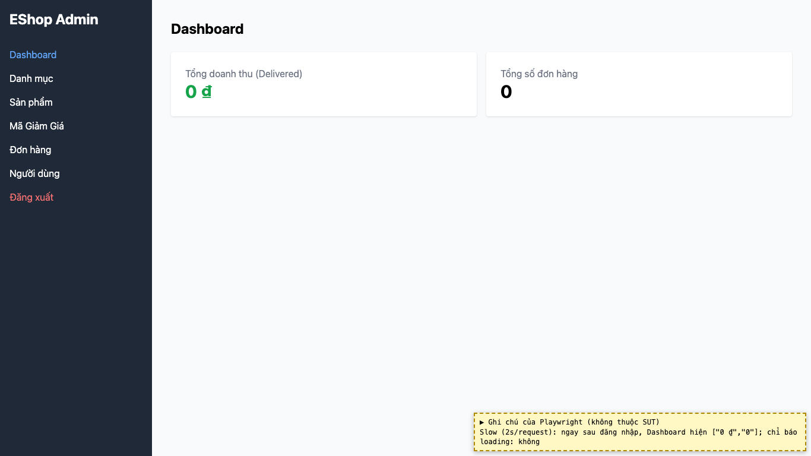
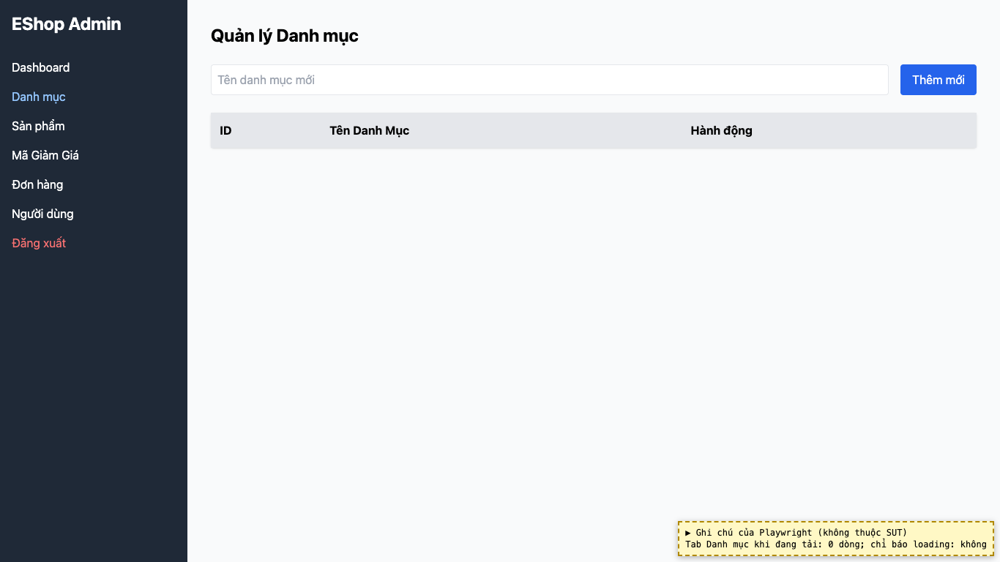
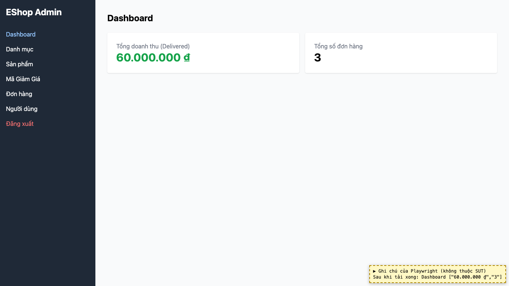

# BUG-15: [Dashboard, Danh mục] Không có trạng thái loading, hiển thị số 0 và bảng trống khi đang tải

| Trường | Giá trị |
|---|---|
| GitHub Issue | Chưa tạo |
| Nguồn phát hiện | Checklist GUI-04-01 |
| Màn hình | Dashboard, Quản lý Danh mục, Quản lý Sản phẩm, Quản lý Mã giảm giá |
| Môi trường | macOS 27.2, Google Chrome 157.0.8103.51 (Playwright, headless), http://localhost:5174 |
| Severity | Minor — số liệu tạm thời sai (0 ₫) dễ gây hiểu nhầm khi mạng chậm |
| Priority | Medium |
| Tham chiếu spec | BP Nielsen #1 (theo giải đáp 8) |

**Điều kiện tiên quyết:** SUT chạy bằng `scripts/start-sut.sh` (+ `scripts/seed-hw03.sh 3`); đăng nhập Web Admin bằng `admin@eshop.com` / `Admin123!`.

**Bước tái hiện:**
1. Mở DevTools → Network → throttling chậm.
2. Đăng nhập, quan sát Dashboard ngay khi vào; chuyển sang tab Danh mục khi dữ liệu chưa về.

**Kết quả mong đợi:** Giải đáp 8: Dashboard và các bảng phải có trạng thái loading khi đang tải dữ liệu.

**Kết quả thực tế:** Dashboard hiện "0 ₫" và "0" trong khi dữ liệu chưa về (sau khi tải xong là 60.000.000 ₫ và 3). Bảng Danh mục chỉ có header. Không có spinner hay chữ "Đang tải".

**Ảnh chụp:**

