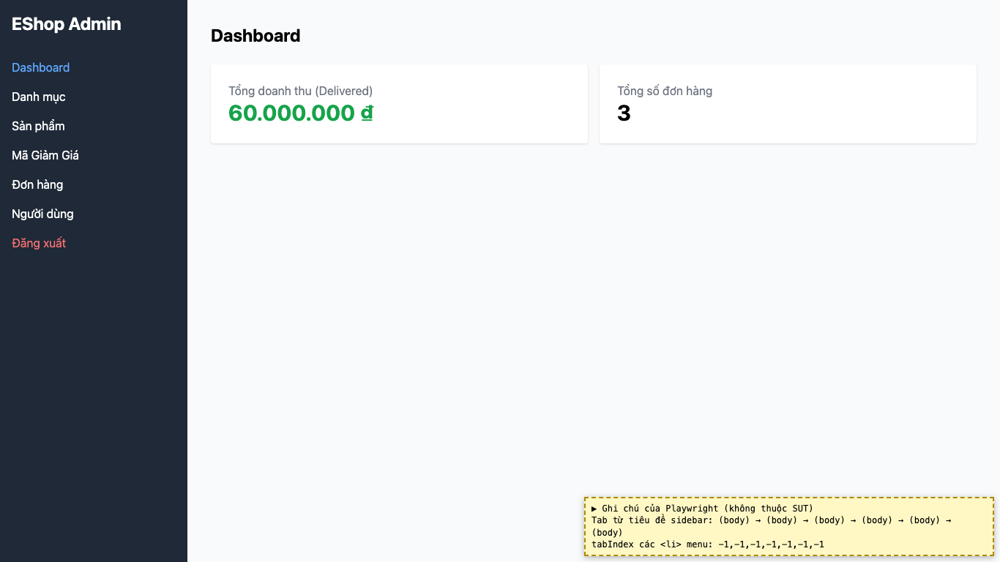

# BUG-16: [Sidebar] Không thể dùng bàn phím để chuyển tab hoặc đăng xuất

| Trường | Giá trị |
|---|---|
| GitHub Issue | Chưa tạo |
| Nguồn phát hiện | Checklist GUI-01-13 |
| Màn hình | Sidebar (mọi màn sau đăng nhập) |
| Môi trường | macOS 27.2, Google Chrome 157.0.8103.51 (Playwright, headless), http://localhost:5174 |
| Severity | Major — người dùng chỉ dùng bàn phím không điều hướng được |
| Priority | Medium |
| Tham chiếu spec | FR-21 (Tab Order), BP WCAG 2.1.1 |

**Điều kiện tiên quyết:** SUT chạy bằng `scripts/start-sut.sh` (+ `scripts/seed-hw03.sh 3`); đăng nhập Web Admin bằng `admin@eshop.com` / `Admin123!`.

**Bước tái hiện:**
1. Đăng nhập, bấm vào tiêu đề "EShop Admin".
2. Nhấn Tab nhiều lần.

**Kết quả mong đợi:** FR-21: thứ tự focus theo Tab đi từ trên xuống dưới; mục menu và "Đăng xuất" phải tới được và kích hoạt được bằng Enter.

**Kết quả thực tế:** Focus không dừng ở mục menu nào (6 lần Tab đều ở `body`): các mục menu là `<li onClick>`, tabIndex = -1, không phải link/button.

**Ảnh chụp:**

