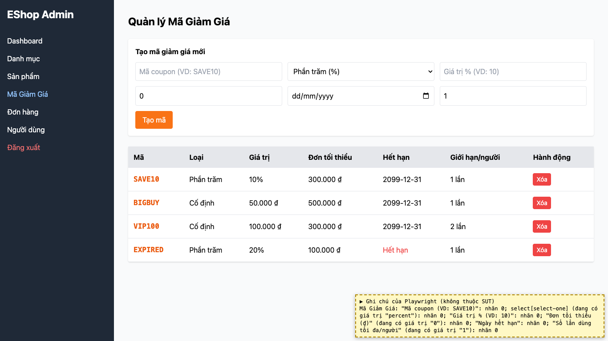
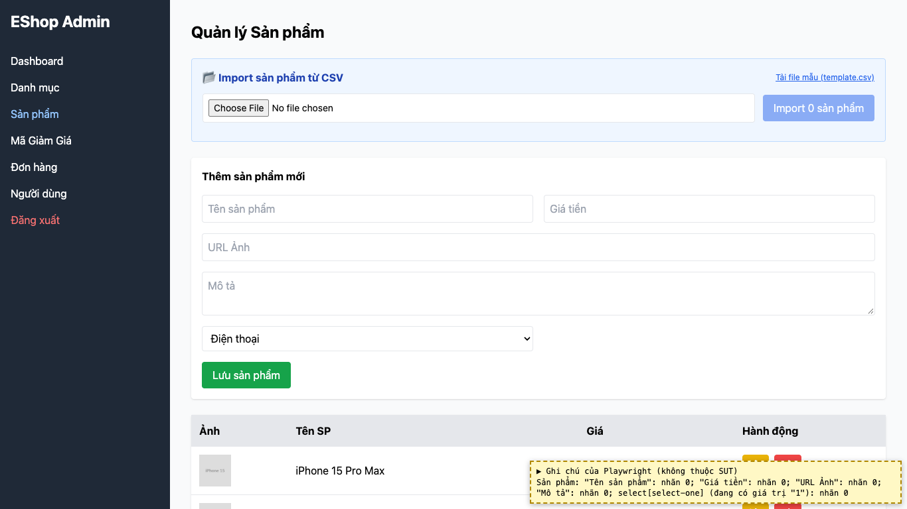
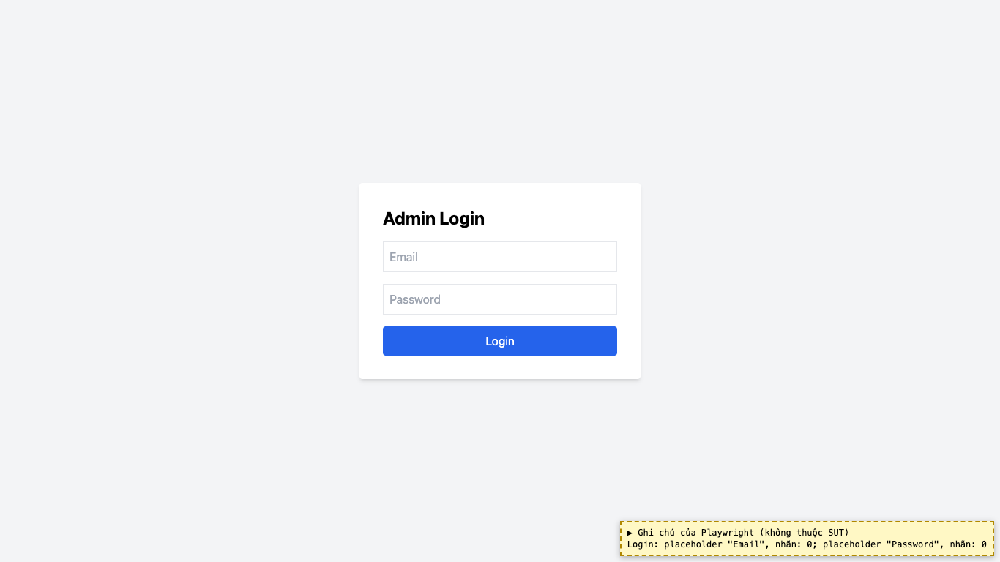
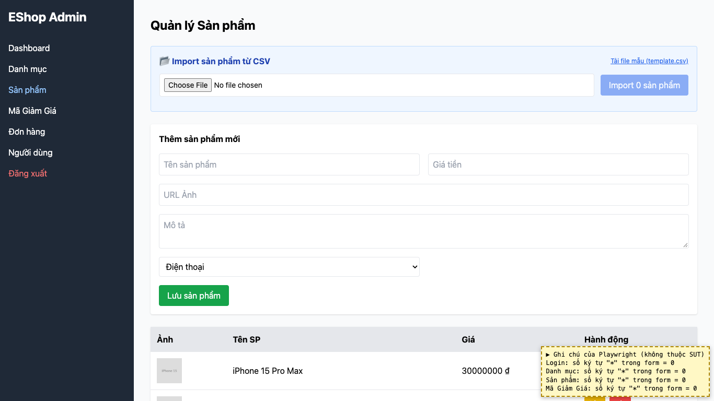

# BUG-17: [Nhiều màn hình] Trường nhập không có nhãn và không có dấu * cho trường bắt buộc

| Trường | Giá trị |
|---|---|
| GitHub Issue | Chưa tạo |
| Nguồn phát hiện | Checklist GUI-02-01, GUI-02-02 |
| Màn hình | Admin Login, Quản lý Danh mục, Quản lý Sản phẩm, Quản lý Mã giảm giá |
| Môi trường | macOS 27.2, Google Chrome 157.0.8103.51 (Playwright, headless), http://localhost:5174 |
| Severity | Major — ở form Mã giảm giá, ô có giá trị mặc định và ô ngày không còn chữ nào cho biết ý nghĩa |
| Priority | Medium |
| Tham chiếu spec | FR-22, giải đáp 5 (WCAG 3.3.2) |

**Điều kiện tiên quyết:** SUT chạy bằng `scripts/start-sut.sh` (+ `scripts/seed-hw03.sh 3`); đăng nhập Web Admin bằng `admin@eshop.com` / `Admin123!`.

**Bước tái hiện:**
1. Mở lần lượt 4 form: Login, Danh mục, Sản phẩm, Mã Giảm Giá.
2. Quan sát nhãn của từng trường; ở form Mã giảm giá để ý các ô "Đơn tối thiểu" (giá trị 0), "Số lần" (giá trị 1) và ô ngày.

**Kết quả mong đợi:** FR-22: tất cả trường bắt buộc phải có ký hiệu `*` bên cạnh nhãn. Giải đáp 5: mỗi trường phải có nhãn hiển thị; chỉ có placeholder thì Fail.

**Kết quả thực tế:** Không trường nào có `<label>` (chỉ có placeholder); không có dấu `*` ở form nào. Ô có giá trị mặc định (0, 1) và ô ngày (`dd/mm/yyyy`) không còn hiện placeholder nên không biết đó là trường gì.

**Ảnh chụp:**

