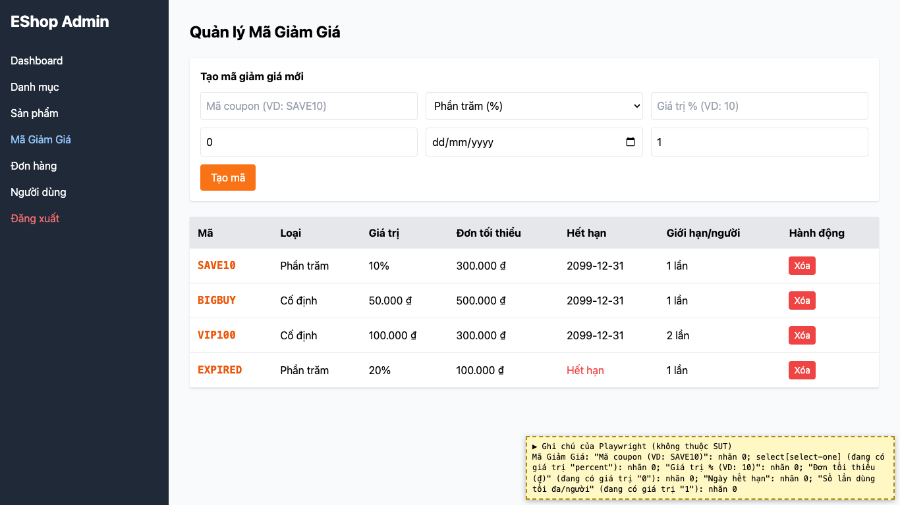
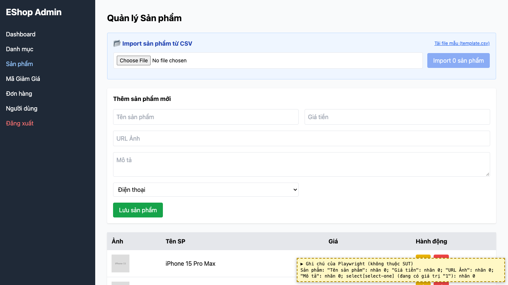
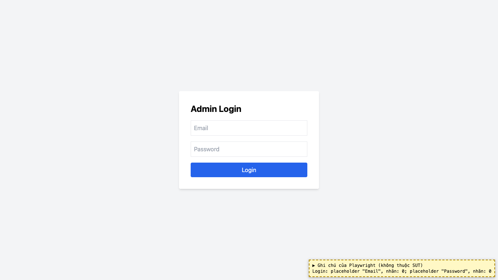
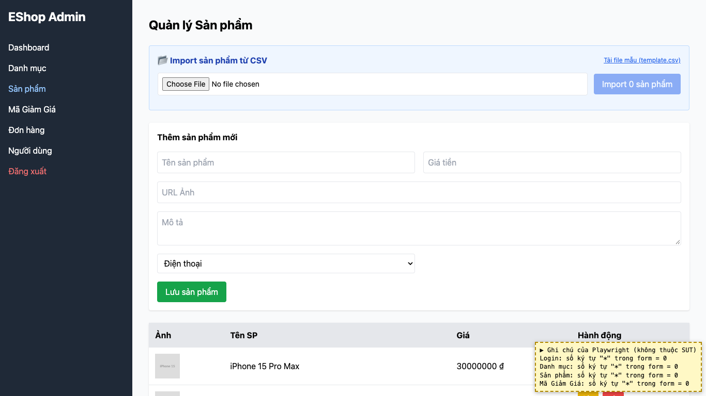

# BUG-17: [Nhiều màn hình] Trường nhập không có nhãn và không có dấu * cho trường bắt buộc

| Trường | Giá trị |
|---|---|
| GitHub Issue | [#134](https://github.com/Taylor3691/eshop-sut/issues/134) |
| Nguồn phát hiện | Checklist GUI-02-01, GUI-02-02; Usability P1–P7 |
| Màn hình | Admin Login, Quản lý Danh mục, Quản lý Sản phẩm, Quản lý Mã giảm giá |
| Môi trường | macOS 27.2, Google Chrome 157.0.8103.51 (Playwright, headless), http://localhost:5174 |
| Severity | Major — ở form Mã giảm giá, ô có giá trị mặc định và ô ngày không còn chữ nào cho biết ý nghĩa |
| Priority | Medium |
| Tham chiếu spec | FR-22, giải đáp 5 (WCAG 3.3.2) |

**Điều kiện tiên quyết:** SUT chạy bằng `scripts/start-sut.sh` (+ `scripts/seed-hw03.sh 3`); đăng nhập Web Admin bằng `admin@eshop.com` / `Admin123!`.

**Bước tái hiện:**
1. Mở lần lượt 4 form: Login, Danh mục, Sản phẩm, Mã Giảm Giá.
2. Quan sát nhãn của từng trường; ở form Mã giảm giá để ý các ô "Đơn tối thiểu" (giá trị 0), "Số lần" (giá trị 1) và ô ngày.

**Kết quả mong đợi:** FR-22: tất cả trường bắt buộc phải có ký hiệu `*` bên cạnh nhãn. Giải đáp 5: mỗi trường phải có nhãn hiển thị; chỉ có placeholder thì Fail.

**Kết quả thực tế:** Không trường nào có `<label>` (chỉ có placeholder); không có dấu `*` ở form nào. Ô có giá trị mặc định (0, 1) và ô ngày (`dd/mm/yyyy`) không còn hiện placeholder nên không biết đó là trường gì.

**Ảnh chụp:**

**Bằng chứng từ đánh giá khả dụng (Task 2, 15/11/2026, nhóm I1 và I2 trong `task2-usability/analysis.md`; đã ghi vào issue bằng [comment](https://github.com/Taylor3691/eshop-sut/issues/134#issuecomment-6897305999)):**
- **Form Mã giảm giá:** 7/7 người tham gia dừng ở hai ô chỉ hiện "0" và "1" mà không biết đó là ô gì (P1 06:10, P2 06:30, P3 08:20, P4 04:20, P5 06:10, P6 08:10, P7 09:50). P3 giữ nguyên 0 và 1 rồi lưu mã WINTER15 với đơn tối thiểu 0 và số lần 1, nên bước B4 không đạt: *"Trong ô có số rồi. Em tưởng trang đã điền giúp."* (P3 08:20). Sáu người còn lại phải dò tiêu đề cột của bảng bên dưới mới biết ô nào là gì.
- **Ô chọn danh mục (form Sản phẩm):** ô không có nhãn nên P3 không nhận ra đó là chỗ chọn nhóm: *"Ô này không có tên. Em không biết có phải nhóm hàng không, em để vậy."* (P3 06:40). Xem thêm BUG-23.
- Câu W1 của cả 7 người đều đề nghị ghi tên ô hoặc bỏ số có sẵn, ví dụ *"Để tên ô luôn hiện, kể cả khi trong ô đã có số."* (P5 W1).
- Trong phân tích usability, đây là vấn đề có severity 4 (Nielsen), cao nhất trong 10 nhóm.
