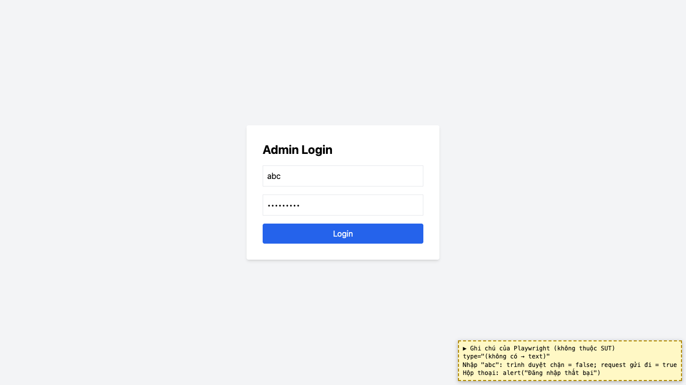
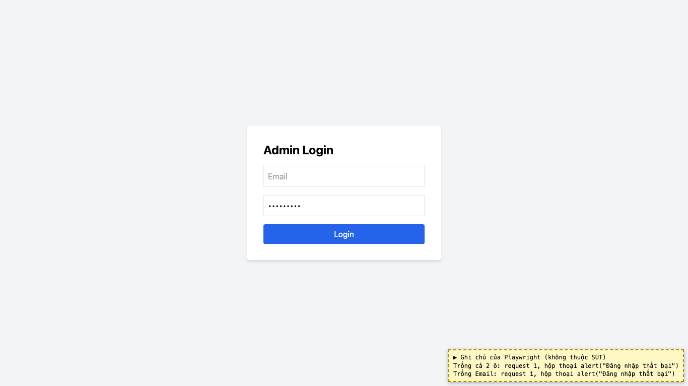

# BUG-18: [Admin Login] Ô Email không kiểm tra định dạng, để trống vẫn gửi đăng nhập

| Trường | Giá trị |
|---|---|
| GitHub Issue | [#135](https://github.com/Taylor3691/eshop-sut/issues/135) |
| Nguồn phát hiện | Checklist GUI-02-06, GUI-02-08 |
| Màn hình | Admin Login |
| Môi trường | macOS 27.2, Google Chrome 157.0.8103.51 (Playwright, headless), http://localhost:5174 |
| Severity | Minor — chỉ nhận thông báo chung "Đăng nhập thất bại", không biết sai ở đâu |
| Priority | Low |
| Tham chiếu spec | FR-22, FR-02 |

**Điều kiện tiên quyết:** SUT chạy bằng `scripts/start-sut.sh` (+ `scripts/seed-hw03.sh 3`); đăng nhập Web Admin bằng `admin@eshop.com` / `Admin123!`.

**Bước tái hiện:**
1. Mở màn Login, nhập Email `abc`, mật khẩu bất kỳ, bấm "Login".
2. Để trống cả hai ô, bấm "Login".

**Kết quả mong đợi:** FR-22 / FR-02: trường Email phải dùng `type="email"` (validate định dạng HTML5); trường bắt buộc để trống thì không gửi được và báo trường cần nhập.

**Kết quả thực tế:** Ô Email không có `type` (thành text). Cả hai trường hợp đều gửi request `/api/login` và chỉ hiện `alert("Đăng nhập thất bại")`.

**Ảnh chụp:**

